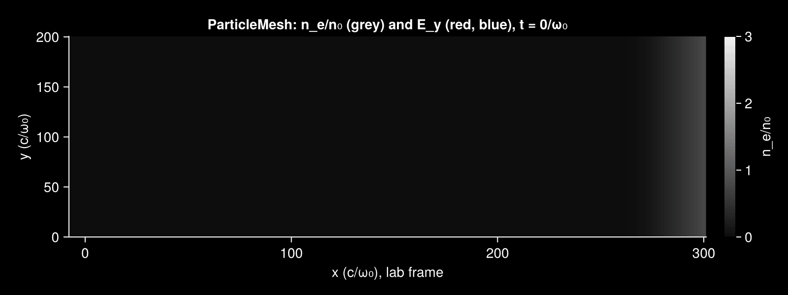

# ParticleMesh.jl

> **Experimental, and built by Claude.** This package is being developed largely by Claude
> (Anthropic's Claude Code, running as autonomous agents and saved workflows) under the direction
> and review of @SebastianM-C. It is also an experiment in how such a software
> factory should be organized. Expect gaps, churn and unverified claims until a release says
> otherwise; every number that leaves this repository is meant to pass an independent review first.

ParticleMesh.jl is a differentiable particle–mesh simulation engine in Julia with pluggable
physics modules. Its first module is a 1D, 2D and 3D electromagnetic particle-in-cell code for
laser-wakefield acceleration, built to optimize laser and plasma parameters by gradient: the same
KernelAbstractions kernels run on the CPU and on NVIDIA GPUs, in Float32, Float64 and
ForwardDiff duals, and on the GPU Enzyme differentiates whole runs in reverse mode.

Ionization injection in 3D: WP-082's nitrogen-doped case (a₀ = 1.9, waist 10 c/ω₀, 0.072 n_c,
448 × 128 × 128 cells at λ₀/32, 1704 steps), run in Float32 in Fast mode on 16 CPU threads (AMD EPYC
9655). A quarter of the box is cut away along the laser axis. The cut faces show the electron
density with the laser's E_y over it, the laser's isosurfaces stand out of them, and the points are
the electrons born from the dopant's K shell that the wake holds (u_x > 3), coloured by γ. This is a
preliminary GLMakie rendering (`scripts/lwfa/animate3d.jl`, `scripts/lwfa/render3d/`; manifests in
`reports/lwfa-animation-3d/`); raytraced versions are planned. The same case run in Smilei and
PIConGPU is compared in `reports/wp-082-ionization-three-codes-3d.md`, which has not had an
independent review yet.

## What it does

The engine core (`lib/ParticleMeshCore`) owns what every particle–mesh method shares: particle
sets, structured grids, the particle↔mesh transfers with shape functions, mesh operators, the time
loop and diagnostics. The electromagnetic module (`lib/ParticleMeshElectromagnetic`) supplies the
fields, the forces and the pushers; electrostatic cases such as Landau damping and two-stream run
as its edge cases with no transverse fields.

- **Dimensions.** 1D, 2D and 3D (3V in all), with the moving window, the laser antenna, the open
  boundaries, field ionization and the compensated gather in 3D as in 2D.
- **Field solvers.** Yee, and the low-dispersion M4 solver (Lu et al. 2020) with the same antenna,
  PML, window and back-edge PML in 1D, 2D and 3D.
- **Particles.** Boris, Vay, Higuera–Cary and quadratic-unitary pushers; Esirkepov's
  charge-conserving current; a plain gather, a gather compensated for the particle shape's loss of
  laser field, and a Galerkin gather that is the transpose of the current deposition; cold and
  Maxwell–Jüttner quiet starts; counter-based random numbers.
- **Two deposition modes.** Fast mode deposits with atomics; Reference mode sorts the particles
  by cell and reduces by segment, and is bitwise reproducible per element type and backend. The
  tests check that the two agree.
- **Lasers.** A Gaussian beam through a total-field/scattered-field antenna in 2D and 3D, and in 2D
  shaped pulses: spectral phase (GDD, TOD, FOD) and a focus from a near field with wavefront
  aberrations (`PulseShapes`, a module written to become its own package).
- **Boundaries and window.** Periodic or open transverse boundaries with a convolutional PML (or an
  absorbing layer) and particle retirement; a moving window with density ramps, plasma refill and
  a PML on its back edge; a binomial current filter.
- **Field ionization.** Dopants as macro-atoms that release the expected fraction of an electron
  each step (no random numbers, so it differentiates), with ADK and barrier-suppression
  (Tong–Lin) rate laws per level, in 2D and 3D.
- **Gradients.** Forward-mode duals through the whole step on the CPU and on CUDA. Enzyme's
  reverse mode on CUDA, with hand-written reverse rules for the deposition, the gather and the
  sort, checkpointed over full-length runs with Checkpointing.jl's Revolve; it runs through the
  whole 3D trapped-beam case (antenna, window, PMLs, field ionization, compensated gather) at λ₀/16 on one
  32 GB GPU, with three workarounds that still live in `scripts/enzyme/` (#384).
- **Interfaces.** The step as a SciML `DiscreteProblem`; optimization drivers on Optimization.jl
  in `scripts/optim/`.

## How it is checked

- Every test runs in Float32, Float64 and `Dual{Float32,3}` on the CPU; the GPU suites run on CUDA
  (RTX 4080 SUPER and RTX 5090), with device tolerances where atomics reorder sums.
- Against theory: Landau damping, two-stream and Weibel in 1D and 2D, Landau damping in 3D, the Yee and M4
  dispersion relations, the Gaussian beam's focus, the closed-form ADK and Tong–Lin populations,
  Gauss's law to roundoff across window shifts and open faces.
- Against other codes, from one case file run in ParticleMesh, Smilei and PIConGPU: the linear
  cases (`reports/crosscode-*`), A5's 2D laser wakefield and its resolution scan
  (`reports/lwfa-2d-a5.md`, `reports/wp-054-lwfa-resolution-scan.md`), and ionization injection in
  2D and 3D (`reports/wp-081-ionization-three-codes.md`,
  `reports/wp-082-ionization-three-codes-3d.md`). These are agreements between implementations at
  one resolution, not convergence results.
- Gradients against finite differences and against each other: duals, Enzyme's reverse pass and
  the hand-written rules by the chain rule.

The cross-code comparisons on the linear cases, the 2D LWFA comparison and its resolution scan
have had an independent review (`review*.md` next to each report); the other reports, the
ionization comparisons, the gradient studies and every performance number among them, have not,
so their numbers are not validated claims.

The 2D animation is A5's LWFA case at λ₀/48 on an RTX 4080 SUPER (`scripts/lwfa/animate.jl`,
outputs and manifest in `reports/lwfa-animation/`).

## Not done yet

- AMD GPUs (the kernels are KernelAbstractions kernels, but no AMD backend is tested), and more
  than one GPU or node.
- Reactant, which is parked (A9).
- Shaped pulses in 3D; Enzyme's reverse mode on the CPU (blocked upstream, #509) and without the
  scripts' workarounds; the reverse pass at λ₀/32 in 3D, which does not fit in 32 GB yet.
- Gradient-based optimization of a full-size 3D case, and independent reviews of the reports
  above. Performance work continues (WP-041).

The work packages and their state are in `trace/wp/`, the results in `reports/`. The aims and
decisions in `docs/goals/` are binding for anyone, human or agent, who works here; the design
record in `docs/plan/` (start with `overview.md`) says where the project is going.

## Layout

| Path | Contents |
|---|---|
| `src/` | the umbrella package |
| `lib/` | subpackages (engine core, extensions, physics modules), resolved through `[sources]` |
| `docs/goals/` | the owner's aims and binding decisions, the root of everything else |
| `docs/plan/` | the design record derived from them: landscape, requirements, architecture, open items, process |
| `trace/` | work packages (linked to the goals they serve), the trace checker's specification |
| `benchmark/` | regression microbenchmarks, a workspace member |
| `scripts/` | user code that produces results (benchmark cases, validation and cross-code runs, campaigns, figures); its own environment with a committed manifest |
| `reports/` | Markdown reports with their figures, one directory per report |
| `questions/` | assumptions agents made instead of asking |
| `.claude/` | agent roles, saved workflows and settings used by the Claude Code sessions |

## License

MIT, see `LICENSE`.
