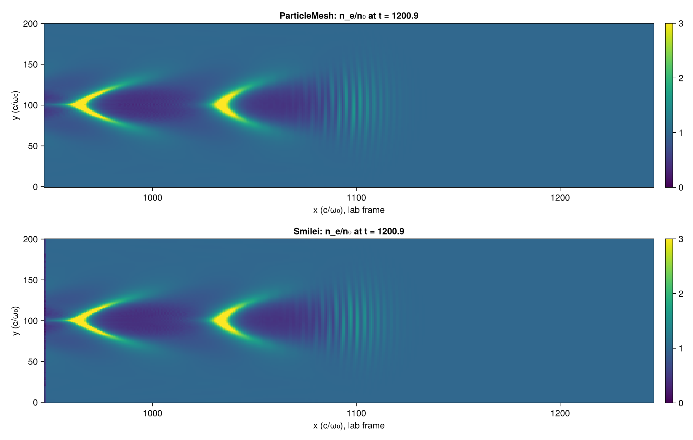

# ParticleMesh.jl

> **Experimental, and built by Claude.** This package is being developed largely by Claude
> (Anthropic's Claude Code, running as autonomous agents and saved workflows) under the direction
> and review of @SebastianM-C. It is also an experiment in how such a software
> factory should be organized. Expect gaps, churn and unverified claims until a release says
> otherwise; every number that leaves this repository is meant to pass an independent review first.

ParticleMesh.jl is a differentiable particle–mesh simulation engine in Julia with pluggable
physics modules. The engine owns what every particle–mesh method shares: particle sets, structured
grids, the particle↔mesh transfers (deposition and gather) with shape functions, mesh operators,
the time loop, diagnostics, parallel exchange, and the differentiation and backend machinery.
Physics modules supply what is deposited, which mesh equations are solved, which force acts on a
particle and which pusher integrates it.

The first module is an electromagnetic particle-in-cell model for laser-wakefield acceleration,
built to optimize laser and plasma parameters by gradient. It is the only physics module planned and the
proof that the engine/module split holds; electrostatic cases such as Landau damping and two-stream
run as its edge cases with no transverse fields. Long term the project is a showcase and stress test for
Julia and Reactant compiler technology: the same KernelAbstractions kernels run natively on
NVIDIA and AMD GPUs and, through Reactant, as a traced, raised and sharded program.

## Status

The engine core (`lib/ParticleMeshCore`) and the electromagnetic module
(`lib/ParticleMeshElectromagnetic`) run 1D and 2D electromagnetic particle-in-cell cases on the
CPU and on NVIDIA GPUs (CUDA) from the same KernelAbstractions kernels. What exists now:

- **Engine.** Particle sets and structured grids at N = 1 and N = 2; deposition and gather with
  shape functions, both as atomics (Fast mode) and as sort plus segmented reduction (Reference
  mode, bitwise reproducible); Esirkepov charge-conserving current deposition; a periodic
  Poisson solve; counter-based random numbers and quiet-start loading.
- **Electromagnetic module.** The Yee solver in N dimensions; swappable relativistic pushers
  (Boris, Vay, Higuera–Cary and a quadratic-unitary scheme) with a resolution rule in a₀·ω₀Δt;
  a laser antenna; a binomial current filter; open transverse boundaries with particle
  retirement; a convolutional PML (PIConGPU's scheme) on the transverse axis and on the moving
  window's back edge; the moving window; Maxwell–Jüttner quiet starts for thermal species; and
  the step as a SciML `DiscreteProblem`.
- **Element types.** Every test runs in Float32, Float64 and `Dual{Float32,3}`; the CPU and CUDA
  test suites pass, the GPU one on an RTX 4080 SUPER (`reports/gpu-cuda.md`).
- **Cross-code checks.** Landau damping, two-stream and Weibel (1D and oblique 2D) against linear
  theory and against Smilei, with PIConGPU on the 2D cases, including seed ensembles and a
  resolution scan of the common offsets from theory.
- **Laser wakefield.** The first 2D LWFA case, run with the moving window in ParticleMesh and in
  Smilei on a coarser grid (λ₀/32) than A5's case, reproduces Smilei's laser and wake to a few
  percent (`reports/lwfa-2d-a2.md`):

Not done yet: A5's LWFA case at λ₀/48 in all three codes and the injecting case after it;
gradients through a full LWFA run (the element type and the SciML harness are in place, the
optimization is not); AMD GPUs; performance work (WP-041); Reactant, which is parked (A9). The
work packages and their state are in `trace/wp/`, the results in `reports/`. The cross-code
comparisons on the linear cases have had a fresh reviewer (`reports/crosscode-*/review*.md`);
the other reports, the LWFA comparison among them, have not, so their numbers are not validated
claims. The aims
and decisions in `docs/goals/` are binding for anyone, human or agent, who works here; the design
record in `docs/plan/` (start with `overview.md`) says where the project is going.

## Layout

| Path | Contents |
|---|---|
| `src/` | the umbrella package |
| `lib/` | subpackages (engine core, extensions, physics modules), resolved through `[sources]` |
| `docs/goals/` | the owner's aims and binding decisions, the root of everything else |
| `docs/plan/` | the design record derived from them: landscape, requirements, architecture, open items, process |
| `trace/` | work packages (linked to the goals they serve), the trace checker's specification, digests |
| `benchmark/` | regression microbenchmarks, a workspace member |
| `scripts/` | user code that produces results (benchmark cases, validation and cross-code runs, campaigns, figures); its own environment with a committed manifest |
| `reports/` | Markdown reports with their figures, one directory per report |
| `questions/` | assumptions agents made instead of asking |
| `.claude/` | agent roles, saved workflows and settings used by the Claude Code sessions |

## License

MIT, see `LICENSE`.
