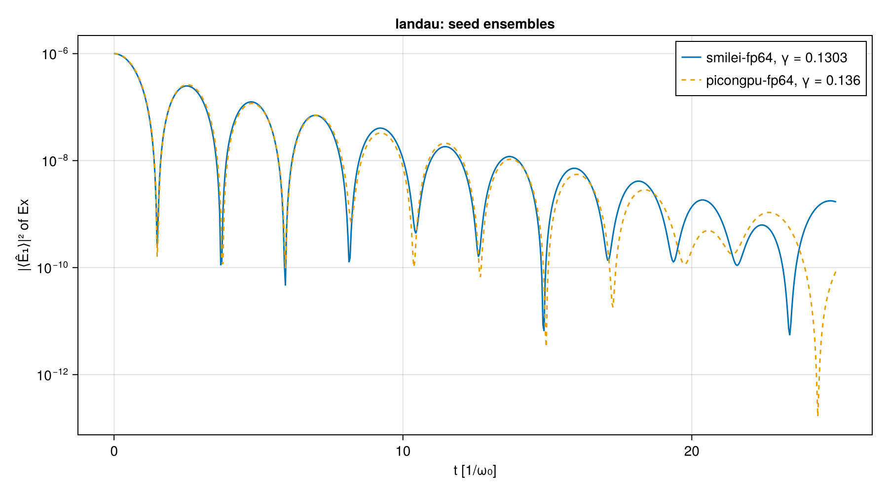
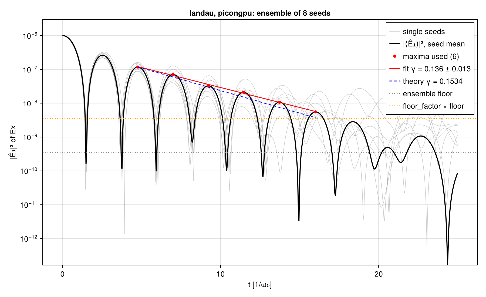
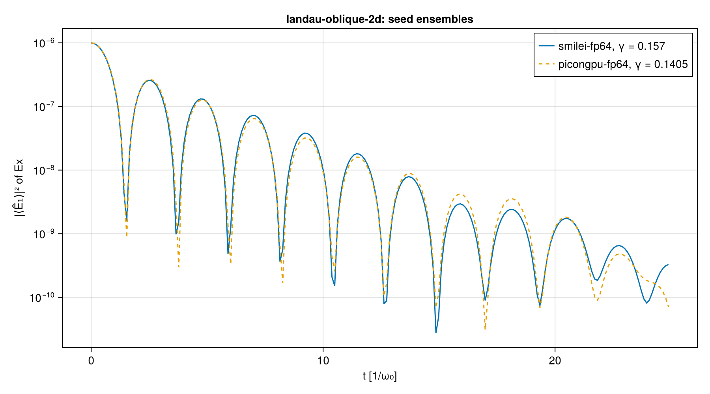
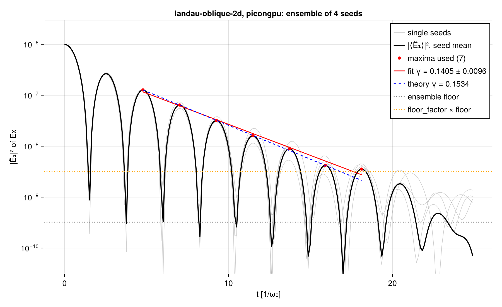
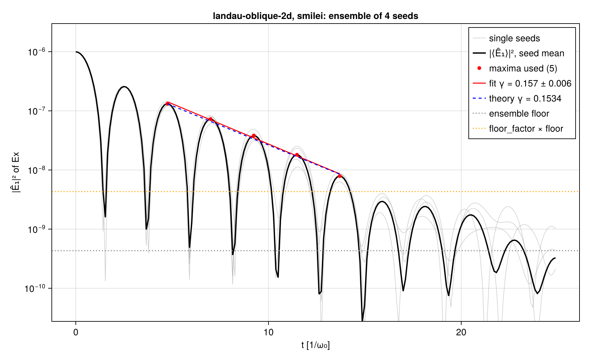

# PIConGPU and Smilei on the 1D set and the oblique 2D Landau case (cross-code stage 2a)

| | |
|---|---|
| Work package | WP-017 (goals A1, A5, A6, A7) |
| Runs | PIConGPU: `picongpu-landau-fp64-295ddf42`, `picongpu-landau-fp32-295ddf42` (8 seeds each; FP32 analyzed after the review), `picongpu-two-stream-fp64-736a428f`, `picongpu-two-stream-fp32-736a428f`, `picongpu-two-stream-256-fp64-56d5d9ae`, `picongpu-two-stream-256-fp32-56d5d9ae`, `picongpu-landau-oblique-2d-fp64-bc8fd6af` (4 seeds); Smilei: `smilei-landau-oblique-2d-bc8fd6af` (4 seeds). The Smilei 1D runs compared against are WP-012's (`reports/crosscode-smilei-1d/stage-1b/`) on the same case files |
| Commits of the inputs | Every run prepared at `917f460f2050ec1a8efa5c59a2d71c2ae7cd9d1b` (clean tree, in each `manifest.toml`); the analyses are recorded in each manifest's `[analysis]` table. The oblique ensemble observable and its seeds were registered in `d61a812`, before it and before any run of the case in this package. These ids are on the branch `wp-017-runs-provenance`, the history before the PR was rebased onto `main`; the PR's commits carry the same content under new ids |
| Case hashes (SHA-256, first 8 hex) | `landau.toml` `295ddf42`, `two-stream.toml` `736a428f`, `two-stream-256.toml` `56d5d9ae` (the files WP-012's Smilei runs used), `landau-oblique-2d.toml` `bc8fd6af` (WP-019's file with the seeds and the ensemble entry added); full hashes in each manifest under `inputs` |
| PIConGPU | 0.8.0, commit `6bb3470ee16dd5a3a93f24c85b111be3b8440d22`, CUDA backend for `sm_89`; image `localhost/particlemesh-picongpu:a743cbb40f17cdae`, id `1b4f3d0fb3c291e2d861732bda21463920167f39227c21b7947c37a9238ff50b` (toolchain as `pm-versions` printed it in each run's `versions.toml`, whose hash is in the manifest: nvcc 12.5.82, gcc 13.3.0, CMake 3.28.3, OpenMPI 4.1.6, openPMD-api 0.15.2, HDF5 1.10.10, Boost 1.83 from Ubuntu's package; the file is not committed, because the Debian revision of the Boost version trips the repository's IP-address scan) |
| Smilei | v5.1, commit `438d43d8ab727d02dd8f4402c50393343e871b99`, CPU build; image `localhost/particlemesh-smilei:e4f0148b8952fc87`, id `7030c120c62ce14dbae971cce76a3973f0a031ef63632a6c4bf4fa20e3937b4c` |
| Hardware | PIConGPU: NVIDIA GeForce RTX 4080 SUPER (driver 595.104.02), one device, one MPI rank. Smilei: Intel Core i9-14900K, 16 OpenMP threads (one per patch), one MPI rank |
| Generator, reader, analysis | `scripts/crosscode/picongpu.jl`, `read.jl` (`PIConGPURead`), `analyze.jl`, `compare.jl` at the commits above; the analysis commit of each run is in its manifest's `[analysis]` table |
| Review | numerics-reviewer (`.claude/agents/numerics-reviewer.md`), fresh subagent, claude-opus-5-5, 2026-11-01; findings `review.md` (one blocking, three major, eight minor), answered in "Review" |

This report records measurements and sets no tolerance (A7: thresholds rest on the measured Smilei–PIConGPU spread, are proposed in `questions/wp-017-a7-thresholds.md`, and the owner accepts them by editing A7). Each run directory holds its manifest (inputs, outputs and their hashes, image, hardware, observables), the generated `params/`, `run.sh`, `units.toml`, the timing record `container.txt`, `observables.json` and the standard plots with JSON sidecars; seeded runs have the same per seed under `seed-<seed>/`. The dumps themselves are not committed. Comparisons are in `compare/`, each a `comparison.json` with the numbers below.

## Setup

### Matching (A5)

| Setting | Smilei | PIConGPU |
|---|---|---|
| Shape | `interpolation_order = 2` | `particles::shapes::TSC` (quadratic B-spline) |
| Current deposition | Esirkepov (`Projector1D2Order`, `Projector2D2Order`) | `currentSolver::Esirkepov<TSC>` |
| Filter | none | none (`--currentInterpolation none`) |
| Pusher | Boris (default `pusher = "boris"`) | `particles::pusher::Boris` |
| Field solver | Yee | `maxwellSolver::Yee` |
| Ions | frozen for twice the run, deposit charge | no pusher, no current; uniform |
| Particles per cell | the case's | the case's in 2D; in quasi-1D the 1D count per x-column (below) |
| Loading | `regular` within 97.5 % of the cell, profile at cell centres | `Quiet` lattice (k + ½)/n over the whole cell, profile at cell centres |
| Thermal momenta | classical Maxwell–Boltzmann energy, \|p\| = √((1 + E)² − 1) | non-relativistic Maxwellian in momentum (`unary::Temperature`) |
| Initial field | Poisson solve of the loaded charge, plus Smilei's constant offset | the discrete Poisson field of the loaded charge as a static `FieldBackgroundE` (below) |
| Output cadence | the case's `scalars_every`, `fields_every` | the same, in steps |
| Precision | FP64 | FP64; the 1D set also in FP32 |
| Reference wavelength | not needed (normalized input) | 0.8 µm (SI input; it cancels in every observable) |

Every PIConGPU-specific choice is listed with the source file it was read from in `scripts/crosscode/README.md` ("PIConGPU specifics").

### Quasi-1D runs of the 1D set

PIConGPU has no 1D geometry. A schema-1 case runs in a 2D box periodic in y, 8 cells wide, with Δy = 8Δx:

- **Width.** PIConGPU needs at least 2·guard + 1 supercells per axis and a guard of 3 cells for TSC's Esirkepov stencil. With supercells of 16 × 1 cells and a guard of 3 supercells along y, the floor is 7 transverse cells. The per-cell counts (50 000 electrons in Landau, 1000 per beam in two-stream) are not divisible by 7, so the generator takes 8.
- **Transverse cell.** With Δy = Δx, the 1D time step 0.95Δx would exceed the 2D Courant limit Δx/√2, which PIConGPU refuses at compile time. With Δy = 8Δx the limit is 0.992Δx. The ky = 0 component of the Yee update is the 1D update with the same Δx and Δt, so the y-averaged fields evolve as in 1D, up to the coupling through the particles.
- **Particles.** Each cell holds the 1D count divided by 8, all on the x lattice (6250 × 1 in Landau, 125 × 1 per beam in two-stream), so an x-column holds the 1D cell's count: 3.2 × 10⁶ electrons per Landau seed, 2.56 × 10⁵ in two-stream at 128 cells, as in Smilei. A column has only 6250 (125) distinct x positions, each repeated in the 8 rows; the velocities are independent, so the noise is that of the 1D count, while the quiet-lattice form factor is that of 6250 (125) per cell (T-255 uses it). The immobile ions keep one per cell (8 per column).
- **Observables** come from the y-averaged Ex and from the energies per unit transverse area, the 1D quantities of Smilei.

T-254 reads these back from the generated files: grid, lattice per column, density, perturbation, time step and step count.

### The initial field

Smilei solves Poisson's equation at t = 0. PIConGPU solves none: its fields start at zero. With Esirkepov's exact charge conservation, a density perturbation loaded with E = 0 keeps a static Gauss-law defect that acts as a neutralizing background, so the Langmuir wave would not be excited at all. The generator therefore supplies the field.

A cosine density sampled at the cell centres and loaded on a quiet lattice with TSC deposits exactly one Fourier mode at the nodes, with amplitude ρ̂ = Σ_s q_s n_s α_s K̂_x K̂_y, where K̂ is the lattice's form factor. The Yee-grid field that satisfies the discrete Gauss law for that charge is analytic: E_d = (ρ̂/K²) κ_d sin(k·x_{E_d}), with κ_d = (2/Δ_d) sin(k_dΔ_d/2) and K² = Σ κ_d². T-255 checks it against a brute-force TSC deposit of the same load to 10⁻¹⁰.

The field enters as a static `FieldBackgroundE` that the pusher sees. PIConGPU adds it to the grid field before the push and for the plugins between steps, and removes it before the field solver, so the total field obeys Maxwell's equations with ∇·E = ρ from t = 0, as after a Poisson solve. It is curl-free on the Yee grid and drives no B.

PIConGPU's own `chargeConservation` plugin (max |∇·E − ρ| on the total field, at every dump) and the analysis's Gauss check on the dumps (`gauss_residual_t0_relative`) confirm it in the runs (Results).

## Linear theory

As in `reports/crosscode-smilei-1d/README.md` and `reports/crosscode-smilei-2d/README.md` (`scripts/crosscode/theory.jl`, T-160, T-273): Landau damping at kλ_D = 0.5, γ = 0.1533595 ω_p, ω_r = 1.4156619 ω_p, in 1D and along k in 2D; cold two-stream with the longitudinal mass γ₀³m, γ = 0.3508758 ω_p; the Ex/Ey energy ratio of the oblique wave on the Yee grid, 3.9975909.

## Results

Rates are of the field amplitude in units of ω_p. "±" is one jackknife standard error over seeds for an ensemble, and one standard error of the fitted slope for a single run; neither includes systematics. Differences are PIConGPU − Smilei unless stated, and they are measurements, not thresholds.

### Checks of the PIConGPU setup

From each run's `observables.json` (`checks`, written by `picongpu_dump_checks` on the 2D dumps before any y-average) and `plots/energy-conservation.json`. Gauss residuals are max |∇·E − ρ| in the units of A1. The relative value is relative to the loaded charge perturbation, max |ρ − ⟨ρ⟩| at t = 0.

| Check | Landau, FP64 (8 seeds) | Two-stream, FP64 (128 / 256 cells) | Two-stream, FP32 (128 / 256 cells) | Oblique 2D, FP64 (4 seeds) |
|---|---|---|---|---|
| Gauss at t = 0, relative | 9.2 × 10⁻¹³ | 1.1 × 10⁻¹² / 2.0 × 10⁻¹² | 7.1 × 10⁻⁴ / 6.7 × 10⁻⁴ | 1.1 × 10⁻¹² (Smilei 6.5 × 10⁻¹⁰) |
| Gauss over the run, absolute | ≤ 1.7 × 10⁻¹⁴ at the unflagged dumps; up to 0.022 at the 18 to 32 flagged dumps per seed (below) | ≤ 8.8 × 10⁻¹⁴ / 3.0 × 10⁻¹³, no dump flagged | ≤ 5.8 × 10⁻⁵ / 1.4 × 10⁻⁴, no dump flagged | ≤ 1.8 × 10⁻¹⁴, no dump flagged |
| \|Ê(0)\| of the perturbed mode, PIConGPU / Smilei | 9.98796 × 10⁻⁴ / 9.98816 × 10⁻⁴ (seed 20261101) | 1.632501 × 10⁻⁴ / 1.632509 × 10⁻⁴ (128 cells) | as FP64 to 7 digits | ensemble \|⟨E·k̂⟩(0)\|² 9.9667 × 10⁻⁷ / 9.9672 × 10⁻⁷ |
| Initial kinetic energy against (3/2) n T L (1D) or (3/2) n T L² (2D), seed mean | −0.32 % (Smilei +0.001 %) | equal to Smilei's to 10⁻⁸ | 10⁻⁵ to 10⁻⁶ below FP64 | −0.34 % (Smilei +0.018 %) |
| Largest relative change of the total energy | 2.4 × 10⁻⁷ to 4.3 × 10⁻⁷ per seed (Smilei 2.7 × 10⁻⁷ to 3.6 × 10⁻⁷) | 1.016 × 10⁻³ / 0.545 × 10⁻³ (Smilei 1.015 × 10⁻³ / 0.545 × 10⁻³) | 1.004 × 10⁻³ / 0.544 × 10⁻³ | 2.5 × 10⁻⁷ to 2.7 × 10⁻⁷ (Smilei 1.3 × 10⁻⁶) |

The kinetic energy is the exact Σ(γ − 1)mc², formed by the reader from PIConGPU's total-energy column minus the rest energy. PIConGPU's own kinetic-energy column switches to p²/2m below γ = 1.005 (`algorithms/KinEnergy.hpp`). The review (B1) found this, and with that column the two-stream energy drift looked twice Smilei's at 256 cells; with the exact energy the two codes agree to three digits.

**Thermal loads.** The initial kinetic energies differ as the loads do. PIConGPU's thermal momenta are the non-relativistic Maxwellian in momentum; Smilei draws the classical energy and sets |p| relativistically (Setup). The review computed by quadrature that PIConGPU's load is 0.31 % below (3/2)nT in exact kinetic energy. The measured seed means are −0.32 % in 1D (eight seeds of 3.2 × 10⁶ electrons) and −0.34 % in 2D (four of 1.68 × 10⁷). The 2D mean is about 2.5 standard errors of the mean from the prediction, which was not followed up.

**Smilei's 2D field energy.** Smilei's t = 0 field energy exceeds PIConGPU's by 2.4 %: Smilei's `Uelm` scalars count extra columns (131/128) and include the constant field Smilei adds after its Poisson solve (`reports/crosscode-smilei-2d/`). PIConGPU's are ½ ΣE²ΔV over the cells.

**FP32 Landau.** The FP32 Landau seeds keep Gauss's law to 4.7 × 10⁻⁴ of the perturbation at t = 0 and to 9 × 10⁻⁶ absolute at unflagged dumps. They show the charge-density glitch at 26 to 41 of 671 dumps per seed. Their total energy changes by at most 2.7 × 10⁻⁵ to 4.6 × 10⁻⁵, which includes the float rounding of the exact kinetic energy formed by subtraction (not separated; FP64: 2.4 × 10⁻⁷ to 4.3 × 10⁻⁷).

**FP32 Gauss.** The FP32 runs keep Gauss's law to the precision of the format: 7 × 10⁻⁴ of the perturbation at t = 0 (the background and the density rounded to float), growing to 5.8 × 10⁻⁵ (128 cells) and 1.4 × 10⁻⁴ (256 cells) absolute over 5253 and 10 506 steps. The review estimates about 4 × 10⁻⁵ for a random walk of FP32 roundoff in E over 5253 steps.

**A glitch in PIConGPU's derived charge density, in the thermal quasi-1D runs only.** In 18 to 32 of the 671 dumps of each Landau seed, the dumped electron charge density summed over the box is short by 1 × 10⁻⁴ to 8 × 10⁻⁴ of the electron charge. At every other dump it is exact to 10⁻¹⁵, and Gauss's law on the dumped fields holds to 10⁻¹⁴. Three observations, from the review (M1), show that the derived density is wrong and not the state:

1. The openPMD dump and the `chargeConservation` plugin derive the density separately from the same particle state at the same iterations. Their spikes fall on different steps (in seed 20261101, 21 against 20, sharing one step). One state gives two densities, so the derivation is not deterministic.
2. The particle-energy plugin runs at the same steps over the same particles and is smooth to 10⁻⁸. A loss of 10⁻⁴ of the electrons would show at 10⁻⁴.
3. At the glitched steps examined, the missing charge sits in one 16 × 1 supercell plus the TSC footprint, away from the periodic seam. About 0.35 % of that supercell's electrons are missing, some 22 frames of 16 particles. That points at the frame traversal of the deposit to the grid.

None of the cold two-stream runs (same layout, no motion in y) and none of the 2D runs (8 × 8 supercells) shows it. The observables use E only, and the analysis uses the density at t = 0 only, so no number in this report is affected.

A particle skipped in the push, if the same frame traversal could skip one there, would leave no trace in Gauss's law: it would neither move nor deposit. That is not tested here (open items). The glitch is being reduced to a minimal setup for an `upstream` issue.

### Two-stream: the codes agree to about 10⁻⁶

Pre-registered `growth_rate` (field energy, the 10⁻³ to 3 × 10⁻² window), and the same rule on |Ê₁|²:

| | Smilei | PIConGPU FP64 | PIConGPU FP32 | PIConGPU − Smilei | FP32 − FP64 |
|---|---|---|---|---|---|
| 128 cells, γ | 0.3456117 ± 0.0009 | 0.3456123 ± 0.0009 | 0.3456120 | +5.8 × 10⁻⁷ (+1.7 × 10⁻⁶ relative, 6 × 10⁻⁴ fit errors) | −2.9 × 10⁻⁷ |
| 128 cells, γ from \|Ê₁\|² | 0.3369876 | 0.3369876 | 0.3369885 | +6.9 × 10⁻⁸ | +8.6 × 10⁻⁷ |
| 256 cells, γ | 0.3459258 ± 0.0009 | 0.3459259 ± 0.0009 | 0.3459269 | +7.5 × 10⁻⁸ (+2.2 × 10⁻⁷ relative) | +1.05 × 10⁻⁶ |
| 256 cells, γ from \|Ê₁\|² | 0.3370343 | 0.3370343 | 0.3370342 | −2.8 × 10⁻⁹ | −9.2 × 10⁻⁸ |

PIConGPU's `Uelm_Ex` is the 16-digit total field energy minus the other components (it prints the components with 6 digits, review m2). Both codes fit the same 164 (163) samples over t = 13.80 to 18.76 (13.83 to 18.76), and their saturation energies agree to 3 × 10⁻⁶. Every run is relative to the theory 0.3508758 by the common −1.5 % (−1.4 % at 256 cells) of WP-012, the fit window sampling a transient (#168).

**ParticleMesh against both.** ParticleMesh's WP-012 run gives 0.345904 at 128 cells, +2.9 × 10⁻⁴ from both codes (+8.4 × 10⁻⁴ relative). A post-hoc investigation of this package traced it to two things:

- **The window.** Fitted over the reference codes' window, ParticleMesh gives 0.345577, −3.5 × 10⁻⁵ from them (−1.0 × 10⁻⁴ relative). Its own window starts one output later, because its saturation peak falls one output later, and because log U bends over the window, a one-sample shift moves γ by 1 × 10⁻³ in any of the codes.
- **The initial condition.** ParticleMesh's U(t) differs from PIConGPU's by +1.3 % at t = 1 and −1.0 % from t = 10 on. The cause is ParticleMesh's half-step momentum kick at start-up (A2's centring: the loaded momenta are those at t = 0 and are pushed back to −Δt/2 in E⁰), while Smilei and PIConGPU take the loaded momenta as those at −Δt/2. With the kick removed, ParticleMesh's U(t) is a constant 1.0002 × PIConGPU's, and its γ equals both codes' to six digits. The deviation is linear in the kick (doubling and reversing it were checked), and a linear cold-fluid model predicts the late-time energy ratio 0.9893 against the measured 0.9896.

This is a choice of initial condition, not a defect, and the agreement between Smilei and PIConGPU holds because they share theirs. #226 proposes an option for ParticleMesh's convention; the threshold proposal depends on it.

### Landau damping (quasi-1D) over eight seeds

Pre-registered `damping_rate_ensemble` of `landau.toml` (WP-012), PIConGPU's eight seeds against WP-012's Smilei ensemble on the same seed numbers (the generators' random streams differ, so the seeds are independent draws in each code):

| | Smilei (WP-012) | PIConGPU FP64 | PIConGPU FP32 |
|---|---|---|---|
| ensemble γ ± jackknife | **0.1303 ± 0.0144** | **0.1360 ± 0.0131** | **0.1323 ± 0.0142** |
| maxima used, fit range | 6, t = 4.75 to 15.93 | 6, t = 4.77 to 16.02 | 5, t = 4.75 to 13.64 |
| relative to theory 0.15336 | −15.1 % | −11.3 % | −13.7 % |
| ω_r from the maxima (theory 1.41566) | 1.4046 | 1.3963 | 1.4144 |
| ensemble floor of \|⟨Ê₁⟩\|² | 5.9 × 10⁻¹⁰ | 3.5 × 10⁻¹⁰ | 6.5 × 10⁻¹⁰ |
| per-seed γ at the ensemble's maxima, mean ± std | 0.1296 ± 0.0268 | 0.1343 ± 0.0413 | 0.1302 ± 0.0356 |

PIConGPU − Smilei (FP64): **+0.0057** (+4.4 %), 0.29 combined jackknife errors, 0.21 Smilei seed spreads, 0.14 PIConGPU seed spreads. PIConGPU FP32 − FP64: **−0.0036** (−2.7 %), 0.19 combined jackknife errors; FP32 − Smilei: +0.0021, 0.10 combined errors. The FP32 ensemble is an independent draw of the same seeds (the float load and push give different trajectories), so the difference is noise-dominated like the code difference.

Per seed (γ at the ensemble's maxima):

| seed | 20261101 | 20262101 | 20263101 | 20264101 | 20265101 | 20266101 | 20267101 | 20268101 |
|---|---|---|---|---|---|---|---|---|
| Smilei | 0.1035 | 0.1651 | 0.1221 | 0.1235 | 0.1472 | 0.1664 | 0.1004 | 0.1081 |
| PIConGPU FP64 | 0.1273 | 0.0799 | 0.1049 | 0.2118 | 0.1071 | 0.1690 | 0.1306 | 0.1437 |
| PIConGPU FP32 | 0.1493 | 0.1850 | 0.1080 | 0.1562 | 0.1469 | 0.1216 | 0.0749 | 0.0997 |

The PIConGPU per-seed spread (0.041) is 1.5 times Smilei's (0.027). With eight seeds each this is not significant (an F ratio of 2.4 on 7 and 7 degrees of freedom), and the PIConGPU ensemble floor is lower, not higher. The single-run rule refuses every seed in both codes, as in WP-012.

### Oblique Landau damping in 2D over four seeds

The pre-registered ensemble observable `damping_rate_mode_ensemble` (added before these runs, `d61a812`) and WP-019's per-run observables on each seed:

| | Smilei | PIConGPU FP64 | PIConGPU − Smilei |
|---|---|---|---|
| ensemble γ ± jackknife (theory 0.15336) | **0.1570 ± 0.0060** (+2.4 %) | **0.1405 ± 0.0096** (−8.4 %) | **−0.0165**: 1.46 combined jackknife errors, 1.25 Smilei seed spreads, 2.49 PIConGPU seed spreads |
| maxima used, fit range | 5, t = 4.75 to 13.70 | 7, t = 4.79 to 18.12 | |
| ω_r from the maxima (theory 1.41566) | 1.4051 | 1.4135 | |
| ensemble floor | 4.3 × 10⁻¹⁰ | 3.2 × 10⁻¹⁰ | |
| per-seed γ at the ensemble's maxima, mean ± std | 0.1571 ± 0.0132 | 0.1366 ± 0.0066 | |
| `damping_rate_mode` per seed (WP-019's single-run rule), mean ± std over 4 | 0.1465 ± 0.0267 | 0.1522 ± 0.0208 | +0.0057: 0.33 combined errors of the means |
| `damping_rate_energy` | none in any seed (the field-energy scalars reach their floor, as pre-registered) | none in any seed | |
| `energy_ratio` (t = 0, scalars; Yee theory 3.9975909) | 3.98629 in every seed | 3.99760 in every seed | Smilei: its constant post-Poisson field; PIConGPU: the background field, to the 6 digits PIConGPU prints |
| `energy_ratio_mode`, mean ± std over 4 | 3.947 ± 0.053 | 4.088 ± 0.110 | +0.140: 2.3 combined errors of the means |

Smilei's seed 20261031 reproduces WP-019's single run (`damping_rate_mode` 0.16093 in both).

The ensembles differ by 1.5 combined errors. They straddle the theory, Smilei's 0.6 errors above it and PIConGPU's 1.35 errors below. Each ensemble's fit stops at a different maximum (5 against 7), the variation the jackknife over four seeds samples poorly (WP-012's review, F1). The single-run rule averaged over the same seeds agrees to 0.3 errors. With four seeds per code this is a 1.5σ difference, and nothing here shows it to be a code difference; more seeds would decide it.

PIConGPU's `energy_ratio` is the background field, not a measurement of PIConGPU: the generator put the discrete Poisson field there. `energy_ratio_mode` is a ratio of noisy mode energies at the fit maxima, and its two codes differ by 2.3 errors of the means: PIConGPU is 1.6 errors above the Yee value and Smilei 1.9 below.

### Compile and run times

Wall time inside the container (`container.txt`). This is not a throughput comparison: the codes ran on different hardware, the quasi-1D runs are far from PIConGPU's design point, and A5's fair comparison on one card is a non-goal of this package.

| Case | PIConGPU compile | PIConGPU run (per seed) | ns per mobile particle-step | Smilei run (per seed) | ns per mobile particle-step |
|---|---|---|---|---|---|
| two-stream, 128 cells, FP64 / FP32 | 71 s / 71 s | 103 s / 96 s | 77 / 71 | 17 s (16 threads, WP-012) | 12 |
| two-stream, 256 cells, FP64 / FP32 | 71 s / 71 s | 147 s / 126 s | 27 / 23 | 48 s | 9 |
| Landau, FP64 | 71 s | 1110 s to 1203 s | 129 to 140 | 79 s to 96 s (8 threads, WP-012) | 9 to 11 |
| Landau, FP32 | 70 s | 803 s to 853 s | 94 to 99 | | |
| oblique 2D, FP64 | 68 s | 327 s to 333 s | 5.7 to 5.9 | 559 s to 569 s (16 threads) | 9.8 to 10.0 |

In quasi-1D the GPU has little work to spread: 512 or 1024 cells, so 512 or 1024 threads per kernel. In addition, each openPMD dump costs about 0.6 s whatever its size (README, "PIConGPU specifics"), and the Landau case dumps 671 times. In 2D (16 384 cells) PIConGPU on the RTX 4080 SUPER in FP64 is 5.9 ns per particle-step with output, the compile once per setup.

## Review

A fresh numerics-reviewer subagent (claude-opus-5-5, 2026-11-01) reviewed the code, the tests, the runs and this report before the FP32 Landau run finished. Its findings are in `review.md`, and the answers below have been applied.

| Finding | Answer |
|---|---|
| **B1** (blocking): PIConGPU's kinetic-energy column is p²/2m below γ = 1.005 | Fixed. `read_picongpu_scalars` forms Σ(γ − 1)mc² from the exact total-energy column minus the rest energy of the load, and keeps PIConGPU's column as `Ukin_threshold`. All runs were re-analyzed. The energy rows above are the exact ones: the two-stream drift agrees with Smilei's to three digits, and the open item about it is withdrawn. The threshold is listed in `scripts/crosscode/README.md` and in `questions/wp-017-lwfa-case.md` |
| **M1**: the Esirkepov argument does not rule out a skipped push | Fixed. The paragraph now rests on the review's three observations (two derivations of one state disagree, the energy plugin sees every particle, the deficit is confined to one supercell), and a skipped push is stated as untested. The localization went to the upstream reduction |
| **M2**: quasi-1D Gauss and charge numbers had no committed source | Fixed. `picongpu_dump_checks` (`analyze.jl`) writes the per-dump Gauss residual and each species' total charge into every PIConGPU run's `observables.json`, and the checks table cites them |
| **M3**: the #226 numbers are relative | Fixed: both are labelled, with the absolute values next to them, and the as-is value is 0.345577 |
| m1: per-seed energy ranges | Regenerated from the re-analysis |
| m2: 6-digit `Uelm_Ex` | Fixed. `Uelm_Ex` is the 16-digit total minus the other components. The 256-cell difference is now +7.5 × 10⁻⁸ (2.2 × 10⁻⁷ relative), and `T-215.wp017` was updated |
| m3: cold two-stream says nothing about thermal momenta | Reworded (open items) |
| m4: a constant factor in U does not change γ | The relaxation argument is removed from the proposal |
| m5: FP32 Gauss not reported | Added: an FP32 column in the checks table, and a paragraph |
| m6: stale Gauss-check comment | Fixed in `analyze.jl` |
| m7: provenance | All runs re-analyzed from a clean tree (each manifest's `[analysis]`). `compare.jl` records the committed report directories |
| m8: repeated x positions in quasi-1D | One clause added under "Quasi-1D runs" |

Not verified by the review, and still open: Smilei's side of the initial-momentum convention and the 131/128 explanation of Smilei's 2D `Uelm` (Smilei's source not checked); whether the push can skip particles; the cell-centred-weight explanation of ParticleMesh's remaining 2 × 10⁻⁴; the 0.6 s per dump; the FP32 Landau run, analyzed after the review.

## Verification status

- T-250 (unit conversion), T-251 (the oblique profile in both generators), T-252 (openPMD reader on files in PIConGPU's layout), T-253 (recipe pinned), T-254 (quasi-1D equivalence), T-255 (the initial field against a brute-force deposit) and T-256 (the oblique seed ensemble, WP-019's entries unchanged by hash) pass on the CPU: `julia +1.13 --project=scripts scripts/crosscode/test/runtests.jl`. CI does not run this file.
- The reader's layout assumptions (meshes under `fields/`, F[y][x], spacing in axisLabels order, position x first) were checked on a run's file.
- The generated setups compiled and ran first time in the runner's image; PIConGPU's own `chargeConservation` and the analysis's Gauss check confirm the initial field.
- The oblique ensemble entry was committed (`d61a812`) before any run of the case in this package, and T-256 checks that WP-019's four entries are unchanged.
- The ParticleMesh two-stream investigation is post hoc: it reran WP-012's ParticleMesh case with the start-up kick scaled (0, 1, 2, −1), from scripts outside the repository, with no repository file changed; its baseline reproduced WP-012's stored series exactly. The proposal of an option is #226.
- Not verified: whether the frame traversal behind the charge-density glitch can also skip particles in the push (a skipped push leaves no Gauss trace); the 2D seed-mean kinetic energy sits about 2.5 standard errors from the quadrature prediction; the cell-centred-weight explanation of ParticleMesh's remaining 2 × 10⁻⁴ in U.

## Known limitations and open items

- **Seeds.** Four seeds per code in 2D and eight in 1D leave the Landau differences unresolved (0.3 and 1.5 combined errors). The jackknife over four seeds samples the variation of the fit's stop poorly (WP-012 review, F1).
- **Initial conditions are not identical across the codes**, by design of each code: the in-cell lattice (whole cell against 97.5 %), the thermal momenta (non-relativistic Maxwellian in momentum against Smilei's classical energy with relativistic |p|, O(T) = 2.5 × 10⁻³), Smilei's constant post-Poisson field, and ParticleMesh's half-step kick (#226). The cold two-stream case shows that the in-cell lattice does not matter at 10⁻⁶ between Smilei and PIConGPU; being cold, it says nothing about the thermal momenta.
- **The charge-density glitch** of PIConGPU in the thermal quasi-1D layout (Results, checks): reduced to an `upstream` issue separately; whether the push can skip particles the same way is untested.
- **PIConGPU's kinetic-energy column** is p²/2m below γ = 1.005; the reader forms the exact kinetic energy from the total-energy column (README, "PIConGPU specifics").
- **Throughput** is not compared (non-goal); the quasi-1D runs are I/O- and occupancy-bound in PIConGPU.
- **Precision of PIConGPU's scalars**: the per-component field energies are printed with 6 significant digits, which sets the 1.6 × 10⁻⁶ offset of the oblique `energy_ratio` from the Yee value; the totals have 16.
- **Weibel** is not run in PIConGPU (non-goal), and the 2D LWFA case is not written; its prerequisites are in `questions/wp-017-lwfa-case.md`.
- The proposed thresholds are in `questions/wp-017-a7-thresholds.md`, for the owner.
