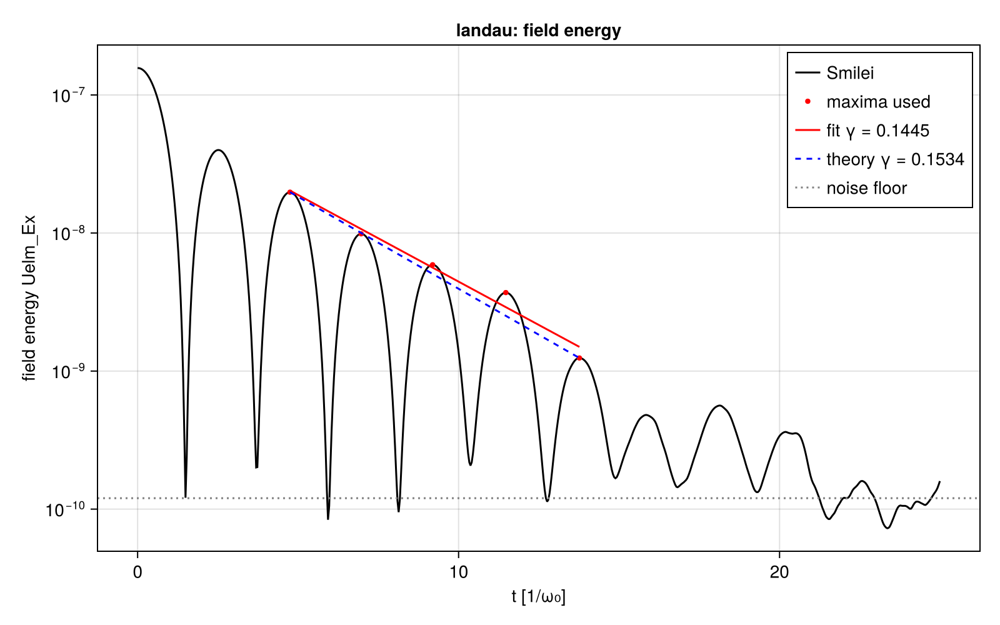
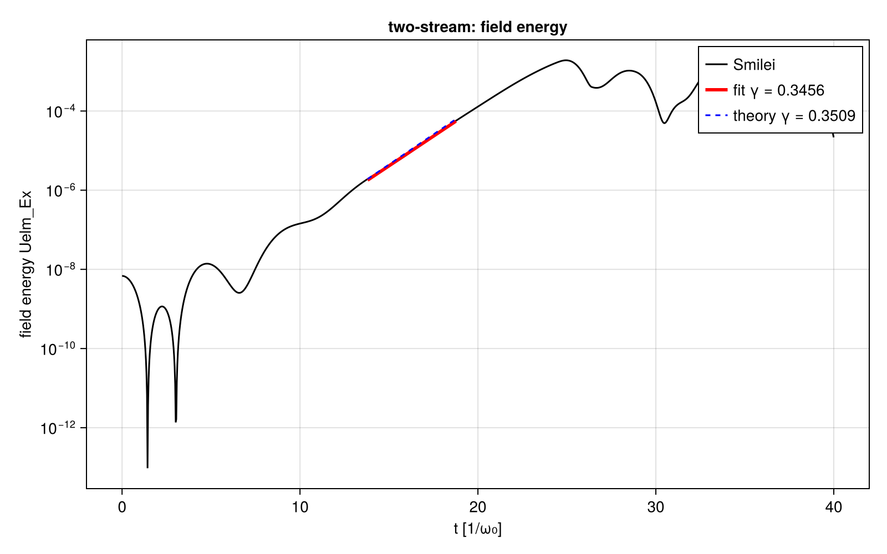

# Smilei on the 1D electrostatic cases (cross-code stage 1)

| | |
|---|---|
| Work package | WP-003 (goals A1, A5, A7) |
| Runs | `smilei-landau-d7d19f86` (reference Landau run), `smilei-two-stream-736a428f`, and `smilei-landau-9a47a107` (Landau at 1/8 of the particles, noise-limited, kept as a record) |
| Commits of the inputs | `4da64a34a0efeca0bd4ca7f77b3bc749e24e16a1` (two-stream, first Landau run); `ae2eb5a` on the results branch of PR #57, squashed on merge (reference Landau run); full ids in each run's `manifest.toml` |
| Case hashes (SHA-256) | `landau.toml` `d7d19f863edd3f1003b69e90000f1c8683075451eab0a730ba64d720d2803a0e` (reference run), `9a47a107b38cf142ae7f7a57c1c1d8440bc08a64987a56f7294ded5363e1eeaf` (first run); `two-stream.toml` `736a428fe67b795543c2c1380a73c94a115d4ec803fb81d59b0089293814a817` |
| Code | Smilei v5.1, commit `438d43d8ab727d02dd8f4402c50393343e871b99`, CPU build; image `localhost/particlemesh-smilei:e4f0148b8952fc87`, id `7030c120c62ce14dbae971cce76a3973f0a031ef63632a6c4bf4fa20e3937b4c`, from `scripts/crosscode/containers/smilei.Containerfile` |
| Hardware | Intel Core i9-14900K; OpenMP with one thread per patch (8 for Landau, 16 for two-stream), one MPI rank |

This report records numbers; it sets no tolerance (A7: thresholds are proposed from measured spread, and the owner accepts them by editing the goals). Each run directory below holds the run's manifest (inputs, outputs and their hashes, image, hardware, observables), its namelist, the container's timing record, `observables.json`, and the standard plots with their JSON sidecars.

## Setup

Both cases are periodic, one-dimensional, with immobile ions (frozen in Smilei), quadratic shapes (Smilei `interpolation_order = 2`), no current filter, double precision, in the units of A1 with the total electron density 1 n_c, so ω_p = ω₀. Case files: `scripts/crosscode/cases/`; namelists generated by `scripts/crosscode/smilei.jl`.

| | Landau damping | Two-stream |
|---|---|---|
| Physics | Maxwellian, v_th = 0.05 c, kλ_D = 0.5, density perturbation 1 % | Two cold beams at ±0.1 c, 0.5 n_c each, density perturbation 0.1 %, k v₀ = √(3/8) ω_p |
| Box, cells | 2π/k = 0.6283 c/ω₀, 64 cells (Δx = 0.196 λ_D) | 2π/k = 1.0260 c/ω₀, 128 cells (Δx = 0.080 v₀/ω_p) |
| Δt, steps | 0.0093266 (0.95 Δx), 2681 steps to t = 25.0 | 0.0076151 (0.95 Δx), 5253 steps to t = 40.0 |
| Electrons per cell | 400 000 (reference run; 50 000 in the first run), regular positions, Maxwell–Jüttner momenta (seed 20261031) | 1 000 per beam, regular positions, cold |
| Electrons in total | 2.56 × 10⁷ (first run 3.2 × 10⁶) | 2.56 × 10⁵ |
| Wall time | 379 s (first run 51 s) on 8 threads | 10 s on 16 threads |
| Observable | damping rate γ of the field amplitude from the maxima of the Ex field energy, t ≥ 3, maxima above 10 × the noise floor (median of the last 20 % of the run) | growth rate γ from a fit of log of the Ex field energy where it lies between 10⁻³ and 3 × 10⁻² of its value at saturation |

The fit rules were fixed in the case files before any run. Two things were changed after the first runs, both recorded in the commit history: the Landau particle count (below), and the anchor of the growth window, which used the global maximum and now uses the first local maximum reaching 10 % of it. This is a post-hoc change to a fit rule, prompted by a run: the mode-amplitude fit of the two-stream run gave a negative rate with the old anchor. The second change does not alter the primary two-stream estimate (its global maximum is the first saturation); it repairs the second estimate from the mode amplitude, whose global maximum is a later nonlinear bounce.

## Linear theory

All rates are those of the field amplitude in units of ω_p; the field energy goes as e^{±2γt}. The values are computed by `scripts/crosscode/theory.jl` and checked by T-160.

**Landau damping.** For a Maxwellian electron plasma with immobile ions, the linearized Vlasov–Poisson system gives the dispersion relation D(ω, k) = 1 + (kλ_D)⁻² [1 + ζ Z(ζ)] = 0, ζ = ω/(√2 k v_th), with Z the plasma dispersion function (Fried and Conte, 1961), evaluated as Z(ζ) = i√π w(ζ) with the Faddeeva function w, which continues Z analytically to the lower half plane. The least-damped root at kλ_D = 0.5, found by Newton iteration from the Bohm–Gross frequency, is ω = 1.4156619 − 0.1533595 i, so **γ = 0.1533595 ω_p** and ω_r = 1.4156619 ω_p.

**Two-stream.** For two cold beams at ±v₀, each with half the density, and immobile ions, the cold-fluid dispersion relation is 1 = (ω_p²/2γ₀³)[(ω − kv₀)⁻² + (ω + kv₀)⁻²], where γ₀³ m is the longitudinal mass of a beam with Lorentz factor γ₀ = (1 − v₀²)^{−1/2}. With a = (kv₀)² and p = γ₀⁻³ it is the biquadratic (ω²)² − (2a + p)ω² + a² − pa = 0, whose smaller root ω² = a + p/2 − √(p² + 8ap)/2 is negative for a < p, giving γ = √(−ω²). At kv₀ = √(3/8) ω_p:

| | γ / ω_p |
|---|---|
| nonrelativistic (γ₀ = 1), the maximum over k, 1/(2√2) | 0.3535534 |
| with γ₀³, v₀ = 0.1 c (γ₀ = 1.0050378); the reference value | **0.3508758** |

Smilei pushes relativistically, so the case file takes the γ₀³ value as its reference and records the nonrelativistic one next to it.

## Results

Uncertainties are one standard error of the fitted slope, from the residuals; they do not include systematic effects.

| Case, run | Quantity | Measured | Theory | Relative difference |
|---|---|---|---|---|
| Landau, `smilei-landau-d7d19f86` | γ from the field-energy maxima (5 maxima, t = 4.75 to 13.76) | 0.1445 ± 0.0130 | 0.1533595 | −5.8 % |
| | γ from the mode-1 amplitude of Ex (same rule) | 0.1699 ± 0.0156 | 0.1533595 | +10.8 % |
| | ω_r from the spacing of the maxima used | 1.3937 | 1.4156619 | −1.6 % |
| Landau, `smilei-landau-9a47a107` (1/8 of the particles) | γ | none: one maximum above 10 × the noise floor | 0.1533595 | — |
| Two-stream, `smilei-two-stream-736a428f` | γ from the field energy (164 points, t = 13.80 to 18.76) | 0.34561 ± 0.00090 | 0.3508758 | −1.5 % (−2.2 % from the nonrelativistic 0.3535534) |
| | γ from the mode-1 amplitude of Ex (field dumps every 32 steps) | 0.3370 ± 0.0025 | 0.3508758 | −4.0 % |

Other recorded numbers, from the sidecars:

| | Landau (reference) | Landau (first) | Two-stream |
|---|---|---|---|
| Noise floor of the Ex field energy (median of the last 20 %) | 1.20 × 10⁻¹⁰ | 1.80 × 10⁻⁹ | — |
| Initial Ex field energy | 1.57 × 10⁻⁷ | 1.57 × 10⁻⁷ | 6.84 × 10⁻⁹ |
| Saturation (time, Ex field energy) | — | — | t = 24.95, 1.91 × 10⁻³ |
| Largest relative change of the total energy over the run | 3.5 × 10⁻⁷ | 3.3 × 10⁻⁷ | 1.0 × 10⁻³ |
| Initial kinetic energy (expected (3/2) n T L = 2.3562 × 10⁻³ for Landau) | 2.35596 × 10⁻³ | 2.35515 × 10⁻³ | 5.169 × 10⁻³ |

Two consistency checks of the setup: the initial mode-1 amplitude of Ex in the reference Landau run, 9.988 × 10⁻⁴, is the amplitude α/k = 10⁻³ of the loaded perturbation times sinc(π/64) = 0.9996 for the per-cell sampling to within 0.08 %, which checks the loading and Smilei's Poisson solve at t = 0; the initial kinetic energies match (3/2) n T L to 0.05 %.

Figures, per run directory (`smilei-landau-d7d19f86/`, `smilei-two-stream-736a428f/`, `smilei-landau-9a47a107/`), each with a JSON sidecar of the numbers it shows:

- `field-energy.png`: the Ex field energy on a log scale, the points used, the fit and the theory slope.

  
  

- `mode-amplitude.png`: the amplitude of Fourier mode 1 of Ex from the field dumps;
- `field-snapshots.png`: Ex(x) at five times;
- `energy-conservation.png`: the relative change of the total energy.

## Verification status

- T-010 (unit conversion), T-012 (reader on a synthetic file in Smilei's layout), T-013 (recipe pinned), T-160 (theory values), T-161 (fits recover known rates on synthetic signals, including a later nonlinear bounce) pass on the CPU: `julia +1.13 --project=scripts scripts/crosscode/test/runtests.jl`. CI does not run this file yet.
- The reader and the analysis ran on the Smilei output of all three runs; the figures above were inspected by eye before the numbers were recorded.
- Not verified: the position of Smilei's dual-grid points relative to the openPMD `position` attribute (it shifts the snapshots by half a cell at most and does not change mode amplitudes); an independent review of these numbers, which they need before they leave the repository.

## Known limitations

- Only positions are quiet: Smilei samples the Maxwell–Jüttner momenta randomly, so the Landau run has a thermal noise floor. With 2.56 × 10⁷ electrons the decay can be followed over about 2.8 e-foldings of the field energy (5 maxima); the statistical error of γ is about 9 %. Narrowing it takes more particles (the noise energy fell by 15 for 8 times the particles here), a quiet start in velocity (possible in Smilei through numpy arrays for positions and momenta), or several seeds.
- The field-energy maxima of a standing wave in noise sit on top of the noise: the last maxima used can be biased upward, which biases γ low. The bias of either estimate was not quantified, and the two estimates of the reference Landau run differ by about 1.2 times their combined standard error.
- Smilei samples the density profile at cell centres, so the loaded perturbation is piecewise constant per cell; its mode-1 amplitude is reduced by sinc(π/N), 0.04 % for the Landau grid and 0.01 % for the two-stream grid.
- The relativistic correction to the Landau root at T = 2.5 × 10⁻³ m_e c² is not computed.
- The (x, pₓ) phase space of the standard set needs Smilei's particle-binning diagnostic, which the reader does not cover yet; it is absent.
- Smilei is an electromagnetic code: in 1D the longitudinal field evolves by Ampère's law from the current after the Poisson solve at t = 0, so it is electrostatic only up to the charge conservation of its current deposition, which was not checked here.
