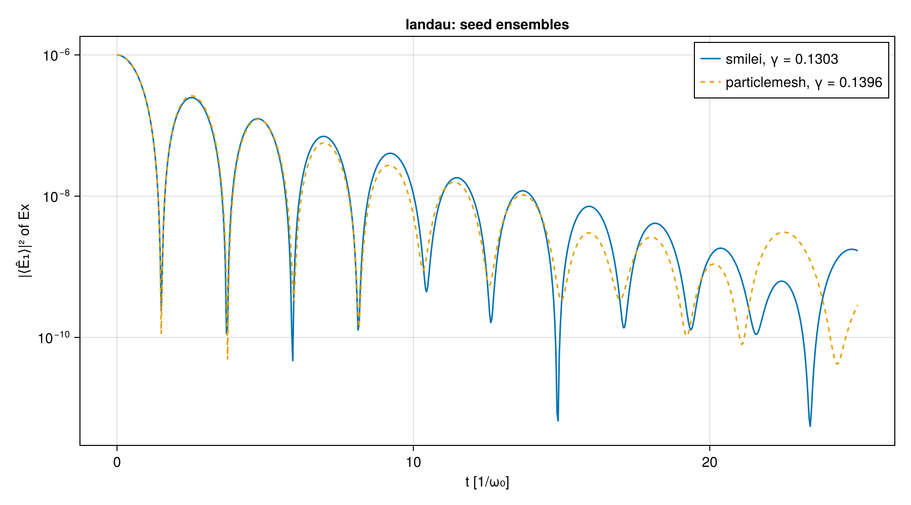
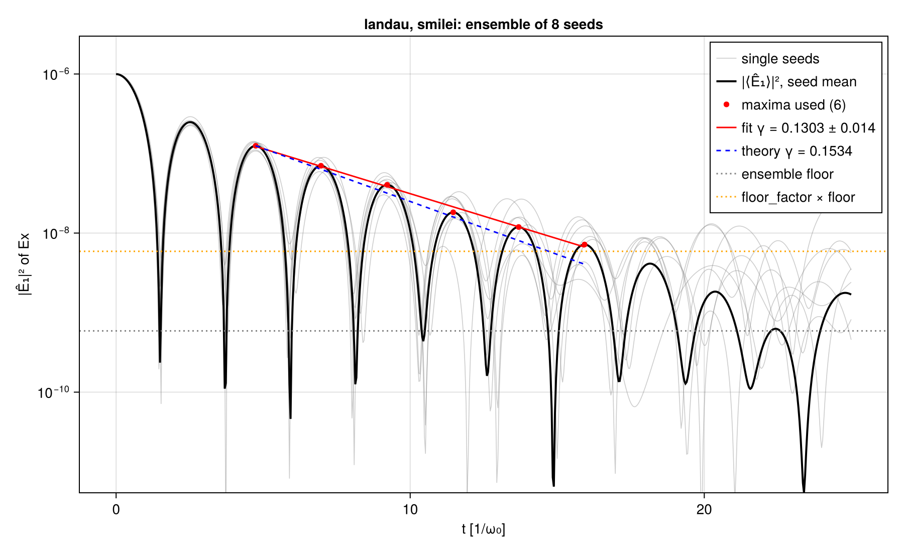
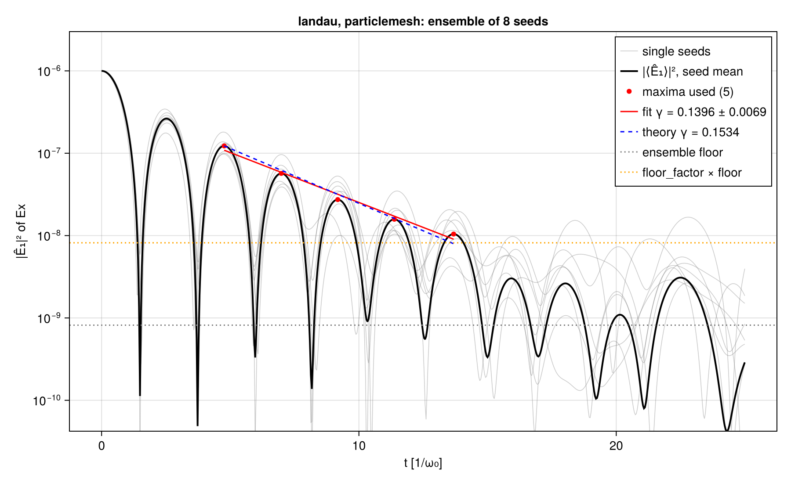
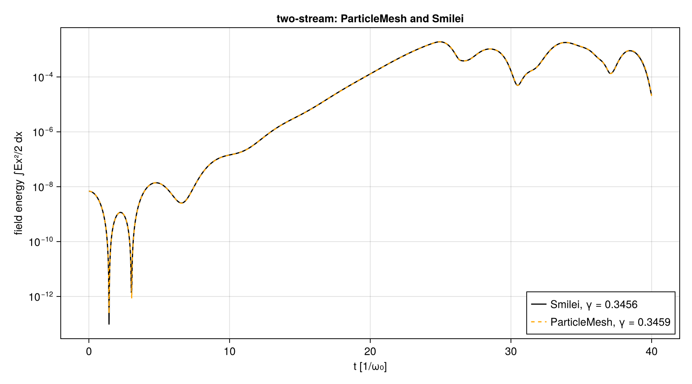
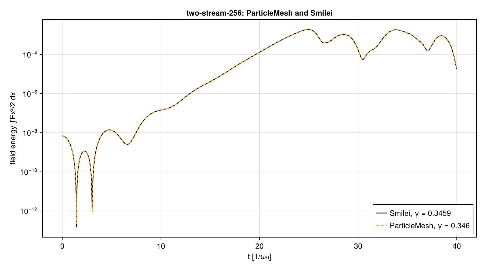

# Smilei and ParticleMesh on the 1D electrostatic cases (cross-code stages 1 and 1b)

| | |
|---|---|
| Work packages | WP-003 (goals A1, A5, A7), stage 1; WP-012 (goals A1, A4, A5, A7), stage 1b |
| Runs | `smilei-landau-d7d19f86` (reference Landau run), `smilei-two-stream-736a428f`, and `smilei-landau-9a47a107` (Landau at 1/8 of the particles, noise-limited, kept as a record) |
| Commits of the inputs | `4da64a34a0efeca0bd4ca7f77b3bc749e24e16a1` (two-stream, first Landau run); `ae2eb5a` on the results branch of PR #57, squashed on merge (reference Landau run); full ids in each run's `manifest.toml` |
| Case hashes (SHA-256) | `landau.toml` `d7d19f863edd3f1003b69e90000f1c8683075451eab0a730ba64d720d2803a0e` (reference run), `9a47a107b38cf142ae7f7a57c1c1d8440bc08a64987a56f7294ded5363e1eeaf` (first run); `two-stream.toml` `736a428fe67b795543c2c1380a73c94a115d4ec803fb81d59b0089293814a817` |
| Code | Smilei v5.1, commit `438d43d8ab727d02dd8f4402c50393343e871b99`, CPU build; image `localhost/particlemesh-smilei:e4f0148b8952fc87`, id `7030c120c62ce14dbae971cce76a3973f0a031ef63632a6c4bf4fa20e3937b4c`, from `scripts/crosscode/containers/smilei.Containerfile` |
| Hardware | Intel Core i9-14900K; OpenMP with one thread per patch (8 for Landau, 16 for two-stream), one MPI rank |
| Stage 1b runs | Smilei `smilei-landau-295ddf42` (8 seeds), `smilei-two-stream-736a428f` (rerun), `smilei-two-stream-256-56d5d9ae`; ParticleMesh `em1d-pm-landau-20261101T111127` (8 seeds), `em1d-pm-two-stream-20261101T110655`, `em1d-pm-two-stream-256-20261101T110809`; synthetic calibration `ensemble-bias-20261101T122122`; all in `stage-1b/` |
| Stage 1b commits and case hashes | Smilei runs prepared at `9d860489eccdbea8b771e1da7692b3a734ab2ef5` (clean), the commit that fixed the seeds and the ensemble observable before any run; ParticleMesh runs at `63795d233309156588e293dfb215ad370c119a5f`; the 128-cell manifest says clean, the Landau and 256-cell ones say dirty, because of an uncommitted edit of `trace/wp/WP-012-crosscode-stage1b-seeds.md` (committed next, in `c67c156`), which no run reads (every input the runs read is hashed in their manifests). Smilei analyses re-recorded at `4d11c1d` (clean), in each manifest's `[analysis]` table. `landau.toml` `295ddf422cb94ae059573be5cb4f1f5971f2b46bbf3502f62ec6e41ec8879de2`, `two-stream.toml` `736a428f…` (above), `two-stream-256.toml` `56d5d9ae1112bb3214922e279af980a202f0ab0607f8ffda9fb2141e541f3d91` |
| Stage 1b ParticleMesh | `scripts/em1d/crosscode.jl`: the electromagnetic module (`ParticleMeshElectromagnetic`), quadratic, Esirkepov, relativistic Boris, `Reference`, Float64, KernelAbstractions CPU backend, 16 threads, Julia 1.13.3 |
| Review | numerics-reviewer role (`.claude/agents/numerics-reviewer.md`), fresh subagent, model claude-opus-5-5, 2026-11-01, on the stage 1b numbers with the ParticleMesh column through the electromagnetic module; findings `review.md` (no blocking finding; one major, F1), answered in "Review findings and answers" |

This report records numbers; it sets no tolerance (A7: thresholds are proposed from measured spread, and the owner accepts them by editing the goals). Each run directory below holds the run's manifest (inputs, outputs and their hashes, image, hardware, observables), its namelist, the container's timing record, `observables.json`, and the standard plots with their JSON sidecars.

## Setup

Both cases are periodic, one-dimensional, with immobile ions (frozen in Smilei), quadratic shapes (Smilei `interpolation_order = 2`), no current filter, double precision, in the units of A1 with the total electron density 1 n_c, so ω_p = ω₀. Case files: `scripts/crosscode/cases/`; namelists generated by `scripts/crosscode/smilei.jl`.

| | Landau damping | Two-stream |
|---|---|---|
| Physics | Maxwellian, v_th = 0.05 c, kλ_D = 0.5, density perturbation 1 % | Two cold beams at ±0.1 c, 0.5 n_c each, density perturbation 0.1 %, k v₀ = √(3/8) ω_p |
| Box, cells | 2π/k = 0.6283 c/ω₀, 64 cells (Δx = 0.196 λ_D) | 2π/k = 1.0260 c/ω₀, 128 cells (Δx = 0.080 v₀/ω_p) |
| Δt, steps | 0.0093266 (0.95 Δx), 2681 steps to t = 25.0 | 0.0076151 (0.95 Δx), 5253 steps to t = 40.0 |
| Electrons per cell | 400 000 (reference run; 50 000 in the first run), regular positions, Maxwell–Jüttner momenta (seed 20261031) | 1 000 per beam, regular positions, cold |
| Electrons in total | 2.56 × 10⁷ (first run 3.2 × 10⁶) | 2.56 × 10⁵ |
| Wall time | 379 s (first run 51 s) on 8 threads | 10 s on 16 threads |
| Observable | damping rate γ of the field amplitude from the maxima of the Ex field energy, t ≥ 3, maxima above 10 × the noise floor (median of the last 20 % of the run) | growth rate γ from a fit of log of the Ex field energy where it lies between 10⁻³ and 3 × 10⁻² of its value at saturation |

The fit rules were fixed in the case files before any run. Two things were changed after the first runs, both recorded in the commit history: the Landau particle count (below), and the anchor of the growth window, which used the global maximum and now uses the first local maximum reaching 10 % of it. This is a post-hoc change to a fit rule, prompted by a run: the mode-amplitude fit of the two-stream run gave a negative rate with the old anchor. The second change does not alter the primary two-stream estimate (its global maximum is the first saturation); it repairs the second estimate from the mode amplitude, whose global maximum is a later nonlinear bounce.

## Linear theory

All rates are those of the field amplitude in units of ω_p; the field energy goes as e^{±2γt}. The values are computed by `scripts/crosscode/theory.jl` and checked by T-160.

**Landau damping.** For a Maxwellian electron plasma with immobile ions, the linearized Vlasov–Poisson system gives the dispersion relation D(ω, k) = 1 + (kλ_D)⁻² [1 + ζ Z(ζ)] = 0, ζ = ω/(√2 k v_th), with Z the plasma dispersion function (Fried and Conte, 1961), evaluated as Z(ζ) = i√π w(ζ) with the Faddeeva function w, which continues Z analytically to the lower half plane. The least-damped root at kλ_D = 0.5, found by Newton iteration from the Bohm–Gross frequency, is ω = 1.4156619 − 0.1533595 i, so **γ = 0.1533595 ω_p** and ω_r = 1.4156619 ω_p.

**Two-stream.** For two cold beams at ±v₀, each with half the density, and immobile ions, the cold-fluid dispersion relation is 1 = (ω_p²/2γ₀³)[(ω − kv₀)⁻² + (ω + kv₀)⁻²], where γ₀³ m is the longitudinal mass of a beam with Lorentz factor γ₀ = (1 − v₀²)^{−1/2}. With a = (kv₀)² and p = γ₀⁻³ it is the biquadratic (ω²)² − (2a + p)ω² + a² − pa = 0, whose smaller root ω² = a + p/2 − √(p² + 8ap)/2 is negative for a < p, giving γ = √(−ω²). At kv₀ = √(3/8) ω_p:

| | γ / ω_p |
|---|---|
| nonrelativistic (γ₀ = 1), the maximum over k, 1/(2√2) | 0.3535534 |
| with γ₀³, v₀ = 0.1 c (γ₀ = 1.0050378); the reference value | **0.3508758** |

Smilei pushes relativistically, so the case file takes the γ₀³ value as its reference and records the nonrelativistic one next to it.

## Results

Uncertainties are one standard error of the fitted slope, from the residuals; they do not include systematic effects.

| Case, run | Quantity | Measured | Theory | Relative difference |
|---|---|---|---|---|
| Landau, `smilei-landau-d7d19f86` | γ from the field-energy maxima (5 maxima, t = 4.75 to 13.76) | 0.1445 ± 0.0130 | 0.1533595 | −5.8 % |
| | γ from the mode-1 amplitude of Ex (same rule) | 0.1699 ± 0.0156 | 0.1533595 | +10.8 % |
| | ω_r from the spacing of the maxima used | 1.3937 | 1.4156619 | −1.6 % |
| Landau, `smilei-landau-9a47a107` (1/8 of the particles) | γ | none: one maximum above 10 × the noise floor | 0.1533595 | — |
| Two-stream, `smilei-two-stream-736a428f` | γ from the field energy (164 points, t = 13.80 to 18.76) | 0.34561 ± 0.00090 | 0.3508758 | −1.5 % (−2.2 % from the nonrelativistic 0.3535534) |
| | γ from the mode-1 amplitude of Ex (field dumps every 32 steps) | 0.3370 ± 0.0025 | 0.3508758 | −4.0 % |

Other recorded numbers, from the sidecars:

| | Landau (reference) | Landau (first) | Two-stream |
|---|---|---|---|
| Noise floor of the Ex field energy (median of the last 20 %) | 1.20 × 10⁻¹⁰ | 1.80 × 10⁻⁹ | — |
| Initial Ex field energy | 1.57 × 10⁻⁷ | 1.57 × 10⁻⁷ | 6.84 × 10⁻⁹ |
| Saturation (time, Ex field energy) | — | — | t = 24.95, 1.91 × 10⁻³ |
| Largest relative change of the total energy over the run | 3.5 × 10⁻⁷ | 3.3 × 10⁻⁷ | 1.0 × 10⁻³ |
| Initial kinetic energy (expected (3/2) n T L = 2.3562 × 10⁻³ for Landau) | 2.35596 × 10⁻³ | 2.35515 × 10⁻³ | 5.169 × 10⁻³ |

Two consistency checks of the setup: the initial mode-1 amplitude of Ex in the reference Landau run, 9.988 × 10⁻⁴, is the amplitude α/k = 10⁻³ of the loaded perturbation times sinc(π/64) = 0.9996 for the per-cell sampling to within 0.08 %, which checks the loading and Smilei's Poisson solve at t = 0; the initial kinetic energies match (3/2) n T L to 0.05 %.

Figures, per run directory (`smilei-landau-d7d19f86/`, `smilei-two-stream-736a428f/`, `smilei-landau-9a47a107/`), each with a JSON sidecar of the numbers it shows:

- `field-energy.png`: the Ex field energy on a log scale, the points used, the fit and the theory slope.

  
  

- `mode-amplitude.png`: the amplitude of Fourier mode 1 of Ex from the field dumps;
- `field-snapshots.png`: Ex(x) at five times;
- `energy-conservation.png`: the relative change of the total energy.

## Verification status

- T-010 (unit conversion), T-012 (reader on a synthetic file in Smilei's layout), T-013 (recipe pinned), T-160 (theory values), T-161 (fits recover known rates on synthetic signals, including a later nonlinear bounce) pass on the CPU: `julia +1.13 --project=scripts scripts/crosscode/test/runtests.jl`. CI does not run this file yet.
- The reader and the analysis ran on the Smilei output of all three runs; the figures above were inspected by eye before the numbers were recorded.
- Not verified: the position of Smilei's dual-grid points relative to the openPMD `position` attribute (it shifts the snapshots by half a cell at most and does not change mode amplitudes); an independent review of the stage 1 numbers, which they need before they leave the repository (the review in the header covers the numbers of stage 1b and the two-stream rerun).

## Known limitations

- Only positions are quiet: Smilei samples the Maxwell–Jüttner momenta randomly, so the Landau run has a thermal noise floor. With 2.56 × 10⁷ electrons the decay can be followed over about 2.8 e-foldings of the field energy (5 maxima); the statistical error of γ is about 9 %. Narrowing it takes more particles (the noise energy fell by 15 for 8 times the particles here), a quiet start in velocity (possible in Smilei through numpy arrays for positions and momenta), or several seeds (stage 1b, below).
- The field-energy maxima of a standing wave in noise sit on top of the noise: the last maxima used can be biased upward, which biases γ low. The bias of either estimate was not quantified, and the two estimates of the reference Landau run differ by about 1.2 times their combined standard error.
- Smilei samples the density profile at cell centres, so the loaded perturbation is piecewise constant per cell; its mode-1 amplitude is reduced by sinc(π/N), 0.04 % for the Landau grid and 0.01 % for the two-stream grid.
- The relativistic correction to the Landau root at T = 2.5 × 10⁻³ m_e c² is not computed.
- The (x, pₓ) phase space of the standard set needs Smilei's particle-binning diagnostic, which the reader does not cover yet; it is absent.
- Smilei is an electromagnetic code: in 1D the longitudinal field evolves by Ampère's law from the current after the Poisson solve at t = 0, so it is electrostatic only up to the charge conservation of its current deposition, which was not checked here.

## Stage 1b: Landau over seeds in both codes, two-stream as a resolution pair (WP-012)

Stage 1 left the Landau case without a usable comparison: at 50 000 electrons per cell neither code reached the pre-registered observable, and relaxed fits moved by 20 % with the fit choices (spike report, "Against Smilei"). Stage 1b averages over seeds instead, in both codes, with no engine change, and gives two-stream a ParticleMesh column and a second resolution. It records measurements; the proposals derived from them, and what stays pending, are in `questions/wp-012-a5-a7-proposals.md`.

### Setup

Fixed in commit `9d86048` before any run of this stage (`scripts/crosscode/cases/landau.toml`; the fit rules of stage 1 unchanged):

- **Seeds.** Eight, `20261101 + 1000 k` for k = 0 … 7, each Smilei's `random_seed` and ParticleMesh's Philox key of the velocity draws. Smilei seeds the generator of patch p with `random_seed + p` (`src/Patch/Patch.cpp`), so seeds closer than the 8 patches would share streams; T-181 checks the spacing. The count comes from the compute budget (eight seeds of 50 000 electrons per cell are the 2.56 × 10⁷ electrons of the stage 1 reference run), not from a measured per-seed spread, which did not exist before these runs.
- **Diagnostics.** Field dumps every 4 steps, the cadence of the scalars, because the ensemble observable is fitted on them.
- **Observable `damping_rate_ensemble`.** For each seed, the complex mode-1 coefficient Ê₁ = (2/N) Σⱼ Ex_j e^{−2πij/N} of the dumped Ex; the seed mean ⟨Ê₁⟩ keeps the coherent wave, while independent noise adds in energy, so its contribution to |⟨Ê₁⟩|² falls as 1/M (T-180). `damping_from_peaks` on |⟨Ê₁⟩|² with the stage 1 rule: maxima after t = 3 above 10 × the floor (the median of the last 20 % of the series), parabolic refinement, γ = −slope/2; the observable exists when at least three maxima are used. Standard error: the jackknife over seeds (the fit repeated with each seed left out). Per seed: γ of each seed's |Ê₁,s|² at the maxima the ensemble fit used; their mean and standard deviation per code, aggregated only when every seed's fit succeeds (T-183).
- **Two-stream.** Unchanged at 128 cells (`two-stream.toml`, rerun), and `two-stream-256.toml` with Δx and Δt halved and the same output cadence in time; T-185 checks that nothing else differs.

Smilei ran through the machine's runner in the stage 1 image, one job per case. ParticleMesh ran `scripts/em1d/crosscode.jl` on the CPU: the case files through the electromagnetic module (`problem_from_case` with each seed, `Reference()` mode, Float64, quadratic shape, Esirkepov current, relativistic Boris pusher, Ex from the charge at t = 0 and from Ampère's law after it), the 1D edge case. The thermal loading differs between the codes: ParticleMesh draws the thermal velocity along x only (u_y = u_z = 0), while Smilei loads an isotropic Maxwell–Jüttner distribution (a single `temperature`), so its electrons carry thermal transverse momenta; the effect on the longitudinal response is of order T = 2.5 × 10⁻³, far below the ensemble resolution. The fit code is `scripts/crosscode/analysis.jl` and `ensemble.jl` for both codes.

### Landau: the ensemble observable

Both codes yield the pre-registered observable.

| | Smilei | ParticleMesh |
|---|---|---|
| ensemble γ (ω_p), ± jackknife standard error | **0.1303 ± 0.0144** | **0.1396 ± 0.0069** |
| spread of the rule's γ on synthetic ensembles at the run's noise (post hoc, below; initial and modal amplitude) | 0.0124 to 0.0161 | 0.0122 to 0.0160 |
| maxima taken by the 8 leave-one-out fits | 6, 6, 5, 5, 6, 6, 6, 5 | 5 in every one |
| standard error of the fit's residuals (recorded, not used) | 0.0049 | 0.0105 |
| maxima used, fit range (1/ω₀) | 6, t = 4.75 to 15.93 | 5, t = 4.77 to 13.68 |
| relative to theory 0.15336 | −15.1 % | −9.0 % |
| ω_r from the spacing of the maxima (theory 1.41566) | 1.4046 (−0.78 %) | 1.4096 (−0.43 %) |
| ensemble floor of \|⟨Ê₁⟩\|² (median of t ≥ 20) | 5.9 × 10⁻¹⁰ | 8.2 × 10⁻¹⁰ |
| \|Ê₁(0)\|² | 9.976 × 10⁻⁷ | 9.984 × 10⁻⁷ |

Uncertainties are one jackknife standard error over the 8 seeds. The ParticleMesh value is probably an underestimate: its leave-one-out fits all stop at the same maximum, so the jackknife misses the variation of the stop rule that it picks up for Smilei; on synthetic ensembles at that noise about 6 % of jackknife errors are that small (`review.md`, "Verified as correct"). The synthetic spread, 0.012 to 0.016 for both codes depending on the amplitude model (below), is the better single number for either.

**Per seed.** γ of each seed's |Ê₁,s|² at the ensemble's maxima (`per-seed-rates.png` in each run directory):

| seed | 20261101 | 20262101 | 20263101 | 20264101 | 20265101 | 20266101 | 20267101 | 20268101 | mean ± std |
|---|---|---|---|---|---|---|---|---|---|
| Smilei | 0.1035 | 0.1651 | 0.1221 | 0.1235 | 0.1472 | 0.1664 | 0.1004 | 0.1081 | 0.1296 ± 0.0268 |
| ParticleMesh | 0.1228 | 0.1725 | 0.1186 | 0.1197 | 0.1690 | 0.1325 | 0.1248 | 0.1382 | 0.1373 ± 0.0217 |

The single-run rule of stage 1, applied to each seed on its own, fails, and the aggregation refuses it as T-183 requires: on the field energy of Ex no seed of either code has more than two maxima above 10 × its floor after t = 3; on |Ê₁,s|², two seeds of each code have fewer than three (Smilei 20265101 and 20267101, ParticleMesh 20265101 and 20266101).

**Noise floor and the difference between the codes.** Smilei's seed-to-seed spread of γ at 50 000 electrons per cell is **0.027**: the scatter of single seeds fitted at the ensemble's maxima, which share the ensemble's stop, so it does not carry the ensemble error by 1/√M (0.027/√8 = 0.0095 lies below the ensemble's own errors). Its ensemble standard error is 0.014. ParticleMesh minus Smilei is +0.0093 (+7.1 %): **0.35** Smilei seed spreads, 0.65 Smilei ensemble standard errors, 0.58 combined jackknife standard errors, 0.41 to 0.54 combined synthetic spreads. This is a measurement, not a threshold: A7 bases the agreement thresholds on the Smilei–PIConGPU spread, which stage 2 measures.

**What the rule itself does at this noise (post hoc, a sensitivity).** `scripts/crosscode/ensemble_bias.jl` builds 400 synthetic ensembles per code and amplitude model with the theory's γ and ω_r, the same time grid and seed count, and per-seed noise from the measured scatter, and applies the same rule (`stage-1b/ensemble-bias-20261101T123655/`, `bias.png` with its sidecar). Two amplitude models: the run's |Ê₁(0)|, which puts all of the initial perturbation into the damped mode, and the modal amplitude, the first maximum the run's fit used extrapolated back with the theory's γ (about 0.73 of |Ê₁(0)|; the non-modal response has phase-mixed away by t = 3). The noise model is narrowband (as in T-180) and stationary, which the runs' noise is not (below). Each run and model draws its own random numbers:

| | Smilei, initial | Smilei, modal | ParticleMesh, initial | ParticleMesh, modal |
|---|---|---|---|---|
| mean bias of the rule | −1.33 % ± 0.40 % | −2.45 % ± 0.53 % | −1.25 % ± 0.40 % | −2.76 % ± 0.52 % |
| spread of the fitted γ | 0.0124 | 0.0161 | 0.0122 | 0.0160 |
| mean jackknife standard error; fraction of fits within one | 0.0142; 0.69 | 0.0192; 0.69 | 0.0137; 0.72 | 0.0188; 0.71 |
| measured γ from theory, in units of that spread | −1.87 | −1.43 | −1.14 | −0.86 |

The modal amplitude is the closer model of the runs, so the larger numbers are the likelier: a rule bias of about −2.5 % and a spread of about 0.016. Either way the bias is small next to the spread, and the jackknife covers as a standard error should (69 % to 72 % at one standard error, 68 % expected; 92 % to 93 % at two, `review.md`). One of the 1600 synthetic fits failed (fewer than three maxima).

**Against the theory.** Each code alone lies within two synthetic spreads of the theory. The two ensembles are independent, though, and both lie below it: pooled with the synthetic spreads they give 0.1350 ± 0.0087 to 0.1350 ± 0.0114, 2.1 to 1.6 spreads below 0.1534 (1.9 to 1.3 after removing the rule's bias of the same model; 2.5 with the jackknife errors as reported). That hints at a systematic common to both codes which this stage does not quantify (#167). Candidates, none computed: finite-grid and quadratic-shape effects at Δx = 0.196 λ_D, the onset of trapping (ω_b/γ = 0.65 at t = 0, below), the part of the rule's bias that the synthetic model misses, the relativistic correction at T = 2.5 × 10⁻³ m_e c², which both codes include in their pushers while the theory does not, and the different thermal loading of the two codes (Setup).

**Noise from the seeds' scatter (post hoc).** The variance of the seed mean, Σₛ |Ê₁,s − ⟨Ê₁⟩|² / (M(M−1)), measures the noise without the coherent signal (T-187). After t = 3 it is 3.1 × 10⁻¹⁰ (Smilei) and 2.9 × 10⁻¹⁰ (ParticleMesh); over the floor window (t ≥ 20), 4.2 × 10⁻¹⁰ and 2.4 × 10⁻¹⁰. The pre-registered floor is 2.0 (Smilei) and 4.9 (ParticleMesh) times its noise-only expectation ln 2 × that variance: the last 20 % of the run still holds coherent signal, so the floor overstates the noise and the rule stops earlier than the noise alone would require. The noise is not stationary, and not in the same way: per seed, Smilei's grows from 2.5 × 10⁻⁹ (average after t = 3) to 3.4 × 10⁻⁹ (t ≥ 20), ParticleMesh's falls from 2.3 × 10⁻⁹ to 1.9 × 10⁻⁹ (#169). It matters because the floor sets where the stop rule cuts. The signal-to-noise ratio |⟨Ê₁⟩|² over the variance of the mean is 39 (Smilei) and 40 (ParticleMesh) at the last maximum used.

**Bounce frequency.** For the wave's field amplitude E₁ the trapping frequency is ω_b = √(k E₁) in the units of A1 (q/m = 1). With |Ê₁(0)| = 9.988 × 10⁻⁴ (Smilei) and 9.992 × 10⁻⁴ (ParticleMesh) and k = 10, ω_b(0) = 0.0999 ω_p, the estimate √α ω_p = 0.1 of the package, and 0.65 γ; at the first maximum used (t ≈ 4.75, |⟨Ê₁⟩| = 3.5 × 10⁻⁴) it is 0.059 ω_p, 0.39 γ. Two further points make the check conservative: a standing wave is two travelling waves of amplitude E₁/2, which lowers the trapping frequency by √2, and with ω_b ∝ e^{−γt/2} the bounce phase accumulated over the whole run is at most 2ω_b(0)/γ ≈ 1.3 rad. The run therefore stays short of one bounce period (2π), although ω_b/γ = 0.65 at t = 0 is not small; at α = 1/20 ω_b would start at 0.22 ω_p, 1.46 γ.

### Two-stream: the ParticleMesh column and the resolution pair

Both codes push relativistically, so both compare with the γ₀³ value of the theory.

| | cells | γ (ω_p) | points, window (1/ω₀) | vs theory 0.35088 | γ from \|Ê₁\|², 20 points |
|---|---|---|---|---|---|
| Smilei | 128 | 0.34561 ± 0.00090 | 164, 13.80 to 18.76 | −1.50 % | 0.33699 ± 0.0025 |
| Smilei | 256 | 0.34593 ± 0.00090 | 163, 13.83 to 18.76 | −1.41 % | 0.33703 ± 0.0025 |
| ParticleMesh | 128 | 0.34590 ± 0.00090 | 164, 13.83 to 18.79 | −1.42 % | 0.33694 ± 0.0025 |
| ParticleMesh | 256 | 0.34599 ± 0.00090 | 164, 13.83 to 18.79 | −1.39 % | 0.33701 ± 0.0025 |

Standard errors are those of the fitted slope's residuals over about 160 correlated points, not a noise measurement; the window's systematic, several per cent (below), dominates them. The case is cold with regular positions in both codes, so no seed enters by construction (not measured with a second seed); the rerun of `smilei-two-stream-736a428f` reproduced stage 1's γ to all digits (its output files differ in their hashes).

ParticleMesh minus Smilei is +0.08 % at 128 cells and +0.02 % at 256 cells, a third and a fourteenth of the fit's residual error. Halving Δx and Δt changes γ by +0.09 % in Smilei and +0.02 % in ParticleMesh, while both codes stay 1.4 % to 1.5 % below the theory, so the common offset does not come from the resolution. The review's post-hoc check (`review.md`, "Verified as correct") points to the fit window: the local growth rate relative to theory is a decaying oscillation, the same in both codes and at both resolutions, within 0.5 % of theory over t = 16 to 18, and neighbouring windows of the same rule move γ by several per cent. That reads as a transient of the other roots, excited by the initial perturbation and sampled by the window, common to the case; this stage did not test it with a script of its own (#168). The mode-amplitude estimate now records its point count and is refused below five points (T-186); here it uses 20, and lies 2.5 % to 2.6 % below the field-energy estimate in both codes alike, also unexamined (#168).

### Cost

Not a performance comparison (the Smilei configuration was not matched to ParticleMesh's thread count, and neither code was tuned). Wall times from each run's records, Intel Core i9-14900K:

| | particles | steps | particle-steps per seed | wall per seed | ns per particle-step |
|---|---|---|---|---|---|
| Smilei Landau, 8 threads | 3.2 × 10⁶ per seed | 2681 | 8.58 × 10⁹ | 79 to 96 s (684 s for the 8 seeds) | 9.2 to 11.2 |
| ParticleMesh Landau, 16 threads | 3.2 × 10⁶ per seed | 2681 | 8.58 × 10⁹ | 512 to 528 s (4138 s for the 8 seeds) | 59.6 to 61.5 |
| Smilei two-stream, 128 / 256 cells (16 / 32 threads) | 2.56 / 5.12 × 10⁵ | 5253 / 10505 | | 17 s / 48 s | |
| ParticleMesh two-stream, 128 / 256 cells, 16 threads | 2.56 / 5.12 × 10⁵ | 5253 / 10505 | | 62 s / 186 s | 46 / 35 |

The Smilei Landau ensemble took 684 s, 1.8 times the 379 s of the stage 1 reference run with the same number of particle-steps (5.5 ns per particle-step then, 9.2 to 11.2 ns now); the cause was not measured. The ParticleMesh Landau seeds ran at the 60 ns per particle-step the package's budget expected from the module's single run (64 ns); other sessions loaded the machine (load average about 5).

### Verification status (stage 1b)

- `julia +1.13 --project=scripts scripts/crosscode/test/runtests.jl` passes on the CPU: T-010 to T-161 as before, T-180 (the ensemble fit on synthetic multi-seed signals: jackknife coverage, also on the runs' time grid and noise, and the floor falling as 1/M where the floor window holds noise only), T-181 (one namelist per seed, identical apart from the seed line), T-182 (through the module, a seed gives a bitwise identical ParticleMesh load and identical observables on rerun; other seeds draw other velocities), T-183 (aggregation and refusal), T-184 (bare image id in the manifest), T-185 (the resolution pair), T-186 (fits on too few points refused), T-187 (the noise of the mean from the seeds' scatter), T-188 (the ParticleMesh mode fit on the field cadence); the module's own suite passes with T-214's seed pinned to that of its recorded measurement.
- The figures above and the per-seed plots of the first seed were inspected before the numbers were recorded.
- Independent review: header row "Review", findings in `review.md`, answered below.

### Known limitations (stage 1b)

- Eight seeds give a standard error of about 0.012 to 0.016 on γ (synthetic spread by amplitude model; the jackknife of one run is itself noisy, 0.007 and 0.014 here); the two codes' Landau rates agree within it, and one combined standard error of their difference is 0.017 to 0.023, 13 % to 17 % of γ, so this stage cannot resolve a code difference below that.
- The floor window still holds coherent signal (above), so the floor of the rule is not a pure noise measurement; the seed scatter is.
- Independence of the seeds rests on how they were made (spacing beyond Smilei's patch count; distinct Philox keys), not on a statistic. A normalized correlation of the seeds' mode-1 series was tried and dropped: over a window of a few wave periods two independent narrowband signals at the same frequency correlate near 1 in that measure.
- The synthetic calibration uses a narrowband, stationary noise model and a pure damped mode (of the initial or of the modal amplitude), not the PIC noise and signal themselves.
- Issue #145 describes two behaviours of the peak-envelope rule on noisy signals: a maximum split by noise biases the frequency, and the stop rule ends the fit early. Neither ensemble fit has a split maximum (spacings of the maxima used: 2.22 to 2.25 in Smilei, 2.19 to 2.30 in ParticleMesh, against π/ω_r = 2.22), so the recorded frequencies are not affected that way.
- The relativistic correction to the Landau root at T = 2.5 × 10⁻³ m_e c² is not computed.

### Review findings and answers

| Finding | Answer |
|---|---|
| F1 (major), the calibration overstates the signal | Fixed: `ensemble_bias.jl` runs two amplitude models side by side, the initial amplitude and the modal one (the first maximum used, extrapolated back with the theory's γ), with independent draws per run and model (`ensemble-bias-20261101T123655`). The report quotes the spread as 0.012 to 0.016 and the bias as −1.3 % to −2.8 % by model. It restates the pooled deficit as 1.6 to 2.1 spreads (1.3 to 1.9 after the bias), and the code-difference resolution as 13 % to 17 % at one combined standard error. Calibrations at the noise of the deleted electrostatic run are no longer quoted. The proposals and the T-214 entry carry the same ranges, and T-180's run-grid case says it checks coverage at about twice the runs' signal-to-noise ratio. |
| F2, citations of the replaced review | Fixed: the sentences point at this review's "Verified as correct" items; coverage at two standard errors is 92 % to 93 %. |
| F3, "a tenth of the residual error" | Fixed: a third (128 cells) and a fourteenth (256 cells). |
| F4, thermal loading differs | Fixed: the setup states it (ParticleMesh thermal along x only, Smilei isotropic Maxwell–Jüttner); it is listed among the candidates of the common deficit. |
| F5, other consumers of `landau.toml` draw with seed 1 | Follow-up issue #183 (a module source change is outside WP-012); the PR description states it. |
| F6, the calibration manifest does not bind its input sidecars | Fixed: its `[inputs]` hash each run's `observables.json` and `ensemble-series.json`. |
| F7, per-seed spread and seed-count arithmetic | Fixed: the per-seed spread is described as a single seed's scatter at the ensemble's maxima that does not carry the ensemble error by 1/√M; the "four times the seeds" estimate is marked as assuming 1/√M. |
| F8, header row and placeholder | Fixed. |
| Not verified: Smilei's per-patch seeding | The line is `rand_ = new Random( params.random_seed + hindex )` in `src/Patch/Patch.cpp` of Smilei v5.1, read by the implementer in a checkout of the Smilei source on this machine. |
| Not verified: a full-length thread-count check | Not done; the bitwise rerun of the full ParticleMesh Landau ensemble was at the same thread count (16), and the review checked a 214-step prefix at 3 and 16 threads. |
