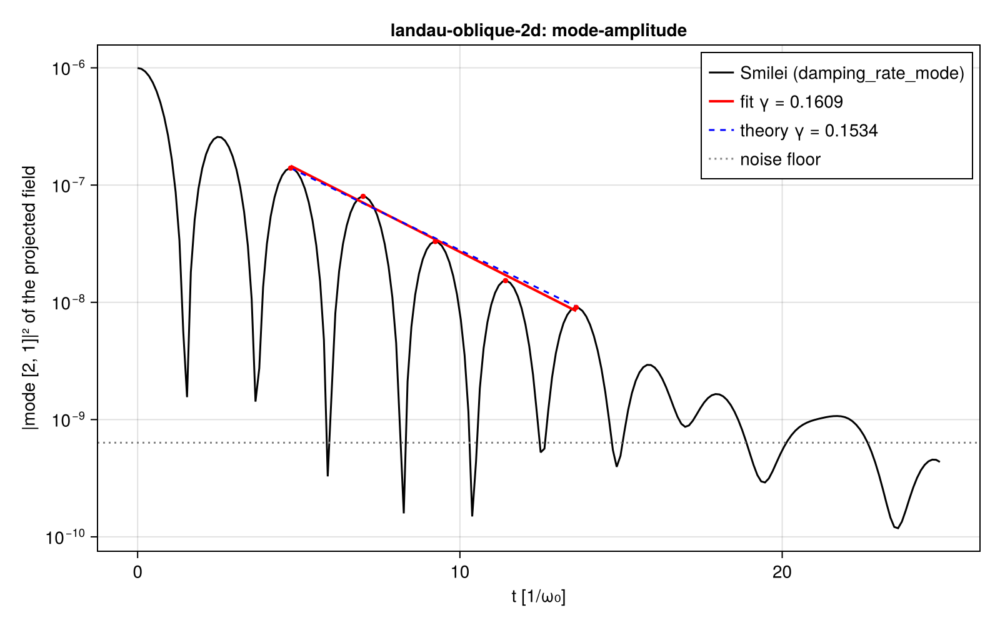
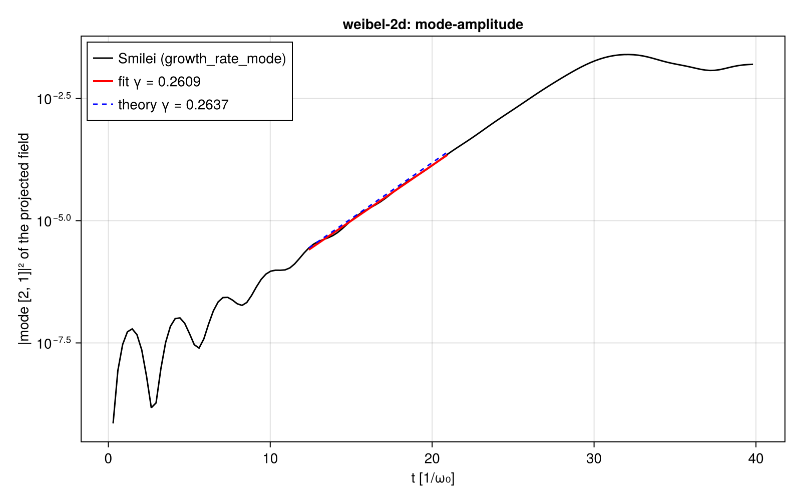
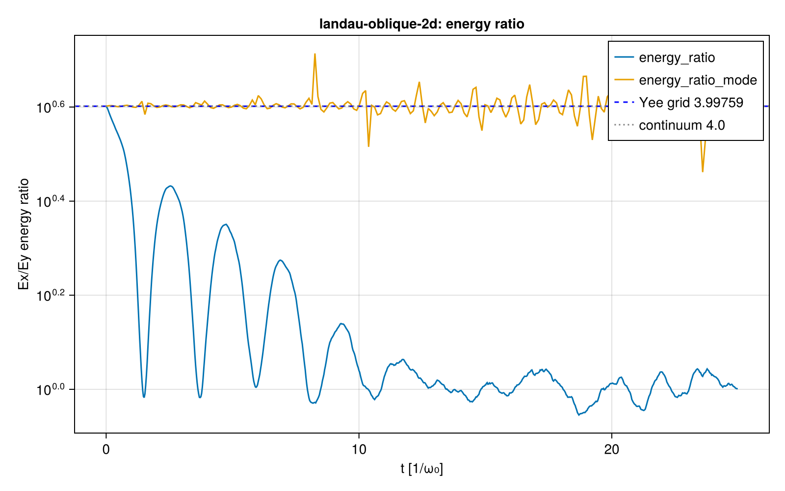

# Smilei on the 2D case core (oblique Landau damping, 2D Weibel)

| | |
|---|---|
| Work package | WP-019 (goals A1, A5, A6, A7) |
| Runs | `smilei-landau-oblique-2d-c8709f77`, `smilei-weibel-2d-dca1230a` |
| Commit of the inputs | `310c2ee63b0c56d0c661091d878878e7767fa8b2` (clean tree, recorded in each `manifest.toml`); the case files and their observables were fixed in that commit, before the runs |
| Case hashes (SHA-256) | `landau-oblique-2d.toml` `c8709f77…` and `weibel-2d.toml` `dca1230a…`; full hashes in each run's `manifest.toml` under `inputs` |
| Code | Smilei v5.1, commit `438d43d8ab727d02dd8f4402c50393343e871b99`, CPU build; image `localhost/particlemesh-smilei:e4f0148b8952fc87`, id `7030c120c62ce14dbae971cce76a3973f0a031ef63632a6c4bf4fa20e3937b4c`, from `scripts/crosscode/containers/smilei.Containerfile` (unchanged since WP-003) |
| Hardware | Intel Core i9-14900K; OpenMP with one thread per patch (4 × 4 patches, 16 threads), one MPI rank |
| Analysis | `scripts/crosscode/analyze.jl` (`analyze_2d`), from the commit after `310c2ee`, which adds the loading checks and the labelled sensitivity below; the pre-registered observables are evaluated as in `310c2ee` |
| Review | numerics-reviewer (`.claude/agents/numerics-reviewer.md`), fresh subagent; findings and answers in `review.md` |

This report records numbers and sets no tolerance (A7). The expected values it measures are proposals for the owner to accept in A5 (`questions/wp-019-a5-2d-proposals.md`). Each run directory holds the run's manifest, namelist, `container.txt` (timing record), `observables.json`, and the standard plots with their JSON sidecars.

## Setup

Both cases are 2D periodic, `2Dcartesian`, in the units of A1 with the total electron density 1 n_c, so ω_p = ω₀. Case files: `scripts/crosscode/cases/`, schema 2 (`scripts/crosscode/README.md`); namelists from `scripts/crosscode/smilei.jl`.

Matching settings, the A5 list:

| Setting | Both cases |
|---|---|
| Shape order | 2 (Smilei `interpolation_order = 2`) |
| Current deposition | Esirkepov (Smilei's `Projector2D2Order`, by its source) |
| Filtering | none |
| Precision | FP64 |
| Time step | 0.95 of the 2D Courant limit 1/√(1/Δx² + 1/Δy²) |
| Particle loading | regular lattice per cell (`regular_number` per axis), density profile sampled at cell centres |
| Ions | immobile (frozen for twice the run), 1 per cell |

| | Oblique Landau damping | 2D Weibel |
|---|---|---|
| Physics | Maxwellian, v_th = 0.05 c, \|k\|λ_D = 0.5, density perturbation 1 % | two cold beams at ±0.3 c along z, 0.5 n_c each, opposite density perturbations 0.1 %, \|k\| = 2 ω_p/c |
| Mode, angle | [2, 1], atan(1/2) = 26.57° | [2, 1], 26.57° |
| Box, cells | 1.40496 × 1.40496 c/ω₀, 128 × 128 (Δ = 0.2195 λ_D) | 7.02481 × 7.02481 c/ω₀, 256 × 256 (Δ = 0.02744 c/ω₀) |
| Δt, steps | 0.0073733, 3391 to t = 25.003 | 0.0184333, 2170 to t = 40.000 |
| Particles per cell | 32 × 32 electrons (Maxwell–Jüttner momenta, seed 20261031) | 8 × 8 per beam, cold |
| Electrons in total | 1.68 × 10⁷ | 8.39 × 10⁶ |
| Field dumps | Ex, Ey, Rho every 16 steps | Bx, By, Rho every 16 steps |

The Smilei-specific choices, verified in the v5.1 source, are listed in `scripts/crosscode/README.md` ("Smilei specifics", the 2D part): the profile passed as a numpy function of (x, y), the patch rule per axis, `regular_number`, `mean_velocity` for a cold drift, the initial Poisson solve and the constant Smilei adds after it, the per-component energy scalars, and the 2D dump layout.

## Linear theory

Rates are those of the field amplitude in units of ω_p; energies go as e^{±2γt}. Values from `scripts/crosscode/theory.jl`, checked by T-273.

**Oblique Landau damping.** For an isotropic Maxwellian the dispersion relation depends on |k| only, so the root at |k|λ_D = 0.5 is that of `landau.toml`: ω = 1.4156619 − 0.1533595 i, **γ = 0.1533595**, ω_r = 1.4156619.

**2D Weibel.** The cold-fluid relation for k ⊥ v₀ is derived in the header of `theory.jl`: X² − A X − B = 0 with X = ω², A = k² + ω_p²/γ₀³, B = ω_p² v₀² k²/γ₀, γ = √(−X₋). At |k| = 2, v₀ = 0.3 (γ₀ = 1.0482848): **γ = 0.2637255**. A rotation about k maps the 1D Weibel case of WP-014 onto this one, and T-273 checks that the two relations agree at every |k|, v₀ and ω_p. The relation is unverified against the literature.

**Ex/Ey energy ratio of the oblique Landau wave.** E = −∇φ by the Yee differences gives Ex ∝ (2/Δx) sin(k_xΔx/2) and Ey ∝ (2/Δy) sin(k_yΔy/2), so the ratio is (sin(k_xΔx/2)/Δx)² / (sin(k_yΔy/2)/Δy)² = **3.9975909** at this resolution, against (k_x/k_y)² = 4 in the continuum.

## Results

Uncertainties are one standard error of the fitted slope, from the residuals; they do not include systematic effects. All four rate and ratio observables were pre-registered in `310c2ee`.

| Case, observable | Method | Measured | Theory | Relative difference |
|---|---|---|---|---|
| Landau, `damping_rate_mode`: E·k̂ of mode [2, 1] from the dumps | maxima of \|E·k̂\|², t ≥ 3, above 10 × floor (5 maxima, t = 4.75 to 13.61) | **0.1609 ± 0.0078** | 0.1533595 | +4.9 % (1.0 standard error) |
| | frequency from the spacing of those maxima | 1.4184 | 1.4156619 | +0.2 % |
| Landau, `damping_rate_energy`: Uelm_Ex + Uelm_Ey | same rule | none: fewer than three maxima above 10 × the floor (3.97 × 10⁻⁸; initial energy 5.04 × 10⁻⁷) | 0.1533595 | — |
| Landau, `energy_ratio`: Uelm_Ex / Uelm_Ey | at t = 0 | 3.98629 | 3.99759 (Yee), 4 (continuum) | −0.28 % (Yee) |
| Landau, `energy_ratio_mode`: \|Êx\|² / \|Êy\|² of mode [2, 1] | median at the 5 fitted maxima | 3.9450 | 3.99759 | −1.3 % |
| Weibel, `growth_rate_mode`: B·ê, ê = ẑ × k̂, of mode [2, 1] | log-linear fit where \|B·ê\|² lies between 10⁻⁴ and 10⁻² of its saturation value (30 outputs, t = 12.39 to 20.94; saturation t = 32.15) | **0.2609 ± 0.0019** | 0.2637255 | −1.1 % (1.5 standard errors) |
| Weibel, `growth_rate_energy`: Uelm_Bx_m + Uelm_By_m | same rule (121 points, t = 12.31 to 21.16; saturation t = 32.00) | 0.2611 ± 0.0009 | 0.2637255 | −1.0 % (2.9 standard errors) |

The Landau field-energy fit was expected to fail: the case file states before the run that the sum over all 128² modes reaches its noise floor within a few maxima. The projected mode reaches the same number of usable maxima as the 1D reference run of WP-003 (5), with a comparable standard error (4.9 % here, 9 % there), as expected from a single-mode noise level set by the total electron count.

**The Ex/Ey ratio and Smilei's constant field.** At t = 0 the box mean of Ey is 1.68 × 10⁻⁵, 3.6 % of the Ey amplitude, and that of Ex is 1.6 × 10⁻⁶ (`field-snapshots.json`, `box_mean_at_first_output`). Smilei adds this uniform field after its Poisson solve (`scripts/crosscode/README.md`). It adds energy to Uelm_Ey and lowers the ratio. A labelled post-hoc sensitivity, not a pre-registered observable: with the box mean of each field removed, the t = 0 ratio is 3.9975909124103444 (`manifest.toml`, `checks`), the Yee value to roundoff. So Smilei's initial field is the Yee-grid solution, and the pre-registered −0.28 % is the uniform field alone. The Yee value differs from the continuum one by 0.06 %, which the pre-registered ratio does not resolve because of the offset and the sensitivity resolves exactly. After t ≈ 10 the scalar ratio falls to about 1, as isotropic noise takes over the field energy, while the mode-coefficient ratio stays near the Yee value (`energy-ratio.png`). The uniform field is a k = 0 plasma oscillation that the case's initial condition does not contain; it does not project on k.

Loading checks at t = 0 (`manifest.toml`, `checks`):

| | Landau | Weibel |
|---|---|---|
| Box mean of Rho | −3.0 × 10⁻¹⁶ | 2.6 × 10⁻¹⁷ |
| Largest deviation of Rho from its mean | 9.980 × 10⁻³ | 5.1 × 10⁻¹⁴ |
| Amplitude of Rho in mode [2, 1] | 9.980 × 10⁻³ (α n₀ = 10⁻²; the factor 0.9980 from cell-centre sampling and the shape was not derived) | 1.4 × 10⁻¹⁶ (opposite-phase beams: uniform net charge) |
| Initial kinetic energy | 7.4034 × 10⁻³ (nonrelativistic (3/2) n T L² = 7.4022 × 10⁻³) | 2.38276 (expected (γ₀ − 1) n₀ L² = 2.38276) |
| Largest relative change of the total energy | 1.3 × 10⁻⁶ | 2.9 × 10⁻³ (nonlinear stage) |

## Cost

| | Landau | Weibel |
|---|---|---|
| Wall time (container `start` to `end`) | 716 s on 16 threads | 228 s on 16 threads |
| Particles (mobile) | 1.68 × 10⁷ | 8.39 × 10⁶ |
| Particle-steps (mobile) | 5.69 × 10¹⁰ | 1.82 × 10¹⁰ |
| Wall time per mobile particle-step | 12.6 ns at 16 threads | 12.5 ns at 16 threads |

WP-019 budgets each run within the cost of WP-003's 1D Landau reference run (2.56 × 10⁷ electrons, 6.86 × 10¹⁰ particle-steps, 379 s on 8 threads). The cases were sized in particle-steps before the runs, and both stay below that. In CPU time the Landau run is 11 500 thread-seconds against 3 030: a 2D particle-step costs Smilei about 4.6 times a 1D one (201 against 44 thread-ns), which was not known when the cases were sized. Smilei's own log reports a push time of about 195 ns per particle per core.

## Figures

Per run directory, each with a JSON sidecar of the numbers it shows:

- `mode-amplitude.png`: the squared mode coefficient of the projected field, the points used, the fit and the theory slope.

  
  

- `field-energy.png`: the summed field-energy scalars on a log scale.
- `energy-ratio.png` (Landau): Uelm_Ex/Uelm_Ey and the mode-coefficient ratio, with the Yee and continuum values.

  

- `field-snapshots.png`: the first projected component (Ex, Bx) at four times; the oblique [2, 1] pattern shows the axes are not swapped.
- `energy-conservation.png`: the relative change of the total energy.

## Verification status

- T-270 to T-275 (schema 2 and schema 1 kept, the 2D unit conversion and namelist, the oblique profile, the 2D theory, the 2D mode fit on synthetic fields, the 2D reader), with T-010, T-012, T-013, T-160 and T-161, pass on the CPU: `julia +1.13 --project=scripts scripts/crosscode/test/runtests.jl`.
- The reader and the analysis ran on both runs' output; the figures were inspected before the numbers were recorded.
- Not verified: the 2D Weibel relation against the literature; the relativistic correction to the Landau root at T = 2.5 × 10⁻³ m_e c²; why Smilei's corner correction does not vanish here: a minimal run reproduces it and attributes the Ey offset to one of the two corner values alone (issue #157, inferred from the numbers, not traced in the source).

## Known limitations

- One run per case, one seed: the Landau standard error is statistical within one realization of the thermal noise, and the spread over seeds is not measured (WP-017 runs the seed ensemble in both codes).
- The peak-envelope rule can count one noise-split maximum twice, which leaves the rate but shortens one spacing and biases the frequency; it also stops at the first maximum larger than its predecessor. Both are described in issue #145. The Landau fit here used 5 maxima, with spacings between 2.18 and 2.25 (no split maximum).
- The uniform field Smilei adds at t = 0 is in every Smilei field-energy scalar of these cases; a comparison of total field energies with a code that does not add it has to remove the box mean first.
- The Weibel energy fit includes every in-plane mode; it agrees with the mode fit here, so the faster modes at larger |k| did not overtake the seeded one before saturation.
