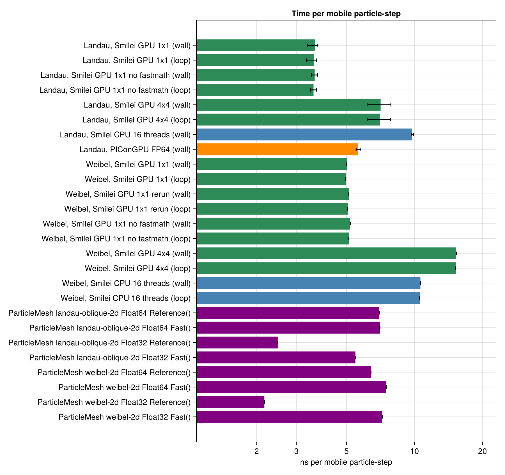

# Smilei on the GPU: the smilei-gpu build against the CPU reference (WP-030)

| | |
|---|---|
| Work package | WP-030 (goals A5, A6, A7) |
| Runs | GPU (`smilei-gpu` image): `smilei-gpu-landau-oblique-2d-p1x1-431f4192` (32 seeds, one patch, the guide's fastmath binary), `smilei-gpu-landau-oblique-2d-p1x1-nofastmath-s8-431f4192` (the first 8 seeds, without fastmath), `smilei-gpu-landau-oblique-2d-p4x4-s8-431f4192` (the first 8 seeds at the CPU's 4 × 4 layout), `smilei-gpu-weibel-2d-p1x1-dca1230a`, `-p1x1-rerun-`, `-p1x1-nofastmath-`, `-p4x4-dca1230a`, and the load checks `smilei-gpu-loadcheck-landau-oblique-2d-p1x1-431f4192`, `-p1x1-nofastmath-`, `-p4x4-431f4192`. CPU (`smilei` image): `smilei-weibel-2d-dca1230a` (a rerun of WP-019's), `smilei-weibel-2d-p8x2-dca1230a`, the load checks `smilei-loadcheck-landau-oblique-2d-p4x4-431f4192` and `-p1x1-431f4192`. References already committed: WP-025's 32-seed ensembles `reports/crosscode-picongpu/smilei-landau-oblique-2d-431f4192` (Smilei CPU) and `picongpu-landau-oblique-2d-fp64-431f4192` (PIConGPU FP64). ParticleMesh: `em2d-timing-cuda-20261103T152950` |
| Commits of the inputs | Every Smilei run prepared from a clean tree, the commit in each `manifest.toml`; the GPU runs' jobs name `HEAD` in the runner log (`b69aca3` and later) |
| Case hashes (SHA-256, first 8 hex) | `landau-oblique-2d.toml` `431f4192` (WP-025's 32 seeds), `weibel-2d.toml` `dca1230a` (WP-019's) |
| Smilei GPU | v5.1, commit `438d43d8ab727d02dd8f4402c50393343e871b99` (the CPU image's), `make config="gpu_nvidia"` (OpenACC); image `localhost/particlemesh-smilei-gpu:369b4134f81b8901`, id `4c5e373b2057c24c24d151a71f1215b24b9bf699981f58d5897b6b49b5465f7d`, from `scripts/crosscode/containers/smilei-gpu.Containerfile` at `af6be19`. Toolchain (`pm-versions`, each run's `versions.toml`): NVIDIA HPC SDK 23.11 (nvc++ `-gpu=cc89,cuda12.3`), nvcc 12.3.52 (`-arch=sm_89`), GCC 11.4.0, HPC-X 2.16's Open MPI 4.1.5rc2 (`OMPI_MCA_pml=ob1 OMPI_MCA_btl=self,vader`, chosen by the build's probe), HDF5 1.14.2, Python 3.10.12, numpy 1.21.5 |
| Smilei CPU | the same commit, image `localhost/particlemesh-smilei:e4f0148b8952fc87`, id `7030c120c62ce14dbae971cce76a3973f0a031ef63632a6c4bf4fa20e3937b4c` (unchanged since WP-003) |
| Hardware | GPU runs: NVIDIA GeForce RTX 4080 SUPER, driver 595.112.07 (CUDA 13.2), one MPI rank, one patch unless named; the card also drives the machine's display: before the first seed of each job, nvidia-smi inside the container saw 1 to 10 % utilization and 2.46 to 4.12 GB in use by processes outside the container (`container.txt`). CPU runs: Intel Core i9-14900K, 16 OpenMP threads |
| Review | none yet: the numbers below have not had the independent review CLAUDE.md asks for before they leave the repository |

This report records measurements and sets no tolerance (A7). Each run directory keeps its `manifest.toml` (inputs, outputs and their SHA-256), `namelist.py`, `run.sh`, `container.txt`, `smilei.log`, `versions.toml` (GPU), `observables.json` and the standard plots with their JSON sidecars; seeded runs the same per seed under `seed-<seed>/` and `seed-coefficients.json` at the top. Dumps and `scalars.txt` are not committed.

## Setup

**The build.** `scripts/crosscode/containers/smilei-gpu.Containerfile` follows Smilei's `doc/Sphinx/Use/install_linux_GPU.rst` at v5.1. It takes HPC SDK 23.11 with CUDA 12.3 and HDF5 1.14.2 built with the SDK's `mpicc`, sources `nvidia_env.sh`, and runs `make config="gpu_nvidia"`. The SDK comes from NVIDIA's signed apt repository, the same package as the guide's tarball. The departures, each because the guide's value cannot work in an image build without a GPU, are listed in `smilei-gpu/nvidia_env.sh`:

- the targets are named instead of `ccnative`, because the build has no GPU;
- every `-gpu=` names `cuda12.3`, because without a driver nvc++ asks for another toolkit;
- nvcc uses the system g++;
- the MPI include path comes from the SDK's wrapper;
- `-cuda` is on the link line.

Five builds were needed. Each failure is in the commit history of the recipe, and the build now checks every one of them: the toolkit pin, the cc89 probe, HPC-X's prefix (`OPAL_PREFIX`), its library path, and an isolated singleton MPI start. The build's MPI probe chose `ob1` over shared memory: UCX's pml could not be opened in the build container. The image holds two binaries: `smilei`, with the guide's `-gpu=cc89,cuda12.3,fastmath`, and `smilei-nofastmath`, with the same flags without fastmath (T-400 checks the pins).

**The namelists.** `smilei.jl prepare <case> --gpu` writes the CPU namelist plus `gpu_computing = True` and a patch layout. One patch is the default, Smilei's guideline (`Understand/GPU_offloading.rst`); `--patches` sets another. Nothing else changes (T-401). Smilei's GPU binary runs one MPI rank without OpenMP (`gpu_nvidia` implies `noopenmp`). A GPU binary refuses `gpu_computing = False`, a CPU binary refuses `True`. The rank picks its GPU from `SLURM_LOCALID`, which the image sets. The generated input is now `namelist.py`, because Smilei writes its expanded namelist to `smilei.py` and overwrote the input before (#256).

**Matching.** Both builds run the same Smilei commit with the same namelist apart from the two lines above: shape order 2, Esirkepov deposition, no filter, Boris push, Yee solver, FP64, the cases' output cadence. The comparisons against the CPU therefore measure the build: the compiler (nvc++ against g++), OpenACC, the GPU's atomic-add current deposition (`Projector2D2OrderGPUKernelCUDAHIP.cu`), fastmath, and the patch layout.

## Results

"±" is one jackknife standard error over seeds for an ensemble, one standard error of the fitted slope for a single run. Differences are GPU − CPU unless stated. They are measurements, not thresholds.

### Does a seed load the same particles?

`smilei.jl prepare <case> --load-check` writes a one-step run of the case's first seed. It dumps the t = 0 particles of the box's lower-left eighth per axis (262 144 electrons, `DiagTrackParticles`) and the fields at t = 0. `loadcheck.jl` matches the particles of two such runs by lattice index and compares them (T-403, T-404). `landau-oblique-2d`, seed 20261031 (`loadchecks/*/loadcheck.json`):

| a | b | positions | momenta | weights | t = 0 fields (max relative) | t = 0 scalars |
|---|---|---|---|---|---|---|
| CPU 4 × 4 | GPU 4 × 4 | 12 800 of 262 144 differ, by 1 ulp | differ, at most 4.0 × 10⁻¹⁴ of max \|p\| | identical | Ex 1.9 × 10⁻¹¹, Ey 3.8 × 10⁻¹¹, Rho 1.7 × 10⁻¹² | identical in every printed digit |
| CPU 1 × 1 | GPU 1 × 1 | 12 800 differ, by 1 ulp | at most 2.9 × 10⁻¹⁴ | identical | 1.7 × 10⁻¹², 2.9 × 10⁻¹², 1.7 × 10⁻¹³ | identical |
| GPU 1 × 1 | GPU 1 × 1 without fastmath | identical | identical | identical | bitwise equal | identical |
| CPU 4 × 4 | CPU 1 × 1 | identical | 245 760 differ, up to 1.4 × max \|p\| | identical | Ey 3.5 × 10⁻² | Ukin −3.4 × 10⁻⁴, Uelm_Ey −2.8 × 10⁻³ |

At the same patch layout, the two builds draw the same particles from the same random streams. The differences are roundoff: nvc++'s host code rounds differently from g++. The corner lies in patch 0 for every layout up to 8 per axis. The physics breaker widened the sample to 262 144 more particles spread over every patch (layouts 1 × 1, 2 × 2, 4 × 4, 8 × 8 and 2 × 8, two seeds). No particle was redrawn in any patch, and |p| differed in 27 % of particles by at most 1.7 × 10⁻¹² relative (0.11 % above 16 eps). Positions differed by 1 ulp in up to 14 % of particles (8 × 8). The t = 0 fields differed by 1.7 × 10⁻¹² to 7.6 × 10⁻¹¹ relative. A different layout gives other particles in either build, because Smilei seeds patch p with `random_seed + p` (Patch.cpp). Only 16 384 particles of one column of 16 cells agree, where the two layouts' streams coincide. The fastmath flag does not touch the load. So a one-patch GPU ensemble is an independent draw against the CPU's 4 × 4 ensemble and is compared as an ensemble. A 4 × 4 GPU run is the CPU's run of the same seed up to roundoff, and is compared seed by seed.

The layout also changes Smilei's constant post-Poisson field (#157, now with a comment from this package). The t = 0 ratio Uelm_Ex/Uelm_Ey is 3.986287 with 4 × 4 patches and 3.997592 with one, in both builds, against 3.9975909 for the Yee grid without an offset. The physics breaker measured 3.986287 also with 2 × 2 and 8 × 8, and 4.039543 with 2 × 8. With one patch, the offset is absent to the scalars' 10 digits. Ukin at t = 0 also moves by −3.4 × 10⁻⁴ relative with the layout, because the draws change.

### Weibel (`weibel-2d`, one seed)

The case is cold and quiet-loaded: positions on the lattice, and momenta p = γv exactly. The random seed enters nowhere that matters, so the case has no seed spread. The physics breaker reran it on the CPU with `random_seed = 777`: every energy column matches through t = 40 to the printed digits, and only Ubal (1.8 × 10⁻⁶ relative, about 10⁻¹⁵ absolute) and the location columns of near-zero fields change. The reference spreads are instead the fits' standard errors and the difference between two runs.

| Run | γ, field energy (theory 0.263725) | γ, mode | ns per mobile particle-step (time loop) |
|---|---|---|---|
| CPU 4 × 4 (WP-019's, rerun) | 0.2610729389046595 ± 0.00091 | 0.2608661059501836 ± 0.0019 | 10.55 (16 threads) |
| CPU 8 × 2 | 0.2610729389046595 | 0.2608661059501836 | 10.48 |
| GPU 1 × 1 | 0.2610729389046595 | 0.2608661059501838 | 4.96 |
| GPU 1 × 1, rerun | 0.2610729389046595 | 0.2608661059501838 | 5.06 |
| GPU 1 × 1, no fastmath | 0.2610729389046595 | 0.2608661059501837 | 5.12 |
| GPU 4 × 4 | 0.2610729389046595 | 0.2608661059501838 | 15.24 |

The CPU rerun reproduces WP-019's committed values to all 16 digits. The field-energy fit works on Smilei's `scalars.txt`, which prints 10 significant digits, and every run gives the same printed series. The double-precision field dumps show how far the runs drift apart (`compare.jl`, `series_difference`, over the whole run, relative to max |B̂⊥|²):

| a | b | largest difference of \|B̂⊥\|², relative to its max |
|---|---|---|
| CPU 4 × 4 | CPU 8 × 2 | 1.1 × 10⁻¹⁵ |
| CPU 4 × 4 | GPU 1 × 1 / no fastmath / 4 × 4 | 4.9 × 10⁻¹⁴ / 4.9 × 10⁻¹⁴ / 5.3 × 10⁻¹⁴ (pointwise relative at most 1.7 × 10⁻¹³) |
| GPU 1 × 1 | GPU 1 × 1 rerun | 5.5 × 10⁻¹⁶ (pointwise at most 3.9 × 10⁻¹⁵) |

So the GPU build is not bitwise reproducible from run to run: its deposition adds with `atomicAdd`. On this cold instability, GPU and CPU stay within 2 × 10⁻¹³ of each other over the whole run. That is 10⁻¹⁰ of the growth-rate fit's standard error. Both builds conserve the total energy to 2.9 × 10⁻³ over the run (Weibel's heating), identically. ∇·B stays at 2.2 × 10⁻¹³ of max |B|.

### Oblique Landau damping (`landau-oblique-2d`, 32 seeds)

The pre-registered ensemble observable `damping_rate_mode_ensemble` (WP-017, WP-025) of the GPU build at one patch, against WP-025's CPU and PIConGPU ensembles of the same 32 seeds:

| | Smilei CPU, 4 × 4 (WP-025) | Smilei GPU, 1 × 1 | PIConGPU FP64 (WP-025) |
|---|---|---|---|
| ensemble γ ± jackknife (theory 0.15336) | 0.1504 ± 0.0033 | **0.1498 ± 0.0031** | 0.1458 ± 0.0033 |
| maxima used, fit range | 5, t = 4.76 to 13.69 | 6, t = 4.76 to 15.88 | 6 |
| ω_r from the maxima (theory 1.41566) | 1.4066 | 1.4126 | |
| ensemble floor | 4.7 × 10⁻¹⁰ | 3.0 × 10⁻¹⁰ | |
| per-seed γ at the ensemble's maxima, mean ± std | 0.1499 ± 0.0189 | 0.1493 ± 0.0203 | 0.1450 ± 0.0191 |
| single-run rule (`damping_rate_mode`), mean ± std over 32 | 0.1454 ± 0.0183 | 0.1467 ± 0.0144 | |
| `energy_ratio` (t = 0, scalars) | 3.98629 | 3.99759 | |

GPU − CPU: **−0.0006**, 0.14 combined jackknife errors and 0.03 seed spreads of either build (`compare/landau-cpu-vs-gpu-p1x1/`). The single-run rule's seed means differ by +0.0013, 0.31 combined standard errors of the means. The `energy_ratio` row is the layout effect above (both builds give 3.99759 at one patch), not a difference of the builds. The GPU ensemble's fit takes a sixth maximum, as PIConGPU's does: it lies above 10 × the GPU ensemble's lower floor (WP-025 describes how the rule's stop depends on the floor). GPU − PIConGPU: +0.0040, 0.89 combined errors (`compare/landau-picongpu-vs-smilei-gpu-p1x1/`).

The total energy changes by at most 1.33 × 10⁻⁶ over the run in both builds (seed 20261031). Gauss's law at t = 0 closes to 6.5 × 10⁻¹⁰ (CPU) and 9.0 × 10⁻¹⁰ (GPU) of max |ρ|.

**Paired, at the CPU's layout** (`smilei-gpu-landau-oblique-2d-p4x4-s8-431f4192` against WP-025's CPU run, the first 8 seeds, the same loads up to roundoff): the per-seed `damping_rate_mode` differs by at most 1.4 × 10⁻¹² (mean −2.2 × 10⁻¹³, 1.2 × 10⁻¹¹ of the seed spread). `energy_ratio` is identical (3.98629 in both). `energy_ratio_mode` differs by at most 4.6 × 10⁻¹⁴. The mode coefficients of each pair stay within 2.0 × 10⁻¹⁴ of their maximum over the whole run, in all 8 seeds (`compare/landau-cpu-vs-gpu-p4x4-s8/`, `paired_coefficient_difference`). So a seed of the GPU build at the CPU's layout is the CPU's run to roundoff. The one-patch ensemble above is therefore an independent draw, and its agreement within 0.14 errors is the agreement of two ensembles, not a coincidence of shared particles.

**The fastmath flag** (`smilei-gpu-landau-oblique-2d-p1x1-nofastmath-s8-431f4192` against the fastmath ensemble, the first 8 seeds, identical loads; `compare/landau-gpu-fastmath-vs-nofastmath/`). The two binaries' mode coefficients differ by at most 2.2 × 10⁻¹⁶ of their maximum over the whole run, in every seed: one ulp. The per-seed `damping_rate_mode` differs by at most 1.7 × 10⁻¹², `energy_ratio` not at all, `energy_ratio_mode` by at most 1.2 × 10⁻¹⁴. Their time per particle-step is the same within the run-to-run scatter (below). On these cases, the guide's fastmath flag changes nothing measurable. Whether it changes the generated code at all was not checked.

### Charge density dumps of the GPU build

In `weibel-2d`, the GPU build's `Rho` dumps agree with the CPU's at t = 0 to 4 × 10⁻¹⁴. From the second dump (iteration 16) on, they equal the CPU's minus the frozen ions' charge density (1 per cell) to 8.5 × 10⁻¹², so their box sum is −65 536, one per cell. A plain Smilei namelist reproduces it (#288, `upstream`): 32 × 32 cells, a frozen ion species, 20 steps. There the GPU's Rho_ion is exactly 0 after t = 0. With the ions mobile, or without them, both builds agree to 3 × 10⁻¹⁵. The likely mechanism, read from the v5.1 source and not tested in a patched build: on diagnostic steps Smilei deposits frozen species on the host (`Species.cpp`), then copies the device's density over the host arrays (`VectorPatch.cpp`), and the device holds only the mobile deposit. The projector's "Does not compute Rho !" comment is in the mobile-species path, which deposits correctly here. The dynamics do not use the dumped density: frozen ions carry no current, and the growth rates agree as above. The analysis uses Rho only at t = 0. No observable here is affected, but a GPU run's later Rho dumps miss every frozen species.

### Field extrema in the GPU build's scalars

The physics breaker found that the GPU build's extrema columns of `scalars.txt` are wrong after t = 0: `ExMax`, `ExMin`, `Bx_mMax`, `JzMax`, `RhoMax` and the rest, with their `*Cell` locations. Each `*Max` equals its `*Min`. In Weibel at t = 19.91, ExMax = ExMin = 1.36 × 10⁻⁵ where the CPU has ±3.2 × 10⁻⁴, and Bx_mMax = Bx_mMin = −5.5 × 10⁻⁵ where the CPU has ±5.0 × 10⁻³. At the first output after t = 0 they are 0, where the CPU has ±8.8 × 10⁻¹⁴. The same run's field dump has max Bx 5.27 × 10⁻³ at t = 20.06, as on the CPU, and the energy columns (`Uelm_*`, `Ukin`, `Utot`) agree with the CPU to all printed digits. No observable or check here uses the extrema. @@MINMAX@@

## Time per particle-step on the RTX 4080 SUPER

ns per mobile particle-step (`throughput/throughput.json` and `throughput/plots/throughput.png`, `scripts/crosscode/throughput.jl`). For Smilei it is the median and range over seeds of its own time loop (`Time_in_time_loop`, without the Python set-up, the load and the Poisson solve) and of the container's wall time. PIConGPU: the wall time per seed (WP-025's runs, the same card and driver). ParticleMesh: `scripts/em2d/timing.jl cuda`, the module's step with its per-step diagnostics, median of 3 × 50 steps after 5 warm-up steps, the case's default seed.

| Run | seeds | wall, median (range) | time loop, median (range) |
|---|---|---|---|
| Landau, Smilei GPU, 1 × 1 | 32 | 3.62 (3.37 to 3.73) | 3.58 (3.33 to 3.69) |
| Landau, Smilei GPU, 1 × 1, no fastmath | 8 | 3.61 (3.50 to 3.72) | 3.57 (3.46 to 3.68) |
| Landau, Smilei GPU, 4 × 4 | 8 | 7.08 (6.22 to 7.86) | 7.03 (6.17 to 7.82) |
| Landau, Smilei CPU, 16 threads (WP-025) | 32 | 9.74 (9.67 to 9.89) | not kept (WP-025's records have no `smilei.log`) |
| Landau, PIConGPU FP64 (WP-025) | 32 | 5.61 (5.51 to 5.79) | not available |
| Landau, ParticleMesh Float64, Reference / Fast | | 6.98 / 7.02 (step) | |
| Landau, ParticleMesh Float32, Reference / Fast | | 2.48 / 5.48 (step) | |
| Weibel, Smilei GPU, 1 × 1 (run, rerun) | 1 + 1 | 5.01, 5.12 | 4.96, 5.06 |
| Weibel, Smilei GPU, 1 × 1, no fastmath | 1 | 5.19 | 5.12 |
| Weibel, Smilei GPU, 4 × 4 | 1 | 15.31 | 15.24 |
| Weibel, Smilei CPU, 16 threads | 1 | 10.62 | 10.55 |
| Weibel, ParticleMesh Float64, Reference / Fast | | 6.42 / 7.50 (step) | |
| Weibel, ParticleMesh Float32, Reference / Fast | | 2.16 / 7.20 (step) | |

**What else ran.** The GPU runs one job at a time under the runner's lock, so no other compute job shared the card. It drives the machine's display. Before the first seed of a job, nvidia-smi saw 1 to 10 % utilization and 2.46 to 4.12 GB in use, by processes outside the container: none of ours, which had exited (each run's `container.txt`). The 26 to 99 % before later seeds is the previous seed's own load in nvidia-smi's sampling window. The host was not idle during the Landau ensemble:

- the CPU test matrix ran from 15:38 to 15:54 UTC;
- WP-030's breakers ran their tests and CPU Smilei jobs from 16:15 on (CPU jobs 16:20 to 16:46 and 16:59 to 17:02).

The ensemble's time loop shows no slowdown from that load. Seed 20261031, on an idle host, took 3.64 ns; the seeds during the matrix took 3.58 to 3.69; the last 16 seeds, during the breakers' CPU jobs, took 3.33 to 3.63. The ParticleMesh timing ran alone on the GPU from 15:29 UTC. The CPU Weibel reruns overlapped it on the host.

**Reading.** Measurements, no threshold (A7's throughput budget is "within a stated factor of Smilei on the same card", for the owner to state):

- At one patch, Smilei's GPU build is 2.7 times faster than its CPU build on 16 threads of the i9-14900K for oblique Landau (wall, 9.74 against 3.62), and 2.1 times for Weibel (10.62 against 5.01).
- It is 1.55 times faster than PIConGPU FP64 on the same card, on the same Landau case with the same output cadence (wall, 5.61 against 3.62).
- ParticleMesh's Float64 step takes 1.9 to 2.0 times Smilei GPU's time loop on Landau (6.98 and 7.02 against 3.58), and 1.3 to 1.5 times on Weibel (6.42 and 7.50 against 4.96).
- At 4 × 4 patches the GPU build takes about twice as long on Landau (7.08 against 3.62) and three times as long on Weibel (15.31 against 5.01).
- The physics breaker's scaled-down Landau case (8 × 8 electrons per cell, 4 seeds) ran at 4.0 to 6.1 ns per mobile particle-step at one patch and 24.7 to 49.4 ns at 4 × 4 on the GPU, against 10.7 to 10.9 ns on the CPU at 4 × 4. With fewer particles per cell, the GPU's time per particle-step depends more on the layout and scatters more from seed to seed. Every number above needs its case size and layout next to it.
- fastmath makes no difference within the run-to-run scatter (Weibel 5.12 and 5.06 without and with it, against 4.96 for the first run).
- ParticleMesh's Float32 Reference step (2.48 ns on Landau) is faster than every FP64 code here. It is not a matched comparison (A5 asks for the same precision).

## Verification status

- T-400 to T-406 pass on the CPU (`julia +1.13 --project=scripts scripts/crosscode/test/runtests.jl`, which CI runs):
  - T-400: the recipe's pins (the same Smilei commit as the CPU image), the toolkit pin, the MPI probe;
  - T-401: the GPU namelist differs from the CPU one only in the build line and the layout;
  - T-402: run.sh, executed with stand-ins for Smilei, nvidia-smi and pm-versions, keeps `namelist.py`, records the build, the GPU and the MPI setting, and resumes;
  - T-403: the load-check run;
  - T-404: the load comparison, which sees a single ulp;
  - T-405: labels, pairing, sub-ensembles, the paired coefficient drift;
  - T-406: the time per particle-step.
- The deliberate breaks seen to fail are in the pull request.
- The full CPU test matrix (root, `lib/ParticleMeshCore`, `lib/ParticleMeshElectromagnetic`, trace tests and checker, cross-code tests) passes.
- Not verified: whether `fastmath` changes the generated code; why UCX's pml could not be opened in the build; the GPU build's behaviour with more than one rank or on several GPUs (not used).

## Known limitations and open items

- The GPU build is not bitwise reproducible run to run (atomic adds), as A4 expects of a fast mode. Smilei has no deterministic GPU deposition.
- The GPU build's `Rho` dumps after t = 0 lack frozen species (above, #288), and its scalar extrema columns are wrong after t = 0 (above).
- One patch is both the guideline and the fastest layout here. A layout other than the CPU's changes Smilei's post-Poisson offset (#157), so `energy_ratio` comparisons between builds need the same layout.
- No review yet (header).

