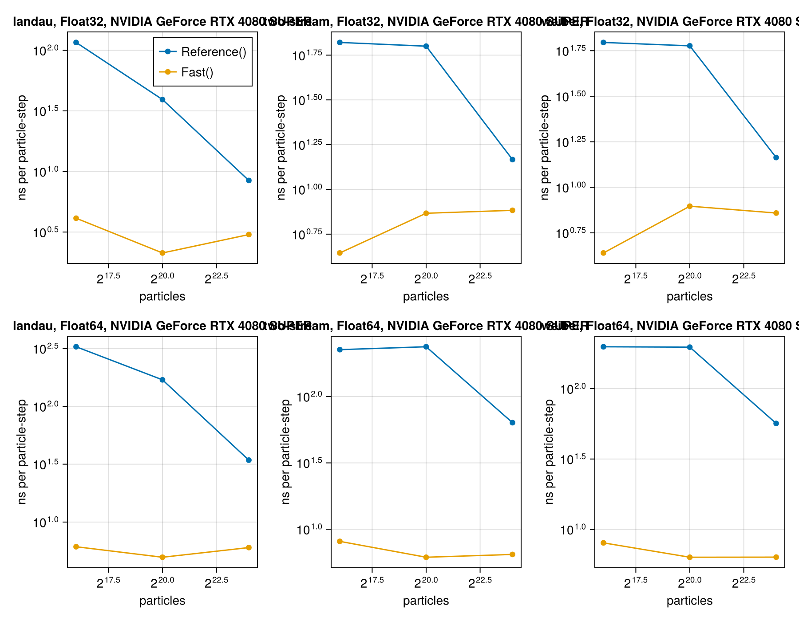
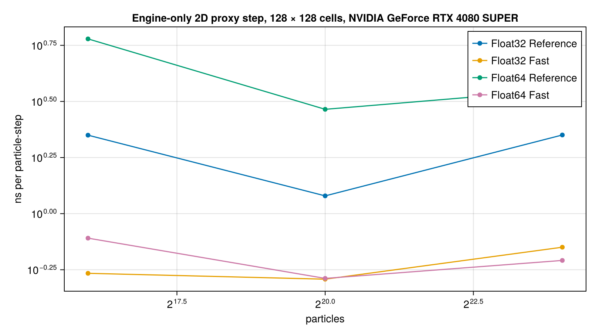

# WP-013: the engine and the electromagnetic module on CUDA

| | |
|---|---|
| Work package | WP-013 (goals A2, A4, A5, A6, A7, A8, A9) |
| Commits | base `25f61c9`, merged with `main` at `0d5e9f5`; branch `worktree-wp-013-cuda` (squashed on merge: see the PR) |
| Runs | GPU test runs (the GPU runner's logs, `$JULIA_DEPOT_PATH/gpu-logs/<tag>.log`): engine `wp-013-cuda-core-5` and module `wp-013-cuda-em-4`, both on `0d5e9f5` (the branch merged with `main` after #151; before the merge the same tests passed in `wp-013-cuda-core-4` on `a639d89` and `wp-013-cuda-em-3` on `df31928`); timing `em1d-timing-cuda-20261101T110748` (log `wp-013-cuda-timing-em1d-3`, on `df31928`) and `engine2d-cuda-20261101T105828` (log `wp-013-cuda-timing-2d-1`, on `216da62`) |
| Input hashes | SHA-256 of every input file in each timing run's manifest: `gpu-cuda/<run>.manifest.toml`. The manifests say `commit = "unknown"`: the runner's sandbox mounts the worktree but not the repository's `.git`, so git cannot run inside a job (#179); the commit of each run is the `HEAD` in its log header, given above. |
| Environment | NVIDIA GeForce RTX 4080 SUPER (16 GB, 15.6 GiB reported), Intel Core i9-14900K host; Julia 1.13.3; KernelAbstractions 0.10, CUDACore 6.5.0, AcceleratedKernels 0.5; jobs one at a time on the machine's GPU runner, no network |
| Figures | `gpu-cuda/timing-cuda.png` (module step, 1D), `gpu-cuda/proxy_cuda.png` (engine-only 2D proxy step), each with its JSON sidecar |
| Status | measured, not independently reviewed; no number here is to leave the repository before that review (`CLAUDE.md`). The throughput and memory figures are first measurements for A7, proposed and not asserted. |

## 1. Setup

The engine (`ParticleMeshCore`, N = 1 and N = 2, the flux deposition included) and the electromagnetic module (`ParticleMeshElectromagnetic`, the 1D step and the SciML harness) ran on `CUDABackend` with no change to `lib/*/src` beyond one docstring: every kernel is a KernelAbstractions kernel selected by the array type. CUDACore (CUDA.jl 6's array and kernel package, without the vendor libraries) is a test and scripts dependency only.

The GPU tests live in each package's `test/` and run whenever CUDA is functional (`test/gpu_switch.jl`; `PM_TEST_GPU=1` requires them, `0` turns them off, T-199). A CPU test body is a function of the backend: it builds its inputs on the host, runs each engine call through `on(be, f, args...)` (`test/gpu_support.jl`), which on the CPU is the plain call and on CUDA moves the arguments to the device, runs the call and copies the results back, and checks on the host. So the CPU tests keep their bits by construction, and the CUDA testsets rerun the same bodies with the CPU's tolerances. The module's tests build their state on the device (`EMState(...; backend)`). All GPU testsets run under `CUDA.allowscalar(false)`.

## 2. Test results

Engine, run `wp-013-cuda-core-5`: 26 613 passed, 16 broken (T-144's and T-268's known multi-thread sort allocation, #82), none failed. Module, run `wp-013-cuda-em-4`: 36 260 passed. The per-testset counts below are from `wp-013-cuda-core-4` and `wp-013-cuda-em-3`, which print the full table. Per testset:

| Test | What ran on CUDA | Result |
|---|---|---|
| T-190 | the N = 1 identities T-130 to T-134, T-140, T-172 to T-175, T-110, T-112, T-114, T-115; Float32, Float64, `Dual{Float32,3}` | 508 passed |
| T-191 | the 2D advance (bitwise against the host) and tensor weights, T-263 to T-265, T-267, T-269 | 383 passed |
| T-192 | Reference mode: scan, sort with extras, `deposit!` (two quantities), `deposit_flux!`, gather, fill, fold, at N = 1 and N = 2 (T-266's set), three reruns × `workgroupsize` ∈ {default, 64, 256} | 188 passed: **bitwise across reruns and launch shapes** for every element type |
| T-193 | Philox and loading against the CPU | 17 passed (§3) |
| T-194 | Fast against Reference per node (T-135, T-265) and per face (T-113) | 46 passed |
| T-198 | engine allocation per step (§4) | 72 passed |
| T-199 | the switch, on the CPU | 11 passed |
| T-195 | the module's T-210, T-211, T-212, T-213, T-214 to T-217, T-219 (Float64) | 18 069 passed |
| T-196 | the module's Reference step bitwise across three reruns and `workgroupsize` 64 and 256, three cases × three types; the harness's `solve` against `initialize!` plus `run!` | 8 passed |
| T-197 | CPU against CUDA (§3) | 7 passed |
| T-280 | module allocation per step (§4) | 8 passed |

The measured ratios err/(eps·scale) on CUDA sit within the CPU's proposed constants for every CPU test that was rerun; the largest relative to the CPU's are T-135 (Fast–Reference per node, 17.0 Float32 on CUDA against 11.2 on the CPU, C = 32) and T-113 (per face, 3.49 against 1.93, C = 32). Both are atomic-order effects of Fast mode and are recorded under the test's id with the backend in `tolerances.toml`'s measured output, not as new constants.

## 3. CPU against CUDA

The device's arithmetic is not the host's. Where the bits differ, the cause is one of two things: the device compiler fuses multiply-adds (inferred from T-172: the CUDA scan and the host serial implementation of the same documented order differ in the last bit, while the same order run as a one-work-item kernel on the device is bitwise equal to the engine's scan; not verified at the PTX level), and `cos`, `log` and `sin` are CUDA's.

- Bitwise equal to the CPU: Philox4x32-10 integer outputs and `uniform_open` (4096 counters, Float32 and Float64); the cells and offsets of a quiet-start load; the 2D advance through both seams and the corner (300 steps); the 2D tensor-product weights in Float32 and Float64.
- Within a measured bound, recorded as new proposed entries in `lib/ParticleMeshCore/test/tolerances.toml` (C chosen above the measured value; owner's to accept in A7):

| Entry | Measured on CUDA | Proposed C | CPU |
|---|---|---|---|
| `T-193 box_muller` (ulp) | 3.0 Float32, 2.0 Float64 | 4 | — |
| `T-193 load`, weights (eps·\|w\|) | 0.973 Float32, 0.978 Float64, 0.973 Dual | 2 | — |
| `T-193 load`, velocities (ulp) | 3.0 Float32, 3.0 Float64, 2.0 Dual | 4 | — |
| `T-191 tensor weights` (eps·max\|W\|) | 0.0 Float32, 0.0 Float64, 0.963 Dual | 4 | — |
| `T-191 T-267 weights` (eps·\|w\|) | 2.21 Float32, 2.2 Float64, 2.21 Dual | 4 | bound 2 |
| `T-190 T-112 zero displacement` (eps·max\|ρy\|) | 2.76 Float32, 1.84 Float64, 0.991 Dual | 4 | 0 measured, bound 2 |

- The module's three cases, Reference mode, Float64, the configurations of T-214 to T-216 (T-197): the relative difference of the field-energy history is 9.7e-16 (Landau, WEx), 4.8e-14 (two-stream, WEx) and 6.0e-15 (Weibel, WBz); of the total-energy history 9.5e-16, 1.8e-15 and 1.3e-15; of the fitted rates 3.2e-10 (Landau damping, from the peak fit), 4.8e-16 (two-stream growth) and 2.1e-16 (Weibel growth). These are the first measured values for A4's cross-backend tolerance, a proposal: the histories agree to a few eps of Float64, and the Landau rate's 3.2e-10 is the fit's sensitivity to those differences.
- `cumsum_periodic!` alone, CPU against CUDA (both run one association order): at most 0.059 in units of eps·n·max|a|·dx (n = 64; 0.0085 at n = 2085, three tiles), Float32 and Float64.

**The A4 reading on CUDA.** A4 now asks for bitwise reproducibility per element type on one backend across reruns, thread counts and launch shapes. T-192 and T-196 hold it on CUDA for every Reference kernel of the engine and for the module's whole step and harness. Across backends nothing is bitwise except what is listed above, and that is expected.

## 4. Allocation per step

Device bytes per step after warm-up are 0 for every engine proxy step (N = 1 and N = 2, three element types, 2 048 to 131 072 particles, 8 to 128 cells per axis) and for every module step (Landau and Weibel, Fast and Reference, 16 and 256 per cell, 64 and 512 cells).

Host bytes (the launches' bookkeeping) of everything but the sort are constant: 4 512 to 7 568 bytes per engine proxy step depending on type and N; 10 928 to 15 328 per module Fast step. The sort's host bytes grow as log₂ of the capacity: AcceleratedKernels' GPU merge sort launches one merge-pass kernel per doubling of the run length (`src/sort/merge_sort.jl`, the global-level `while len > run_len` loop, read in the sources), each with a constant host cost; measured, 13 056 to 18 736 bytes per sort between 2 048 and 131 072 particles, about 750 bytes per doubling. Its device scratch is the `Workspace`'s. T-198 and T-280 hold the rest of the step constant and the sort to 1 KiB per doubling per sorted species.

One unexplained observation: at 8 particles per cell the engine proxy step's host bytes were 592 lower than at 64 and 512 per cell, the same at both grid sizes (a step, not a growth); the tests use 64 and 512 per cell.

## 5. Throughput and memory (A7, first measurements)

The module's step (`scripts/em1d/timing.jl cuda`), ns per particle-step, median of three synchronized runs of 30 steps (10 at 2^24). The loader's counter layout holds at most 65 535 particles per cell, so at large counts the case is tiled: repeated f times along x, with Δx, the CFL ratio and the perturbation's wavenumber unchanged. The cell counts are therefore part of each row:

| Case | Particles | Cells | Float32 Reference | Float32 Fast | Float64 Reference | Float64 Fast |
|---|---|---|---|---|---|---|
| Landau | 2^16 | 64 | 116 | 4.11 | 328 | 6.12 |
| Landau | 2^20 | 256 | 39.2 | 2.13 | 170 | 4.96 |
| Landau | 2^24 | 4096 | 8.43 | 3.02 | 34.3 | 6.02 |
| two-stream | 2^16 | 128 | 66.2 | 4.41 | 226 | 8.1 |
| two-stream | 2^20 | 128 | 63.1 | 7.36 | 237 | 6.15 |
| two-stream | 2^24 | 2048 | 14.7 | 7.64 | 63.5 | 6.46 |
| Weibel | 2^16 | 128 | 62.4 | 4.36 | 198 | 8.03 |
| Weibel | 2^20 | 128 | 59.8 | 7.88 | 197 | 6.34 |
| Weibel | 2^24 | 2048 | 14.6 | 7.23 | 56.6 | 6.35 |

What the breakdown in the sidecar shows:

- **Reference mode is bound by the sorted flux deposition on small 1D grids.** `deposit_flux!` is 72 to 84 % of the Reference step at 64 to 256 cells. Its Reference kernel is one work item per face that sums its stencil's particles in order, so the parallelism is the number of cells: 64 to 128 work items leave the card almost idle, and the cost per particle falls as the cells grow (Landau: 116, 39 and 8.4 ns at 64, 256 and 4096 cells). Fast mode (atomics, one work item per particle) is 2 to 8 ns per particle-step and nearly flat. On 2D grids, whose node counts are far larger, the problem largely goes away (next table: 16 384 nodes); for 1D validation runs on the GPU, Fast mode or more cells is the practical choice.
- The sort costs 0.5 to 3.9 ns per particle; the Yee solve is negligible at these sizes (0.27 to 0.54 ns per particle at 2^16, under 0.04 above).
- **The scan** (`cumsum_periodic!`, one work item) costs 9 to 550 µs per call, growing with the cell count. The module calls it once, at t = 0, so it is not part of the step; a parallel kernel of the same order is not needed now (WP-013's non-goals).
- Float64 costs 2.8 to 4.3 times Float32 in Reference mode and 0.8 to 2.3 times in Fast mode; the RTX 4080 SUPER's Float64 arithmetic rate is a small fraction of its Float32 rate (a property of the consumer card, from its specifications, not measured here), and the Reference kernels are arithmetic-heavy per work item.

The engine-only 2D proxy step (`scripts/engine2d/timing.jl cuda`: advance, sort in Reference mode, order-2 deposit at (Center, Center), fold, fill, order-2 gather), 128 × 128 cells, ns per particle-step, median of five synchronized runs of 20 steps:

| Particles (per cell) | Float32 Reference | Float32 Fast | Float64 Reference | Float64 Fast |
|---|---|---|---|---|
| 2^16 (2 × 2) | 2.24 | 0.542 | 6.01 | 0.778 |
| 2^20 (8 × 8) | 1.20 | 0.510 | 2.92 | 0.515 |
| 2^24 (32 × 32) | 2.24 | 0.709 | 3.57 | 0.619 |

With 16 384 nodes the 2D Reference deposition has enough work items, and Reference is 1.2 to 2.24 ns per particle-step in Float32, 2.4 to 4.1 times Fast.

**Memory.** Device bytes per particle of the module's state (species with the flux extras, `Workspace`, fields and histories, from `CUDACore.@allocated` around the state's construction): 82 B in Float32 and 110 B in Float64, at every size. Fitting bytes against particles over the two largest Float32 sizes gives at most about 2.0 × 10⁸ particles of state in the card's 15.6 GiB, without the harness. The `FunctionMap` harness holds further copies of the state: T-104 (CPU) measures 5 copies at `init` and 6 at the end with `save_everystep = false`, which this run did not measure on the device. The 2D proxy's species, `Workspace` and field: 86 to 89 B per particle in Float32, 118 to 122 B in Float64 (the larger values at 2^16 particles, where the field's share is largest).

No throughput threshold is asserted (WP-013's non-goals): A7's budget is a factor of Smilei on the same card, and the Smilei GPU reference is cross-code stage 2.

## 6. Open issues

- The runner's job sandbox has no access to the repository's `.git`, so the run manifests record `commit = "unknown"` and the commit comes from the runner's log header (#179).
- The 592-byte step in the engine proxy's host bytes at 8 particles per cell (§4) is not explained.
- The Reference flux deposition's 1D parallelism (§5) is a design property of one work item per face, not a defect; whether 1D GPU validation needs a faster Reference path is a question for a later package, not taken up here.
