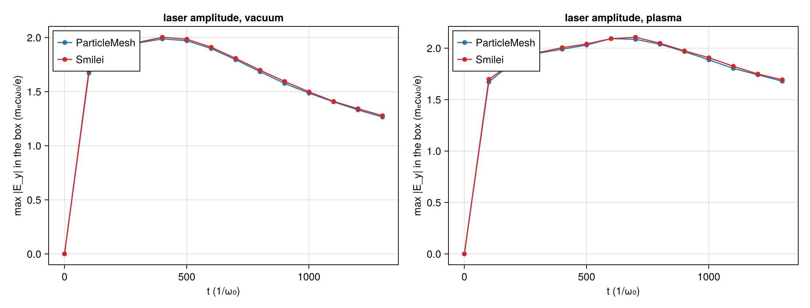
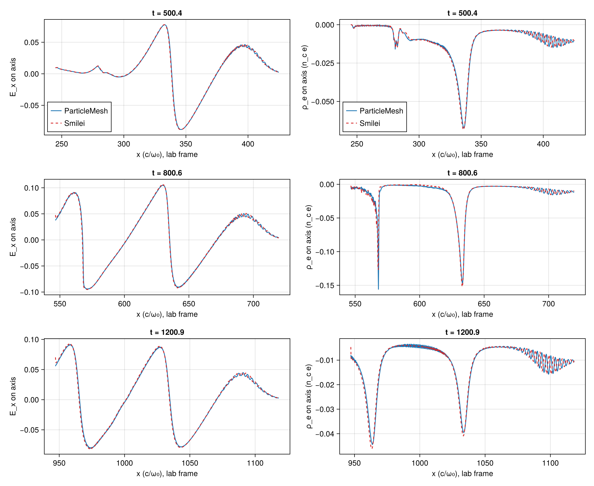
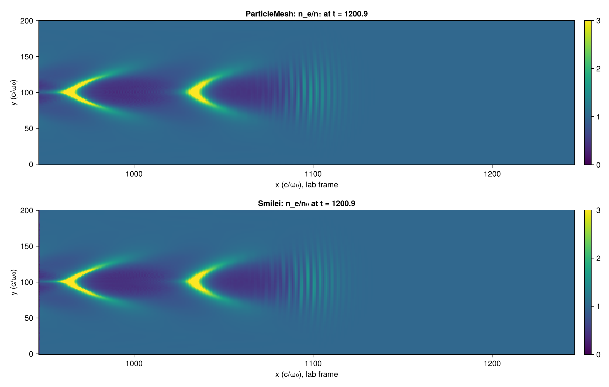
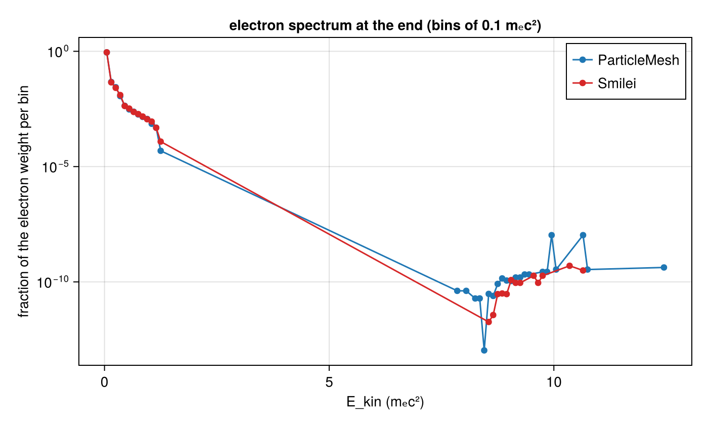

# LWFA 2D: a first matched ParticleMesh–Smilei run of a laser wakefield with the moving window

| | |
|---|---|
| Goals | A5 (the 2D LWFA case run in ParticleMesh and Smilei), A1, A2, A3; on WP-028's moving window, WP-026's antenna |
| Case | `scripts/lwfa/cases/lwfa-2d-a2.toml`: A5's first LWFA case (`scripts/lwfa/cases/lwfa-2d.toml`) on a coarser grid, λ₀/32 instead of λ₀/48, where a₀·ω₀Δt = 0.36 is beyond `reports/pushers.md` §5's rule; the same lengths, laser and plasma |
| Commits | the generator and the case `905b93f` (the runs' code); the comparison `ae10436` |
| Runs | CPU box request `runs/lwfa-a2-1` (request commit `2b57dd0` = `905b93f` plus the prepared run directories, which is why the box's manifests say `dirty = true`): `pm-vacuum`, `pm-plasma`, `smilei-vacuum`, `smilei-plasma`; the summaries and 2D maps stay on that branch, the comparison is `lwfa-2d-a2/lwfa-a2-1-compare/` (commit `ae10436`, `dirty = false`) |
| Input hashes | each run's `manifest.toml` (copied as `lwfa-2d-a2/lwfa-a2-1-compare/manifest-<run>.toml`), the box's `box-status.toml` |
| Environment | the CPU box: AMD EPYC 9655, 16 threads; ParticleMesh with Julia 1.13.3, Float64, Reference mode; Smilei v5.1 (`438d43d`, the CPU image `particlemesh-smilei:e4f0148b8952fc87`), 16 OpenMP threads, one process |
| Figures | `laser_amplitude.png`, `wake_axis.png`, `density_maps.png`, `spectrum.png` in `lwfa-2d-a2/lwfa-a2-1-compare/`, each with its JSON sidecar; the numbers below are in `comparison.json` |
| Status | measured, not independently reviewed; no number here is to leave the repository before that review |

## 1. Setup

The case (all in A1 units; the table with reasons is in the question file):

- **laser:** a₀ = 2, waist 28 c/ω₀, τ = 26/ω₀ (the 1/e half width of the field), focused at the start of the plateau (x = 320), polarized in the plane;
- **plasma:** cold electrons, 0.01 n_c (λ_p = 62.8 c/ω₀), behind 260 c/ω₀ of vacuum and a 60 c/ω₀ sin² ramp, 2 × 2 per cell; immobile ions;
- **grid:** Δx = λ₀/32, Δy = 4Δx, Δt at 0.95 of Yee's 2D limit. The window ahead of the injection plane is 1536 × 256 cells (301 × 201 c/ω₀), transverse periodic. It moves at c from t = 256;
- **length:** 7189 steps, t_end ≈ 1301, about 1000 c/ω₀ of propagation in plasma.

How the two codes are matched is in the header of `scripts/lwfa/lwfa.jl`. Each choice was read in Smilei's v5.1 source at the container's pinned commit:

- The case's x = 0 is the injection plane: Smilei's xmin, and ParticleMesh's antenna plane, 40 columns into its box.
- Same Δx, Δy and Δt, so both grids are one lattice in the lab frame, and the comparison matches nodes by index without interpolating. Smilei's `x_moved` gives its offset (`gridGlobalOffset` is 0).
- Smilei's `tgaussian` with fwhm = 2τ√ln 2 is ParticleMesh's envelope exactly (T-510). Its normal-incidence `LaserGaussian2D` has no Gouy phase at the boundary, so the carriers differ by a constant phase. The comparison therefore uses the box maximum of |E_y| and the energy centroid of E_y² on the axis, not the carrier.
- Smilei moves its window by whole patches, 24 cells here (`SimWindow::isMoving`), and ParticleMesh by single cells. Both fronts stay far ahead of the pulse.
- Smilei's regular load sits at 0.975·(k + ½)/n of a cell (`ParticleCreator`), ParticleMesh's at (k + ½)/n.
- Along x, Smilei has Silver–Müller boundaries, and ParticleMesh a field-free outside that reflects what reaches its back edge (`questions/wp-028-moving-window.md` §3). Every comparison below stays within 2.5 λ_p of the pulse, away from the back.

Cost on the box: ParticleMesh 15.4 s (vacuum) and 750 s (plasma); Smilei 15.7 s and 116 s. These are single runs, not benchmarks. ParticleMesh ran in Reference mode, which sorts every step, and Smilei's ions are frozen.

## 2. The laser in vacuum

- **Amplitude.** From t = 200 on, ParticleMesh's box maximum of |E_y| is 0.04 % to 1.1 % below Smilei's. Both rise to 2.0 when the pulse reaches its focus (t ≈ 424) and fall as it diffracts.
- **Position.** The difference of the E_y² centroids on the axis is 0.38 c/ω₀ at t = 200 and shrinks to below 0.02 c/ω₀ from t = 700. ParticleMesh's pulse leaves its antenna slightly ahead of Smilei's boundary-injected one. The two codes' source terms differ (TF/SF plane against a boundary condition, `questions/wp-017-lwfa-case.md` §3), and the difference was not decomposed further.
- **Shape.** The rms difference of the running-max envelopes on the axis is 5 %. For a Gaussian envelope of 1/e half width τ, a shift δ gives a relative rms difference of about δ/τ, so 5 % corresponds to δ ≈ 1.3 c/ω₀. The envelope is a crude estimator, though: it snaps to carrier crests, and the carriers differ by the Gouy phase. An earlier argmax of it put ParticleMesh 1.37 c/ω₀ ahead, which the centroid shows was the estimator, not the pulse.

## 3. The wake

On the axis, from the laser's peak back over two plasma wavelengths, from t ≈ 500 (the pulse in the plateau):

| | ParticleMesh vs Smilei |
|---|---|
| E_x, rms difference relative to Smilei's rms | 3.6 % to 5.2 % |
| E_x, most negative value (the accelerating phase) | within 1.5 %; Smilei's value runs from −0.089 to −0.095 and down to −0.077 at the end (m_ecω₀/e) |
| E_x, maximum | within 1.8 % |
| ρ_e, rms difference | 5 % to 17 % (the density spikes at the wake's crests are steep, and a sub-cell shift of a spike shows as a large rms) |
| laser box maximum in plasma | 1.2 % below to equal; both self-focus to 2.1 |
| laser centroid | ParticleMesh 0.02 to 0.15 c/ω₀ ahead |

The wake is nonlinear in both codes: a steepened sawtooth with |E_x| up to about 0.9 of the cold wave-breaking field m_ecω_p/e = 0.1. In SI at λ₀ = 0.8 µm that is about 0.36 TV/m, computed from m_ecω₀/e ≈ 4.0 TV/m.

The 2D density at t ≈ 1201 has the same two wake buckets, the same curved crests and the same laser-driven ripples in both codes, at the same lab positions.

## 4. Electrons

- **Above 1 mₑc².** At the end, 0.13 % of the electron weight is there in ParticleMesh and 0.15 % in Smilei.
- **Above 5 mₑc².** The fraction is 2.4 × 10⁻⁸ (ParticleMesh) and 1.7 × 10⁻⁹ (Smilei): a few macro-particles. ParticleMesh's most energetic electron has 66 mₑc² (34 MeV), beyond the histogram's 20 mₑc².
- **Injection is not resolved.** At this particles-per-cell count the injected population is a handful of macro-particles, so this run does not establish whether the codes agree on injection.

## 5. Verification status and open issues

- **Not reviewed.** The agreement is measured on one run of each code, with no seed or resolution scan. Nothing here is a validation claim, and the numbers stay in the repository until a fresh reviewer has looked at them.
- **What is shown.** On this case, ParticleMesh's moving window, antenna and 2D step reproduce Smilei's laser and wake to a few percent, with no tuning between the runs.
- **What is not.**
  - injection and the spectrum (§4);
  - the transverse absorber (periodic y here);
  - the back edge (ParticleMesh reflects there);
  - Float32;
  - the GPU;
  - PIConGPU, whose window slides only along y (`questions/wp-017-lwfa-case.md` §3).
- **The tests.** `scripts/lwfa/test/runtests.jl` (T-510 to T-513) checks the generator and the readers, not the physics. The CI's scripts job does not run it yet.
- **The Smilei input was not dry-run.** Running Smilei's own Python layer on it in the cloud session was denied, since it runs downloaded code. The namelists were syntax-checked and read, and Smilei accepted both on the box (`smilei.log`).
- **Diagnostics to add for a second run:**
  - a spectrum range up to 100 mₑc², with Smilei's maximum energy;
  - more particles per cell where injection happens;
  - a probe on the axis for the laser's spectrum.
