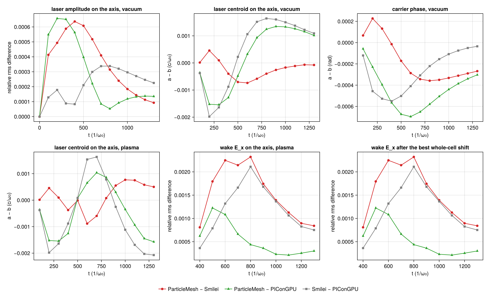
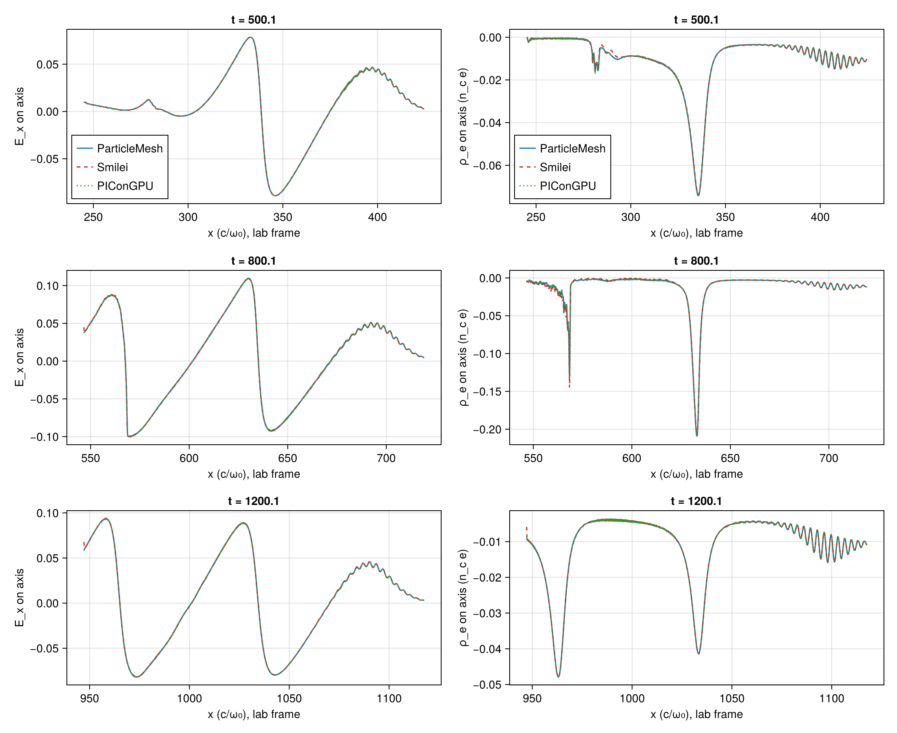
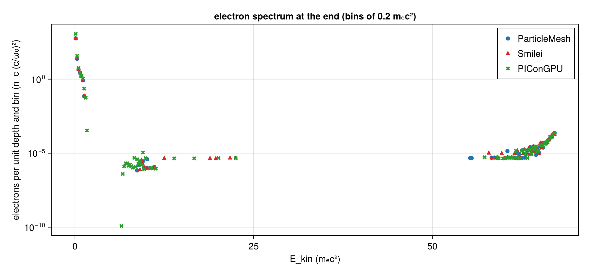

# LWFA 2D: A5's first case in ParticleMesh, Smilei and PIConGPU

| | |
|---|---|
| Work package | WP-053 (`trace/wp/WP-053-lwfa-three-codes.md`); goals A5, A7, and A3 for #362. Follows PR #336, which brought the PIConGPU column |
| Case | `scripts/lwfa/cases/lwfa-2d.toml`, λ₀/48, with `laser.envelope = "wavefront"` (sha256 `e7bc9e3f…`, in the run manifests), and `scripts/lwfa/cases/lwfa-2d-focus0.toml`, the same with the focus on the injection plane, in vacuum only |
| Commits | ParticleMesh's and PIConGPU's runs of §4 used the code of `6ead5bd` (the box requests `5b729a7` and `9f8a388` are that commit plus the prepared run directories); Smilei's runs of §4 the request `e79e5b7`, which is `df75c5c` plus its run directories. These commits and the others cited below are commits of the PR branch `worktree-wp-053-lwfa-three-codes`; a squash merge does not keep them reachable from `main`. The comparisons: the commit in each `manifest.toml` under `lwfa-2d-a5/` (`dirty = false`) |
| Runs | ParticleMesh: CPU box requests `runs/lwfa-a5-2` (result `ab315a6`) and `runs/lwfa-a5-focus0` (result `e86a2b8`). Smilei: CPU box request `runs/lwfa-a5-3-smilei` (result `088fd90`), with the amplitude it is given corrected for its boundary condition; its runs on the two earlier requests, without the correction, are history (§3.2). The summaries stay on those branches. A further correction of Smilei's launch (§4.1) is in `smilei_laser` and prepared as a request, not run. PIConGPU: gpu-run jobs `a5-2-pic-vacuum`, `a5-2-pic-plasma` and the focus-0 vacuum run; ParticleMesh on CUDA: `lwfa-a5-2-cuda-pm-plasma`. The summaries of these four are on no branch and are in `lwfa-2d-a5/runs/`, with the maps of PIConGPU's plasma run (`runs/lwfa-a5-2/picongpu-plasma/maps.h5`), which the off-axis rows read. First runs (§3.1): `runs/lwfa-a5-1` and `lwfa-a5pic` |
| Input hashes | each run's `manifest.toml` as `manifest-<run>.toml` next to its comparison; the boxes' `box-status.toml` (`lwfa-a5-2-compare/`, `lwfa-a5-focus0-compare/`) and `box-status-smilei.toml` (`lwfa-a5-3-compare/`); the sha256 of the summaries compared under `summaries`, and of the plasma runs' `maps.h5` under `maps`, in each comparison's `manifest.toml` |
| Environment | ParticleMesh: Julia 1.13.3, Float64, Reference mode; 16 threads on an AMD EPYC 9655 (the CPU box), and CUDA on an RTX 4080 SUPER. Smilei v5.1 (`438d43d`, image `particlemesh-smilei:e4f0148b8952fc87`), 16 OpenMP threads, the same box. PIConGPU 0.8.0 (`6bb3470e`), CUDA, Float64, the RTX 4080 SUPER |
| Figures | `lwfa-2d-a5/lwfa-a5-3-compare/` (A5's case), `lwfa-a5-3-focus0-compare/` (focus on the plane), each PNG with its JSON sidecar; `lwfa-a5-2-cuda-pair/pair.json` (ParticleMesh on two backends); `lwfa-a5-smilei-pair/pair.json` (Smilei with and without the correction). History: `lwfa-a5-2-compare/comparison.json` and `lwfa-a5-focus0-compare/comparison.json` (Smilei uncorrected), `lwfa-a5-three-compare/comparison.json` (first runs); their figures are in the commits `df75c5c` and `c9de0de` of the PR branch. The measured values below are keys of the `comparison.json` or `pair.json` named with them; ranges, largest values, counts and ratios are computed from those keys, the wall times and the box's step times are from the runs' summaries and the box status files, and the few numbers computed from the summaries or the maps directly say so where they stand |
| Status | measured; reviewed three times, the present version not yet. No number here is to leave the repository before the review of this version |
| Review | Three independent reviews by fresh numerics-reviewer subagents (claude-fable-5-2, 2026-11-12); their findings are in `lwfa-2d-a5/review.md`. The first, on the unmatched first runs, found that the three codes had launched three different pulses and that the spectra covered different regions (§3.1, §4.4). The second, on `c9de0de`, reproduced every table of the runs with Smilei uncorrected and found two wrong numbers, a hypothesis stated as fact, the wake's measure ending on a bucket's edge, and the pulse compared on the axis only. The third, on `2ee80a5`, reproduced the tables of §4 and §6 (732 cells) and found one more term in Smilei's launch, its boundary condition's response to oblique components (§4.1), and sentences of §4 to §6 that were wrong or attributed a difference to the wrong pair; this version answers those |

`pm-plasma`'s manifest says `dirty = true`: the step before it on the box, `pm-vacuum` (same commit, `dirty = false`), rewrites its own tracked `manifest.toml`. This is inferred from the two manifests, not recorded by the run.

## 1. Setup

The case, in A1's units: a₀ = 2, waist 28, τ = 26 (1/e half width of the field), focus at x = 320; electrons of 0.01 n_c (λ_p = 62.8) behind 260 of vacuum and a 60 sin² ramp, 2 × 2 per cell, cold, ions immobile; Δx = λ₀/48, Δy = 4Δx, Δt at 0.95 of Yee's 2D limit; a window of 2304 × 384 cells moving at c from t = 256; 10 777 steps, 14 outputs 829 steps apart (t ≈ 0, 100, …, 1300). Yee, Esirkepov, quadratic shapes, Boris, no current filter, Float64 in all three.

One pulse on the lab plane x = 0 in all three codes: a cosine carrier counted from the envelope's peak, the 2D Gouy phase, envelope and carrier on one time along the curved wavefront, and one amplitude. How each code is made to launch it, with the source lines read, is in the headers of `scripts/lwfa/lwfa.jl` and `scripts/lwfa/picongpu.jl`: PIConGPU's `GaussianPulse` is that pulse; ParticleMesh launches it with `GaussianLaser(envelope = WavefrontTime())`; Smilei's namelist gets a focus counted from its ghost node, an envelope centre, a phase offset, and the case's a₀ divided by what its boundary condition launches per unit (`smilei_laser`, §3.2). `smilei_laser` now also narrows the waist to undo that condition's response to oblique components; the runs of §4 were made before that (§4.1). The three share Δx, Δy and Δt, so their grids are one lattice in the lab frame and every comparison matches nodes by index, with nothing interpolated.

## 2. Measures

`compare_rows` in `scripts/lwfa/lwfa.jl`; a pair is written a–b (PM–S ParticleMesh–Smilei, PM–P ParticleMesh–PIConGPU, S–P Smilei–PIConGPU), and every relative rms difference is relative to b's rms.

- **Carrier phase, amplitude** (`carrier_phase`, `amplitude_relrms`, `amplitude_max`): from the lattice's own analytic signal on the axis, z(m) = E_y(m) + i·(9·(E_y(m − q) − E_y(m + q)) + E_y(m − 3q) − E_y(m + 3q))/16 with q a quarter wavelength (12 points). What is left of the carrier in |z| is of order (qΔx/τ)⁴ = 10⁻⁵ for this pulse (T-691, T-692).
- **Centroid** of E_y² on the axis (`centroid_x`).
- **Wake**: E_x on the axis from ParticleMesh's envelope peak back one and a half plasma wavelengths (720 cells), the same lattice points for all three pairs (`wake_Ex_relrms`, `wake_Ex_min`, `wake_Ex_max`); `wake_Ex_shift` is the whole-cell displacement of b's wake that fits a's best. An output has these only when |E_x| reaches 10⁻³ of the wave-breaking field in the window in both codes: from t = 400 here. The window ends inside the second bucket. A window of two plasma wavelengths (960 cells), which the first reviewed version used, ends from t = 600 on the jump of E_x at the back of the second bucket: the window's anchor moves in steps of half a laser wavelength (24 cells), and a few cells at the jump then carry a large part of every pair's squared difference (§4.3). `wake_sensitivity` repeats the measures for windows of 1.0, 2.0 and 2.5 λ_p, and `wake_anchor_sensitivity` for the window moved by 24 cells either way.
- **Off the axis** (`maps`, `map_rows`): the relative rms difference of the 2D maps of E_y, kept on every sixth column and every row at the three outputs t = 300, 700, 1200 of the plasma runs, on the lattice points two maps share: over all rows, over the beam's flank (0.9 to 1.6 waists from the axis, 25.2 ≤ |y| < 44.8) and over its far wing (2.15 to 2.85 waists, 60.2 ≤ |y| < 79.8). The two envelope conventions of §3.1 are one field on the axis of the launch plane and differ off it, so this is where a remaining mismatch of that kind would show. The 48 cells (a laser wavelength) at the back of the shared columns are left out, for the reason given in §4.3; the keys ending in `_with_back` keep them.
- **Spectra** in one unit, electrons per unit depth in n_c (c/ω₀)²; `bunch` is the highest energy group of a spectrum, the occupied bins above its widest empty gap (`bunch_group`); `top` the upper edge of the highest occupied bin; `above` the weight above 1, 5, 10, 20 and 40 mₑc².

In `comparison.json` for reference, not counted: the box maximum of |E_y| (sampled on the lattice, up to 1 − cos(π/48) = 0.21 % below a crest); the running-max envelope (`envelope_relrms`, which reads a carrier phase as a difference); ρ_e on the axis (`wake_rho_relrms`: a few narrow spikes, whose relative rms moves by tens of percent with a displacement of a cell or with the code that places the window).

## 3. The runs before these: two rounds of mismatched launches

### 3.1 The first runs: three different pulses

The runs of 5 November (`lwfa-2d-a5/lwfa-a5-three-compare/comparison.json`) compared three pulses, and this is the record of what the mismatch was. The first version of this report, with their tables, is commit `1080c9a` of the PR branch; their figures and PIConGPU's first-run summaries are in its commit `c9de0de`.

| on the axis in vacuum, t = 200 to 1300 | PM–S | PM–P | S–P |
|---|---|---|---|
| carrier phase a − b (rad) | +1.9785 to +1.9790 | −0.0011 to +0.0004 | −1.9795 to −1.9785 |
| centroid a − b (c/ω₀) | +0.249 falling to −0.145 | −0.014 falling to −0.405 | −0.264 to −0.260 |

- **Smilei.** `LaserGaussian2D` gives the boundary envelope(t − φ(y))·sin(t − φ(y)): a sine of the run's time and no Gouy phase, where the others have a cosine from the envelope's peak; and the Silver–Müller condition applies it on the outermost ghost node, two cells behind xmin. For the case's numbers that is a phase of delay + ½·atan(320/392) − π/2 − 2Δx = 1.9787 rad mod 2π and a lag of 2Δx = 0.2618 c/ω₀: the two constant offsets measured.
- **ParticleMesh.** Its default envelope is in t − delay alone, the same at every y (`AxisTime`); PIConGPU's and Smilei's follow the curved wavefront. Past the plane the `AxisTime` pulse arrives on the axis later by (w²/(4|R|))/(1 + κ²w⁴), κ = (1/L − 1/|R|)/2, with w = 36.1 and |R| = 800.2 on the plane and L the distance travelled (T-696, and launched through the antenna in T-709): up to 0.408 c/ω₀. That closed form, with no free parameter, is the measured motion of ParticleMesh's centroid against PIConGPU's to 0.0044 c/ω₀ at each of the twelve outputs. Neither convention is a defect; `AxisTime` stays ParticleMesh's default and `WavefrontTime` is an opt-in (T-695 to T-697).
- **So the first runs' Smilei–PIConGPU distance was Smilei's two launch offsets**, not a spread for equivalent inputs: 5 % in the running-max envelope, and in the wake's E_x (two plasma wavelengths behind the peak) 4.2 % to 6.2 % at the nine outputs t = 500 to 1300, which a shift of two cells took down to 1.1 % to 1.7 %. At t = 400, where the wake is just forming, it was 2.17 %, the best shift one cell, and 1.87 % was left. Over the three pairs the first runs' wake distances ran from 0.17 % (ParticleMesh–PIConGPU at t = 400) to 6.2 %.
- **#362.** ParticleMesh's `ekin_max` was 1.17 to 2.41 mₑc² before the laser reached the plasma: the window's loader fills the vacuum with particles of zero weight (the density enters through the weights, A3), and the laser makes them quiver. `pm_spectrum` now takes the maximum over particles of positive weight (T-690).

### 3.2 The second runs: Smilei's amplitude

With carrier and envelope matched (`lwfa-a5-2-compare/comparison.json`, `lwfa-a5-focus0-compare/comparison.json`; the tables are in the PR branch's commit `df75c5c`), the three carriers agreed to 0.7 mrad and the centroids to 0.002 c/ω₀ in vacuum, and Smilei's amplitude was above the other two at every output: its peak 0.166 % to 0.214 % above PIConGPU's with the focus ahead, 0.164 % to 0.186 % with it on the plane.

**The factor is Smilei's boundary condition.** Its Silver–Müller update at xmin (`ElectroMagnBC2D_SM.cpp:63` to `66` and `245`) is, at normal incidence, (B₀ + B₁)/2 + (E₀ half a step before + E₀ half a step after)/2 = 2b: the mean of the new B_z over the two points either side of the boundary node plus the mean of that node's E_y over the step around the new B's time, set to twice the profile b the namelist prescribes at that time. For the grid's own right-going plane wave those two means are cos(kΔx/2) and cos(ω₀Δt/2) of the wave, k the Yee wavenumber, so the wave launched is

    2/(cos(kΔx/2) + cos(ω₀Δt/2))

of the amplitude prescribed: 1.001984 on this grid, 1 + (Δx² + Δt²)/16 to second order, and 1.004474 at λ₀/32. Smilei's update run on a 1D Yee grid launches that factor to 10⁻¹⁰, for both case files and three other pairs of Δx and Δt (T-710). `smilei_laser` gives Smilei the case's a₀ divided by the factor (T-510), and the Smilei runs of §4 are made so. The prediction written before those runs, a Smilei amplitude within a few hundredths of a percent of the other two, held (§4.1).

**What 0.198 % of amplitude does, in one code.** Smilei's plasma run without the correction against the one with it (`lwfa-a5-smilei-pair/pair.json`, a the uncorrected run): the same code and inputs but for a₀. Amplitude and wake as relative rms differences in percent, the phase a − b in mrad, the centroid in 10⁻³ c/ω₀, the extrema as a/b − 1 in percent:

| t | amplitude | carrier phase | centroid | wake E_x | wake minimum | wake maximum | wake / amplitude |
|---|---|---|---|---|---|---|---|
| 400 | 0.198 | +0.05 | +0.03 | 0.185 | +0.13 | +0.24 | 0.93 |
| 500 | 0.196 | +0.43 | +1.40 | 0.512 | +0.24 | +0.18 | 2.61 |
| 600 | 0.200 | +0.93 | +3.06 | 0.598 | +0.24 | +0.27 | 2.99 |
| 700 | 0.211 | +1.38 | +2.59 | 0.636 | +0.28 | +0.38 | 3.02 |
| 800 | 0.221 | +1.78 | +2.15 | 0.637 | +0.27 | +0.50 | 2.89 |
| 900 | 0.224 | +2.18 | +2.37 | 0.608 | +0.35 | +0.27 | 2.72 |
| 1000 | 0.224 | +2.59 | +2.87 | 0.614 | +0.19 | +0.21 | 2.74 |
| 1100 | 0.223 | +3.02 | +3.35 | 0.617 | +0.25 | +0.29 | 2.76 |
| 1200 | 0.223 | +3.46 | +4.01 | 0.594 | +0.34 | +0.41 | 2.66 |
| 1300 | 0.225 | +3.91 | +3.96 | 0.572 | +0.33 | +0.33 | 2.54 |

Before the plasma (t = 100 to 300) the amplitude difference is 0.1984 %, the factor, and the phase and centroid differences are roundoff. In the plasma the wake's E_x changes by 2.5 to 3.0 times the amplitude's change from t = 500, the carrier phase by 3.9 mrad by the end, the centroid by up to 0.004 c/ω₀, and the wake's maximum by 0.50 % at t = 800 against 0.18 % to 0.41 % at the other outputs. These are the differences the second runs showed between Smilei and the other two codes (a wake 0.19 % to 0.57 % from PIConGPU's, a carrier drifting to 3.4 mrad from it, a wake maximum at t = 800 twice as far off as at its neighbours), and the previous version of this report listed them as hypotheses or as unexplained. They were the 0.2 % of amplitude.

## 4. The matched runs

ParticleMesh's and PIConGPU's runs are those of the second runs; Smilei's are new, with the corrected amplitude.

### 4.1 Do the three codes launch one pulse? The laser in vacuum

A5's case, focus 320 ahead of the plane (`vacuum`, `picongpu_vacuum`, `smilei_picongpu_vacuum` in `lwfa-a5-3-compare/comparison.json`). Carrier phase a − b in mrad and centroid a − b in 10⁻³ c/ω₀:

| t | phase: PM–S | PM–P | S–P | centroid: PM–S | PM–P | S–P |
|---|---|---|---|---|---|---|
| 200 | +0.23 | −0.23 | −0.46 | +0.46 | −1.52 | −1.98 |
| 300 | +0.13 | −0.40 | −0.53 | +0.10 | −1.54 | −1.64 |
| 400 | −0.01 | −0.56 | −0.55 | −0.40 | −1.28 | −0.88 |
| 500 | −0.17 | −0.67 | −0.50 | −0.70 | −0.48 | +0.22 |
| 600 | −0.29 | −0.70 | −0.41 | −0.74 | +0.32 | +1.06 |
| 700 | −0.34 | −0.65 | −0.31 | −0.58 | +0.93 | +1.52 |
| 800 | −0.36 | −0.58 | −0.22 | −0.40 | +1.24 | +1.64 |
| 900 | −0.35 | −0.51 | −0.16 | −0.26 | +1.35 | +1.60 |
| 1000 | −0.33 | −0.44 | −0.11 | −0.17 | +1.33 | +1.50 |
| 1100 | −0.31 | −0.39 | −0.07 | −0.11 | +1.26 | +1.38 |
| 1200 | −0.29 | −0.34 | −0.05 | −0.07 | +1.16 | +1.22 |
| 1300 | −0.27 | −0.30 | −0.03 | −0.08 | +1.01 | +1.09 |

Amplitude: relative rms difference and the peak's ratio a/b − 1, in percent (`amplitude_relrms`, `amplitude_max`):

| t | rms: PM–S | PM–P | S–P | peak: PM–S | PM–P | S–P |
|---|---|---|---|---|---|---|
| 200 | 0.049 | 0.066 | 0.018 | +0.050 | +0.065 | +0.016 |
| 300 | 0.059 | 0.065 | 0.009 | +0.059 | +0.065 | +0.005 |
| 400 | 0.064 | 0.056 | 0.008 | +0.064 | +0.055 | −0.008 |
| 500 | 0.061 | 0.040 | 0.021 | +0.060 | +0.039 | −0.021 |
| 600 | 0.052 | 0.022 | 0.030 | +0.051 | +0.021 | −0.029 |
| 700 | 0.041 | 0.008 | 0.034 | +0.040 | +0.007 | −0.033 |
| 800 | 0.031 | 0.005 | 0.034 | +0.030 | −0.002 | −0.032 |
| 900 | 0.024 | 0.009 | 0.032 | +0.023 | −0.008 | −0.031 |
| 1000 | 0.018 | 0.012 | 0.030 | +0.017 | −0.011 | −0.028 |
| 1100 | 0.014 | 0.013 | 0.027 | +0.013 | −0.013 | −0.026 |
| 1200 | 0.011 | 0.014 | 0.025 | +0.010 | −0.013 | −0.023 |
| 1300 | 0.009 | 0.014 | 0.023 | +0.008 | −0.013 | −0.022 |

- **The prediction held.** Smilei's peak amplitude is within 0.033 % of PIConGPU's (+0.016 % to −0.033 %) and within 0.064 % of ParticleMesh's; it was 0.166 % to 0.214 % above PIConGPU's. At t = 200 the difference to PIConGPU went from +0.214 % to +0.016 %, the factor's 0.198 %. The phases and centroids are those of the second runs to the digits shown, as a change of amplitude leaves them in vacuum.
- **To these numbers:** the three carriers agree to 0.70 mrad, the centroids to 0.002 c/ω₀ (a sixty-fifth of a cell), the amplitudes to 0.07 %. Smilei–PIConGPU is the closest pair in amplitude (0.03 %) and ParticleMesh–Smilei in phase and centroid. The amplitudes and phases that are left are not scatter: they are smooth functions of where the pulse is, and the next paragraphs say what they are.

**What the launches still differ by: oblique components.** Take the 24 vacuum outputs of the two sets (this one and §4.2's) as functions of ξ, the distance of the pulse from its focus. Where their ranges of ξ overlap the two sets fall on one curve for each pair, to 0.001 % in the peak amplitude and 0.007 mrad in the phase. Least squares of each pair's a/b − 1 on two shapes, 1/(2w(ξ)²) and the change of the on-axis amplitude per unit of displacement of b's focus, ξ/(2(z_R² + ξ²)), with w(ξ) the beam radius and z_R = 392; and of its phase on the corresponding two, ξ/(4(z_R² + ξ²)) and z_R/(2(z_R² + ξ²)), and a constant (computed from the two `comparison.json`, not keys; the phase coefficients with the sign for which Smilei's term counts as it does in the amplitude):

| pair | amplitude: times 1/(2w²) | b's focus further out by (c/ω₀) | largest residual (%) | phase: times ξ/(4(z_R² + ξ²)) | b's focus further out by | constant (mrad) | largest residual (mrad) |
|---|---|---|---|---|---|---|---|
| PM–S | 1.00 | 0.05 | 0.008 | 0.99 | 0.01 | −0.04 | 0.03 |
| PM–P | 0.82 | 0.47 | 0.004 | 0.83 | 0.47 | 0.00 | 0.06 |
| S–P | −0.18 | 0.42 | 0.004 | −0.16 | 0.46 | +0.04 | 0.06 |

Without the last two outputs of the focus-0 set, where the pulse is near the end of its run, the residuals are 0.0006 %, 0.0008 % and 0.0013 %, and 0.011, 0.015 and 0.004 mrad, and the coefficients change in the third digit. Amplitude and phase give the same two numbers for each pair, independently.

- **Smilei: its boundary condition, derived.** The update of B_z at xmin has no transverse term (`ElectroMagnBC2D_SM.cpp:245` to `247`), so it sets B_z + E_y = 2b on the boundary whatever the wave's direction. A component of the beam at transverse wavenumber k_y travels at an angle α with E_y = B_z·cos α, and is launched with E_y = b·2cos α/(1 + cos α) = b·(1 − k_y²/4 − …); Smilei's update run for one k_y on the Yee grid gives that factor to 0.01·k_y², with no phase (T-712). A Gaussian spectrum exp(−k_y²w₀²/4) times 1 − k_y²/4 is, to that order, exp(−k_y²(w₀² + 1)/4): Smilei launches the beam of waist √(w₀² + 1) with the same focus and the same a₀·w₀. On the axis that beam is lower than the case's by 1/(2w(ξ)²), 0.064 % at the focus, and its carrier differs by ξ/(4(z_R² + ξ²)), at most 0.32 mrad. These are the two shapes fitted, and ParticleMesh–Smilei has them with coefficients 1.00 and 0.99: subtracting the closed forms leaves 0.003 % or less in amplitude at 22 of the 24 outputs (0.010 % at the last output of the focus-0 set) and a constant −0.03 to −0.07 mrad in phase. The closed forms are the third review's; they are derived again here and checked against the data as above. The estimate of the previous version, 0.03 %, was half the effect, and was set against the wrong pair.
- **The correction, made and not yet run.** `smilei_laser` gives Smilei the waist √(w₀² − 1) = 27.98214, a₀ times w₀/√(w₀² − 1) and the Gouy constant of that narrower beam, so that the condition launches the case's beam: the namelist's profile, put through the condition's response 1 + ¼∂_y² − ⅛∂_y⁴, is the case's pulse on the node to 2 × 10⁻⁵ a₀, where the uncorrected one leaves 1/(2w²) of the amplitude (T-698). The focus position does not move, since the response is real. A Smilei-only request with it is prepared (§6).
- **PIConGPU: read and modelled, not corrected.** Its incident B is `ApproximateIncidentB`, B = k̂ × E/c (`fields/incidentField/Functors.hpp:544` to `579`, selected for `GaussianPulse` at `profiles/GaussianPulse.hpp:407` to `409`): the plane-wave relation, exact at normal incidence only. A Huygens surface fed so launches (1 + cos α)/2 of an oblique component forward, the same 1 − k_y²/4, and sends (cos α − 1)/2 of it backward, into the region behind the surface. There PIConGPU has its default exponential absorber, 12 cells of strength 10⁻³ (`param/fieldAbsorber.param`; `fields/absorber/exponential/Exponential.kernel:106` to `121`, applied once a step to E and once to B, `fields/MaxwellSolver/FDTD/FDTDBase.hpp:153` to `178`), and behind it the edge of the box. That layout in the 1D reduction of T-712 (the surface's first total-field node at cell 17, B zero behind the first node) returns more than eight tenths of the backward part, and the forward wave comes out as 1 − (0.208 − 0.222i)·k_y²: 0.83 of the 1/4, and a phase that is a focus 0.44 c/ω₀ further out (T-713). The runs measure 0.82 and 0.42 to 0.47. This is a model: how PIConGPU treats the fields at the edge of the box was assumed, not read, and no PIConGPU run has tested it; a run with a thicker or a different absorber would. Nothing was found in `GaussianPulse.hpp` itself that displaces the focus.
- **So Smilei–PIConGPU is close in amplitude because both launch low**, by 1 and by 0.82 of the same term, and not because they agree on the prescribed pulse; and ParticleMesh's distance to each of them in the vacuum amplitude and phase is, to the residuals above, the other code's launch.

### 4.2 The focus on the injection plane

`lwfa-2d-focus0.toml`: the wavefront is flat where the pulse is launched, so nothing of the launch depends on its curvature (`lwfa-a5-3-focus0-compare/comparison.json`). Phase in mrad, centroid in 10⁻³ c/ω₀, amplitude rms in percent:

| t | phase: PM–S | PM–P | S–P | centroid: PM–S | PM–P | S–P | amplitude: PM–S | PM–P | S–P |
|---|---|---|---|---|---|---|---|---|---|
| 200 | −0.20 | −0.69 | −0.49 | −0.21 | −0.76 | −0.56 | 0.060 | 0.036 | 0.024 |
| 300 | −0.30 | −0.69 | −0.39 | −0.51 | −0.15 | +0.36 | 0.050 | 0.018 | 0.032 |
| 400 | −0.35 | −0.64 | −0.29 | −0.56 | +0.40 | +0.95 | 0.039 | 0.006 | 0.034 |
| 500 | −0.36 | −0.56 | −0.20 | −0.49 | +0.75 | +1.24 | 0.030 | 0.005 | 0.034 |
| 600 | −0.35 | −0.49 | −0.14 | −0.41 | +0.92 | +1.33 | 0.023 | 0.009 | 0.032 |
| 700 | −0.33 | −0.43 | −0.10 | −0.35 | +0.98 | +1.32 | 0.018 | 0.012 | 0.029 |
| 800 | −0.31 | −0.38 | −0.07 | −0.30 | +0.98 | +1.28 | 0.014 | 0.013 | 0.027 |
| 900 | −0.28 | −0.33 | −0.05 | −0.25 | +0.96 | +1.20 | 0.011 | 0.014 | 0.024 |
| 1000 | −0.26 | −0.30 | −0.03 | −0.24 | +0.80 | +1.04 | 0.009 | 0.013 | 0.022 |
| 1100 | −0.26 | −0.28 | −0.02 | −0.52 | +0.62 | +1.15 | 0.008 | 0.014 | 0.022 |
| 1200 | −0.27 | −0.25 | +0.02 | −0.48 | +1.24 | +1.73 | 0.005 | 0.018 | 0.022 |
| 1300 | −0.22 | −0.15 | +0.07 | +0.65 | +2.17 | +1.52 | 0.005 | 0.020 | 0.017 |

The same sizes as with the focus 320 ahead: phases within 0.7 mrad, centroids within 0.0022 c/ω₀, amplitudes within 0.06 %, Smilei's peak 0.013 % to 0.034 % below PIConGPU's. What the three launches still differ by does not come from the wavefront's curvature on the plane; it depends on where the pulse is relative to its focus, the same for both sets (§4.1).

### 4.3 The laser and the wake in plasma

The laser (`plasma`, `picongpu_plasma`, `smilei_picongpu_plasma`). Phase in mrad, centroid in 10⁻³ c/ω₀, amplitude rms in percent:

| t | phase: PM–S | PM–P | S–P | centroid: PM–S | PM–P | S–P | amplitude: PM–S | PM–P | S–P |
|---|---|---|---|---|---|---|---|---|---|
| 400 | +0.01 | −0.55 | −0.56 | −0.37 | −1.26 | −0.88 | 0.064 | 0.056 | 0.008 |
| 500 | +0.03 | −0.53 | −0.56 | −0.01 | +0.08 | +0.09 | 0.063 | 0.040 | 0.023 |
| 600 | +0.06 | −0.46 | −0.52 | −0.88 | +0.65 | +1.54 | 0.062 | 0.027 | 0.036 |
| 700 | +0.09 | −0.37 | −0.45 | −0.60 | +1.04 | +1.63 | 0.057 | 0.017 | 0.045 |
| 800 | +0.16 | −0.25 | −0.41 | +0.08 | +0.86 | +0.78 | 0.052 | 0.014 | 0.046 |
| 900 | +0.25 | −0.15 | −0.40 | +0.55 | +0.30 | −0.25 | 0.042 | 0.013 | 0.040 |
| 1000 | +0.35 | −0.07 | −0.42 | +0.77 | −0.35 | −1.12 | 0.033 | 0.009 | 0.031 |
| 1100 | +0.44 | −0.01 | −0.46 | +0.75 | −0.94 | −1.69 | 0.022 | 0.006 | 0.021 |
| 1200 | +0.53 | +0.03 | −0.50 | +0.58 | −1.45 | −2.03 | 0.018 | 0.008 | 0.016 |
| 1300 | +0.61 | +0.07 | −0.54 | +0.50 | −1.57 | −2.07 | 0.017 | 0.010 | 0.015 |

The wake's E_x on the axis: relative rms difference in percent, over one and a half plasma wavelengths behind the peak (`wake_Ex_relrms`, the measure) and over two (`wake_sensitivity`). The best whole-cell shift is 0 for every pair at every output and both windows (`wake_Ex_shift`), so the difference after the shift is the same number.

| t | 1.5 λ_p: PM–S | PM–P | S–P | 2 λ_p: PM–S | PM–P | S–P |
|---|---|---|---|---|---|---|
| 400 | 0.081 | 0.062 | 0.036 | 0.081 | 0.062 | 0.036 |
| 500 | 0.179 | 0.122 | 0.079 | 0.195 | 0.135 | 0.094 |
| 600 | 0.225 | 0.108 | 0.132 | 0.272 | 0.162 | 0.128 |
| 700 | 0.214 | 0.066 | 0.166 | 0.326 | 0.137 | 0.266 |
| 800 | 0.232 | 0.044 | 0.211 | 0.411 | 0.152 | 0.370 |
| 900 | 0.174 | 0.036 | 0.168 | 0.334 | 0.168 | 0.336 |
| 1000 | 0.139 | 0.023 | 0.137 | 0.218 | 0.165 | 0.289 |
| 1100 | 0.113 | 0.021 | 0.106 | 0.143 | 0.029 | 0.129 |
| 1200 | 0.090 | 0.025 | 0.083 | 0.115 | 0.032 | 0.098 |
| 1300 | 0.084 | 0.030 | 0.075 | 0.103 | 0.039 | 0.084 |

Why the two-wavelength number is the secondary one. From t = 600 the jump of E_x at the back of the second bucket lies 914 to 954 cells behind ParticleMesh's envelope peak, in the last 46 cells of that 960-cell window, and within 20 cells of it sit 31 % to 57 % of ParticleMesh–Smilei's squared difference, 34 % to 97 % of ParticleMesh–PIConGPU's and 20 % to 77 % of Smilei–PIConGPU's; of the 720-cell window's, none. (Computed from the summaries with `compare`'s own functions, the jump taken as the largest change of E_x over 8 cells between 1.5 and 2.2 λ_p behind the peak; not keys of `comparison.json`.) The two-wavelength number is therefore in large part how each code places one steep front and where the window's end, which moves in 24-cell steps with the anchor, cuts it. ParticleMesh–PIConGPU's falls from 0.165 % at t = 1000 to 0.029 % at t = 1100 on that window and smoothly on the interior one.

The largest value over the ten outputs for other windows (`wake_sensitivity`, `wake_anchor_sensitivity`):

| window | PM–S | PM–P | S–P |
|---|---|---|---|
| 1.0 λ_p | 0.224 | 0.131 | 0.165 |
| 1.5 λ_p, the measure | 0.232 | 0.122 | 0.211 |
| 1.5 λ_p, moved 24 cells back | 0.243 | 0.124 | 0.221 |
| 1.5 λ_p, moved 24 cells forward | 0.220 | 0.121 | 0.200 |
| 2.0 λ_p | 0.411 | 0.168 | 0.370 |
| 2.5 λ_p | 0.956 | 0.197 | 0.958 |

The 2.5 λ_p window is longer than what the three windows share behind the peak (at t = 700 the maps' shared columns begin 1093 cells behind it), so it ends on the first cells of Smilei's window (see the maps below).

The wake's extrema in the 1.5 λ_p window, m_ecω₀/e (`wake_Ex_min`, `wake_Ex_max`), and a/b − 1 in percent:

| t | min: PM | Smilei | PIConGPU | PM–S | PM–P | S–P | max: PM | Smilei | PIConGPU | PM–S | PM–P | S–P |
|---|---|---|---|---|---|---|---|---|---|---|---|---|
| 400 | −0.00481 | −0.00480 | −0.00480 | +0.099 | +0.100 | +0.000 | 0.02934 | 0.02932 | 0.02933 | +0.056 | +0.038 | −0.018 |
| 500 | −0.08907 | −0.08900 | −0.08903 | +0.077 | +0.051 | −0.026 | 0.07853 | 0.07852 | 0.07851 | +0.013 | +0.018 | +0.005 |
| 600 | −0.09362 | −0.09358 | −0.09359 | +0.044 | +0.032 | −0.012 | 0.10354 | 0.10347 | 0.10350 | +0.073 | +0.042 | −0.031 |
| 700 | −0.09405 | −0.09399 | −0.09403 | +0.067 | +0.021 | −0.046 | 0.10987 | 0.10969 | 0.10984 | +0.162 | +0.031 | −0.131 |
| 800 | −0.09262 | −0.09258 | −0.09262 | +0.047 | +0.001 | −0.046 | 0.10960 | 0.10956 | 0.10963 | +0.043 | −0.021 | −0.064 |
| 900 | −0.08980 | −0.08970 | −0.08979 | +0.113 | +0.015 | −0.098 | 0.10456 | 0.10449 | 0.10455 | +0.063 | +0.009 | −0.054 |
| 1000 | −0.08621 | −0.08620 | −0.08620 | +0.014 | +0.006 | −0.009 | 0.09982 | 0.09980 | 0.09982 | +0.017 | +0.003 | −0.014 |
| 1100 | −0.08299 | −0.08303 | −0.08297 | −0.053 | +0.019 | +0.072 | 0.09428 | 0.09428 | 0.09429 | −0.009 | −0.011 | −0.002 |
| 1200 | −0.07980 | −0.07980 | −0.07980 | +0.003 | −0.001 | −0.004 | 0.08933 | 0.08930 | 0.08933 | +0.042 | +0.008 | −0.034 |
| 1300 | −0.07699 | −0.07695 | −0.07698 | +0.051 | +0.011 | −0.040 | 0.08476 | 0.08474 | 0.08476 | +0.024 | +0.001 | −0.023 |

The wake's difference against the laser's, per output: `wake_Ex_relrms` over `amplitude_relrms` of the same pair. The ratio sets an amplitude difference on the axis at one instant against a wake that the whole pulse made, so it is a rough guide only; the 4.30 of Smilei–PIConGPU at t = 400 is where that pair's amplitude difference changes sign (0.008 %).

| t | PM–S | PM–P | S–P |
|---|---|---|---|
| 400 | 1.27 | 1.11 | 4.30 |
| 500 | 2.87 | 3.03 | 3.47 |
| 600 | 3.64 | 4.03 | 3.62 |
| 700 | 3.79 | 3.94 | 3.73 |
| 800 | 4.44 | 3.02 | 4.56 |
| 900 | 4.15 | 2.72 | 4.18 |
| 1000 | 4.25 | 2.58 | 4.35 |
| 1100 | 5.17 | 3.69 | 5.15 |
| 1200 | 4.95 | 3.09 | 5.03 |
| 1300 | 5.06 | 3.12 | 5.03 |

- **The wake is the same in the three codes to 0.23 %** in E_x over 1.5 λ_p and to 0.16 % in its extrema, and no pair is displaced by a cell. With Smilei uncorrected the pairs with it were 0.17 % to 0.57 % apart; they are 0.04 % to 0.23 % now.
- **The pairs with Smilei are still the further ones from t = 700**: 0.07 % to 0.23 %, where ParticleMesh–PIConGPU is 0.02 % to 0.07 %. Before t = 700 ParticleMesh–PIConGPU (0.06 % to 0.12 %) is no closer than Smilei–PIConGPU (0.04 % to 0.13 %).
- **What is left for the pairs with Smilei is of the size its launch gives.** One code's wake changes by 2.5 to 3.0 times a uniform change of its laser's amplitude (§3.2). Smilei launches low on the axis by 1/(2w²), 0.064 % at the focus (§4.1), which at that response is 0.16 % to 0.19 % of wake; ParticleMesh–Smilei measures 0.18 % to 0.23 % at t = 500 to 800. The comparison is crude: Smilei's deficit is not a uniform change of a₀, it falls off away from the focus and comes with a phase term, and the ratios of the table above are 2.9 to 5.2 for the pairs with Smilei where ParticleMesh–PIConGPU is at 2.6 to 4.0. Whether the wake difference goes with the launch is what the run with the fourth correction tests (§6).
- **The wake's maximum at t = 700** is the one extremum where a code stands out: Smilei's is 0.13 % and 0.16 % below the others', where every other entry of the pairs with Smilei is within 0.12 %.
- **The laser in plasma.** Phases within 0.61 mrad, centroids within 0.0021 c/ω₀, amplitudes within 0.064 %, for all three pairs. Smilei's carrier, which drifted 3.4 mrad from PIConGPU's in the second runs, now stays −0.40 to −0.56 mrad from it. In vacuum the same pair goes from −0.55 mrad at t = 400 to −0.03 at t = 1300 (§4.1), so in plasma it ends 0.5 mrad from where it ends in vacuum; ParticleMesh–Smilei ends 0.9 mrad from its vacuum value (+0.61 against −0.27) and ParticleMesh–PIConGPU 0.4 (+0.07 against −0.30). One code's carrier moves by 3.9 mrad for 0.198 % of amplitude over this run (§3.2); at that response the 0.02 % to 0.05 % by which the launched amplitudes differ on the axis give 0.4 to 1.0 mrad, the size of these three. Like the wake's, that reading is a hypothesis until the fourth correction is run.

Off the axis: the 2D maps of E_y, relative rms difference in percent on the lattice points two maps share, without the 48 cells at the back of the shared columns (`maps`). t = 300 is before the pulse reaches the plasma.

| t | rows | PM–S | PM–P | S–P |
|---|---|---|---|---|
| 300 | all | 0.058 | 0.070 | 0.054 |
| 300 | flank, 0.9 to 1.6 waists | 0.099 | 0.121 | 0.091 |
| 300 | far wing, 2.15 to 2.85 waists | 0.552 | 0.685 | 0.503 |
| 700 | all | 0.098 | 0.062 | 0.092 |
| 700 | flank | 0.138 | 0.129 | 0.143 |
| 700 | far wing | 0.435 | 0.443 | 0.427 |
| 1200 | all | 0.104 | 0.056 | 0.103 |
| 1200 | flank | 0.118 | 0.074 | 0.120 |
| 1200 | far wing | 0.386 | 0.293 | 0.419 |

- **One pulse off the axis too, to these numbers.** Over the whole map every pair is within 0.10 % (with Smilei uncorrected its pairs were at 0.17 % to 0.36 %), and within 0.14 % in the flank. For scale, computed from `laser_field` and not measured in a run: on the launch plane the two envelope conventions of §3.1 differ by 1.4 % over all rows, 2.6 % in the flank and 10 % in the far wing.
- **The far wing is where all three pairs are furthest apart**, 0.29 % to 0.69 %, of similar size for the three pairs. At the focus the field in that band is a hundredth of the axis's and less. Not explained.
- **The back of Smilei's window.** With the back 48 cells kept (`…_with_back`), the far wing at t = 700 is 4.18 % for both pairs with Smilei and 0.44 % for ParticleMesh–PIConGPU; at t = 300, before there is a wake, the two versions are equal. The shared columns begin at the back of Smilei's window, and the difference is Smilei's first cells: in the two kept columns nearest that back at t = 700 (12 cells), and the three nearest at t = 1200 (18 cells), Smilei's E_y differs from ParticleMesh's by 20 % to 40 % of the column's field (the root of the squares summed over its rows), where PIConGPU's differs by 1 %. In the columns after, Smilei's differs by 1 % to 5 % and PIConGPU's by 0.3 % to 1.7 %; these are columns far behind the pulse, where the field is small. These column numbers are from the runs' `maps.h5`, not keys of `comparison.json`. The numbers are those of the second runs: correcting Smilei's amplitude did not change them. The cause is not established; what stands there is the wake's transverse field at Smilei's xmin boundary, where its absorbing condition acts. The wake's window on the axis ends more than 300 cells ahead of these columns at both outputs.

The three density maps at t ≈ 1200: the same two buckets, crests and laser-driven ripples at the same lab positions. The figure's sidecar holds the plotted values to four decimals (1.9 MB), which is finer than the colour scale shows.

### 4.4 Electrons

What each histogram covers (`spectrum` in `comparison.json`; `region` there says "each code's own"):

- **ParticleMesh and Smilei: one region**, the lattice cells both windows' plasma covers at the output (`spectrum_region`, e.g. cells 7992 to 10277 at the end). Smilei's two strip diagnostics worked (`spectrum_failed` is empty in its summary). The two totals agree to 3 × 10⁻⁴ or better at every output (1.2 × 10⁻⁵ at the end: 602.878 against 602.871).
- **PIConGPU: its whole simulated domain**, up to a local domain of 2328 cells behind the window's back. Its deck writes no electrons: with every species in the file output, the plasma run computed its steps and then did not exit, and left a file that could not be read (`scripts/lwfa/picongpu.jl`'s header; #412). So PIConGPU's totals and low energies do not compare with the others' (above 5 mₑc² it holds 0.63 at t = 1100, the others 0.0013). That the excess is electrons behind the window, which the other two codes have dropped, is an inference from those totals and from what the plugin covers; no dump was there to check it against. What is compared is the highest energy group and the highest occupied bin, on the assumption that they do not depend on the region. That too is not checked against a dump; what supports it is that PIConGPU's bunch weighs 1.248813 × 10⁻³ at all six outputs from t = 800, whatever its domain holds behind the window at each. The reader that would bin an electron dump over the region is tested on synthetic files only (T-704, T-705) and has not met PIConGPU.

The bunch, the highest energy group of each spectrum (`bunch`):

| | ParticleMesh | Smilei | PIConGPU |
|---|---|---|---|
| weight (n_c (c/ω₀)²) | 1.247061 × 10⁻³ from t = 800 | 1.282582 × 10⁻³ at t = 800 and 900, 1.264578 × 10⁻³ from t = 1000 | 1.248813 × 10⁻³ from t = 800 |
| energy range at t = 1300 (mₑc²) | 55.2 to 67.2 | 57.8 to 67.2 | 57.2 to 67.2 |
| occupied bins at t = 1300 (0.2 mₑc² each) | 36 | 36 | 36 |
| of those, bins with less than half a plateau macro-particle's weight | 32 | 31 | 32 |
| empty gap below the group at t = 1300 (mₑc²) | 44.0 | 35.2 | 34.6 |
| highest occupied bin ends at, t = 800 … 1300 | 24.2, 33.6, 42.4, 51.2, 59.4, 67.2 | 24.2, 33.6, 42.4, 51.0, 59.4, 67.2 | 24.2, 33.6, 42.4, 51.0, 59.4, 67.2 |

- **Maximum energy.** Smilei's and PIConGPU's highest occupied bins are the same at all six outputs; ParticleMesh's is theirs at five and one bin (0.2 mₑc²) higher at t = 1100.
- **Weight.** ParticleMesh is 0.14 % below PIConGPU. Smilei's group from t = 1000 is 1.26 % above PIConGPU's, and ParticleMesh's 1.39 % below Smilei's; at t = 800 and 900 the gap rule gives Smilei a group that reaches lower (13.8 to 24.2 mₑc² at t = 800, where ParticleMesh's is 17.8 to 24.2), and the two numbers are 2.70 % and 2.77 %. At t = 800 PIConGPU's group is separated from the rest by one mₑc² only (`gap`), and Smilei's by 2.6.
- **Smilei's heavier bunch is not its laser.** With Smilei uncorrected its group weighed 1.269786 × 10⁻³, 1.68 % above PIConGPU's, and its stronger laser was one of two candidates. With the amplitude matched the excess is still there, and by a measure that does not depend on the gap rule it grew: over the region ParticleMesh and Smilei share, Smilei's weight above 10 mₑc² is 3.2 % to 3.3 % above ParticleMesh's at t = 800 to 1200 (1.289 × 10⁻³ against 1.249 × 10⁻³; 2.3 % to 2.6 % in the second runs), and above 20 mₑc² 2.1 % to 2.5 % from t = 900 (1.8 % in the second runs). The difference is 0.23 of one plateau macro-particle's weight.
- **What the bunch is.** One plateau macro-particle carries n₀·Δx·Δy/4 = 1.713 × 10⁻⁴ (`macro_weight`); the bunch weighs 7.3 to 7.4 of those but occupies 36 bins, 31 or 32 of them with less than half of one. It is at least about 35 macro-particles, most of them light: a particle's weight is the density where it was loaded, so they come from the foot of the ramp, where the three codes assign weights by three rules (ParticleMesh at the particle, PIConGPU at the cell centre, Smilei where its particle creator puts it, `lwfa.jl`'s header). That leaves Smilei's load rule as the candidate for its heavier bunch; it was not tested. ParticleMesh and PIConGPU load by different rules and agree to 0.14 %. The case does not test injection (A5 plans a second, injecting one).
- **ParticleMesh against Smilei over the common region**, weight above 1 mₑc² (`above`): within 0.5 % at six of the ten outputs from t = 400 (t = 400 to 600 and 1100 to 1300), and 1.5 % to 3.6 % at t = 700 to 1000 (3.6 % at t = 900: 4.090 against 3.947), on a population that rises to 4 and falls to 1 while the window passes over it. In the second runs the same comparison had the other sign at t = 1000 (−4.0 %); it is sensitive to more than the codes' agreement.

ParticleMesh's `ekin_max` (#362) is 0 at t = 0 to 200 and 8 × 10⁻⁶ mₑc² at t = 300 in this run (`ekin_max_pm`), where the first run had 1.17 to 2.41, and from t = 400 it lies in the highest occupied bin of ParticleMesh's histogram at every output (67.15 in the bin that ends at 67.2 at t = 1300).

### 4.5 ParticleMesh on two backends

The plasma case in Reference mode, Float64, on the CPU box and on CUDA (`lwfa-a5-2-cuda-pair/pair.json`, `compare-pair`; a is the CPU run): the same code in the same mode, so the pair is what roundoff and the order of the reductions do to these observables over 10 777 steps.

| over the outputs with the measure | largest CPU–CUDA difference |
|---|---|
| carrier phase (rad) | 1.6 × 10⁻¹⁶ |
| centroid (c/ω₀) | 10⁻¹³ to 10⁻¹²: 3.4 × 10⁻¹³ as `compare-pair` sums the measure; the third reviewer's order of summation gave 1.8 × 10⁻¹², so this is roundoff of the sum, not of the runs |
| amplitude, relative rms | 3.5 × 10⁻¹³ |
| E_y, E_x, ρ_e on the axis, largest pointwise difference | 3.6 × 10⁻¹², 2.8 × 10⁻¹², 2.4 × 10⁻¹¹ |
| wake E_x, relative rms | 1.7 × 10⁻¹³ |
| wake extrema, a/b − 1 | 2.9 × 10⁻¹³ |
| spectrum | totals, the bunch's bins and range and the highest bin identical at every output; the bunch's weight to 3 × 10⁻¹⁶ |

The two backends are not bit for bit the same run (Reference mode's reproducibility is per backend, A4) and differ at 10⁻¹¹ and below at the end. That is seven orders or more below the differences between two codes in §4.3, so none of those is roundoff.

### 4.6 Cost, as measured

| Run | Wall time | What the time covers | Hardware |
|---|---|---|---|
| ParticleMesh vacuum / plasma | 58.3 s / 2589.0 s | the stepping loop with its outputs (`seconds`); the box's steps with start-up took 82 s / 2606 s | AMD EPYC 9655, 16 threads |
| ParticleMesh plasma, CUDA | 393.8 s | the stepping loop with its outputs, the diagnostics on host copies | RTX 4080 SUPER |
| Smilei vacuum / plasma | 46.5 s / 386.9 s | the `smilei` process; the box's steps 47 s / 387 s | AMD EPYC 9655, 16 OpenMP threads |
| PIConGPU vacuum / plasma | 63.7 s / 142.2 s | the `picongpu` run after compilation; compiling took 78.0 s and 75.4 s more | RTX 4080 SUPER |
| focus on the plane, vacuum | ParticleMesh 63.1 s, Smilei 47.5 s, PIConGPU 63.7 s | as above | as above |

Single runs. No performance conclusion is drawn: ParticleMesh ran in Reference mode, which sorts every step, in Float64, and has had no optimization round; Smilei's ions are frozen particles; the codes ran on different hardware and with different diagnostics. A5's performance comparison (the same card, particle-steps per second) is not this.

## 5. Verification status and open issues

- **Reviewed three times, this version not** (the Review row). One run of each code at one resolution. Nothing here is a validation claim.
- **What is shown.** With carrier, envelope and plane-wave amplitude matched, the three codes agree on this case to 0.7 mrad, 0.002 c/ω₀ and 0.07 % in the laser in vacuum, to 0.23 % in the wake's E_x over 1.5 λ_p and 0.16 % in its extrema, to 0.10 % in the maps of E_y over all rows, and to one bin of 0.2 mₑc² in the maximum energy. The trapped bunch's weight agrees to 0.14 % between ParticleMesh and PIConGPU; Smilei's is heavier, by 1.3 % to 1.4 % by the group from t = 1000, by 2.7 % to 2.8 % at t = 800 and 900 where the gap rule gives it a wider group, and by 2.1 % to 3.3 % by the weight above 20 and 10 mₑc². The launches are not yet equivalent at the size of these laser and wake numbers: Smilei's and PIConGPU's treat oblique components differently from ParticleMesh's (§4.1).
- **Settled** (§3, §4.1):
  - The three launch mismatches of the earlier runs (carrier and Gouy phase, the envelope's convention, Smilei's plane-wave factor), each understood from the sources and its correction measured in a run.
  - Smilei's carrier drift in plasma (3.4 mrad), most of its wake excess (0.17 % to 0.57 % in E_x) and its wake maximum at t = 800 in the second runs: its amplitude.
  - ParticleMesh against Smilei in the vacuum amplitude and phase: Smilei's boundary condition and oblique components, derived, and equal to the measured differences to 0.003 % and a constant 0.03 to 0.07 mrad. The correction is made in `smilei_laser` and not yet run.
- **Refuted.** That Smilei's heavier bunch was its stronger laser: the excess stays with the amplitude matched (§4.4).
- **Modelled, not verified.** ParticleMesh against PIConGPU in the vacuum amplitude and phase (0.82 of Smilei's term and a focus 0.42 to 0.47 c/ω₀ further out): PIConGPU's B = k̂ × E on its Huygens surface with its default absorber behind it gives 0.83 and 0.44 in a 1D model (§4.1, T-713). No PIConGPU run has tested this, and PIConGPU was not changed.
- **Hypotheses the fourth correction tests.** That what is left of the wake's difference for the pairs with Smilei (0.07 % to 0.23 % from t = 700, against 0.02 % to 0.07 % for ParticleMesh–PIConGPU), and the 0.5 to 0.9 mrad by which their carrier phases in plasma end away from their vacuum values, are Smilei's launch deficit (§4.3).
- **Unexplained**, each with its numbers above:
  - Smilei's bunch, heavier than the other two as given under "What is shown". Its load rule at the ramp's foot is the candidate, untested.
  - Smilei's wake maximum at t = 700, 0.13 % and 0.16 % below the others'.
  - The constant −0.03 to −0.07 mrad left between ParticleMesh's and Smilei's carriers in vacuum after Smilei's term.
  - The far wing of the maps: 0.29 % to 0.69 % between every pair, where the rest of each map agrees to 0.14 %.
  - Smilei's E_y in the 12 to 18 cells at the back of its window, different from both other codes' by 20 % to 40 % of the field there, unchanged by the amplitude correction. The cause proposed, its boundary acting on the wake's field, was not tested.
  - The weight above 1 mₑc² over the shared region, ParticleMesh against Smilei: 1.5 % to 3.6 % at t = 700 to 1000 where it is within 0.5 % at the other outputs.
- **Not done.**
  - The Smilei runs with the fourth correction: prepared, not submitted (§6).
  - A PIConGPU run that would test the model of its launch (another absorber, or an incident B with the oblique term), and any correction of PIConGPU's side.
  - PIConGPU's spectrum over the common region (§4.4, #412), and with it the reader of its electron dump on a real file.
  - A second resolution (§6).
  - Float32, and the Fast mode, for ParticleMesh; A5's performance comparison.
  - The engine on `main` after `6ead5bd`: ParticleMesh's runs are that commit's.
- **The tests.** `scripts/lwfa/test/runtests.jl` (T-510 to T-518, T-690 to T-694, T-698 to T-708, T-710 to T-713): the generators, the readers and the measures on synthetic data, Smilei's boundary update at normal incidence and for an oblique component, the model of PIConGPU's launch, and a small ParticleMesh run end to end. `lib/ParticleMeshElectromagnetic/test/antenna.jl` (T-695 to T-697, T-709): the wavefront envelope, as a function and launched through the antenna. They do not test the physics of the case.

## 6. For A7: what these runs give, and what waits for one more run

A7 bases the benchmark thresholds on the measured Smilei–PIConGPU spread for equivalent inputs and asks that ParticleMesh agree with each of them to within it. It has accepted thresholds for the thermal and cold cases and none for LWFA. Nothing here is accepted, the owner sets A7, and this version proposes no threshold number: at the size of the distances below the three launches are not yet equivalent (§4.1), and one more Smilei run changes the table.

### 6.1 The distances of the present runs

The counted observables over the outputs where they exist (vacuum: t = 200 to 1300, 12 outputs; plasma: t = 400 to 1300, 10 outputs; maps: t = 300, 700, 1200). Each entry is the range of the magnitude; "outside" counts the outputs where ParticleMesh's distance exceeds the Smilei–PIConGPU distance at the same output, with the largest excess; the last two columns are ParticleMesh's largest distance over the run divided by the largest Smilei–PIConGPU distance over the run.

| Observable | S–P spread | PM–S | PM–P | PM–S outside | PM–P outside | PM–S / S–P | PM–P / S–P |
|---|---|---|---|---|---|---|---|
| vacuum: carrier phase (mrad) | 0.03 to 0.55 | 0.01 to 0.36 | 0.23 to 0.70 | 7 (0.24 at t = 1200) | 10 (0.36 at t = 800) | 0.65 | 1.26 |
| vacuum: centroid (10⁻³ c/ω₀) | 0.22 to 1.98 | 0.07 to 0.74 | 0.32 to 1.54 | 1 (0.48 at t = 500) | 2 (0.40 at t = 400) | 0.37 | 0.78 |
| vacuum: amplitude, relative rms (%) | 0.008 to 0.034 | 0.009 to 0.064 | 0.005 to 0.066 | 6 (0.055 at t = 400) | 4 (0.056 at t = 300) | 1.88 | 1.94 |
| focus on the plane: carrier phase (mrad) | 0.02 to 0.49 | 0.20 to 0.36 | 0.15 to 0.69 | 10 (0.25 at t = 1200) | 12 (0.36 at t = 500) | 0.73 | 1.41 |
| focus on the plane: centroid (10⁻³ c/ω₀) | 0.36 to 1.73 | 0.21 to 0.65 | 0.15 to 2.17 | 1 (0.15 at t = 300) | 2 (0.65 at t = 1300) | 0.38 | 1.26 |
| focus on the plane: amplitude, relative rms (%) | 0.017 to 0.034 | 0.005 to 0.060 | 0.005 to 0.036 | 3 (0.036 at t = 200) | 2 (0.012 at t = 200) | 1.74 | 1.05 |
| plasma: carrier phase (mrad) | 0.40 to 0.56 | 0.01 to 0.61 | 0.01 to 0.55 | 2 (0.07 at t = 1300) | 0 | 1.09 | 0.98 |
| plasma: centroid (10⁻³ c/ω₀) | 0.09 to 2.07 | 0.01 to 0.88 | 0.08 to 1.57 | 1 (0.30 at t = 900) | 3 (0.37 at t = 400) | 0.43 | 0.76 |
| plasma: amplitude, relative rms (%) | 0.008 to 0.046 | 0.017 to 0.064 | 0.006 to 0.056 | 10 (0.055 at t = 400) | 2 (0.048 at t = 400) | 1.38 | 1.22 |
| wake E_x over 1.5 λ_p, relative rms (%) | 0.04 to 0.21 | 0.08 to 0.23 | 0.02 to 0.12 | 10 (0.101 at t = 500) | 2 (0.044 at t = 500) | 1.10 | 0.58 |
| wake minimum, \|a/b − 1\| (%) | 0.00 to 0.10 | 0.00 to 0.11 | 0.00 to 0.10 | 8 (0.099 at t = 400) | 3 (0.099 at t = 400) | 1.16 | 1.02 |
| wake maximum, \|a/b − 1\| (%) | 0.00 to 0.13 | 0.01 to 0.16 | 0.00 to 0.04 | 9 (0.043 at t = 600) | 4 (0.020 at t = 400) | 1.24 | 0.32 |
| maps of E_y, all rows, relative rms (%) | 0.05 to 0.10 | 0.06 to 0.10 | 0.06 to 0.07 | 3 of 3 (0.006 at t = 700) | 1 (0.016 at t = 300) | 1.01 | 0.67 |
| maps of E_y, flank, relative rms (%) | 0.09 to 0.14 | 0.10 to 0.14 | 0.07 to 0.13 | 1 (0.008 at t = 300) | 1 (0.030 at t = 300) | 0.97 | 0.90 |
| bunch weight, \|a/b − 1\| (%), t = 1000 to 1300 | 1.26 | 1.39 | 0.14 | 4 of 4 (0.12) | 0 | 1.10 | 0.11 |
| highest occupied bin, \|a − b\| (mₑc²), t = 800 to 1300 | 0 | 0 to 0.2 | 0 to 0.2 | 1 (0.2 at t = 1100) | 1 (0.2 at t = 1100) | no ratio | no ratio |

How these read:

- **The three distances are of one size in most rows.** ParticleMesh's largest distance is 0.58 to 1.94 of the largest Smilei–PIConGPU distance, within a factor of two, except in the centroids against Smilei (0.37 to 0.43), the wake's maximum against PIConGPU (0.32) and the bunch against PIConGPU (0.11). A pair with ParticleMesh is the largest of the three in 13 of the 16 rows; the Smilei–PIConGPU spread is the smallest of the three in 5. In the second runs it looked as if ParticleMesh were close to PIConGPU and Smilei the code apart; that was Smilei's amplitude.
- **Part of this table is launch, not agreement.** The vacuum amplitude rows, where ParticleMesh is furthest outside (1.88 and 1.94), are Smilei's and PIConGPU's response to oblique components: both launch the beam low on the axis, by 1 and by 0.82 of the same term, so their mutual distance is small and ParticleMesh's distance to each is that term (§4.1). The same holds for part of the vacuum phase rows, and by the hypotheses of §5 for part of the wake and plasma rows.
- **"Within the spread, output by output" is decided by hundredths of a percent and by signs.** ParticleMesh is outside at some output in every row, against Smilei at all ten outputs in the wake's E_x and in the plasma amplitude (by at most 0.10 % and 0.055 %), and in the maximum energy because the two reference codes happen to fill the same bin at t = 1100 and ParticleMesh the next one.
- **The laser's phase and centroid are signed and cross zero**, so the distance of two codes at a single output can be arbitrarily small (0.02 mrad) while every pair stays below 0.7 mrad and 0.0022 c/ω₀. An output-by-output comparison of such a quantity with the spread does not measure agreement.

### 6.2 The run that is prepared, and its two outcomes

Smilei alone, with the waist and amplitude that undo its boundary condition's response to oblique components (§4.1), in the three sets: the focus on the plane in vacuum, A5's case in vacuum, A5's case in plasma (`scripts/runs/lwfa-a5-4/` and `lwfa-a5-4-focus0/`, one CPU box request, not submitted). ParticleMesh's and PIConGPU's runs stay, and `compare` is run again with the new Smilei summaries. The prediction, the third review's, which the closed forms' fit to the present runs supports: ParticleMesh–Smilei within about 0.003 % in the vacuum amplitude and a constant of about 0.05 mrad in the vacuum phase.

- *It holds.* ParticleMesh and Smilei then launch one beam to a few thousandths of a percent, and their distances in plasma are the first between two of these codes with equivalent inputs at that level. The hypotheses of §5 are read off: the wake's difference and the plasma phase of that pair either come down to what is then left in the launch or they do not, and what stays is the two implementations'. Both pairs with PIConGPU will carry PIConGPU's launch (0.82 of the oblique term and the displaced focus), so the Smilei–PIConGPU spread will then be a known difference of the inputs, of measured form and size, and not a spread for equivalent inputs. Whether A7's spread should include it, or PIConGPU's launch should be matched first (its incident B, or its absorber, if the model of §4.1 is right), is a decision for the owner; this report does not make it.
- *It does not hold.* Then the reduction to one transverse component (T-712) does not describe what Smilei's boundary does in the 2D run, the agreement of the closed forms with the present runs to 0.003 % was a coincidence of form, and the table above stands with an oblique term of unknown origin in it.

### 6.3 What a rule should be able to reject

Two sets of runs with a known mismatch of the inputs exist to try a rule on, besides the matched ones:

- the first runs (§3.1): a carrier 1.98 rad off, a centroid 0.26 to 0.41 c/ω₀ off;
- Smilei uncorrected (§3.2): 0.198 % more amplitude than the other two and nothing else. Its largest distances to PIConGPU over the run (`lwfa-a5-2-compare/comparison.json`): amplitude 0.215 % in vacuum and 0.218 % in plasma, plasma phase 3.37 mrad, plasma centroid 0.0046 c/ω₀, wake E_x 0.568 %, wake minimum 0.335 % and maximum 0.435 %, maps over all rows 0.356 %, bunch 1.68 %, highest bin 0.2 mₑc². Over the largest Smilei–PIConGPU distances of §6.1 these are 6.3 and 4.7 (amplitude; 5.3 with the focus on the plane), 6.0 (plasma phase), 2.2 (plasma centroid), 2.7 (wake E_x), 3.4 and 3.3 (wake minimum and maximum), 3.5 (maps; 2.1 in the flank) and 1.3 (bunch).

A mismatch of 0.2 % in a₀ is a small one, and the oblique term of §4.1 is a third of it; whether a rule for this case should reject either is the owner's choice.

### 6.4 The forms a rule could take, and what the evidence says so far

In every form the signed quantities (phase, centroid) are held on the run's largest magnitude, not output by output, and the spread is a stored one from matched runs, not the spread of whichever runs are being judged: against the first runs' own Smilei–PIConGPU centroid spread of 0.264 c/ω₀, ParticleMesh's first-run centroid distance of 0.405 c/ω₀ is 1.5 of it.

1. **A7's sentence as it stands, output by output**: |ParticleMesh − each code| ≤ |Smilei − PIConGPU| at the same output, for every counted observable. The evidence is against it. On the present runs ParticleMesh fails it in every row, by the "outside" entries, which in the laser and wake rows are hundredths of a percent and less; either reference code put in ParticleMesh's place fails rows too, since whichever of three distances of one size is largest at an output is outside; and for the signed quantities the comparison does not measure agreement.
2. **A stated multiple of the stored spread's largest value over the run, per observable.** ParticleMesh's ratios are the last two columns of §6.1, the largest 1.94, then 1.88, 1.74, 1.41 and 1.38; Smilei uncorrected has the ratios of §6.3; the first runs are at 200 in the centroid. The row that binds, the vacuum amplitude against PIConGPU, is the launch term of §4.1: a multiple of 2 would pass ParticleMesh there with a margin of 3 %, on a spread that is small because the two reference codes share a bias. The maximum energy has no ratio (the spread is zero) and would need a floor of one bin.
3. **Fixed thresholds per observable, set once from matched runs.** A7's accepted number for the cold two-stream growth rate is of this form (1 × 10⁻⁵ relative of each reference code, `docs/goals/A7-acceptance.md` on `main`). They read more plainly than a multiple, do not move when a reference run is repeated, need no floor, and can be asked of ParticleMesh against one reference code where the other is not available; they are tied to one case, one resolution and one set of windows.

The evidence does not yet choose between forms 2 and 3, and no number is proposed for either. Both would be judged here on the data they were set from: one matched set, which still has a known launch difference in it, and two mismatched ones; there is no held-out case. After the run of §6.2 the table of §6.1 changes in the rows that bind, and numbers set before it would be numbers about the oblique term.

Whichever form, as part of the rule's statement:

- the wake's measure on a window that ends inside a bucket, with its length (§4.3);
- a measure off the axis among the counted ones, with the cells at the back of the windows left out (§4.3);
- the bunch's weight not counted, or counted loosely: on this case it is 7 macro-particle weights carried by 35 or more particles from the ramp's foot, the gap rule that defines it gives Smilei a different group at two outputs, and what makes Smilei's heavier is not understood (§4.4).

### 6.5 What the spread means, and what a second resolution would add

Each code ran once at one resolution. For ParticleMesh it is measured that a second run differs at 10⁻¹¹ and below (§4.5, on another backend); for Smilei and PIConGPU it is inferred, from their cold regular loads without seeds, and no run of either was repeated. On that footing no difference here is noise and none can be averaged away: every number of §6.1 is a systematic difference of three implementations of one scheme at λ₀/48, with launches matched as far as §4.1 says. Three things limit what it means.

- **It is one point.** A spread from one run per code has no error bar. The history of this report is the caution: the Smilei–PIConGPU "spread" in the wake's E_x was 6 % in the first runs (over two plasma wavelengths), 0.57 % in the second and is 0.21 % now (over one and a half), each time because a mismatch of the inputs was found and removed, and a fourth is found and not yet removed. Nothing shows that it is the last; the unexplained items of §5 are where another could be.
- **It does not say how close any code is to the equations.** The three share the scheme, so they share its errors: at λ₀/48 the observables are converged to some percent that these runs do not measure, and a threshold of a few tenths of a percent is a statement about three codes sharing an error, not about any of them being right.
- **Its dependence on the grid is unknown, except for two parts.** Smilei's plane-wave launch factor is discretization of a known size, (Δx² + Δt²)/16 above 1: 0.198 % at λ₀/48, 0.447 % at λ₀/32. The oblique term does not depend on the grid to leading order: 1/(2w²) is a property of the boundary condition and the beam. For the rest, one resolution cannot say whether a difference shrinks as the grid is refined or stays (a load rule would stay).

A second resolution in all three codes, λ₀/32 (the grid of `lwfa-2d-a2.toml`) or λ₀/64, would give the spread's dependence on Δ, and each code's own change with resolution, which is the scale a threshold has to be compared with. It would also show whether thresholds set at one resolution hold at another, or whether the rule has to be a relative one.
