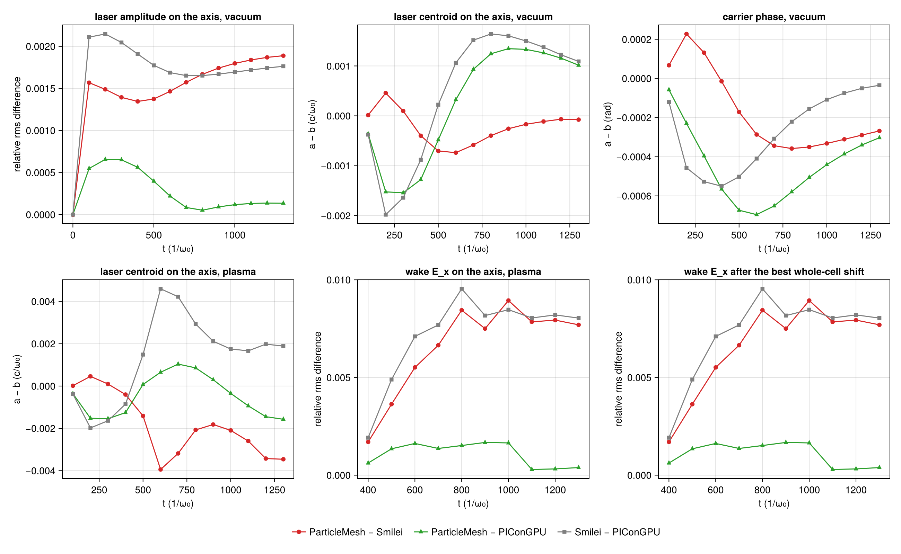
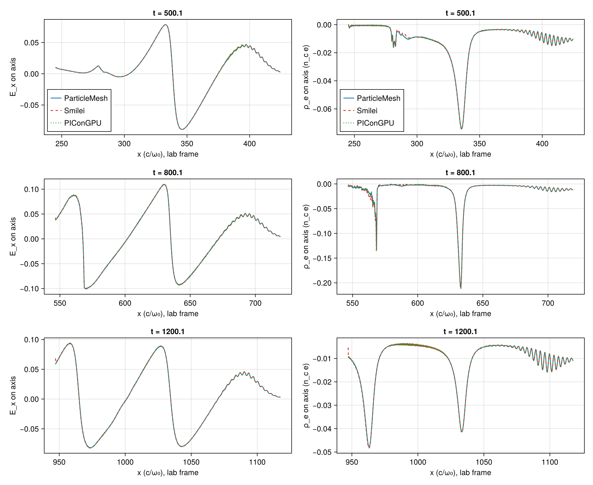
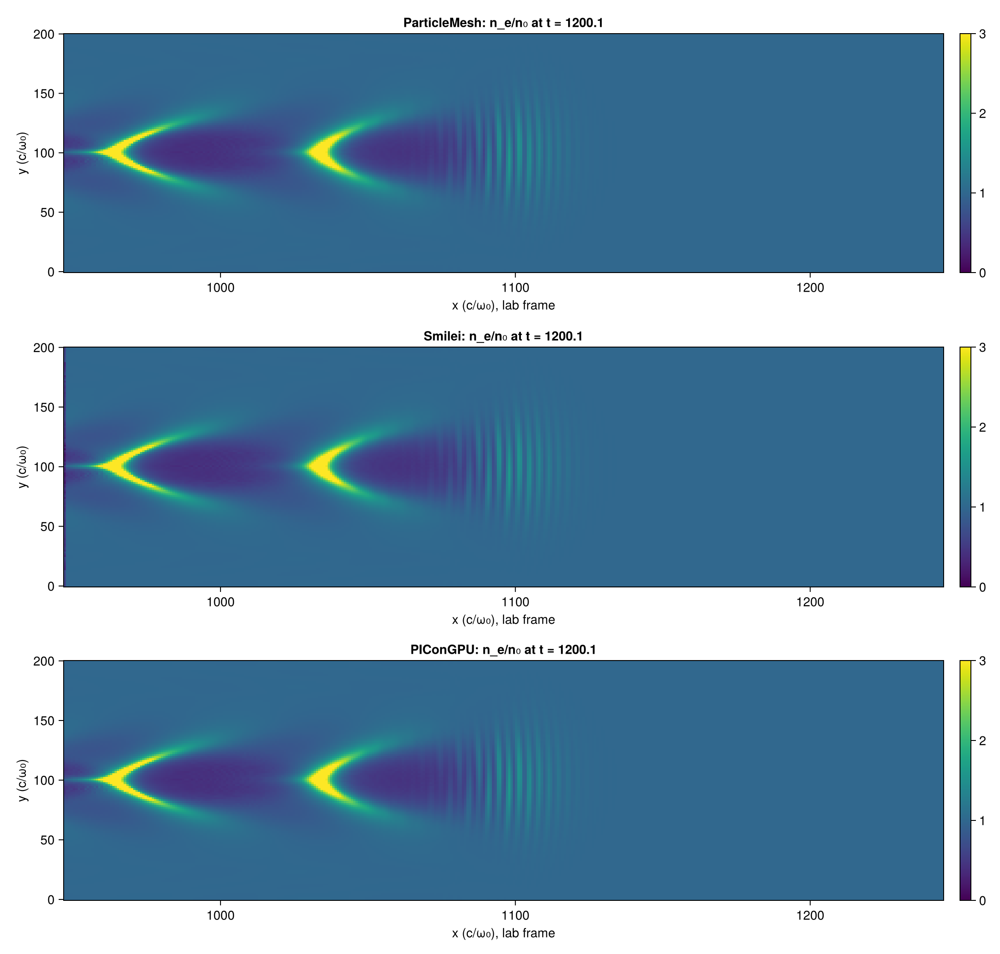

# LWFA 2D: A5's first case in ParticleMesh, Smilei and PIConGPU

| | |
|---|---|
| Work package | WP-053 (`trace/wp/WP-053-lwfa-three-codes.md`); goals A5, A7, and A3 for #362. Follows PR #336, which brought the PIConGPU column |
| Case | `scripts/lwfa/cases/lwfa-2d.toml`, λ₀/48, with `laser.envelope = "wavefront"` (sha256 `e7bc9e3f…`, in the run manifests), and `scripts/lwfa/cases/lwfa-2d-focus0.toml`, the same with the focus on the injection plane, in vacuum only |
| Commits | every run of §4 used the code of `6ead5bd` (the box requests `5b729a7` and `9f8a388` are that commit plus the prepared run directories). The comparisons: the commit in each `manifest.toml` under `lwfa-2d-a5/` (`dirty = false`) |
| Runs | ParticleMesh and Smilei: CPU box requests `runs/lwfa-a5-2` (result `ab315a6`) and `runs/lwfa-a5-focus0` (result `e86a2b8`); their summaries stay on those branches. PIConGPU: gpu-run jobs `a5-2-pic-vacuum`, `a5-2-pic-plasma` and the focus-0 vacuum run; ParticleMesh on CUDA: `lwfa-a5-2-cuda-pm-plasma`. The summaries of these four are on no branch and are in `lwfa-2d-a5/runs/`. First runs (§3): `runs/lwfa-a5-1` and `lwfa-a5pic` |
| Input hashes | each run's `manifest.toml` as `manifest-<run>.toml` next to its comparison; the box's `box-status.toml` there; the sha256 of the summaries compared under `summaries` in each comparison's `manifest.toml` |
| Environment | ParticleMesh: Julia 1.13.3, Float64, Reference mode; 16 threads on an AMD EPYC 9655 (the CPU box), and CUDA on an RTX 4080 SUPER. Smilei v5.1 (`438d43d`, image `particlemesh-smilei:e4f0148b8952fc87`), 16 OpenMP threads, the same box. PIConGPU 0.8.0 (`6bb3470e`), CUDA, Float64, the RTX 4080 SUPER |
| Figures | `lwfa-2d-a5/lwfa-a5-2-compare/` (A5's case), `lwfa-a5-focus0-compare/` (focus on the plane), each PNG with its JSON sidecar; `lwfa-a5-2-cuda-pair/pair.json` (the two backends); `lwfa-a5-three-compare/` (first runs). Every number below is a key of the `comparison.json` or `pair.json` named with it |
| Status | measured, not independently reviewed; no number here is to leave the repository before that review. An independent review of the first version found the first runs' lasers mismatched (§3); the matched runs of §4 have not been reviewed |

`pm-plasma`'s manifest says `dirty = true`: the step before it on the box, `pm-vacuum` (same commit, `dirty = false`), rewrites its own tracked `manifest.toml`. This is inferred from the two manifests, not recorded by the run.

## 1. Setup

The case, in A1's units: a₀ = 2, waist 28, τ = 26 (1/e half width of the field), focus at x = 320; electrons of 0.01 n_c (λ_p = 62.8) behind 260 of vacuum and a 60 sin² ramp, 2 × 2 per cell, cold, ions immobile; Δx = λ₀/48, Δy = 4Δx, Δt at 0.95 of Yee's 2D limit; a window of 2304 × 384 cells moving at c from t = 256; 10 777 steps, 14 outputs 829 steps apart (t ≈ 0, 100, …, 1300). Yee, Esirkepov, quadratic shapes, Boris, no current filter, Float64 in all three.

One pulse on the lab plane x = 0 in all three codes: a cosine carrier counted from the envelope's peak, the 2D Gouy phase, and envelope and carrier on one time along the curved wavefront. How each code is made to launch it, with the source lines read, is in the headers of `scripts/lwfa/lwfa.jl` and `scripts/lwfa/picongpu.jl`: PIConGPU's `GaussianPulse` is that pulse; ParticleMesh launches it with `GaussianLaser(envelope = WavefrontTime())`; Smilei's namelist gets a focus counted from its ghost node, an envelope centre and a phase offset (`smilei_laser`). The three share Δx, Δy and Δt, so their grids are one lattice in the lab frame and every comparison matches nodes by index, with nothing interpolated.

## 2. Measures

`compare_rows` in `scripts/lwfa/lwfa.jl`; a pair is written a–b (PM–S ParticleMesh–Smilei, PM–P ParticleMesh–PIConGPU, S–P Smilei–PIConGPU), and every relative rms difference is relative to b's rms.

- **Carrier phase, amplitude** (`carrier_phase`, `amplitude_relrms`, `amplitude_max`): from the lattice's own analytic signal on the axis, z(m) = E_y(m) + i·(9·(E_y(m − q) − E_y(m + q)) + E_y(m − 3q) − E_y(m + 3q))/16 with q a quarter wavelength (12 points). What is left of the carrier in |z| is of order (qΔx/τ)⁴ = 10⁻⁵ for this pulse (T-691, T-692).
- **Centroid** of E_y² on the axis (`centroid_x`).
- **Wake**: E_x on the axis from ParticleMesh's envelope peak back two plasma wavelengths, the same lattice points for all three pairs (`wake_Ex_relrms`, `wake_Ex_min`, `wake_Ex_max`); `wake_Ex_shift` is the whole-cell displacement of b's wake that fits a's best. An output has these only when |E_x| reaches 10⁻³ of the wave-breaking field in the window in both codes: from t = 400 here. `wake_sensitivity` repeats them for windows of 1.0, 1.5 and 2.5 λ_p.
- **Spectra** in one unit, electrons per unit depth in n_c (c/ω₀)²; `bunch` is the highest energy group of a spectrum, the occupied bins above its widest empty gap (`bunch_group`); `top` the upper edge of the highest occupied bin.

In `comparison.json` for reference, not counted: the box maximum of |E_y| (sampled on the lattice, up to 1 − cos(π/48) = 0.21 % below a crest); the running-max envelope (`envelope_relrms`, which reads a carrier phase as a difference); ρ_e on the axis (`wake_rho_relrms`: a few narrow spikes, whose relative rms moves by tens of percent with a displacement of a cell or with the code that places the window).

## 3. The first runs: three different pulses

The runs of 5 November (`lwfa-2d-a5/lwfa-a5-three-compare/comparison.json`) compared three pulses, and this is the record of what the mismatch was. The first version of this report, with their tables, is in this file's history (`1080c9a`).

| on the axis in vacuum, t = 200 to 1300 | PM–S | PM–P | S–P |
|---|---|---|---|
| carrier phase a − b (rad) | +1.9785 to +1.9790 | −0.0011 to +0.0004 | −1.9795 to −1.9785 |
| centroid a − b (c/ω₀) | +0.249 falling to −0.145 | −0.014 falling to −0.405 | −0.264 to −0.260 |

- **Smilei.** `LaserGaussian2D` gives the boundary envelope(t − φ(y))·sin(t − φ(y)): a sine of the run's time and no Gouy phase, where the others have a cosine from the envelope's peak; and the Silver–Müller condition applies it on the outermost ghost node, two cells behind xmin. For the case's numbers that is a phase of delay + ½·atan(320/392) − π/2 − 2Δx = 1.9787 rad mod 2π and a lag of 2Δx = 0.2618 c/ω₀: the two constant offsets measured.
- **ParticleMesh.** Its default envelope is in t − delay alone, the same at every y (`AxisTime`); PIConGPU's and Smilei's follow the curved wavefront. Past the plane the `AxisTime` pulse arrives on the axis later by (w²/(4|R|))/(1 + κ²w⁴), κ = (1/L − 1/|R|)/2, with w = 36.1 and |R| = 800.2 on the plane and L the distance travelled (T-696): up to 0.408 c/ω₀. That closed form, with no free parameter, is the measured motion of ParticleMesh's centroid against PIConGPU's to 0.004 c/ω₀ at each of the twelve outputs. Neither convention is a defect; `AxisTime` stays ParticleMesh's default and `WavefrontTime` is an opt-in (T-695 to T-697).
- **So the first runs' Smilei–PIConGPU distance was Smilei's two launch offsets**, not a spread for equivalent inputs: 5 % in the running-max envelope, and 4.2 % to 6.2 % in the wake's E_x, which a shift of two cells took down to 1.1 % to 1.7 %.
- **#362.** ParticleMesh's `ekin_max` was 1.17 to 2.41 mₑc² before the laser reached the plasma: the window's loader fills the vacuum with particles of zero weight (the density enters through the weights, A3), and the laser makes them quiver. `pm_spectrum` now takes the maximum over particles of positive weight (T-690).

## 4. The matched runs

### 4.1 Do the three codes now launch one pulse? The laser in vacuum

A5's case, focus 320 ahead of the plane (`vacuum`, `picongpu_vacuum`, `smilei_picongpu_vacuum` in `lwfa-a5-2-compare/comparison.json`). Carrier phase a − b in mrad and centroid a − b in 10⁻³ c/ω₀:

| t | phase: PM–S | PM–P | S–P | centroid: PM–S | PM–P | S–P |
|---|---|---|---|---|---|---|
| 200 | +0.23 | −0.23 | −0.46 | +0.46 | −1.52 | −1.98 |
| 300 | +0.13 | −0.40 | −0.53 | +0.10 | −1.54 | −1.64 |
| 400 | −0.01 | −0.56 | −0.55 | −0.40 | −1.28 | −0.88 |
| 500 | −0.17 | −0.67 | −0.50 | −0.70 | −0.48 | +0.22 |
| 600 | −0.29 | −0.70 | −0.41 | −0.74 | +0.32 | +1.06 |
| 700 | −0.34 | −0.65 | −0.31 | −0.58 | +0.93 | +1.52 |
| 800 | −0.36 | −0.58 | −0.22 | −0.40 | +1.24 | +1.64 |
| 900 | −0.35 | −0.51 | −0.16 | −0.26 | +1.35 | +1.60 |
| 1000 | −0.33 | −0.44 | −0.11 | −0.17 | +1.33 | +1.50 |
| 1100 | −0.31 | −0.39 | −0.07 | −0.11 | +1.26 | +1.38 |
| 1200 | −0.29 | −0.34 | −0.05 | −0.07 | +1.16 | +1.22 |
| 1300 | −0.27 | −0.30 | −0.03 | −0.08 | +1.01 | +1.09 |

Amplitude: relative rms difference and the peak's ratio a/b − 1, in percent (`amplitude_relrms`, `amplitude_max`):

| t | rms: PM–S | PM–P | S–P | peak: PM–S | PM–P | S–P |
|---|---|---|---|---|---|---|
| 200 | 0.149 | 0.066 | 0.215 | −0.148 | +0.065 | +0.214 |
| 300 | 0.139 | 0.065 | 0.205 | −0.139 | +0.065 | +0.204 |
| 400 | 0.135 | 0.056 | 0.191 | −0.135 | +0.055 | +0.190 |
| 500 | 0.137 | 0.040 | 0.177 | −0.138 | +0.039 | +0.177 |
| 600 | 0.146 | 0.022 | 0.169 | −0.147 | +0.021 | +0.169 |
| 700 | 0.157 | 0.008 | 0.165 | −0.158 | +0.007 | +0.166 |
| 800 | 0.167 | 0.005 | 0.165 | −0.168 | −0.002 | +0.166 |
| 900 | 0.174 | 0.009 | 0.167 | −0.175 | −0.008 | +0.168 |
| 1000 | 0.180 | 0.012 | 0.169 | −0.181 | −0.011 | +0.170 |
| 1100 | 0.184 | 0.013 | 0.172 | −0.185 | −0.013 | +0.173 |
| 1200 | 0.187 | 0.014 | 0.174 | −0.188 | −0.013 | +0.175 |
| 1300 | 0.189 | 0.014 | 0.176 | −0.190 | −0.013 | +0.177 |

- **Smilei's corrected launch behaves as its source said.** Its carrier is within 0.55 mrad of PIConGPU's and 0.36 mrad of ParticleMesh's (it was 1.979 rad), and its centroid within 0.002 c/ω₀ of both (it was 0.26 behind). This is the first time that namelist met Smilei.
- **`WavefrontTime` in a real run.** ParticleMesh's centroid stays within 0.0016 c/ω₀ of PIConGPU's through the focus and after (it fell 0.405 behind with `AxisTime`), and its carrier within 0.70 mrad.
- **What is left.** The three carriers agree to 0.7 mrad, the centroids to 0.002 c/ω₀ (a sixty-fifth of a cell), ParticleMesh's and PIConGPU's amplitudes to 0.07 %. Smilei's amplitude is 0.14 % to 0.21 % above both, at every output and with the pulse's shape (the rms difference is the peak's): a factor on its field, not a displacement.

### 4.2 The focus on the injection plane

`lwfa-2d-focus0.toml`: the wavefront is flat where the pulse is launched, so nothing of the launch depends on its curvature (`lwfa-a5-focus0-compare/comparison.json`). Phase in mrad, centroid in 10⁻³ c/ω₀, amplitude rms in percent:

| t | phase: PM–S | PM–P | S–P | centroid: PM–S | PM–P | S–P | amplitude: PM–S | PM–P | S–P |
|---|---|---|---|---|---|---|---|---|---|
| 200 | −0.20 | −0.69 | −0.49 | −0.21 | −0.76 | −0.56 | 0.138 | 0.036 | 0.174 |
| 300 | −0.30 | −0.69 | −0.39 | −0.51 | −0.15 | +0.36 | 0.148 | 0.018 | 0.167 |
| 400 | −0.35 | −0.64 | −0.29 | −0.56 | +0.40 | +0.95 | 0.159 | 0.006 | 0.164 |
| 500 | −0.36 | −0.56 | −0.20 | −0.49 | +0.75 | +1.24 | 0.168 | 0.005 | 0.165 |
| 600 | −0.35 | −0.49 | −0.14 | −0.41 | +0.92 | +1.33 | 0.175 | 0.009 | 0.167 |
| 700 | −0.33 | −0.43 | −0.10 | −0.35 | +0.98 | +1.32 | 0.180 | 0.012 | 0.170 |
| 800 | −0.31 | −0.38 | −0.07 | −0.30 | +0.98 | +1.28 | 0.184 | 0.013 | 0.172 |
| 900 | −0.28 | −0.33 | −0.05 | −0.25 | +0.96 | +1.20 | 0.187 | 0.014 | 0.175 |
| 1000 | −0.26 | −0.30 | −0.03 | −0.24 | +0.80 | +1.04 | 0.189 | 0.013 | 0.177 |
| 1100 | −0.26 | −0.28 | −0.02 | −0.52 | +0.62 | +1.15 | 0.190 | 0.014 | 0.177 |
| 1200 | −0.27 | −0.25 | +0.02 | −0.48 | +1.24 | +1.73 | 0.194 | 0.018 | 0.178 |
| 1300 | −0.22 | −0.15 | +0.07 | +0.65 | +2.17 | +1.52 | 0.201 | 0.020 | 0.183 |

The same sizes as with the focus 320 ahead: phases within 0.7 mrad, centroids within 0.0022 c/ω₀, Smilei's amplitude 0.14 % to 0.20 % above the others. So what the three launches still differ by does not come from the wavefront's curvature, and the larger part of it, Smilei's amplitude, is in the launch itself and not in the propagation: it is there at t = 200 and changes by 0.06 over the run.

### 4.3 The laser and the wake in plasma

The laser (`plasma`, `picongpu_plasma`, `smilei_picongpu_plasma`). Phase in mrad, centroid in 10⁻³ c/ω₀, amplitude rms in percent:

| t | phase: PM–S | PM–P | S–P | centroid: PM–S | PM–P | S–P | amplitude: PM–S | PM–P | S–P |
|---|---|---|---|---|---|---|---|---|---|
| 400 | −0.04 | −0.55 | −0.51 | −0.40 | −1.26 | −0.85 | 0.134 | 0.056 | 0.191 |
| 500 | −0.40 | −0.53 | −0.13 | −1.41 | +0.08 | +1.49 | 0.133 | 0.040 | 0.174 |
| 600 | −0.88 | −0.46 | +0.42 | −3.94 | +0.65 | +4.60 | 0.140 | 0.027 | 0.166 |
| 700 | −1.29 | −0.37 | +0.93 | −3.18 | +1.04 | +4.22 | 0.162 | 0.017 | 0.174 |
| 800 | −1.63 | −0.25 | +1.38 | −2.07 | +0.86 | +2.93 | 0.183 | 0.014 | 0.187 |
| 900 | −1.93 | −0.15 | +1.78 | −1.82 | +0.30 | +2.12 | 0.196 | 0.013 | 0.198 |
| 1000 | −2.25 | −0.07 | +2.17 | −2.10 | −0.35 | +1.75 | 0.202 | 0.009 | 0.203 |
| 1100 | −2.57 | −0.01 | +2.56 | −2.60 | −0.94 | +1.66 | 0.206 | 0.006 | 0.209 |
| 1200 | −2.93 | +0.03 | +2.96 | −3.43 | −1.45 | +1.98 | 0.208 | 0.008 | 0.213 |
| 1300 | −3.30 | +0.07 | +3.37 | −3.46 | −1.57 | +1.89 | 0.212 | 0.010 | 0.218 |

The wake's E_x on the axis, two plasma wavelengths behind the peak: relative rms difference in percent (`wake_Ex_relrms`). The best whole-cell shift is 0 for every pair at every output (`wake_Ex_shift`), so the difference after the shift is the same number.

| t | PM–S | PM–P | S–P |
|---|---|---|---|
| 400 | 0.170 | 0.062 | 0.192 |
| 500 | 0.363 | 0.135 | 0.490 |
| 600 | 0.552 | 0.162 | 0.710 |
| 700 | 0.665 | 0.137 | 0.769 |
| 800 | 0.844 | 0.152 | 0.954 |
| 900 | 0.750 | 0.168 | 0.817 |
| 1000 | 0.894 | 0.165 | 0.847 |
| 1100 | 0.785 | 0.029 | 0.805 |
| 1200 | 0.794 | 0.032 | 0.820 |
| 1300 | 0.770 | 0.039 | 0.804 |

The same for other lengths of the window, the largest value over the ten outputs (`wake_sensitivity`):

| window (λ_p) | PM–S | PM–P | S–P | outputs where PM–S exceeds S–P | where PM–P does |
|---|---|---|---|---|---|
| 1.0 | 0.556 | 0.131 | 0.567 | none | none |
| 1.5 | 0.556 | 0.122 | 0.568 | none | none |
| 2.0 | 0.894 | 0.168 | 0.954 | t = 1000 (0.894 against 0.847) | none |
| 2.5 | 1.183 | 0.197 | 1.153 | t = 1000 (1.183 against 1.153) | none |

The wake's extrema in the window, m_ecω₀/e (`wake_Ex_min`, `wake_Ex_max`), and a/b − 1 in percent:

| t | min: PM | Smilei | PIConGPU | PM–S | PM–P | S–P | max: PM | Smilei | PIConGPU | PM–S | PM–P | S–P |
|---|---|---|---|---|---|---|---|---|---|---|---|---|
| 400 | −0.00481 | −0.00481 | −0.00480 | −0.033 | +0.100 | +0.133 | 0.02934 | 0.02939 | 0.02933 | −0.181 | +0.038 | +0.219 |
| 500 | −0.08907 | −0.08921 | −0.08903 | −0.158 | +0.051 | +0.209 | 0.07853 | 0.07866 | 0.07851 | −0.169 | +0.018 | +0.187 |
| 600 | −0.09362 | −0.09380 | −0.09359 | −0.191 | +0.032 | +0.224 | 0.10354 | 0.10375 | 0.10350 | −0.194 | +0.042 | +0.237 |
| 700 | −0.09405 | −0.09425 | −0.09403 | −0.209 | +0.021 | +0.231 | 0.10987 | 0.11011 | 0.10984 | −0.221 | +0.031 | +0.252 |
| 800 | −0.10011 | −0.10091 | −0.10019 | −0.793 | −0.075 | +0.723 | 0.10960 | 0.11010 | 0.10963 | −0.454 | −0.021 | +0.435 |
| 900 | −0.09342 | −0.09368 | −0.09343 | −0.282 | −0.012 | +0.271 | 0.10456 | 0.10477 | 0.10455 | −0.203 | +0.009 | +0.213 |
| 1000 | −0.09040 | −0.09062 | −0.09038 | −0.249 | +0.017 | +0.267 | 0.09982 | 0.10001 | 0.09982 | −0.189 | +0.003 | +0.192 |
| 1100 | −0.08371 | −0.08397 | −0.08372 | −0.307 | −0.018 | +0.291 | 0.09428 | 0.09456 | 0.09429 | −0.303 | −0.011 | +0.293 |
| 1200 | −0.08187 | −0.08220 | −0.08187 | −0.392 | +0.002 | +0.395 | 0.08933 | 0.08966 | 0.08933 | −0.364 | +0.008 | +0.374 |
| 1300 | −0.07701 | −0.07720 | −0.07700 | −0.251 | +0.018 | +0.270 | 0.08476 | 0.08502 | 0.08476 | −0.301 | +0.001 | +0.304 |

- **The wake is the same in the three codes to better than 1 %.** With the first runs' lasers the pairs were 1.2 % to 6.2 % apart; with one pulse, 0.03 % to 0.95 %, and no pair is displaced by a cell.
- **ParticleMesh and PIConGPU agree several times closer than either does with Smilei**: 0.03 % to 0.17 % in E_x and within 0.10 % in the extrema, against 0.17 % to 0.95 % and 0.03 % to 0.79 % for the pairs with Smilei. Smilei's wake is the larger one, by 0.16 % to 0.79 % in the extrema at every output from t = 500, as its laser is the stronger one, by 0.13 % to 0.22 %.
- **The laser in plasma.** ParticleMesh and PIConGPU: phase within 0.55 mrad, centroid within 0.0016 c/ω₀, amplitude within 0.06 %. Smilei's carrier moves away from both, steadily, to 3.3 and 3.4 mrad at the end, and its centroid by up to 0.0046 c/ω₀.

The three density maps at t ≈ 1200 (the maps now come back at the case's stride): the same two buckets, crests and laser-driven ripples at the same lab positions.

### 4.4 Electrons

What each histogram covers (`spectrum` in `comparison.json`; `region` there says "each code's own"):

- **ParticleMesh and Smilei: one region**, the lattice cells both windows' plasma covers at the output (`spectrum_region`, e.g. cells 7992 to 10277 at the end). Smilei's two strip diagnostics, new in this run, worked on the real code (`spectrum_failed` is empty in its summary). The two totals agree to 3 × 10⁻⁴ or better at every output (1.5 × 10⁻⁵ at the end: 602.878 against 602.887).
- **PIConGPU: its whole simulated domain**, up to a local domain of 2328 cells behind the window's back, where the electrons the other codes have dropped still are. Its deck writes no electrons: with every species in the file output, the plasma run computed its steps and then did not exit, and left a file that could not be read (`scripts/lwfa/picongpu.jl`'s header). So PIConGPU's totals and low energies do not compare with the others' (above 5 mₑc² it holds 0.63 at t = 1100, the others 0.0013), and what compares is what does not depend on the region: the highest energy group and the highest occupied bin. The reader that would bin an electron dump over the region is tested on synthetic files only (T-704, T-705) and has not met PIConGPU.

The bunch, the highest energy group of each spectrum (`bunch`):

| | ParticleMesh | Smilei | PIConGPU |
|---|---|---|---|
| weight, every output from t = 800 (n_c (c/ω₀)²) | 1.247061 × 10⁻³ | 1.269786 × 10⁻³ | 1.248813 × 10⁻³ |
| energy range at t = 1300 (mₑc²) | 55.2 to 67.2 | 56.4 to 67.4 | 57.2 to 67.2 |
| occupied bins at t = 1300 (0.2 mₑc² each) | 36 | 35 | 36 |
| of those, bins with less than half a plateau macro-particle's weight | 32 | 30 | 32 |
| empty gap below the group at t = 1300 (mₑc²) | 44.0 | 40.6 | 34.6 |
| highest occupied bin ends at, t = 800 … 1300 | 24.2, 33.6, 42.4, 51.2, 59.4, 67.2 | 24.4, 33.6, 42.6, 51.2, 59.6, 67.4 | 24.2, 33.6, 42.4, 51.0, 59.4, 67.2 |

- **Weight.** ParticleMesh is 0.14 % below PIConGPU and 1.79 % below Smilei; Smilei is 1.68 % above PIConGPU. At t = 800 PIConGPU's group is separated from the rest by one mₑc² only (`gap`); from t = 900 by 4.6 or more.
- **What the bunch is.** One plateau macro-particle carries n₀·Δx·Δy/4 = 1.713 × 10⁻⁴ (`macro_weight`); the bunch weighs 7.3 to 7.4 of those but occupies 35 or 36 bins, 30 to 32 of them with less than half of one. It is at least about 35 macro-particles, most of them light: a particle's weight is the density where it was loaded, so they come from the foot of the ramp, where the three codes assign weights by three rules (ParticleMesh at the particle, PIConGPU at the cell centre, Smilei where its particle creator puts it, `lwfa.jl`'s header). A difference of a percent or two in the bunch's weight may therefore be the load and not the dynamics; this was not separated. The case does not test injection (A5 plans a second, injecting one).
- **Maximum energy.** The highest occupied bins of the three are within one bin (0.2 mₑc²) of each other at every output.
- **ParticleMesh against Smilei over the common region**, weight above 1 mₑc² (`above`): within 0.6 % to 1.8 % at eight of the ten outputs from t = 400, 2.9 % at the end and 4.0 % at t = 1000 (2.013 against 2.097), on a population that falls from 4 to 1 while the window passes over it. With the first runs' different regions the same two differed by up to 15 %.

ParticleMesh's `ekin_max` (#362) is 0 at t = 0 to 200 and 8 × 10⁻⁶ mₑc² at t = 300 in this run (`ekin_max_pm`), where the first run had 1.17 to 2.41, and from t = 400 it lies in the highest occupied bin of ParticleMesh's histogram at every output (67.15 in the bin that ends at 67.2 at t = 1300).

### 4.5 ParticleMesh on two backends

The plasma case in Reference mode, Float64, on the CPU box and on CUDA (`lwfa-a5-2-cuda-pair/pair.json`, `compare-pair`; a is the CPU run): the same code in the same mode, so the pair is what roundoff and the order of the reductions do to these observables over 10 777 steps.

| over the outputs with the measure | largest CPU–CUDA difference |
|---|---|
| carrier phase (rad) | 1.6 × 10⁻¹⁶ |
| centroid (c/ω₀) | 3.4 × 10⁻¹³ |
| amplitude, relative rms | 3.5 × 10⁻¹³ |
| E_y, E_x, ρ_e on the axis, largest pointwise difference | 3.6 × 10⁻¹², 2.8 × 10⁻¹², 2.4 × 10⁻¹¹ |
| wake E_x, relative rms | 2.0 × 10⁻¹² |
| wake extrema, a/b − 1 | 2.9 × 10⁻¹³ |
| spectrum | totals, the bunch's bins and range and the highest bin identical at every output; the bunch's weight to 3 × 10⁻¹⁶ |

The two backends are not bit for bit the same run (Reference mode's reproducibility is per backend, A4) and differ at 10⁻¹¹ and below at the end. That is eight orders below the smallest difference between two codes in §4.3, so none of those differences is roundoff.

### 4.6 Cost, as measured

| Run | Wall time | What the time covers | Hardware |
|---|---|---|---|
| ParticleMesh vacuum / plasma | 58.3 s / 2589.0 s | the stepping loop with its outputs (`seconds`); the box's steps with start-up took 82 s / 2606 s | AMD EPYC 9655, 16 threads |
| ParticleMesh plasma, CUDA | 393.8 s | the stepping loop with its outputs, the diagnostics on host copies | RTX 4080 SUPER |
| Smilei vacuum / plasma | 47.3 s / 385.6 s | the `smilei` process; the box's steps 48 s / 386 s | AMD EPYC 9655, 16 OpenMP threads |
| PIConGPU vacuum / plasma | 63.7 s / 142.2 s | the `picongpu` run after compilation; compiling took 78.0 s and 75.4 s more | RTX 4080 SUPER |
| focus on the plane, vacuum | ParticleMesh 63.1 s, Smilei 46.1 s, PIConGPU 63.7 s | as above | as above |

Single runs. No performance conclusion is drawn: ParticleMesh ran in Reference mode, which sorts every step, in Float64, and has had no optimization round; Smilei's ions are frozen particles; the codes ran on different hardware and with different diagnostics. A5's performance comparison (the same card, particle-steps per second) is not this.

## 5. Verification status and open issues

- **Not reviewed.** One run of each code at one resolution. Nothing here is a validation claim.
- **What is shown.** With one launched pulse, the three codes agree on this case to 0.7 mrad and 0.002 c/ω₀ in the laser in vacuum, to better than 1 % in the wake's E_x and its extrema, to within one bin of 0.2 mₑc² in the maximum energy and to 1.8 % in the trapped bunch's weight; ParticleMesh and PIConGPU agree to 0.17 % in the wake and 0.14 % in the bunch. The two launch conventions that separated the first runs are understood from the sources and their corrections measured (§4.1).
- **Unexplained**, each with its numbers above:
  - Smilei's laser amplitude, 0.13 % to 0.22 % above the other two in both vacuum sets and in plasma. One candidate was not tested: its boundary condition applies the incident field at half steps, and 1/cos(Δt/2) − 1 is 0.18 % here.
  - Smilei's wake, 0.16 % to 0.79 % larger in the extrema from t = 500, and its E_x 0.17 % to 0.95 % from the others'. The sign fits its stronger laser; how much of the difference that accounts for was not computed. At t = 800 the minimum differs by 0.72 % and 0.79 %, against at most 0.40 % at the other outputs.
  - Smilei's carrier phase in plasma, drifting to 3.3 mrad from both others by the end, where ParticleMesh and PIConGPU stay within 0.55 mrad.
  - Smilei's bunch, 1.7 % to 1.8 % heavier than the other two; the load rules at the ramp's foot are the candidate (§4.4).
  - ParticleMesh against PIConGPU: a carrier phase of up to 0.70 mrad and a centroid difference of up to 0.0016 c/ω₀ in vacuum with the focus ahead (0.69 mrad and 0.0022 with it on the plane), and a wake difference of 0.14 % to 0.17 % from t = 500 to 1000 that falls to 0.03 % to 0.04 % from t = 1100.
- **Not done.**
  - PIConGPU's spectrum over the common region (§4.4), and with it the reader of its electron dump on a real file.
  - A second resolution (§6).
  - Float32, and the Fast mode, for ParticleMesh; A5's performance comparison.
  - The engine on `main` after `6ead5bd`: the runs are that commit's.
- **The tests.** `scripts/lwfa/test/runtests.jl` (T-510 to T-518, T-690 to T-694, T-698 to T-708): the generators, the readers and the measures on synthetic data, and a small ParticleMesh run end to end. `lib/ParticleMeshElectromagnetic/test/antenna.jl` (T-695 to T-697): the wavefront envelope. They do not test the physics of the case.

## 6. Proposed for A7

A7 bases the benchmark thresholds on the measured Smilei–PIConGPU spread for equivalent inputs and asks that ParticleMesh agree with each of them to within it. It has accepted thresholds for the thermal and cold cases and none for LWFA. What follows is measured on the matched runs; nothing is accepted, and the owner sets A7.

The counted observables over the outputs where they exist (vacuum: t = 200 to 1300, 12 outputs; plasma: t = 400 to 1300, 10 outputs). Each entry is the range of the magnitude; "outside" counts the outputs where ParticleMesh's distance exceeds the spread at the same output, with the largest excess.

| Observable | S–P spread | PM–S | PM–P | PM–S outside | PM–P outside |
|---|---|---|---|---|---|
| vacuum: carrier phase (mrad) | 0.03 to 0.55 | 0.01 to 0.36 | 0.23 to 0.70 | 7 (0.24 at t = 1200) | 10 (0.36 at t = 800) |
| vacuum: centroid (10⁻³ c/ω₀) | 0.22 to 1.98 | 0.07 to 0.74 | 0.32 to 1.54 | 1 (0.48 at t = 500) | 2 (0.40 at t = 400) |
| vacuum: amplitude, relative rms (%) | 0.165 to 0.215 | 0.135 to 0.189 | 0.005 to 0.066 | 6 (0.013 at t = 1200) | 0 |
| plasma: carrier phase (mrad) | 0.13 to 3.37 | 0.04 to 3.30 | 0.01 to 0.55 | 7 (0.46 at t = 600) | 3 (0.40 at t = 500) |
| plasma: centroid (10⁻³ c/ω₀) | 0.85 to 4.60 | 0.40 to 3.94 | 0.08 to 1.57 | 4 (1.57 at t = 1300) | 1 (0.40 at t = 400) |
| plasma: amplitude, relative rms (%) | 0.166 to 0.218 | 0.133 to 0.212 | 0.006 to 0.056 | 0 | 0 |
| wake E_x, relative rms (%) | 0.19 to 0.95 | 0.17 to 0.89 | 0.03 to 0.17 | 1 (0.047 at t = 1000) | 0 |
| wake minimum, \|a/b − 1\| (%) | 0.13 to 0.72 | 0.03 to 0.79 | 0.00 to 0.10 | 3 (0.070 at t = 800) | 0 |
| wake maximum, \|a/b − 1\| (%) | 0.19 to 0.44 | 0.17 to 0.45 | 0.00 to 0.04 | 2 (0.019 at t = 800) | 0 |
| bunch weight, \|a/b − 1\| (%), t = 800 to 1300 | 1.68 | 1.79 | 0.14 | 6 of 6 (0.11) | 0 |
| highest occupied bin, \|a − b\| (mₑc²), t = 800 to 1300 | 0 to 0.2 | 0 to 0.2 | 0 to 0.2 | 0 | 0 |

How these read:

- **ParticleMesh is close to PIConGPU, and Smilei is the code apart**: in every observable with a scale (amplitude, wake, extrema, bunch) ParticleMesh–PIConGPU is a fifth or less of the Smilei–PIConGPU spread. ParticleMesh's distance to Smilei is then the spread itself, give or take ParticleMesh–PIConGPU, and falls inside or outside it by a few hundredths of a percent, by chance of sign. That is all the "outside" entries of the wake, the extrema and the bunch are.
- **The laser's phase and centroid are signed and cross zero**, so the spread at a single output can be arbitrarily small (0.03 mrad) while every pair stays below 0.7 mrad and 0.002 c/ω₀ in vacuum. An output-by-output comparison of such a quantity with the spread does not measure agreement.

Three forms a rule for this case could take, with what each does on these runs:

1. **A7's sentence as it stands, output by output**: |ParticleMesh − each code| ≤ |Smilei − PIConGPU| at the same output, for every counted observable. On these runs ParticleMesh fails it in the cells of the table above: against Smilei in 9 of the 11 observables, against PIConGPU in the laser's phase and centroid. The failures are of the two kinds just described, and the rule would also fail a code that reproduced PIConGPU exactly (its distance to Smilei would be the spread, and equal is the edge).
2. **A stated multiple of the spread's largest value over the run, per observable**, the form A7 accepted for the cold two-stream (about five times the measured spread there). The largest values and ParticleMesh's largest distance as a multiple of them:

   | Observable | largest S–P | PM–S / that | PM–P / that |
   |---|---|---|---|
   | vacuum: carrier phase | 0.55 mrad | 0.65 | 1.26 |
   | vacuum: centroid | 1.98 × 10⁻³ c/ω₀ | 0.37 | 0.78 |
   | vacuum: amplitude rms | 0.215 % | 0.88 | 0.31 |
   | plasma: carrier phase | 3.37 mrad | 0.98 | 0.16 |
   | plasma: centroid | 4.60 × 10⁻³ c/ω₀ | 0.86 | 0.34 |
   | plasma: amplitude rms | 0.218 % | 0.97 | 0.26 |
   | wake E_x rms | 0.954 % | 0.94 | 0.18 |
   | wake minimum | 0.723 % | 1.10 | 0.14 |
   | wake maximum | 0.435 % | 1.05 | 0.10 |
   | bunch weight | 1.68 % | 1.07 | 0.08 |
   | highest occupied bin | 0.2 mₑc² | 1.0 | 1.0 |

   With a multiple of 1 ParticleMesh fails four rows (by 5 % to 26 % of the spread). With 1.5 it passes every row; with 2 it passes with a margin of 1.6 or more everywhere. The first runs fail any such multiple by a wide margin if their lasers are held to it (ParticleMesh's centroid was 0.405 c/ω₀ from PIConGPU's, 200 times this spread), which is what the rule should do with a mismatched launch.
3. **Fixed thresholds per observable, set once from these runs**, for example the spread's largest value times 1.5 and rounded: carrier phase 1 mrad in vacuum and 5 mrad in plasma; centroid 0.003 c/ω₀ in vacuum and 0.007 in plasma; amplitude 0.35 %; wake E_x 1.5 % relative rms over two plasma wavelengths; wake extrema 1.1 % and 0.7 %; bunch weight 2.5 %; maximum energy one bin of 0.2 mₑc². ParticleMesh passes all of them against both codes. They read more plainly than a multiple, do not move when a reference run is repeated, and can be asked of ParticleMesh against one reference code where the other is not available; they are tied to this case, this resolution and these windows.

Whichever form: a rule for the laser's phase and centroid should be on the run's largest value or an absolute number, not output by output; and the bunch's weight on this case measures the load at the ramp's foot as much as the dynamics (§4.4), so it is a weak thing to hold a code to.

What the spread means here, and what a second resolution would add. Each code ran once at one resolution, and the runs are deterministic (cold regular loads, no seeds), so the spread is not noise: it is the systematic difference of two implementations of one scheme at λ₀/48, and most of it is Smilei's stronger launched amplitude (§5). One resolution cannot say whether these differences are discretization, which shrinks as the grid is refined (a boundary condition's half-step factor would go as Δt²), or a difference of what is being solved, which stays (the load rules). A second resolution in all three codes, λ₀/32 (the grid of `lwfa-2d-a2.toml`) or λ₀/64, would give the spread's dependence on Δ, and each code's own change with resolution, which is the scale a threshold has to be compared with: at λ₀/48 the observables themselves are converged to some percent that these runs do not measure, and a threshold tighter than that is a statement about two codes sharing an error, not about either being right.
