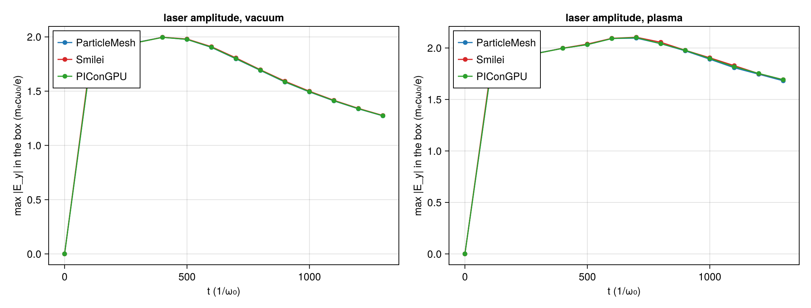
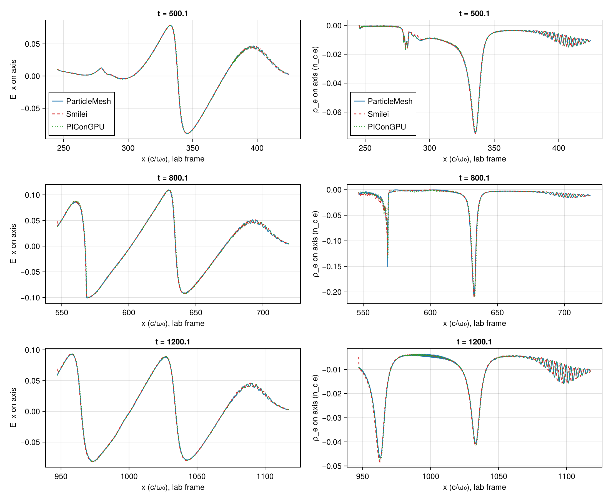
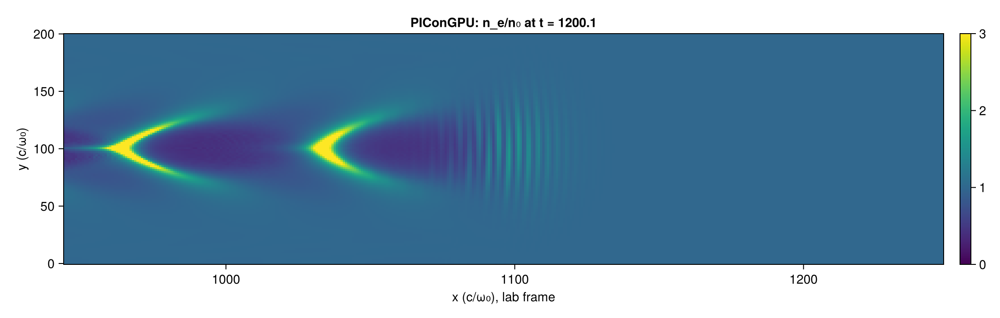
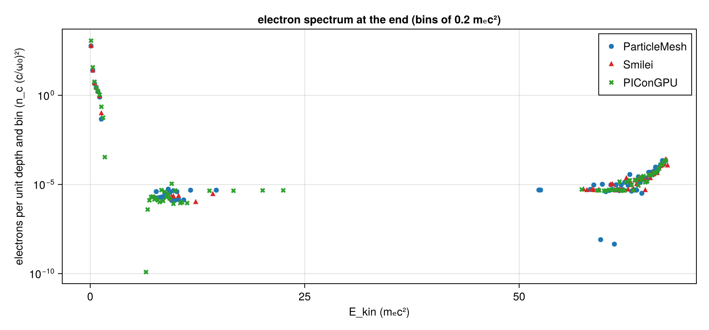

# LWFA 2D: A5's first case in ParticleMesh, Smilei and PIConGPU

| | |
|---|---|
| Goals | A5 (the first 2D LWFA case in all three codes), A7 (the measured Smilei–PIConGPU spread next to ParticleMesh's distance to each), A3 (#362); no work package. Follows PR #336, which brought the PIConGPU column and left this comparison open |
| Case | `scripts/lwfa/cases/lwfa-2d.toml` (sha256 `3c189e04…`, the same in all six run manifests): λ₀/48 |
| Commits | ParticleMesh and Smilei ran at `a28681c`, PIConGPU's deck was generated at `515e4c0`; the comparison is `a2a5c9a` (`lwfa-2d-a5/lwfa-a5-three-compare/manifest.toml`, `dirty = false`) |
| Runs | ParticleMesh and Smilei: CPU box request `runs/lwfa-a5-1` (request commit `a28681c`, result commit `9d3be28`), `pm-vacuum`, `pm-plasma`, `smilei-vacuum`, `smilei-plasma`; their summaries stay on that branch. PIConGPU: run `lwfa-a5pic`, `picongpu-vacuum` and `picongpu-plasma`; its summaries had not been committed anywhere (#361), so they are here, in `lwfa-2d-a5/picongpu/`, with the run's `container.txt` and `versions.toml` |
| Input hashes | each run's `manifest.toml`, copied as `lwfa-2d-a5/lwfa-a5-three-compare/manifest-<run>.toml`; the box's `box-status.toml`; the sha256 of the six summaries compared, under `summaries` in the comparison's `manifest.toml` (the four on `runs/lwfa-a5-1` at `9d3be28` have these hashes) |
| Environment | ParticleMesh: Julia 1.13.3, Float64, Reference mode, 16 threads, AMD EPYC 9655 (the CPU box). Smilei v5.1 (`438d43d`, image `particlemesh-smilei:e4f0148b8952fc87`), 16 OpenMP threads, one process, the same box. PIConGPU 0.8.0 (`6bb3470e`), CUDA backend, Float64, on an RTX 4080 SUPER (`picongpu/*/container.txt`, `versions.toml`) |
| Figures | `laser_amplitude.png`, `pair_distances.png`, `wake_axis.png`, `density_maps.png`, `spectrum.png` in `lwfa-2d-a5/lwfa-a5-three-compare/`, each with its JSON sidecar; every number in the tables below is a key of `comparison.json` there, named in the table's caption |
| Status | measured, not independently reviewed; no number here is to leave the repository before that review |

What the manifests say about the code that ran:

- **ParticleMesh, `dirty = true` in `pm-plasma`.** The request commit `a28681c` is `4648c36` plus the prepared run directories (`git diff --stat 4648c36 a28681c` lists only them and `box-request.toml`). `pm-vacuum` ran first, on the same commit, and its manifest says `dirty = false`; it then rewrote its own tracked `manifest.toml`, and `pm-plasma`, the next step, found a modified tracked file. This is inferred from the two manifests and from the result commit's diff (which changes nothing outside the run directories); the run did not record which file was modified.
- **PIConGPU, `515e4c0`, `dirty = false`.** `515e4c0` is an ancestor of `4648c36`, and `scripts/lwfa/` is the same at both, so the three codes were set up by one generator.
- **The engine has moved since.** `main` has changed `lib/ParticleMeshElectromagnetic/src` (`window.jl`, `step2d.jl`, `problem.jl` among others) after `a28681c`. The ParticleMesh numbers here are those of `a28681c`; nothing here shows that `main` reproduces them.

## 1. Setup

The case, in A1's units: a₀ = 2, waist 28, τ = 26 (1/e half width of the field), focus at x = 320; electrons of 0.01 n_c (λ_p = 62.8) behind 260 of vacuum and a 60 sin² ramp, 2 × 2 per cell, cold, ions immobile; Δx = λ₀/48, Δy = 4Δx, Δt at 0.95 of Yee's 2D limit; a window of 2304 × 384 cells moving at c from t = 256; 10 777 steps, 14 outputs 829 steps apart (t ≈ 0, 100, …, 1300). Yee, Esirkepov, quadratic shapes, Boris, no current filter, Float64 in all three.

How the codes are matched is in the header of `scripts/lwfa/lwfa.jl` (ParticleMesh and Smilei) and of `scripts/lwfa/picongpu.jl` (PIConGPU, its axes swapped). All three share Δx, Δy and Δt, so their grids are one lattice in the lab frame and every comparison below matches nodes by index, with nothing interpolated.

The measures (`compare_rows` in `scripts/lwfa/lwfa.jl`; a pair is written a–b, and every relative rms difference is relative to b's rms):

- **box max**: the maximum of |E_y| in the window (`Ey_absmax`).
- **centroid**: the centroid of E_y² on the axis (`centroid_x`).
- **amplitude**: the relative rms difference of the carrier-free amplitude |z| on the axis, z(m) = E_y(m) − i·(E_y(m + 12) − E_y(m − 12))/2, twelve points being a quarter wavelength (`amplitude_relrms`); `carrier_phase` is the phase of Σ z_a·z̄_b.
- **envelope**: the relative rms difference of the running maximum of |E_y| over one wavelength (`envelope_relrms`), the measure of `reports/lwfa-2d-a2.md`. It snaps to the carrier's crests, so it reads a carrier phase between two codes as a difference (§3).
- **wake**: E_x and ρ_e on the axis from ParticleMesh's envelope peak back two plasma wavelengths, the same lattice points for all three pairs (`wake_Ex_relrms`, `wake_Ex_min`, `wake_Ex_max`, `wake_rho_relrms`); `wake_Ex_shift` is the whole-cell displacement of b's wake that fits a's best, `wake_Ex_relrms_shifted` what is left after it.

In the tables, PM–S is ParticleMesh–Smilei, PM–P ParticleMesh–PIConGPU, S–P Smilei–PIConGPU, and a ParticleMesh entry is **bold** where its magnitude exceeds that of S–P at the same output.

## 2. Cost, as measured

| Run | Wall time | What the time covers | Hardware |
|---|---|---|---|
| ParticleMesh vacuum / plasma | 67.2 s / 2656.1 s | the stepping loop with its outputs (`seconds` in the summary) | AMD EPYC 9655, 16 threads |
| Smilei vacuum / plasma | 48.0 s / 401.0 s | the `smilei` process (`container.txt`) | AMD EPYC 9655, 16 OpenMP threads |
| PIConGPU vacuum / plasma | 62.9 s / 138.3 s | the `picongpu` run after compilation (`container.txt`); compiling took 69.1 s and 67.1 s more | RTX 4080 SUPER |

These are single runs, from `seconds` in `comparison.json`. No performance conclusion is drawn from them: ParticleMesh ran in Reference mode, which sorts every step, and has had no optimization round; Smilei's ions are frozen particles; PIConGPU ran on different hardware. A5's performance comparison (the same card, particle-steps per second) is not this.

## 3. The laser in vacuum

Relative rms difference on the axis, in percent (`vacuum`, `picongpu_vacuum`, `smilei_picongpu_vacuum`: `amplitude_relrms`, `envelope_relrms`). At t = 100 the envelope peak has not yet crossed the injection plane (it does at t = 104).

| t | amplitude: PM–S | PM–P | S–P | envelope: PM–S | PM–P | S–P |
|---|---|---|---|---|---|---|
| 100 | **1.09** | 0.05 | 1.04 | **5.642** | 0.056 | 5.618 |
| 200 | 0.99 | 0.09 | 1.06 | 4.998 | 0.095 | 5.016 |
| 300 | 0.83 | 0.25 | 1.05 | 4.978 | 0.245 | 5.017 |
| 400 | 0.54 | 0.56 | 1.05 | 4.940 | 0.535 | 5.013 |
| 500 | 0.30 | 0.93 | 1.04 | 4.918 | 0.883 | 5.008 |
| 600 | 0.38 | **1.25** | 1.04 | 4.920 | 1.187 | 5.003 |
| 700 | 0.53 | **1.44** | 1.03 | 4.920 | 1.368 | 4.997 |
| 800 | 0.60 | **1.53** | 1.03 | 4.930 | 1.445 | 4.998 |
| 900 | 0.62 | **1.55** | 1.03 | 4.927 | 1.469 | 4.995 |
| 1000 | 0.61 | **1.55** | 1.03 | 4.932 | 1.459 | 4.999 |
| 1100 | 0.58 | **1.52** | 1.04 | 4.929 | 1.438 | 4.998 |
| 1200 | 0.55 | **1.49** | 1.04 | 4.923 | 1.406 | 4.997 |
| 1300 | 0.52 | **1.46** | 1.04 | 4.917 | 1.380 | 4.995 |

Box maximum, a/b − 1 in percent, and centroid, a − b in c/ω₀ (`Ey_absmax`, `centroid_x`):

| t | box max: PM–S | PM–P | S–P | centroid: PM–S | PM–P | S–P |
|---|---|---|---|---|---|---|
| 100 | −1.58 | +0.06 | +1.67 | +0.705 | −0.001 | −0.706 |
| 200 | −0.01 | +0.09 | +0.10 | +0.249 | −0.014 | −0.264 |
| 300 | **+0.11** | **+0.10** | −0.01 | +0.203 | −0.060 | −0.263 |
| 400 | −0.03 | +0.05 | +0.08 | +0.119 | −0.143 | −0.263 |
| 500 | **−0.19** | −0.03 | +0.16 | +0.020 | −0.242 | −0.262 |
| 600 | **−0.35** | −0.11 | +0.24 | −0.065 | **−0.326** | −0.261 |
| 700 | **−0.49** | −0.16 | +0.33 | −0.116 | **−0.376** | −0.260 |
| 800 | **−0.37** | −0.16 | +0.21 | −0.139 | **−0.399** | −0.260 |
| 900 | **−0.53** | −0.16 | +0.37 | −0.145 | **−0.405** | −0.260 |
| 1000 | **−0.45** | −0.14 | +0.30 | −0.142 | **−0.403** | −0.260 |
| 1100 | **−0.38** | −0.13 | +0.25 | −0.136 | **−0.396** | −0.261 |
| 1200 | **−0.32** | −0.11 | +0.21 | −0.127 | **−0.387** | −0.261 |
| 1300 | **−0.27** | −0.09 | +0.19 | −0.119 | **−0.380** | −0.261 |

Carrier phase of a minus b, E_y ∝ cos(x − t + φ), from t = 200 to 1300 (`carrier_phase`): PM–S +1.9785 to +1.9790 rad, PM–P −0.0011 to +0.0004 rad, S–P −1.9795 to −1.9785 rad.

Measured:

- **Smilei's carrier is 1.979 rad from the other two, constant to 0.001 rad.** ParticleMesh's and PIConGPU's carriers agree to 0.001 rad.
- **Smilei's pulse is 0.26 c/ω₀ behind PIConGPU's, constant to 0.003** (2Δx = 0.2618).
- **ParticleMesh's pulse moves against the other two.** It starts with PIConGPU's (−0.001 at t = 100, −0.014 at t = 200), falls 0.40 behind it by t = 900, most of that between t = 300 and 700 while it passes the focus (x = 320, Rayleigh length 392), and then recovers slowly (−0.38 at t = 1300). The carrier does not move with it.
- **The 5 % of the envelope measure is the carrier phase, not the pulse.** With the carrier-free amplitude Smilei is 1.03 % to 1.06 % from PIConGPU and 0.30 % to 0.99 % from ParticleMesh. A synthetic pulse of the case's duration against itself with a carrier phase of 1.979 rad and a lag of two cells gives 5.0 % in the envelope measure and δ/τ = 2Δx/26 = 1.0 % in the amplitude (T-692 in `scripts/lwfa/test/runtests.jl`), which are Smilei–PIConGPU's 5.00 % and 1.03 %. So Smilei's distance to PIConGPU in vacuum is these two offsets, to the digits shown.
- **ParticleMesh–PIConGPU's amplitude difference is the centroid's.** It grows from 0.05 % to 1.55 % as the centroid difference grows to 0.405; a displacement δ of a Gaussian of half width τ is δ/τ = 0.405/26 = 1.56 %.
- **Box maximum.** From t = 200, ParticleMesh is within 0.16 % of PIConGPU and within 0.53 % of Smilei; Smilei is up to 0.37 % above PIConGPU. The maximum is sampled on the lattice, so it too depends on where the crests fall.

Hypotheses, not tested:

- **Smilei's carrier phase.** The script header names one cause, the missing Gouy phase of v5.1's `LaserGaussian2D` at the boundary, which is ½·atan(320/392) = 0.342 rad here. That leaves 1.64 rad unaccounted for; a different carrier convention at the boundary (a sine where the others have a cosine is π/2) would be the first thing to look for in Smilei's source. The `tgaussian` cut the header also names is at e⁻¹⁶ of the peak and cannot matter at this level.
- **Smilei's lag of two cells.** Not traced. The reader's lattice mapping is an unlikely cause: at t = 0 the three codes' ρ_e on the axis is the profile at the same lab x (`rho_axis` of the first output of the three plasma summaries: at x = 289.94, −4.985031 × 10⁻³ in ParticleMesh and PIConGPU and −4.985459 × 10⁻³ in Smilei, the profile being −4.985031 × 10⁻³; a shift of two cells would change it by 1.4 %), and E_y sits on the same x nodes as ρ_e in Smilei.
- **ParticleMesh's moving centroid.** ParticleMesh's antenna multiplies one time envelope, the same at every y, with the beam's transverse profile, and puts the wavefront curvature into the carrier only (`GaussianLaser`, `lib/ParticleMeshElectromagnetic/src/antenna.jl`). If PIConGPU's `GaussianPulse` or Smilei's boundary delays the envelope along the curved wavefront, the on-axis pulse arrives differently through the focus by a fraction of the delay at the beam's edge, r²/(2R) ≈ 0.8 c/ω₀ at the beam radius on the injection plane (r = 36, R = 800), which is the size seen. Reading PIConGPU's source for this, or a vacuum run with the focus on the injection plane (flat wavefront, where the difference should vanish), would settle it. Numerical dispersion is the same in all three (one Δx, Δy, Δt) and is not a candidate.

## 4. The laser and the wake in plasma

The laser (`plasma`, `picongpu_plasma`, `smilei_picongpu_plasma`). Box maximum a/b − 1 in percent, centroid a − b in c/ω₀:

| t | box max: PM–S | PM–P | S–P | centroid: PM–S | PM–P | S–P |
|---|---|---|---|---|---|---|
| 400 | −0.02 | +0.05 | +0.08 | +0.119 | −0.143 | −0.262 |
| 500 | **−0.27** | −0.01 | +0.26 | +0.021 | −0.238 | −0.259 |
| 600 | −0.10 | +0.02 | +0.12 | −0.083 | **−0.337** | −0.254 |
| 700 | **−0.42** | **−0.27** | +0.15 | −0.108 | **−0.363** | −0.255 |
| 800 | **−0.69** | −0.02 | +0.67 | −0.088 | **−0.345** | −0.257 |
| 900 | **−0.30** | **−0.27** | +0.03 | −0.055 | **−0.314** | −0.259 |
| 1000 | **−0.75** | −0.37 | +0.37 | −0.026 | **−0.285** | −0.260 |
| 1100 | **−1.13** | −0.55 | +0.59 | −0.001 | **−0.261** | −0.260 |
| 1200 | **−0.35** | **−0.44** | −0.08 | +0.017 | −0.243 | −0.260 |
| 1300 | **−0.65** | **−0.61** | +0.04 | +0.029 | −0.230 | −0.259 |

Amplitude from t = 400, relative rms in percent (`amplitude_relrms`): PM–S 0.33 to 1.27, PM–P 0.56 to 1.44 (above S–P from t = 600 to 1000, by at most 0.35 at t = 700), S–P 1.05 to 1.42. Carrier phase from t = 400 to 1300 (`carrier_phase`): PM–P drifts from −0.001 to −0.019 rad, S–P from −1.980 to −1.990 rad. All three self-focus to a box maximum of 2.09 to 2.10 at t = 600 to 700 (`laser_amplitude.json`).

The wake's E_x, relative rms in percent, as it is and after the best whole-cell shift of b (`wake_Ex_relrms`, `wake_Ex_relrms_shifted`), and that shift in cells (`wake_Ex_shift`, positive: b's wake is ahead of a's):

| t | as is: PM–S | PM–P | S–P | shifted: PM–S | PM–P | S–P | shift: PM–S | PM–P | S–P |
|---|---|---|---|---|---|---|---|---|---|
| 500 | 1.58 | 3.06 | 4.23 | 1.23 | 1.46 | 1.65 | −1 | +2 | +2 |
| 600 | 1.24 | 4.52 | 4.89 | **1.24** | 0.90 | 1.08 | 0 | +2 | +2 |
| 700 | 2.43 | 4.94 | 5.30 | **2.43** | **1.85** | 1.45 | 0 | +2 | +2 |
| 800 | 2.26 | 5.34 | 6.03 | **2.26** | **1.59** | 1.46 | 0 | +2 | +2 |
| 900 | 1.85 | 5.72 | 6.19 | **1.85** | 1.16 | 1.59 | 0 | +2 | +2 |
| 1000 | 2.88 | **5.81** | 5.30 | **2.88** | **2.19** | 1.62 | 0 | +2 | +2 |
| 1100 | 2.41 | 2.93 | 4.59 | **1.89** | 1.29 | 1.63 | −1 | +2 | +2 |
| 1200 | 2.56 | 2.60 | 4.58 | **1.68** | 1.13 | 1.41 | −1 | +1 | +2 |
| 1300 | 2.80 | 2.24 | 4.46 | **1.78** | 0.99 | 1.42 | −1 | +1 | +2 |

The wake's extrema in the window, m_ecω₀/e (`wake_Ex_min`, `wake_Ex_max`), and a/b − 1 in percent:

| t | min: PM | Smilei | PIConGPU | PM–S | PM–P | S–P | max: PM | Smilei | PIConGPU | PM–S | PM–P | S–P |
|---|---|---|---|---|---|---|---|---|---|---|---|---|
| 500 | −0.08919 | −0.08919 | −0.08903 | −0.00 | +0.18 | +0.19 | 0.07855 | 0.07863 | 0.07851 | −0.11 | +0.04 | +0.15 |
| 600 | −0.09348 | −0.09381 | −0.09359 | **−0.35** | −0.11 | +0.24 | 0.10389 | 0.10373 | 0.10350 | +0.16 | **+0.37** | +0.22 |
| 700 | −0.09367 | −0.09421 | −0.09403 | **−0.57** | **−0.38** | +0.19 | 0.11048 | 0.10999 | 0.10984 | **+0.44** | **+0.58** | +0.14 |
| 800 | −0.10087 | −0.10054 | −0.10019 | +0.34 | **+0.69** | +0.35 | 0.10946 | 0.10976 | 0.10963 | **−0.27** | **−0.15** | +0.12 |
| 900 | −0.09347 | −0.09401 | −0.09343 | −0.57 | +0.04 | +0.62 | 0.10406 | 0.10487 | 0.10455 | **−0.77** | **−0.47** | +0.30 |
| 1000 | −0.08978 | −0.09054 | −0.09038 | **−0.83** | **−0.66** | +0.17 | 0.09895 | 0.09997 | 0.09982 | **−1.02** | **−0.87** | +0.16 |
| 1100 | −0.08315 | −0.08388 | −0.08372 | **−0.87** | **−0.68** | +0.19 | 0.09349 | 0.09438 | 0.09429 | **−0.94** | **−0.84** | +0.10 |
| 1200 | −0.08161 | −0.08208 | −0.08187 | **−0.57** | **−0.32** | +0.26 | 0.08849 | 0.08935 | 0.08933 | **−0.97** | **−0.94** | +0.03 |
| 1300 | −0.07647 | −0.07716 | −0.07700 | **−0.90** | **−0.69** | +0.22 | 0.08398 | 0.08491 | 0.08476 | **−1.10** | **−0.92** | +0.18 |

ρ_e on the axis in the same window, relative rms in percent (`wake_rho_relrms`):

| t | PM–S | PM–P | S–P |
|---|---|---|---|
| 400 | **47.0** | 0.9 | 45.7 |
| 500 | 4.1 | 3.9 | 6.5 |
| 600 | 3.6 | **8.7** | 7.6 |
| 700 | **17.3** | **20.8** | 14.5 |
| 800 | 10.0 | 17.3 | 19.0 |
| 900 | 11.8 | 26.9 | 27.3 |
| 1000 | 14.8 | **25.8** | 17.8 |
| 1100 | 6.3 | 4.1 | 7.9 |
| 1200 | 5.5 | 3.5 | 6.0 |
| 1300 | 5.9 | 2.5 | 6.3 |

Measured:

- **The same wake in all three.** A steepened sawtooth with |E_x| up to 0.101 m_ecω₀/e (t = 800), the cold wave-breaking field being 0.1. The extrema agree within 0.8 % between any two codes up to t = 900 and within 1.1 % to the end.
- **Most of the E_x difference is a displacement.** Smilei's wake fits PIConGPU's best two cells back at every output, which is the lag of its pulse (§3); shifting it takes 4.2 % to 6.2 % down to 1.1 % to 1.7 %. ParticleMesh's wake sits with Smilei's (shift 0 or −1) and one to two cells behind PIConGPU's, as its centroid does. After the shift every pair is between 0.9 % and 2.9 %.
- **As it is, ParticleMesh is inside the Smilei–PIConGPU spread at every output but one**: against PIConGPU at t = 1000, 5.81 % against 5.30 %. After the shift it is not: ParticleMesh–Smilei exceeds Smilei–PIConGPU at eight of nine outputs (by up to 1.27 at t = 1000) and ParticleMesh–PIConGPU at three.
- **ParticleMesh's wake and laser are slightly weaker late in the run.** From t = 1000 its extrema are 0.3 % to 1.1 % smaller in magnitude than both other codes', which agree with each other to 0.03 % to 0.26 %; its box maximum is 0.35 % to 1.13 % below both from t = 1000 (0.09 % to 0.45 % below in vacuum).
- **Density.** 2.5 % to 7.9 % in every pair at t = 500 and from t = 1100; 3.6 % to 8.7 % at t = 600 and 10 % to 27 % from t = 700 to 1000, when the window holds two narrow spikes. At t = 800 (`wake_axis.json`, `rho_axis_step6632`) the spike at the back of the first bucket is −0.209 (ParticleMesh), −0.212 (Smilei) and −0.210 n_c (PIConGPU) at x = 632.6 to 633.0, and the one behind it −0.151, −0.130 and −0.135 at x = 568.1 to 568.4. At t = 400 the window holds only the foot of the ramp under the pulse, and Smilei is 46 % to 47 % from the other two, which agree to 0.9 %.

Hypotheses, not tested:

- **Smilei's density under the pulse.** The laser is polarized in the plane, the electrons quiver across the axis, and ρ_e on the axis under the pulse oscillates at the laser's wavelength (`wake_axis.png`, right column, ahead of x = 380 at t = 500). Smilei's oscillation is displaced against the others', as its carrier is. That this accounts for the 47 % at t = 400 was not checked.
- **The density spikes.** A spike a few cells wide that moves by a cell or two changes the rms by tens of percent, and the spikes' positions do differ by up to three cells between the codes (above); the E_x of the same window agrees to 1 % to 3 % after the shift. The second spike's height differs by 16 % between ParticleMesh and Smilei at t = 800; how much of the rms is position and how much is height was not separated out.
- **ParticleMesh's weaker late wake.** Not traced. Candidates are the pulse's different on-axis history through the focus (§3) and ParticleMesh's field-free back edge; neither was tested.

The 2D map is PIConGPU's alone. The box returned no `maps.h5` above 20 MB (`box-status.toml`, `dumps_over_20MB`), which were ParticleMesh's and Smilei's, so the three maps cannot be drawn without running those two again (about 45 minutes for ParticleMesh).

## 5. Electrons

The three histograms come in different units and cover different regions, so `compare` puts them in one unit, electrons per unit depth in n_c (c/ω₀)², and names the regions (`spectrum` in `comparison.json`; #361):

- **ParticleMesh**: weights are the density per particle of a cell, so the histogram is multiplied by Δx·Δy (read in `quiet_particle_2d`; T-693 checks it against the profile's integral). It covers ParticleMesh's window, the 60 antenna columns behind the case's window included.
- **Smilei**: `ParticleBinning` of the weight is ∫n dA already. It covers Smilei's window, whose back is up to a patch ahead of the case's.
- **PIConGPU**: the reader gives ∫n dA. It covers the whole simulated domain: two local domains of 2328 cells, which slide by 2328 cells at a time, so the histogram reaches up to 2328 cells behind the window's back.

The check of the unit: at t = 0 each total is the integral of the case's profile over the code's region, 25.42697 (ParticleMesh), 26.04357 (Smilei), 637.85627 (PIConGPU) against 25.42698, 26.04360 and 637.85627 from n₀·L_y·(∫sin² over the ramp + the plateau) up to each region's front at x = 301.20, 301.59 and 607.24; Smilei's normalization was not read in its source.

Total, weight above 1, 5 and 20 mₑc², and the upper edge of the highest occupied bin (`total`, `above`, `top`; bins of 0.2 mₑc²):

| t | total: PM | Smilei | PIConGPU | > 1: PM | Smilei | PIConGPU | > 5, ×10⁻³: PM | Smilei | PIConGPU | > 20, ×10⁻³: PM | Smilei | PIConGPU | top: PM | Smilei | PIConGPU |
|---|---|---|---|---|---|---|---|---|---|---|---|---|---|---|---|
| 400 | 312.0 | 317.0 | 637.9 | 1.328 | 1.322 | 1.326 | 0 | 0 | 0 | 0 | 0 | 0 | 1.8 | 1.8 | 1.8 |
| 500 | 513.1 | 515.7 | 637.9 | 1.602 | 1.591 | 1.597 | 0 | 0 | 0 | 0 | 0 | 0 | 1.6 | 1.6 | 1.6 |
| 600 | 621.0 | 608.1 | 1219.8 | 1.794 | 1.820 | 1.797 | 0.981 | 0.999 | 0.999 | 0 | 0 | 0 | 5.8 | 5.8 | 5.8 |
| 700 | 621.4 | 608.2 | 1215.7 | 2.154 | 2.002 | 3.216 | 1.532 | 1.526 | 65.53 | 0 | 0 | 0 | 15.0 | 15.0 | 15.0 |
| 800 | 621.8 | 608.2 | 1211.8 | 4.154 | 3.994 | 6.576 | 1.533 | 1.522 | 579.3 | 1.207 | 1.219 | 1.215 | 24.2 | 24.2 | 24.2 |
| 900 | 622.2 | 608.1 | 1221.3 | 4.539 | 3.950 | 4.793 | 1.532 | 1.478 | 1.497 | 1.246 | 1.268 | 1.253 | 33.6 | 33.6 | 33.6 |
| 1000 | 622.0 | 607.8 | 1217.1 | 2.064 | 2.099 | 4.309 | 1.523 | 1.344 | 1.497 | 1.246 | 1.268 | 1.258 | 42.4 | 42.6 | 42.4 |
| 1100 | 621.5 | 608.4 | 1213.6 | 1.314 | 1.375 | 5.459 | 1.368 | 1.322 | 625.6 | 1.246 | 1.268 | 1.258 | 51.0 | 51.2 | 51.0 |
| 1200 | 621.2 | 608.2 | 1222.0 | 1.093 | 1.112 | 1.120 | 1.329 | 1.301 | 1.314 | 1.246 | 1.268 | 1.258 | 59.2 | 59.4 | 59.4 |
| 1300 | 621.0 | 607.9 | 1217.9 | 0.847 | 0.954 | 1.381 | 1.297 | 1.279 | 1.314 | 1.246 | 1.268 | 1.258 | 67.0 | 67.4 | 67.2 |

Measured:

- **One small bunch, the same in all three.** From t = 600 a population above 5 mₑc² appears and is accelerated to 67 mₑc² at the end; above 20 mₑc² it holds 1.246 × 10⁻³ (ParticleMesh), 1.268 × 10⁻³ (Smilei) and 1.258 × 10⁻³ (PIConGPU) from t = 1000. ParticleMesh is 1.7 % below Smilei and 1.0 % below PIConGPU; Smilei is 0.8 % above PIConGPU. One plateau macro-particle carries n₀·Δx·Δy/4 = 1.71 × 10⁻⁴, so the bunch is about seven of them: the load is cold and regular, and the three codes trap what must be nearly the same handful of particles. This case does not test injection (A5 plans a second, injecting case).
- **Maximum energy.** The highest occupied bin ends at 67.0 (ParticleMesh), 67.4 (Smilei) and 67.2 mₑc² (PIConGPU) at t = 1300, and the three are within one bin of each other at every output from t = 400 (two bins between ParticleMesh and Smilei at t = 1300). This is the maximum to compare: each code has it from its own weighted histogram.
- **The low energies compare only where the regions agree.** Above 1 mₑc² the three agree within 1.5 % at t = 400 to 600 and within 2.5 % at t = 1200, when PIConGPU's domain reaches little behind its window. At the other outputs from t = 700 PIConGPU's histogram holds hot electrons behind the window that the other two have dropped (above 5 mₑc²: 0.58 at t = 800 against 0.0015), and ParticleMesh's and Smilei's differ by up to 15 % (t = 900): ParticleMesh's window reaches 60 cells further back than the case's, Smilei's up to a patch (36 cells) less. That these differences come from the regions and not from the codes is the reading that fits their pattern; it was not tested, and testing it means histogramming one common region, which needs new runs.

ParticleMesh's `ekin_max` (#362). `pm-plasma`'s summary has 1.17, 2.12 and 2.41 mₑc² at t = 100, 200 and 300 (`ekin_max_pm` in `comparison.json`), before the laser reaches the plasma, while its histogram holds nothing above the first bin. The cause is in the loader: the window's load and refill fill every column, the vacuum's included, with particles of weight n(x)/4 (`refill_kernel!` in `lib/ParticleMeshElectromagnetic/src/window.jl`, `quiet_particle_2d` in `lib/ParticleMeshCore/src/loading.jl`), so the vacuum holds particles of zero weight (3 626 496 alive at t = 0, 2361 × 384 × 4), and the laser makes them quiver. T-690 checks this with the real loader. `pm_spectrum` now takes the maximum over particles of positive weight. The summary of this run was written before the fix and keeps the old values. From t = 700 they lie in the highest occupied bin of ParticleMesh's histogram at every output (66.92 in [66.8, 67.0) at the end), so there the old value was the bunch's. At t = 600 the old value is 6.02 while the histogram's highest occupied bin ends at 5.8: one more particle of zero weight, this one riding in the wake.

## 6. Verification status and open issues

- **Not reviewed.** One run of each code, no scan over resolution or particles per cell. Nothing here is a validation claim.
- **What is shown.** On A5's first case the three codes produce the same pulse, wake and trapped bunch: wake extrema within 1.1 %, E_x on the axis within 6.2 % as it is and 2.9 % after a whole-cell shift, bunch weight within 1.7 %, maximum energy within two bins of 0.2 mₑc². The largest differences between the codes are two offsets of Smilei's laser (1.979 rad of carrier phase, two cells of lag) and a slow motion of ParticleMesh's on-axis pulse against the other two (0.40 c/ω₀).
- **Unexplained** (each with its numbers in §3 to §5):
  - the 0.40 c/ω₀ motion of ParticleMesh's centroid against PIConGPU's and Smilei's through the focus, in vacuum;
  - Smilei's lag of two cells, and 1.64 rad of its carrier phase beyond the Gouy phase the header names;
  - what is left of the wake's E_x after the shift (0.9 % to 2.9 %), where ParticleMesh–Smilei is the largest pair at eight of nine outputs;
  - ParticleMesh's extrema and box maximum 0.3 % to 1.1 % below both other codes from t = 1000;
  - ParticleMesh's bunch 1.0 % and 1.7 % lighter than the other two.
- **Not done.**
  - The three density maps (§4).
  - A run on `main`'s engine: the ParticleMesh column is `a28681c`'s.
  - A5's performance comparison (§2).
  - Float32 and the GPU for ParticleMesh.
- **The tests.** `scripts/lwfa/test/runtests.jl`, T-510 to T-518 and T-690 to T-694: the generators, the readers and the comparison's measures on synthetic data (341 assertions pass). They do not test the physics.

## 7. Proposed for A7

A7 asks that ParticleMesh agree with each reference code to within the measured Smilei–PIConGPU spread. The measurements for this case, per observable, over the outputs where the observable exists; nothing below is accepted, and the owner sets A7's values. "Outside" counts the outputs where ParticleMesh's distance exceeds the spread at the same output, with the largest excess.

Vacuum, t = 200 to 1300 (12 outputs):

| Observable | S–P spread | PM–S | PM–P | PM–S outside | PM–P outside |
|---|---|---|---|---|---|
| box max, \|a/b − 1\| (%) | 0.01 to 0.37 | 0.01 to 0.53 | 0.03 to 0.16 | 10 (0.16 at t = 800) | 1 (0.08 at t = 300) |
| amplitude, relative rms (%) | 1.03 to 1.06 | 0.30 to 0.99 | 0.09 to 1.55 | 0 | 8, t = 600 to 1300 (0.52 at t = 900) |
| envelope, relative rms (%) | 4.995 to 5.017 | 4.917 to 4.998 | 0.095 to 1.469 | 0 | 0 |
| centroid, \|a − b\| (c/ω₀) | 0.260 to 0.264 | 0.020 to 0.249 | 0.014 to 0.405 | 0 | 8, t = 600 to 1300 (0.145 at t = 900) |

At t = 100, while the pulse is still entering, ParticleMesh–Smilei exceeds Smilei–PIConGPU in the envelope measure by 2.3 × 10⁻⁴ (0.05642 against 0.05618) and in the amplitude by 5.2 × 10⁻⁴ (0.01093 against 0.01042).

Plasma, t = 500 to 1300 (9 outputs):

| Observable | S–P spread | PM–S | PM–P | PM–S outside | PM–P outside |
|---|---|---|---|---|---|
| box max, \|a/b − 1\| (%) | 0.03 to 0.67 | 0.10 to 1.13 | 0.01 to 0.61 | 8 (0.61 at t = 1300) | 4 (0.57 at t = 1300) |
| amplitude, relative rms (%) | 1.06 to 1.42 | 0.33 to 1.27 | 0.94 to 1.44 | 0 | 5, t = 600 to 1000 (0.35 at t = 700) |
| centroid, \|a − b\| (c/ω₀) | 0.254 to 0.260 | 0.001 to 0.108 | 0.230 to 0.363 | 0 | 6, t = 600 to 1100 (0.108 at t = 700; 0.001 at t = 1100) |
| wake E_x, relative rms (%) | 4.23 to 6.19 | 1.24 to 2.88 | 2.24 to 5.81 | 0 | 1 (0.51 at t = 1000) |
| wake E_x after the shift (%) | 1.08 to 1.65 | 1.23 to 2.88 | 0.90 to 2.19 | 8 (1.27 at t = 1000) | 3 (0.58 at t = 1000) |
| wake E_x minimum, \|a/b − 1\| (%) | 0.17 to 0.62 | 0.00 to 0.90 | 0.04 to 0.69 | 6 (0.69 at t = 1300) | 6 (0.50 at t = 1100) |
| wake E_x maximum, \|a/b − 1\| (%) | 0.03 to 0.30 | 0.11 to 1.10 | 0.04 to 0.94 | 7 (0.94 at t = 1200) | 8 (0.91 at t = 1200) |
| ρ_e, relative rms (%) | 6.0 to 27.3 | 3.6 to 17.3 | 2.5 to 26.9 | 1 (2.8 at t = 700) | 3 (8.0 at t = 1000) |
| bunch weight above 20 mₑc², \|a/b − 1\| (%), t = 900 to 1300 | 0.76 to 1.14 | 1.72 | 0.60 to 0.97 | 5 of 5 (0.95) | 4 of 5 (0.20) |
| highest occupied bin, \|a − b\| (mₑc²), t = 1300 | 0.2 | 0.4 | 0.2 | 1 of 1 (0.2, one bin) | 0 |

What the owner would be choosing between, as the numbers stand:

- **The spread is not noise.** The runs are deterministic (cold regular loads, no seeds), and the Smilei–PIConGPU spread of the laser and of E_x is two constant offsets of Smilei's laser. A threshold taken from it is as wide as those offsets, and ParticleMesh passes or fails by where its own pulse sits relative to them: inside for E_x as it is (all but one output), outside once the displacement is removed.
- **Which measure of the laser.** With the envelope measure of `reports/lwfa-2d-a2.md`, ParticleMesh is inside at every output from t = 200; that measure is dominated by Smilei's carrier phase. With the carrier-free amplitude and the centroid, ParticleMesh is outside against PIConGPU from t = 600, by the motion of its centroid, which is unexplained.
- **Extrema and bunch.** Smilei and PIConGPU agree to a few tenths of a percent in the wake's extrema and 0.8 % in the bunch; ParticleMesh is about 1 % from both at the end. With the spread as the threshold ParticleMesh fails these as measured.
