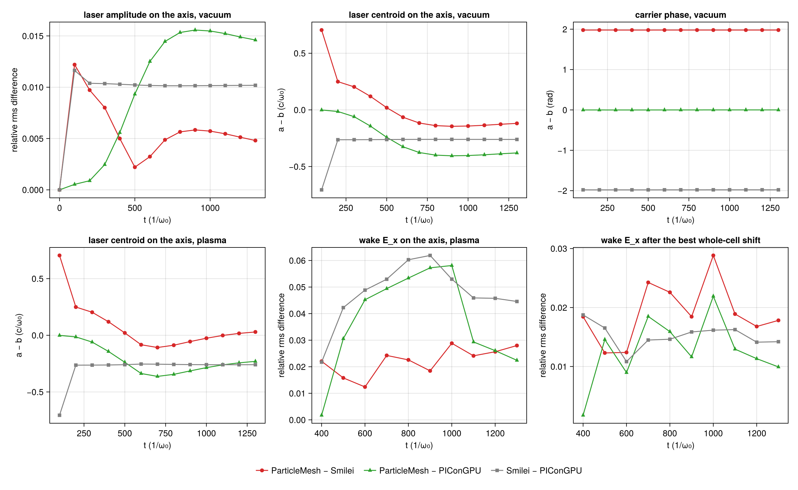

# LWFA 2D: A5's first case in ParticleMesh, Smilei and PIConGPU

| | |
|---|---|
| Work package | WP-053 (`trace/wp/WP-053-lwfa-three-codes.md`); goals A5, A7, and A3 for #362. Follows PR #336, which brought the PIConGPU column |
| Case | `scripts/lwfa/cases/lwfa-2d.toml`, λ₀/48. The first runs used it without `laser.envelope` (sha256 `3c189e04…`, in their manifests); the matched re-run uses it with `envelope = "wavefront"` |
| Commits | first runs: ParticleMesh and Smilei at `a28681c`, PIConGPU's deck at `515e4c0`. Their comparison here: the commit in `lwfa-2d-a5/lwfa-a5-three-compare/manifest.toml` (`dirty = false`) |
| Runs | first runs, 5 November: CPU box request `runs/lwfa-a5-1` (result commit `9d3be28`: `pm-*`, `smilei-*`; their summaries stay on that branch) and PIConGPU run `lwfa-a5pic` (its summaries, committed nowhere else, are in `lwfa-2d-a5/picongpu/`). Matched re-run: prepared, not yet run (§4) |
| Input hashes | each first run's `manifest.toml` as `lwfa-2d-a5/lwfa-a5-three-compare/manifest-<run>.toml`; the box's `box-status.toml`; the sha256 of the six summaries under `summaries` in the comparison's `manifest.toml` |
| Environment | first runs: ParticleMesh with Julia 1.13.3, Float64, Reference mode, 16 threads, and Smilei v5.1 (`438d43d`, image `particlemesh-smilei:e4f0148b8952fc87`), 16 OpenMP threads, both on an AMD EPYC 9655; PIConGPU 0.8.0 (`6bb3470e`), CUDA, Float64, on an RTX 4080 SUPER |
| Figures | `lwfa-2d-a5/lwfa-a5-three-compare/`, each PNG with its JSON sidecar; the numbers of §3 are keys of `comparison.json` there |
| Status | measured, not independently reviewed; no number here is to leave the repository before that review. The result tables are pending the matched re-run: the first runs compared three different laser pulses (§3), so their differences between codes are not a spread for equivalent inputs |

This report is in two states. §3 is what the first runs, of 5 November, established: how the three codes' launched pulses differed, why, and what that did to the measures. The comparison itself (§5) waits for the re-run with one pulse in all three codes, which §4 describes.

The first runs' code: ParticleMesh's `pm-plasma` manifest says `dirty = true`, because the step before it, `pm-vacuum` (same commit, `dirty = false`), had rewritten its own tracked `manifest.toml`; this is inferred from the two manifests and the result commit's diff, which touches only the run directories. `a28681c` is `4648c36` plus the prepared run directories, `515e4c0` is an ancestor of it, and `scripts/lwfa/` is the same at both. ParticleMesh's engine has changed on `main` since.

## 1. Setup

The case, in A1's units: a₀ = 2, waist 28, τ = 26 (1/e half width of the field), focus at x = 320; electrons of 0.01 n_c (λ_p = 62.8) behind 260 of vacuum and a 60 sin² ramp, 2 × 2 per cell, cold, ions immobile; Δx = λ₀/48, Δy = 4Δx, Δt at 0.95 of Yee's 2D limit; a window of 2304 × 384 cells moving at c from t = 256; 10 777 steps, 14 outputs 829 steps apart (t ≈ 0, 100, …, 1300). Yee, Esirkepov, quadratic shapes, Boris, no current filter, Float64 in all three.

How the codes are matched is in the headers of `scripts/lwfa/lwfa.jl` and `scripts/lwfa/picongpu.jl`, with the source lines each choice was read from. The three share Δx, Δy and Δt, so their grids are one lattice in the lab frame and every comparison matches nodes by index, with nothing interpolated.

## 2. Measures

`compare_rows` in `scripts/lwfa/lwfa.jl`; a pair is written a–b, and every relative rms difference is relative to b's rms.

- **Carrier-free amplitude and phase** (`amplitude_relrms`, `amplitude_max`, `carrier_phase`): from the lattice's own analytic signal, z(m) = E_y(m) + i·(9·(E_y(m − q) − E_y(m + q)) + E_y(m − 3q) − E_y(m + 3q))/16 with q a quarter wavelength (12 points). What is left of the carrier in |z| is of order (qΔx/τ)⁴ = 10⁻⁵ for this pulse (T-691, T-692), and of the lattice's phase-velocity error, 10⁻⁴, in a run.
- **Centroid** of E_y² on the axis (`centroid_x`).
- **Wake**: E_x on the axis from ParticleMesh's envelope peak back two plasma wavelengths, the same lattice points for all three pairs (`wake_Ex_relrms`, `wake_Ex_min`, `wake_Ex_max`); `wake_Ex_shift` is the whole-cell displacement of b's wake that fits a's best, `wake_Ex_relrms_shifted` what is left after it. An output has these only when |E_x| reaches 10⁻³ of the wave-breaking field in the window in both codes; the first such output of this case is t = 400. `wake_sensitivity` repeats them for windows of 1.0, 1.5 and 2.5 λ_p.
- **Spectra** in one unit, electrons per unit depth in n_c (c/ω₀)², over one region, the lattice cells all three codes' plasma covers at the output (`spectrum_region`); `bunch` is the highest energy group of a spectrum, the occupied bins above its widest empty gap (`bunch_group`).

Kept in `comparison.json` for reference and not counted:

- **Box maximum of |E_y|** (`Ey_absmax`). It is sampled on the lattice, up to 1 − cos(π/48) = 0.21 % below the crest, and where the crests fall depends on the carrier phase. The differences it showed between the first runs (0.01 % to 0.5 %) are of that size.
- **Running-max envelope** (`envelope_relrms`), the measure of `reports/lwfa-2d-a2.md`. It snaps to the crests: a carrier phase alone reads as percents (§3.1).
- **ρ_e on the axis** (`wake_rho_relrms`). ρ_e is a few spikes a few cells wide; a displacement of a cell or two, or another choice of the code that places the window, moves its relative rms by tens of percent, and the window holds the pulse, under which ρ_e follows the carrier.

## 3. What the first runs showed: three different pulses

Measured on the axis in vacuum, t = 200 to 1300 (`vacuum`, `picongpu_vacuum`, `smilei_picongpu_vacuum` in `comparison.json`):

| | ParticleMesh–Smilei | ParticleMesh–PIConGPU | Smilei–PIConGPU |
|---|---|---|---|
| carrier phase a − b (rad) | +1.9785 to +1.9790 | −0.0011 to +0.0004 | −1.9795 to −1.9785 |
| centroid a − b (c/ω₀) | +0.249 falling to −0.145 | −0.014 falling to −0.405 | −0.264 to −0.260 |
| amplitude, relative rms (%) | 0.22 to 0.97 | 0.09 to 1.56 | 1.01 to 1.04 |
| running-max envelope, relative rms (%) | 4.92 to 5.00 | 0.10 to 1.47 | 5.00 to 5.02 |

### 3.1 Smilei: a sine carrier without Gouy phase, launched two cells behind the plane

Read in Smilei v5.1's source (lines in the header of `scripts/lwfa/lwfa.jl`): `LaserGaussian2D` at normal incidence gives the boundary the amplitude envelope(t − φ(y))·space(y)·sin(t − φ(y)) with φ(y) the wavefront's phase alone. The carrier is a sine of the time since the start of the run, where the other two codes have a cosine of the time from the envelope's peak, and there is no Gouy phase. The Silver–Müller condition applies it on the outermost ghost node, two cells behind xmin, so the pulse reaches x = 0 two cells late.

For the case's numbers that is a carrier phase of delay + ½·atan(320/392) − π/2 − 2Δx = 1.9787 rad (mod 2π) against the other two codes, and a lag of 2Δx = 0.2618 c/ω₀. Measured: 1.9785 to 1.9790 rad, and Smilei 0.260 to 0.264 behind PIConGPU. Both offsets are constant in time, as a difference of the launch must be.

The 5 % of the running-max envelope is these two offsets and not a difference of the pulses' shapes: a synthetic pulse of the case's duration against itself with a carrier phase of 1.979 rad and a lag of two cells reads 5.0 % in that measure and δ/τ = 2Δx/26 = 1.0 % in the amplitude (T-692), the first runs' 5.00 % and 1.02 %.

### 3.2 ParticleMesh: an envelope in t alone, where the other two follow the wavefront

ParticleMesh's `GaussianLaser` by default has its envelope in t − delay, the same at every y of the antenna plane, with the wavefront's curvature in the carrier only (`AxisTime`). PIConGPU's `GaussianPulse` evaluates its envelope at time − r/c, r the wavefront's delay (`GaussianPulse.hpp:284`), and Smilei's at t − φ(y) (`Laser.cpp:460`): both along the curved wavefront. On the plane the two conventions are the same field on the axis and differ off it; past the plane they differ on the axis. For a plane ahead of the focus, where the beam has radius w and the wavefront radius R, the `AxisTime` pulse arrives on the axis later by

    (w²/(4|R|)) / (1 + κ²w⁴),   κ = (1/L − 1/|R|)/2,

a distance L past the plane (each frequency of the pulse is a Gaussian beam; the two conventions give its wavefront radius on the plane as R and as ω·R; T-696 checks this against a Fresnel propagation of the antenna's field). Here w = 36.1 and |R| = 800.2, so the lag grows to w²/(4|R|) = 0.408 at L = 800 and falls slowly after.

The first runs against that, ParticleMesh minus PIConGPU, with L = t − 104 (`centroid_x` of `picongpu_vacuum`):

| t | L | closed form | measured | difference |
|---|---|---|---|---|
| 200 | 96 | −0.011 | −0.014 | −0.003 |
| 300 | 196 | −0.056 | −0.060 | −0.004 |
| 400 | 296 | −0.139 | −0.143 | −0.004 |
| 500 | 396 | −0.241 | −0.242 | −0.001 |
| 600 | 496 | −0.326 | −0.326 | +0.001 |
| 700 | 596 | −0.379 | −0.376 | +0.002 |
| 800 | 696 | −0.402 | −0.399 | +0.003 |
| 900 | 796 | −0.408 | −0.405 | +0.003 |
| 1000 | 896 | −0.405 | −0.403 | +0.002 |
| 1100 | 996 | −0.398 | −0.396 | +0.002 |
| 1200 | 1096 | −0.389 | −0.387 | +0.002 |
| 1300 | 1196 | −0.380 | −0.380 | +0.001 |

The closed form has no free parameter and accounts for the motion of ParticleMesh's pulse to 0.004 c/ω₀. ParticleMesh's and PIConGPU's carriers agreed to 0.001 rad throughout, as they should: the two conventions have the same carrier. The amplitude difference between the two (0.09 % rising to 1.56 %) is this displacement: δ/τ = 0.405/26 = 1.56 %.

Neither convention is a defect; they are two pulses. `AxisTime` stays ParticleMesh's default. For runs compared with the other two codes the case file now selects `WavefrontTime`, an opt-in of `GaussianLaser` (T-695 to T-697).

### 3.3 What this means for the first comparison

- **The Smilei–PIConGPU distance of the first runs is not A7's spread for equivalent inputs.** In the laser it is Smilei's two launch offsets (§3.1). In the wake's E_x it is mostly the same lag: Smilei's wake fitted PIConGPU's best two cells back at every output from t = 500 (`wake_Ex_shift` of `smilei_picongpu_plasma`), and the shift took their relative rms difference from 4.2 % to 6.2 % down to 1.1 % to 1.7 %.
- **ParticleMesh's distances were set by where its own pulse sat between the other two**, 0.40 behind PIConGPU's and so near Smilei's from t = 600. Whether it was inside the Smilei–PIConGPU distance also depended on choices of the measure: with a window of two plasma wavelengths ParticleMesh–PIConGPU exceeded Smilei–PIConGPU in E_x at one of the nine outputs from t = 500; with 1.0, 1.5 and 2.5 λ_p at three, two and two (`wake_sensitivity`); and at t = 400, the first output with a wake, ParticleMesh–Smilei was 2.206 % against 2.174 %.
- **So the first runs do not show the three codes launching the same pulse**, and no statement of agreement is drawn from them here.

### 3.4 The electron spectra of the first runs

The three histograms were in different units and covered different regions: ParticleMesh's weights are the density per particle of a cell, so its histogram needs the factor Δx·Δy (T-693); it covered ParticleMesh's window with the 60 antenna columns behind the case's; Smilei's covered its window, whose back leads by up to a patch; PIConGPU's plugin covers its whole simulated domain, which reaches up to a local domain of 2328 cells behind the window's back. At t = 0 each total is the integral of the case's profile over its code's region, to 10⁻⁶ or better (25.42697, 26.04357 and 637.85627 against 25.42698, 26.04360 and 637.85627), which fixes the units. Behind PIConGPU's window its histogram held hot electrons the other two had dropped, so the low energies did not compare (#361).

One population compared: the electrons trapped in the wake, which gain energy up to 67 mₑc² at the end. Isolated as the highest energy group of each spectrum (`bunch` under `spectrum` in `comparison.json`):

| | ParticleMesh | Smilei | PIConGPU |
|---|---|---|---|
| weight, t = 900 to 1300 (n_c (c/ω₀)²) | 1.245920 × 10⁻³ | 1.267714 × 10⁻³ | 1.248813 × 10⁻³ |
| energy range at t = 1300 (mₑc²) | 52.2 to 67.0 | 57.4 to 67.4 | 57.2 to 67.2 |
| occupied bins at t = 1300 (0.2 mₑc² each) | 40 | 38 | 36 |
| of those, bins with less than half a plateau macro-particle's weight | 35 | 33 | 32 |
| empty gap below the group at t = 1300 (mₑc²) | 37.4 | 43.0 | 34.6 |

- **Weight.** ParticleMesh is 0.23 % below PIConGPU and 1.72 % below Smilei; Smilei is 1.51 % above PIConGPU. Each weight is constant from t = 900 (ParticleMesh's and Smilei's from t = 800, where PIConGPU's group is separated by one mₑc² only).
- **A threshold is not this measure.** The weight above 20 mₑc² is PIConGPU's 1.258096 × 10⁻³ from t = 1000: it counts two more electrons of 4.64 × 10⁻⁶ each, between 20.0 and 23.6 mₑc², which do not gain energy while the bunch goes from 33 to 67. ParticleMesh and Smilei have nothing between 20 mₑc² and their bunch.
- **What the bunch is made of.** One plateau macro-particle carries n₀·Δx·Δy/4 = 1.713 × 10⁻⁴ (`macro_weight`), and the bunch weighs 7.3 of those. But it occupies 36 to 40 bins, 32 to 35 of which hold less than half of one: it is at least about 40 macro-particles, most of them light. A particle's weight is the density where it was loaded, so the light ones come from the foot of the ramp. The three codes assign weights there by three different rules (`lwfa.jl`'s header, "The plasma"), so differences of a percent in the bunch's weight may come from the load and not from the dynamics. This case does not test injection (A5 plans a second, injecting case).

### 3.5 ParticleMesh's `ekin_max` (#362)

`pm-plasma`'s summary has 1.17, 2.12 and 2.41 mₑc² at t = 100, 200 and 300 (`ekin_max_pm`), before the laser reaches the plasma, while its histogram holds nothing above the first bin. The window's load and refill fill every column, the vacuum's included, with particles of weight n(x)/4 (`refill_kernel!`, `quiet_particle_2d`), so the vacuum holds particles of zero weight (3 626 496 alive at t = 0, 2361 × 384 × 4), and the laser makes them quiver. T-690 checks this with the real loader. `pm_spectrum` now takes the maximum over particles of positive weight; the first run's summary keeps the old values. From t = 700 they lie in the highest occupied bin of ParticleMesh's histogram; at t = 600 the old value is 6.02 while the histogram ends at 5.8, one more particle of zero weight, riding in the wake.

## 4. The matched re-run

What is changed for it, each in `scripts/lwfa/` unless said:

- **One pulse on the lab plane x = 0**: a cosine carrier from the envelope's peak, the 2D Gouy phase, envelope and carrier on one time along the curved wavefront (the header's "The laser"). PIConGPU launches it as it is. ParticleMesh launches it with `envelope = WavefrontTime()` (`lib/ParticleMeshElectromagnetic/src/antenna.jl`), which the case file selects. Smilei's namelist gets the focus counted from its ghost node, an envelope centre that turns its sine into that cosine with the Gouy phase, and the phase offset that puts the peak on the node at t = delay − 2Δx (`smilei_laser`; T-698 evaluates the namelist's laser as Smilei's source does and finds the case's pulse to 10⁻¹² a₀).
- **A second, vacuum-only set with the focus on the injection plane** (`cases/lwfa-2d-focus0.toml`): the wavefront is flat where the pulse is launched, so nothing of the launch depends on its curvature, and what the codes differ by is the rest.
- **The spectra over one region**: ParticleMesh bins the particles of `spectrum_region`; Smilei's window histogram has the strips outside it taken off (two more diagnostics); PIConGPU's is binned by the reader from an electron dump (T-701, T-703, T-704).
- **The maps at the case's stride**, so that all three come back from the box (the first runs' ParticleMesh and Smilei maps were over its 20 MB limit).

The prepared run directories and the commands are in the pull request that carries this report.

## 5. Results

Pending the matched re-run:

- the laser in vacuum, both sets: carrier phase, centroid and amplitude of the three pairs per output;
- the laser and the wake in plasma: centroid, amplitude, E_x (as it is and after the shift, with the rows of the other window lengths), extrema;
- the electrons: the spectra over the common region, the bunch by its energy group, the highest occupied bin;
- the three density maps;
- wall times, as measured, with the hardware named.

## 6. Verification status and open issues

- **Not a validation claim.** One run of each code so far, with mismatched lasers.
- **Settled by reading the sources and by the first runs' numbers**: Smilei's carrier phase and two-cell lag (§3.1), and the motion of ParticleMesh's centroid against the other two (§3.2).
- **Not settled.**
  - Whether the matched lasers agree as the sources say they should; the vacuum runs of §4 measure it. Smilei's launch was read, not run: the sub-cell part of its lag is known only from the first runs (the phase leaves 0.001 c/ω₀).
  - What is left of the wake's E_x after a whole-cell shift in the first runs, 0.9 % to 2.9 % in every pair, and ParticleMesh's wake extrema about 1 % below both other codes' from t = 1000. Both may follow from the pulses' different histories through the focus; the re-run tells.
  - The reader of PIConGPU's electron dump is tested on synthetic files written as PIConGPU 0.8.0 is understood to write them, not on a real dump. It decides from the data which way `positionOffset` counts and refuses what fits none; if it refuses, the summary keeps the plugin's histogram and says so, and the dump stays for a corrected reader.
- **The tests.** `scripts/lwfa/test/runtests.jl` (T-510 to T-518, T-690 to T-694, T-698 to T-707) for the generators, the readers and the measures on synthetic data, and a small ParticleMesh run end to end; `lib/ParticleMeshElectromagnetic/test/antenna.jl` (T-695 to T-697) for the wavefront envelope. They do not test the physics of the case.

## 7. Proposed for A7

Pending the matched re-run. A7 has no accepted threshold for LWFA. The first runs' Smilei–PIConGPU distances are not proposed as a spread: they are two launch offsets of Smilei's laser (§3.3).
