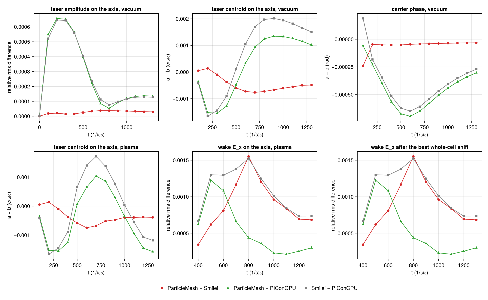
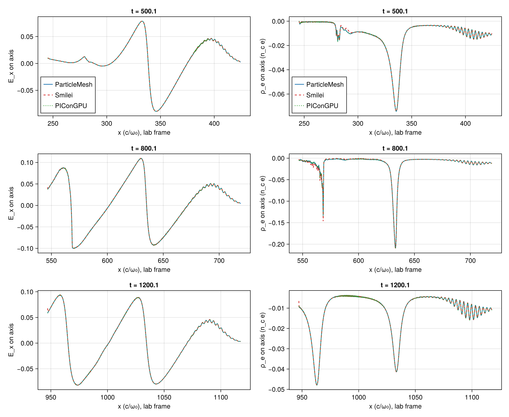
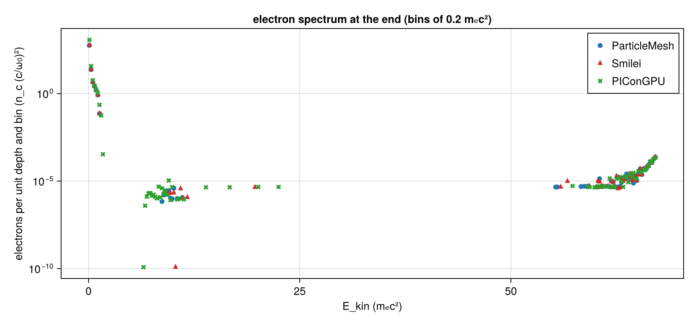

# LWFA 2D: A5's first case in ParticleMesh, Smilei and PIConGPU

**Summary.**
- The case: A5's first 2D laser-wakefield case (a₀ = 2, λ₀/48, 10 777 steps, a wake with little injection), run from one case file in ParticleMesh, Smilei v5.1 and PIConGPU 0.8.0 and compared on shared lattice points.
- Matching the launched pulse took four terms in Smilei (a sine carrier without Gouy phase, an injection node two cells behind the boundary, its boundary condition's plane-wave factor of 1.00198, and that condition's response to oblique components), one envelope convention in ParticleMesh (the opt-in `WavefrontTime`), and one term in PIConGPU that is modelled and not removed (B = k̂ × E on its Huygens surface with a weak absorber behind).
- ParticleMesh against Smilei, launches matched, largest over the run: 0.004 % in the vacuum amplitude, 0.05 mrad in the carrier, 0.0008 c/ω₀ in the centroid; in plasma 0.03 % in the amplitude on the axis, 0.16 % in the wake's E_x over 1.5 λ_p, 0.09 % in its extrema, 0.06 % in the maps of E_y over all rows (0.07 % in the flank, 0.29 % in the far wing), the 48 cells at the back of Smilei's window left out (0.15 % with them), the same maximum-energy bin, 1.0 % to 1.4 % in the trapped bunch's weight, and up to 3.0 % and 2.1 % in the electron weight above 1 and above 10 mₑc².
- Either of them against PIConGPU: 0.07 %, 0.70 mrad and 0.0025 c/ω₀ in vacuum. In amplitude and phase this has the form of a launch term of PIConGPU's (0.82 of the oblique term, a focus 0.42 to 0.47 c/ω₀ further out; modelled, not verified by a PIConGPU run); the centroid difference is not fitted and not explained. In plasma: up to 0.16 % in the wake's E_x, up to 0.12 % in its extrema, one bin of 0.2 mₑc²; ParticleMesh's bunch 0.14 % from PIConGPU's, Smilei's 0.9 % to 1.2 %.
- Not shown: correctness (three implementations of one scheme at one resolution share its error) or convergence (one run per code); injection (the bunch is seven macro-particle weights); Float32 and the Fast mode of ParticleMesh; the engine after `6ead5bd`, at which ParticleMesh ran; PIConGPU's spectrum over the common region; any PIConGPU run testing the model of its launch; a repeat of a Smilei or PIConGPU run (their determinism is inferred). Left unexplained: Smilei's wake difference from t = 700, and its E_y at the back of its window (20 % to 40 % in a few columns, excluded from the map number).
- This is not an A7 pass. A7 has no LWFA threshold; §6 says what the evidence supports and offers three choices, accepting none.

| | |
|---|---|
| Work package | WP-053 (`trace/wp/WP-053-lwfa-three-codes.md`); goals A5, A7, and A3 for #362. Follows PR #336, which brought the PIConGPU column |
| Case | `scripts/lwfa/cases/lwfa-2d.toml`, λ₀/48, with `laser.envelope = "wavefront"` (sha256 `e7bc9e3f…`, in the run manifests), and `scripts/lwfa/cases/lwfa-2d-focus0.toml`, the same with the focus on the injection plane, in vacuum only |
| Commits | ParticleMesh's and PIConGPU's runs of §4 used the code of `6ead5bd` (the box requests `5b729a7` and `9f8a388` are that commit plus the prepared run directories); Smilei's runs of §4 the request `99179ed`, which is `2a8d467` plus its run directories. These commits and the others cited below are commits of the PR branch `worktree-wp-053-lwfa-three-codes`; a squash merge does not keep them reachable from `main`. The comparisons: the commit in each `manifest.toml` under `lwfa-2d-a5/` (`dirty = false`) |
| Runs | ParticleMesh: CPU box requests `runs/lwfa-a5-2` (result `ab315a6`) and `runs/lwfa-a5-focus0` (result `e86a2b8`). Smilei: CPU box request `runs/lwfa-a5-4-smilei` (result `2ca3eb6`), with all four corrections of its launch; its three earlier sets are history: on the first two requests without the plane-wave factor (§3.2), on `runs/lwfa-a5-3-smilei` (result `088fd90`) without the oblique term (§3.3). The summaries stay on those branches. PIConGPU: gpu-run jobs `a5-2-pic-vacuum`, `a5-2-pic-plasma` and the focus-0 vacuum run; ParticleMesh on CUDA: `lwfa-a5-2-cuda-pm-plasma`. The summaries of these four are on no branch and are in `lwfa-2d-a5/runs/`, with the maps of PIConGPU's plasma run (`runs/lwfa-a5-2/picongpu-plasma/maps.h5`), which the off-axis rows read. First runs (§3.1): `runs/lwfa-a5-1` and `lwfa-a5pic` |
| Input hashes | each run's `manifest.toml` as `manifest-<run>.toml` next to its comparison; the boxes' `box-status.toml` (`lwfa-a5-2-compare/`, `lwfa-a5-focus0-compare/`) and `box-status-smilei.toml` (`lwfa-a5-4-compare/`, and `lwfa-a5-3-compare/` for the third set); the sha256 of the summaries compared under `summaries`, and of the plasma runs' `maps.h5` under `maps`, in each comparison's `manifest.toml` |
| Environment | ParticleMesh: Julia 1.13.3, Float64, Reference mode; 16 threads on an AMD EPYC 9655 (the CPU box), and CUDA on an RTX 4080 SUPER. Smilei v5.1 (`438d43d`, image `particlemesh-smilei:e4f0148b8952fc87`), 16 OpenMP threads, the same box. PIConGPU 0.8.0 (`6bb3470e`), CUDA, Float64, the RTX 4080 SUPER |
| Figures | `lwfa-2d-a5/lwfa-a5-4-compare/` (A5's case), `lwfa-a5-4-focus0-compare/` (focus on the plane), each PNG with its JSON sidecar; `lwfa-a5-2-cuda-pair/pair.json` (ParticleMesh on two backends); `lwfa-a5-smilei-pair/pair.json` and `lwfa-a5-smilei-pair-oblique/pair.json` (Smilei against itself, before and after its third and its fourth correction). History, each a `comparison.json` with its manifests: `lwfa-a5-three-compare/` (first runs), `lwfa-a5-2-compare/` and `lwfa-a5-focus0-compare/` (second), `lwfa-a5-3-compare/` and `lwfa-a5-3-focus0-compare/` (third); their figures are in the commits `c9de0de`, `df75c5c` and `2a8d467` of the PR branch. The measured values below are keys of the `comparison.json` or `pair.json` named with them; ranges, largest values, counts and ratios are computed from those keys, the wall times and the box's step times are from the runs' summaries and the box status files, and the few numbers computed from the summaries or the maps directly say so where they stand |
| Status | measured; reviewed independently four times (`lwfa-2d-a5/review.md`), the last pass on `efdc9b4`, whose findings are applied in this text; not validated, and not an A7 pass |
| Review | Three independent reviews by fresh numerics-reviewer subagents (claude-fable-5-2, 2026-11-12); their findings are in `lwfa-2d-a5/review.md`. The first, on the unmatched first runs, found that the three codes had launched three different pulses and that the spectra covered different regions (§3.1, §4.4). The second, on `c9de0de`, reproduced every table of the second runs and found two wrong numbers, a hypothesis stated as fact, the wake's measure ending on a bucket's edge, and the pulse compared on the axis only. The third, on `2ee80a5`, reproduced the tables of the third runs (732 cells) and found one more term in Smilei's launch, its boundary condition's response to oblique components (§3.3), and sentences that were wrong or attributed a difference to the wrong pair. The fourth, on `efdc9b4`, reproduced the summary, the tables of the fourth runs and §6.1, and found wording stronger than the data in the summary and §6 (the centroid distance to PIConGPU called its launch term, the map number without its exclusions, "equivalent inputs" for a pair whose launches only are matched); those are corrected here and no number changed |

`pm-plasma`'s manifest says `dirty = true`: the step before it on the box, `pm-vacuum` (same commit, `dirty = false`), rewrites its own tracked `manifest.toml`. This is inferred from the two manifests, not recorded by the run.

## 1. Setup

The case, in A1's units: a₀ = 2, waist 28, τ = 26 (1/e half width of the field), focus at x = 320; electrons of 0.01 n_c (λ_p = 62.8) behind 260 of vacuum and a 60 sin² ramp, 2 × 2 per cell, cold, ions immobile; Δx = λ₀/48, Δy = 4Δx, Δt at 0.95 of Yee's 2D limit; a window of 2304 × 384 cells moving at c from t = 256; 10 777 steps, 14 outputs 829 steps apart (t ≈ 0, 100, …, 1300). Yee, Esirkepov, quadratic shapes, Boris, no current filter, Float64 in all three.

One pulse on the lab plane x = 0 in all three codes: a cosine carrier counted from the envelope's peak, the 2D Gouy phase, envelope and carrier on one time along the curved wavefront, and one amplitude. How each code is made to launch it, with the source lines read, is in the headers of `scripts/lwfa/lwfa.jl` and `scripts/lwfa/picongpu.jl`: PIConGPU's `GaussianPulse` is that pulse; ParticleMesh launches it with `GaussianLaser(envelope = WavefrontTime())`; Smilei's namelist gets a focus counted from its ghost node, an envelope centre, a phase offset, the case's a₀ divided by what its boundary condition launches per unit, and a waist narrowed to undo that condition's response to oblique components (`smilei_laser`, §3.2, §3.3). PIConGPU's launch has a term of that last kind which is not removed (§3.3). The three share Δx, Δy and Δt, so their grids are one lattice in the lab frame and every comparison matches nodes by index, with nothing interpolated.

## 2. Measures

`compare_rows` in `scripts/lwfa/lwfa.jl`; a pair is written a–b (PM–S ParticleMesh–Smilei, PM–P ParticleMesh–PIConGPU, S–P Smilei–PIConGPU), and every relative rms difference is relative to b's rms.

- **Carrier phase, amplitude** (`carrier_phase`, `amplitude_relrms`, `amplitude_max`): from the lattice's own analytic signal on the axis, z(m) = E_y(m) + i·(9·(E_y(m − q) − E_y(m + q)) + E_y(m − 3q) − E_y(m + 3q))/16 with q a quarter wavelength (12 points). What is left of the carrier in |z| is of order (qΔx/τ)⁴ = 10⁻⁵ for this pulse (T-691, T-692).
- **Centroid** of E_y² on the axis (`centroid_x`).
- **Wake**: E_x on the axis from ParticleMesh's envelope peak back one and a half plasma wavelengths (720 cells), the same lattice points for all three pairs (`wake_Ex_relrms`, `wake_Ex_min`, `wake_Ex_max`); `wake_Ex_shift` is the whole-cell displacement of b's wake that fits a's best. An output has these only when |E_x| reaches 10⁻³ of the wave-breaking field in the window in both codes: from t = 400 here. The window ends inside the second bucket. A window of two plasma wavelengths (960 cells), which the first reviewed version used, ends from t = 600 on the jump of E_x at the back of the second bucket: the window's anchor moves in steps of half a laser wavelength (24 cells), and a few cells at the jump then carry a large part of every pair's squared difference (§4.3). `wake_sensitivity` repeats the measures for windows of 1.0, 2.0 and 2.5 λ_p, and `wake_anchor_sensitivity` for the window moved by 24 cells either way.
- **Off the axis** (`maps`, `map_rows`): the relative rms difference of the 2D maps of E_y, kept on every sixth column and every row at the three outputs t = 300, 700, 1200 of the plasma runs, on the lattice points two maps share: over all rows, over the beam's flank (0.9 to 1.6 waists from the axis, 25.2 ≤ |y| < 44.8) and over its far wing (2.15 to 2.85 waists, 60.2 ≤ |y| < 79.8). The two envelope conventions of §3.1 are one field on the axis of the launch plane and differ off it, so this is where a remaining mismatch of that kind would show. The 48 cells (a laser wavelength) at the back of the shared columns are left out, for the reason given in §4.3; the keys ending in `_with_back` keep them.
- **Spectra** in one unit, electrons per unit depth in n_c (c/ω₀)²; `bunch` is the highest energy group of a spectrum, the occupied bins above its widest empty gap (`bunch_group`); `top` the upper edge of the highest occupied bin; `above` the weight above 1, 5, 10, 20 and 40 mₑc².

In `comparison.json` for reference, not counted: the box maximum of |E_y| (sampled on the lattice, up to 1 − cos(π/48) = 0.21 % below a crest); the running-max envelope (`envelope_relrms`, which reads a carrier phase as a difference); ρ_e on the axis (`wake_rho_relrms`: a few narrow spikes, whose relative rms moves by tens of percent with a displacement of a cell or with the code that places the window).

## 3. The runs before these: three rounds of mismatched launches

### 3.1 The first runs: three different pulses

The runs of 5 November (`lwfa-2d-a5/lwfa-a5-three-compare/comparison.json`) compared three pulses, and this is the record of what the mismatch was. The first version of this report, with their tables, is commit `1080c9a` of the PR branch; their figures and PIConGPU's first-run summaries are in its commit `c9de0de`.

| on the axis in vacuum, t = 200 to 1300 | PM–S | PM–P | S–P |
|---|---|---|---|
| carrier phase a − b (rad) | +1.9785 to +1.9790 | −0.0011 to +0.0004 | −1.9795 to −1.9785 |
| centroid a − b (c/ω₀) | +0.249 falling to −0.145 | −0.014 falling to −0.405 | −0.264 to −0.260 |

- **Smilei.** `LaserGaussian2D` gives the boundary envelope(t − φ(y))·sin(t − φ(y)): a sine of the run's time and no Gouy phase, where the others have a cosine from the envelope's peak; and the Silver–Müller condition applies it on the outermost ghost node, two cells behind xmin. For the case's numbers that is a phase of delay + ½·atan(320/392) − π/2 − 2Δx = 1.9787 rad mod 2π and a lag of 2Δx = 0.2618 c/ω₀: the two constant offsets measured.
- **ParticleMesh.** Its default envelope is in t − delay alone, the same at every y (`AxisTime`); PIConGPU's and Smilei's follow the curved wavefront. Past the plane the `AxisTime` pulse arrives on the axis later by (w²/(4|R|))/(1 + κ²w⁴), κ = (1/L − 1/|R|)/2, with w = 36.1 and |R| = 800.2 on the plane and L the distance travelled (T-696, and launched through the antenna in T-709): up to 0.408 c/ω₀. That closed form, with no free parameter, is the measured motion of ParticleMesh's centroid against PIConGPU's to 0.0044 c/ω₀ at each of the twelve outputs. Neither convention is a defect; `AxisTime` stays ParticleMesh's default and `WavefrontTime` is an opt-in (T-695 to T-697).
- **So the first runs' Smilei–PIConGPU distance was Smilei's two launch offsets**, not a spread for equivalent inputs: 5 % in the running-max envelope, and in the wake's E_x (two plasma wavelengths behind the peak) 4.2 % to 6.2 % at the nine outputs t = 500 to 1300, which a shift of two cells took down to 1.1 % to 1.7 %. At t = 400, where the wake is just forming, it was 2.17 %, the best shift one cell, and 1.87 % was left. Over the three pairs the first runs' wake distances ran from 0.17 % (ParticleMesh–PIConGPU at t = 400) to 6.2 %.
- **#362.** ParticleMesh's `ekin_max` was 1.17 to 2.41 mₑc² before the laser reached the plasma: the window's loader fills the vacuum with particles of zero weight (the density enters through the weights, A3), and the laser makes them quiver. `pm_spectrum` now takes the maximum over particles of positive weight (T-690).

### 3.2 The second runs: Smilei's amplitude

With carrier and envelope matched (`lwfa-a5-2-compare/comparison.json`, `lwfa-a5-focus0-compare/comparison.json`; the tables are in the PR branch's commit `df75c5c`), the three carriers agreed to 0.7 mrad and the centroids to 0.002 c/ω₀ in vacuum, and Smilei's amplitude was above the other two at every output: its peak 0.166 % to 0.214 % above PIConGPU's with the focus ahead, 0.164 % to 0.186 % with it on the plane.

**The factor is Smilei's boundary condition.** Its Silver–Müller update at xmin (`ElectroMagnBC2D_SM.cpp:63` to `66` and `245`) is, at normal incidence, (B₀ + B₁)/2 + (E₀ half a step before + E₀ half a step after)/2 = 2b: the mean of the new B_z over the two points either side of the boundary node plus the mean of that node's E_y over the step around the new B's time, set to twice the profile b the namelist prescribes at that time. For the grid's own right-going plane wave those two means are cos(kΔx/2) and cos(ω₀Δt/2) of the wave, k the Yee wavenumber, so the wave launched is

    2/(cos(kΔx/2) + cos(ω₀Δt/2))

of the amplitude prescribed: 1.001984 on this grid, 1 + (Δx² + Δt²)/16 to second order, and 1.004474 at λ₀/32. Smilei's update run on a 1D Yee grid launches that factor to 10⁻¹⁰, for both case files and three other pairs of Δx and Δt (T-710). `smilei_laser` gives Smilei the case's a₀ divided by the factor (T-510); the third runs and those of §4 are made so. The prediction written before the runs with that correction, a Smilei amplitude within a few hundredths of a percent of the other two, held (§3.3).

**What 0.198 % of amplitude does, in one code.** Smilei's plasma run without the correction against the one with it (`lwfa-a5-smilei-pair/pair.json`, a the uncorrected run): the same code and inputs but for a₀. Amplitude and wake as relative rms differences in percent, the phase a − b in mrad, the centroid in 10⁻³ c/ω₀, the extrema as a/b − 1 in percent:

| t | amplitude | carrier phase | centroid | wake E_x | wake minimum | wake maximum | wake / amplitude |
|---|---|---|---|---|---|---|---|
| 400 | 0.198 | +0.05 | +0.03 | 0.185 | +0.13 | +0.24 | 0.93 |
| 500 | 0.196 | +0.43 | +1.40 | 0.512 | +0.24 | +0.18 | 2.61 |
| 600 | 0.200 | +0.93 | +3.06 | 0.598 | +0.24 | +0.27 | 2.99 |
| 700 | 0.211 | +1.38 | +2.59 | 0.636 | +0.28 | +0.38 | 3.02 |
| 800 | 0.221 | +1.78 | +2.15 | 0.637 | +0.27 | +0.50 | 2.89 |
| 900 | 0.224 | +2.18 | +2.37 | 0.608 | +0.35 | +0.27 | 2.72 |
| 1000 | 0.224 | +2.59 | +2.87 | 0.614 | +0.19 | +0.21 | 2.74 |
| 1100 | 0.223 | +3.02 | +3.35 | 0.617 | +0.25 | +0.29 | 2.76 |
| 1200 | 0.223 | +3.46 | +4.01 | 0.594 | +0.34 | +0.41 | 2.66 |
| 1300 | 0.225 | +3.91 | +3.96 | 0.572 | +0.33 | +0.33 | 2.54 |

Before the plasma (t = 100 to 300) the amplitude difference is 0.1984 %, the factor, and the phase and centroid differences are roundoff. In the plasma the wake's E_x changes by 2.5 to 3.0 times the amplitude's change from t = 500, the carrier phase by 3.9 mrad by the end, the centroid by up to 0.004 c/ω₀, and the wake's maximum by 0.50 % at t = 800 against 0.18 % to 0.41 % at the other outputs. These are the differences the second runs showed between Smilei and the other two codes (a wake 0.19 % to 0.57 % from PIConGPU's, a carrier drifting to 3.4 mrad from it, a wake maximum at t = 800 twice as far off as at its neighbours), and an earlier version of this report listed them as hypotheses or as unexplained. They were the 0.2 % of amplitude.

### 3.3 The third runs: oblique components

With Smilei's plane-wave factor corrected (`lwfa-a5-3-compare/comparison.json`, `lwfa-a5-3-focus0-compare/comparison.json`; the tables are in the PR branch's commit `2a8d467`) the prediction held: Smilei's peak amplitude came within 0.033 % of PIConGPU's in vacuum (+0.016 % to −0.033 %; at t = 200 the difference went from +0.214 % to +0.016 %, the factor's 0.198 %), and within 0.064 % of ParticleMesh's. In plasma Smilei–PIConGPU's wake difference fell from 0.19 % to 0.57 % to 0.04 % to 0.21 % and Smilei's carrier drift went away. What was left in the laser was not scatter: smooth functions of where the pulse is.

**What the launches still differed by: oblique components.** Take the 24 vacuum outputs of the third runs' two sets (the focus ahead of the plane and on it) as functions of ξ, the distance of the pulse from its focus. Where their ranges of ξ overlap the two sets fall on one curve for each pair, to 0.001 % in the peak amplitude and 0.007 mrad in the phase. Least squares of each pair's a/b − 1 on two shapes, 1/(2w(ξ)²) and the change of the on-axis amplitude per unit of displacement of b's focus, ξ/(2(z_R² + ξ²)), with w(ξ) the beam radius and z_R = 392; and of its phase on the corresponding two, ξ/(4(z_R² + ξ²)) and z_R/(2(z_R² + ξ²)), and a constant (computed from the two `comparison.json`, not keys; the phase coefficients with the sign for which Smilei's term counts as it does in the amplitude):

| pair | amplitude: times 1/(2w²) | b's focus further out by (c/ω₀) | largest residual (%) | phase: times ξ/(4(z_R² + ξ²)) | b's focus further out by | constant (mrad) | largest residual (mrad) |
|---|---|---|---|---|---|---|---|
| PM–S | 1.00 | 0.05 | 0.008 | 0.99 | 0.01 | −0.04 | 0.03 |
| PM–P | 0.82 | 0.47 | 0.004 | 0.83 | 0.47 | 0.00 | 0.06 |
| S–P | −0.18 | 0.42 | 0.004 | −0.16 | 0.46 | +0.04 | 0.06 |

Without the last two outputs of the focus-0 set, where the pulse is near the end of its run, the residuals are 0.0006 %, 0.0008 % and 0.0013 %, and 0.011, 0.015 and 0.004 mrad, and the coefficients change in the third digit. Amplitude and phase give the same two numbers for each pair, independently.

- **Smilei: its boundary condition, derived.** The update of B_z at xmin has no transverse term (`ElectroMagnBC2D_SM.cpp:245` to `247`), so it sets B_z + E_y = 2b on the boundary whatever the wave's direction. A component of the beam at transverse wavenumber k_y travels at an angle α with E_y = B_z·cos α, and is launched with E_y = b·2cos α/(1 + cos α) = b·(1 − k_y²/4 − …); Smilei's update run for one k_y on the Yee grid gives that factor to 0.01·k_y², with no phase (T-712). A Gaussian spectrum exp(−k_y²w₀²/4) times 1 − k_y²/4 is, to that order, exp(−k_y²(w₀² + 1)/4): Smilei launches the beam of waist √(w₀² + 1) with the same focus and the same a₀·w₀. On the axis that beam is lower than the case's by 1/(2w(ξ)²), 0.064 % at the focus, and its carrier differs by ξ/(4(z_R² + ξ²)), at most 0.32 mrad. These are the two shapes fitted, and ParticleMesh–Smilei has them with coefficients 1.00 and 0.99: subtracting the closed forms leaves 0.003 % or less in amplitude at 22 of the 24 outputs (0.010 % at the last output of the focus-0 set) and a constant −0.03 to −0.07 mrad in phase. The closed forms are the third review's; they are derived again here and checked against the data as above. An earlier estimate in this report, 0.03 %, was half the effect and was set against the wrong pair.
- **The correction.** `smilei_laser` gives Smilei the waist √(w₀² − 1) = 27.98214, a₀ times w₀/√(w₀² − 1) and the Gouy constant of that narrower beam, so that the condition launches the case's beam: the namelist's profile, put through the condition's response 1 + ¼∂_y² − ⅛∂_y⁴, is the case's pulse on the node to 2 × 10⁻⁵ a₀, where the uncorrected one leaves 1/(2w²) of the amplitude (T-698). The focus position does not move, since the response is real.
- **PIConGPU: read and modelled, not corrected.** Its incident B is `ApproximateIncidentB`, B = k̂ × E/c (`fields/incidentField/Functors.hpp:544` to `579`, selected for `GaussianPulse` at `profiles/GaussianPulse.hpp:407` to `409`): the plane-wave relation, exact at normal incidence only. A Huygens surface fed so launches (1 + cos α)/2 of an oblique component forward, the same 1 − k_y²/4, and sends (cos α − 1)/2 of it backward, into the region behind the surface. There PIConGPU has its default exponential absorber, 12 cells of strength 10⁻³ (`param/fieldAbsorber.param`; `fields/absorber/exponential/Exponential.kernel:106` to `121`, applied once a step to E and once to B, `fields/MaxwellSolver/FDTD/FDTDBase.hpp:153` to `178`), and behind it the edge of the box. That layout in the 1D reduction of T-712 (the surface's first total-field node at cell 17, B zero behind the first node) returns more than eight tenths of the backward part, and the forward wave comes out as 1 − (0.208 − 0.222i)·k_y²: 0.83 of the 1/4, and a phase that is a focus 0.44 c/ω₀ further out (T-713). The runs measure 0.82 and 0.42 to 0.47. This is a model: how PIConGPU treats the fields at the edge of the box was assumed, not read, and no PIConGPU run has tested it; a run with a thicker or a different absorber would. Nothing was found in `GaussianPulse.hpp` itself that displaces the focus.
- **So Smilei–PIConGPU was close in amplitude in the third runs because both launched low**, by 1 and by 0.82 of the same term, and not because they agree on the prescribed pulse; and ParticleMesh's distance to each of them in the vacuum amplitude and phase is, to the residuals above, the other code's launch.

The Smilei runs of §4 are made with this correction; ParticleMesh's and PIConGPU's are unchanged. Against the third runs the correction changed Smilei's own plasma run by 0.064 % in amplitude at the focus, by 0.16 % to 0.20 % in the wake's E_x at t = 500 to 800, and by 0.6 mrad in the carrier at the end (`lwfa-a5-smilei-pair-oblique/pair.json`, `compare-pair` of Smilei's two plasma runs).

## 4. The matched runs

ParticleMesh's and PIConGPU's runs are those of the second runs; Smilei's are the fourth set, with all four corrections of §3.

### 4.1 Do the three codes launch one pulse? The laser in vacuum

A5's case, focus 320 ahead of the plane (`vacuum`, `picongpu_vacuum`, `smilei_picongpu_vacuum` in `lwfa-a5-4-compare/comparison.json`). Carrier phase a − b in mrad and centroid a − b in 10⁻³ c/ω₀:

| t | phase: PM–S | PM–P | S–P | centroid: PM–S | PM–P | S–P |
|---|---|---|---|---|---|---|
| 200 | −0.05 | −0.23 | −0.18 | +0.14 | −1.52 | −1.66 |
| 300 | −0.05 | −0.40 | −0.35 | −0.10 | −1.54 | −1.44 |
| 400 | −0.05 | −0.56 | −0.51 | −0.37 | −1.28 | −0.90 |
| 500 | −0.05 | −0.67 | −0.62 | −0.60 | −0.48 | +0.11 |
| 600 | −0.05 | −0.70 | −0.65 | −0.73 | +0.32 | +1.05 |
| 700 | −0.04 | −0.65 | −0.61 | −0.77 | +0.93 | +1.70 |
| 800 | −0.04 | −0.58 | −0.54 | −0.73 | +1.24 | +1.97 |
| 900 | −0.04 | −0.51 | −0.47 | −0.67 | +1.35 | +2.01 |
| 1000 | −0.04 | −0.44 | −0.40 | −0.61 | +1.33 | +1.94 |
| 1100 | −0.03 | −0.39 | −0.35 | −0.56 | +1.26 | +1.82 |
| 1200 | −0.03 | −0.34 | −0.31 | −0.50 | +1.16 | +1.66 |
| 1300 | −0.03 | −0.30 | −0.27 | −0.49 | +1.01 | +1.50 |

Amplitude: relative rms difference and the peak's ratio a/b − 1, in percent (`amplitude_relrms`, `amplitude_max`):

| t | rms: PM–S | PM–P | S–P | peak: PM–S | PM–P | S–P |
|---|---|---|---|---|---|---|
| 200 | 0.002 | 0.066 | 0.065 | +0.002 | +0.065 | +0.064 |
| 300 | 0.001 | 0.065 | 0.064 | +0.001 | +0.065 | +0.063 |
| 400 | 0.002 | 0.056 | 0.056 | −0.000 | +0.055 | +0.055 |
| 500 | 0.002 | 0.040 | 0.040 | −0.001 | +0.039 | +0.040 |
| 600 | 0.003 | 0.022 | 0.024 | −0.002 | +0.021 | +0.024 |
| 700 | 0.004 | 0.008 | 0.011 | −0.003 | +0.007 | +0.010 |
| 800 | 0.004 | 0.005 | 0.008 | −0.003 | −0.002 | +0.000 |
| 900 | 0.004 | 0.009 | 0.010 | −0.003 | −0.008 | −0.005 |
| 1000 | 0.003 | 0.012 | 0.012 | −0.003 | −0.011 | −0.008 |
| 1100 | 0.003 | 0.013 | 0.013 | −0.003 | −0.013 | −0.010 |
| 1200 | 0.003 | 0.014 | 0.013 | −0.003 | −0.013 | −0.011 |
| 1300 | 0.003 | 0.014 | 0.013 | −0.003 | −0.013 | −0.011 |

- **The prediction held.** It was: ParticleMesh–Smilei within about 0.003 % in the vacuum amplitude and a constant of about 0.05 mrad in the phase. Measured: the peak within 0.003 % at every output of both vacuum sets (+0.002 % to −0.003 %), the relative rms difference 0.001 % to 0.004 %, and the phase −0.03 to −0.05 mrad. In the third runs the same pair was at up to 0.064 % and 0.36 mrad.
- **ParticleMesh and Smilei launch one pulse to these numbers**: 0.004 % in amplitude, 0.05 mrad in phase, 0.0008 c/ω₀ in the centroid. The fit of §3.3 on these runs gives 0.00 of the oblique term for this pair, a focus of Smilei's 0.02 to 0.04 c/ω₀ further out (phase and amplitude fits), and the constant −0.03 mrad; neither of the last two is explained.
- **PIConGPU differs from both** by 0.07 % in amplitude, 0.70 mrad in phase and 0.002 c/ω₀ in the centroid, the same against ParticleMesh and against Smilei. In amplitude and phase the difference has the form of a launch term (the fit gives 0.82 of the oblique term and a focus 0.42 to 0.47 c/ω₀ further out for both pairs); §3.3's model of it is not verified by a PIConGPU run, and PIConGPU's side is not changed. The centroid difference is not fitted and not explained.

### 4.2 The focus on the injection plane

`lwfa-2d-focus0.toml`: the wavefront is flat where the pulse is launched, so nothing of the launch depends on its curvature (`lwfa-a5-4-focus0-compare/comparison.json`). Phase in mrad, centroid in 10⁻³ c/ω₀, amplitude rms in percent:

| t | phase: PM–S | PM–P | S–P | centroid: PM–S | PM–P | S–P | amplitude: PM–S | PM–P | S–P |
|---|---|---|---|---|---|---|---|---|---|
| 200 | −0.05 | −0.69 | −0.64 | +0.16 | −0.76 | −0.92 | 0.001 | 0.036 | 0.036 |
| 300 | −0.05 | −0.69 | −0.64 | −0.01 | −0.15 | −0.14 | 0.002 | 0.018 | 0.019 |
| 400 | −0.04 | −0.64 | −0.59 | −0.14 | +0.40 | +0.54 | 0.002 | 0.006 | 0.007 |
| 500 | −0.04 | −0.56 | −0.52 | −0.22 | +0.75 | +0.97 | 0.003 | 0.005 | 0.004 |
| 600 | −0.04 | −0.49 | −0.45 | −0.28 | +0.92 | +1.20 | 0.003 | 0.009 | 0.008 |
| 700 | −0.04 | −0.43 | −0.39 | −0.31 | +0.98 | +1.29 | 0.003 | 0.012 | 0.011 |
| 800 | −0.03 | −0.38 | −0.34 | −0.33 | +0.98 | +1.30 | 0.003 | 0.013 | 0.012 |
| 900 | −0.03 | −0.33 | −0.30 | −0.34 | +0.96 | +1.29 | 0.003 | 0.014 | 0.013 |
| 1000 | −0.03 | −0.30 | −0.27 | −0.35 | +0.80 | +1.15 | 0.003 | 0.013 | 0.012 |
| 1100 | −0.03 | −0.28 | −0.25 | −0.36 | +0.62 | +0.98 | 0.003 | 0.014 | 0.012 |
| 1200 | −0.03 | −0.25 | −0.22 | −0.33 | +1.24 | +1.58 | 0.003 | 0.018 | 0.017 |
| 1300 | −0.03 | −0.15 | −0.12 | −0.29 | +2.17 | +2.47 | 0.003 | 0.020 | 0.019 |

The same picture as with the focus 320 ahead: ParticleMesh–Smilei within 0.003 % in amplitude, 0.05 mrad and 0.0004 c/ω₀; either code against PIConGPU within 0.04 %, 0.69 mrad and 0.0025 c/ω₀. In amplitude and phase, what the launches differ by depends on where the pulse is relative to its focus, the same function for both sets (§3.3), and not on the wavefront's curvature on the plane. The centroid differences are not one function of that distance: at equal distance from the focus the two sets differ by up to 0.001 c/ω₀ (Smilei–PIConGPU, 0.0020 against 0.0010), unexplained.

### 4.3 The laser and the wake in plasma

The laser (`plasma`, `picongpu_plasma`, `smilei_picongpu_plasma`). Phase in mrad, centroid in 10⁻³ c/ω₀, amplitude rms in percent:

| t | phase: PM–S | PM–P | S–P | centroid: PM–S | PM–P | S–P | amplitude: PM–S | PM–P | S–P |
|---|---|---|---|---|---|---|---|---|---|
| 400 | −0.05 | −0.55 | −0.50 | −0.37 | −1.26 | −0.88 | 0.002 | 0.056 | 0.056 |
| 500 | −0.05 | −0.53 | −0.48 | −0.59 | +0.08 | +0.66 | 0.006 | 0.040 | 0.042 |
| 600 | −0.04 | −0.46 | −0.42 | −0.75 | +0.65 | +1.40 | 0.009 | 0.027 | 0.030 |
| 700 | −0.03 | −0.37 | −0.33 | −0.68 | +1.04 | +1.71 | 0.019 | 0.017 | 0.026 |
| 800 | −0.03 | −0.25 | −0.23 | −0.52 | +0.86 | +1.38 | 0.032 | 0.014 | 0.032 |
| 900 | −0.02 | −0.15 | −0.13 | −0.47 | +0.30 | +0.77 | 0.026 | 0.013 | 0.025 |
| 1000 | −0.02 | −0.07 | −0.06 | −0.39 | −0.35 | +0.05 | 0.019 | 0.009 | 0.019 |
| 1100 | −0.02 | −0.01 | +0.00 | −0.39 | −0.94 | −0.54 | 0.010 | 0.006 | 0.011 |
| 1200 | −0.01 | +0.03 | +0.04 | −0.38 | −1.45 | −1.07 | 0.008 | 0.008 | 0.011 |
| 1300 | −0.01 | +0.07 | +0.08 | −0.39 | −1.57 | −1.18 | 0.009 | 0.010 | 0.013 |

The wake's E_x on the axis: relative rms difference in percent, over one and a half plasma wavelengths behind the peak (`wake_Ex_relrms`, the measure) and over two (`wake_sensitivity`). The best whole-cell shift is 0 for every pair at every output and both windows (`wake_Ex_shift`), so the difference after the shift is the same number.

| t | 1.5 λ_p: PM–S | PM–P | S–P | 2 λ_p: PM–S | PM–P | S–P |
|---|---|---|---|---|---|---|
| 400 | 0.034 | 0.062 | 0.067 | 0.034 | 0.062 | 0.067 |
| 500 | 0.062 | 0.122 | 0.130 | 0.084 | 0.135 | 0.154 |
| 600 | 0.081 | 0.108 | 0.129 | 0.072 | 0.162 | 0.171 |
| 700 | 0.117 | 0.066 | 0.138 | 0.222 | 0.137 | 0.254 |
| 800 | 0.155 | 0.044 | 0.152 | 0.305 | 0.152 | 0.303 |
| 900 | 0.120 | 0.036 | 0.125 | 0.256 | 0.168 | 0.275 |
| 1000 | 0.096 | 0.023 | 0.101 | 0.175 | 0.165 | 0.241 |
| 1100 | 0.084 | 0.021 | 0.084 | 0.081 | 0.029 | 0.083 |
| 1200 | 0.069 | 0.025 | 0.073 | 0.068 | 0.032 | 0.074 |
| 1300 | 0.068 | 0.030 | 0.074 | 0.067 | 0.039 | 0.076 |

Why the two-wavelength number is the secondary one. From t = 600 the jump of E_x at the back of the second bucket lies 914 to 954 cells behind ParticleMesh's envelope peak, in the last 46 cells of that 960-cell window. At t = 700 to 1000, where the two windows differ most, 38 % to 70 % of ParticleMesh–Smilei's squared difference sits within 20 cells of it, 72 % to 97 % of ParticleMesh–PIConGPU's and 43 % to 82 % of Smilei–PIConGPU's; of the 720-cell window's, none. (Computed from the summaries with `compare`'s own functions, the jump taken as the largest change of E_x over 8 cells between 1.5 and 2.2 λ_p behind the peak; not keys of `comparison.json`.) The two-wavelength number is therefore in large part how each code places one steep front and where the window's end, which moves in 24-cell steps with the anchor, cuts it. ParticleMesh–PIConGPU's falls from 0.165 % at t = 1000 to 0.029 % at t = 1100 on that window and smoothly on the interior one.

The largest value over the ten outputs for other windows (`wake_sensitivity`, `wake_anchor_sensitivity`):

| window | PM–S | PM–P | S–P |
|---|---|---|---|
| 1.0 λ_p | 0.105 | 0.131 | 0.140 |
| 1.5 λ_p, the measure | 0.155 | 0.122 | 0.152 |
| 1.5 λ_p, moved 24 cells back | 0.176 | 0.124 | 0.172 |
| 1.5 λ_p, moved 24 cells forward | 0.147 | 0.121 | 0.145 |
| 2.0 λ_p | 0.305 | 0.168 | 0.303 |
| 2.5 λ_p | 0.914 | 0.197 | 0.914 |

The 2.5 λ_p window is longer than what the three windows share behind the peak (at t = 700 the maps' shared columns begin 1093 cells behind it), so it ends on the first cells of Smilei's window (see the maps below).

The wake's extrema in the 1.5 λ_p window, m_ecω₀/e (`wake_Ex_min`, `wake_Ex_max`), and a/b − 1 in percent:

| t | min: PM | Smilei | PIConGPU | PM–S | PM–P | S–P | max: PM | Smilei | PIConGPU | PM–S | PM–P | S–P |
|---|---|---|---|---|---|---|---|---|---|---|---|---|
| 400 | −0.00481 | −0.00481 | −0.00480 | −0.011 | +0.100 | +0.111 | 0.02934 | 0.02934 | 0.02933 | +0.013 | +0.038 | +0.025 |
| 500 | −0.08907 | −0.08907 | −0.08903 | +0.002 | +0.051 | +0.049 | 0.07853 | 0.07854 | 0.07851 | −0.019 | +0.018 | +0.037 |
| 600 | −0.09362 | −0.09363 | −0.09359 | −0.014 | +0.032 | +0.046 | 0.10354 | 0.10356 | 0.10350 | −0.018 | +0.042 | +0.060 |
| 700 | −0.09405 | −0.09405 | −0.09403 | +0.002 | +0.021 | +0.019 | 0.10987 | 0.10985 | 0.10984 | +0.019 | +0.031 | +0.011 |
| 800 | −0.09262 | −0.09261 | −0.09262 | +0.008 | +0.001 | −0.007 | 0.10960 | 0.10968 | 0.10963 | −0.073 | −0.021 | +0.052 |
| 900 | −0.08980 | −0.08976 | −0.08979 | +0.048 | +0.015 | −0.033 | 0.10456 | 0.10457 | 0.10455 | −0.005 | +0.009 | +0.014 |
| 1000 | −0.08621 | −0.08622 | −0.08620 | −0.009 | +0.006 | +0.015 | 0.09982 | 0.09983 | 0.09982 | −0.010 | +0.003 | +0.013 |
| 1100 | −0.08299 | −0.08306 | −0.08297 | −0.086 | +0.019 | +0.105 | 0.09428 | 0.09433 | 0.09429 | −0.056 | −0.011 | +0.045 |
| 1200 | −0.07980 | −0.07982 | −0.07980 | −0.027 | −0.001 | +0.026 | 0.08933 | 0.08933 | 0.08933 | +0.002 | +0.008 | +0.006 |
| 1300 | −0.07699 | −0.07697 | −0.07698 | +0.022 | +0.011 | −0.011 | 0.08476 | 0.08476 | 0.08476 | +0.011 | +0.001 | −0.010 |

- **The wake is the same in the three codes to 0.16 %** in E_x over 1.5 λ_p and to 0.11 % in its extrema, and no pair is displaced by a cell. In the first runs the pairs were up to 6.2 % apart (over two wavelengths), in the second up to 0.57 %, in the third up to 0.23 %.
- **The hypothesis about ParticleMesh–Smilei held in part.** It was that most of that pair's 0.18 % to 0.23 % at t = 500 to 800 was Smilei's launch term. With the term removed the pair is at 0.06 % and 0.08 % at t = 500 and 600, a third of what it was, and at 0.12 % and 0.16 % at t = 700 and 800, a half and two thirds of what it was. Smilei's own wake changed by 0.16 % to 0.20 % at those outputs (§3.3), the size predicted; the two do not simply subtract.
- **Two differences can now be told apart.** Up to t = 600 the pairs with PIConGPU are the further ones (0.06 % to 0.13 %, against 0.03 % to 0.08 % for ParticleMesh–Smilei), while PIConGPU's laser is 0.03 % to 0.06 % weaker on the axis: its launch term, at about the response of §3.2. From t = 700 the pairs with Smilei are the further ones and nearly equal (0.07 % to 0.16 % both, against 0.02 % to 0.07 % for ParticleMesh–PIConGPU), with their largest value at t = 800: a difference of Smilei's from both other codes that its launch does not account for, since ParticleMesh's and Smilei's lasers agree to 0.006 % in the peak there. The relative rms difference of their amplitudes on the axis rises to 0.03 % at the same output. Not explained; the weight above 1 mₑc² differs between the same two codes at the same outputs (§4.4).
- **The laser in plasma.** ParticleMesh–Smilei: phase within 0.05 mrad at every output, ending 0.02 mrad from its vacuum value; the 0.9 mrad of the third runs was Smilei's launch term, as supposed. Centroid within 0.0008 c/ω₀, peak amplitude within 0.006 %. Either code against PIConGPU: phase up to 0.55 mrad, ending 0.35 to 0.37 mrad from its vacuum value, centroid up to 0.0017 c/ω₀, amplitude up to 0.06 %.

Off the axis: the 2D maps of E_y, relative rms difference in percent on the lattice points two maps share, without the 48 cells at the back of the shared columns (`maps`). t = 300 is before the pulse reaches the plasma.

| t | rows | PM–S | PM–P | S–P |
|---|---|---|---|---|
| 300 | all | 0.017 | 0.070 | 0.070 |
| 300 | flank, 0.9 to 1.6 waists | 0.011 | 0.121 | 0.119 |
| 300 | far wing, 2.15 to 2.85 waists | 0.049 | 0.685 | 0.662 |
| 700 | all | 0.051 | 0.062 | 0.076 |
| 700 | flank | 0.070 | 0.129 | 0.141 |
| 700 | far wing | 0.290 | 0.443 | 0.517 |
| 1200 | all | 0.058 | 0.056 | 0.077 |
| 1200 | flank | 0.061 | 0.074 | 0.093 |
| 1200 | far wing | 0.271 | 0.293 | 0.382 |

- **One pulse off the axis too**: over the whole map every pair is within 0.08 %, and ParticleMesh–Smilei within 0.06 %. For scale, computed from `laser_field` and not measured in a run: on the launch plane the two envelope conventions of §3.1 differ by 1.4 % over all rows, 2.6 % in the flank and 10 % in the far wing.
- **The far wing was the oblique term.** Before the pulse reaches the plasma, ParticleMesh–Smilei's far wing went from 0.55 % in the third runs to 0.05 %: a beam of waist √(w₀² + 1) differs from the case's most where the field is small. The pairs with PIConGPU keep 0.66 % and 0.69 % there: PIConGPU's launch term, which has a displaced focus besides the wider beam, is still in them. In plasma (t = 700, 1200) all three pairs have 0.27 % to 0.52 % in that band, where the wake's own field is; not separated further.
- **The back of Smilei's window.** With the back 48 cells kept (`…_with_back`), the far wing at t = 700 is 4.16 % and 4.19 % for the pairs with Smilei and 0.44 % for ParticleMesh–PIConGPU; at t = 300, before there is a wake, the two versions are equal. The shared columns begin at the back of Smilei's window, and the difference is Smilei's first cells: in the two kept columns nearest that back at t = 700 (12 cells), and the three nearest at t = 1200 (18 cells), Smilei's E_y differs from ParticleMesh's by 20 % to 40 % of the column's field (the root of the squares summed over its rows), where PIConGPU's differs by 1 %. In the columns after, Smilei's differs by 1 % to 4 % and PIConGPU's by 1 %; these are columns far behind the pulse, where the field is small. These column numbers are from the runs' `maps.h5`, not keys of `comparison.json`. None of Smilei's four launch corrections changed them. The cause is not established; what stands there is the wake's transverse field at Smilei's xmin boundary, where its absorbing condition acts. The wake's window on the axis ends more than 300 cells ahead of these columns at both outputs.

The three density maps at t ≈ 1200: the same two buckets, crests and laser-driven ripples at the same lab positions. The figure's sidecar holds the plotted values to four decimals (1.9 MB), which is finer than the colour scale shows.

### 4.4 Electrons

What each histogram covers (`spectrum` in `comparison.json`; `region` there says "each code's own"):

- **ParticleMesh and Smilei: one region**, the lattice cells both windows' plasma covers at the output (`spectrum_region`, e.g. cells 7992 to 10277 at the end). Smilei's two strip diagnostics worked (`spectrum_failed` is empty in its summary). The two totals agree to 3 × 10⁻⁴ or better at every output (9 × 10⁻⁶ at the end: 602.878 against 602.872).
- **PIConGPU: its whole simulated domain**, up to a local domain of 2328 cells behind the window's back. Its deck writes no electrons: with every species in the file output, the plasma run computed its steps and then did not exit, and left a file that could not be read (`scripts/lwfa/picongpu.jl`'s header; #412). So PIConGPU's totals and low energies do not compare with the others' (above 5 mₑc² it holds 0.63 at t = 1100, the others 0.0013). That the excess is electrons behind the window, which the other two codes have dropped, is an inference from those totals and from what the plugin covers; no dump was there to check it against. What is compared is the highest energy group and the highest occupied bin, on the assumption that they do not depend on the region. That too is not checked against a dump; what supports it is that PIConGPU's bunch weighs 1.248813 × 10⁻³ at all six outputs from t = 800, whatever its domain holds behind the window at each. The reader that would bin an electron dump over the region is tested on synthetic files only (T-704, T-705) and has not met PIConGPU.

The bunch, the highest energy group of each spectrum (`bunch`):

| | ParticleMesh | Smilei | PIConGPU |
|---|---|---|---|
| weight (n_c (c/ω₀)²) | 1.247061 × 10⁻³ from t = 800 | 1.259722 × 10⁻³ from t = 800, but 1.264174 × 10⁻³ at t = 900 | 1.248813 × 10⁻³ from t = 800 |
| energy range at t = 1300 (mₑc²) | 55.2 to 67.2 | 55.8 to 67.2 | 57.2 to 67.2 |
| occupied bins at t = 1300 (0.2 mₑc² each) | 36 | 36 | 36 |
| of those, bins with less than half a plateau macro-particle's weight | 32 | 32 | 32 |
| empty gap below the group at t = 1300 (mₑc²) | 44.0 | 36.0 | 34.6 |
| highest occupied bin ends at, t = 800 … 1300 | 24.2, 33.6, 42.4, 51.2, 59.4, 67.2 | 24.2, 33.6, 42.4, 51.2, 59.4, 67.2 | 24.2, 33.6, 42.4, 51.0, 59.4, 67.2 |

- **Maximum energy.** ParticleMesh's and Smilei's highest occupied bins are the same at all six outputs; PIConGPU's is theirs at five and one bin (0.2 mₑc²) lower at t = 1100.
- **Weight.** ParticleMesh is 0.14 % below PIConGPU and 1.01 % below Smilei; Smilei is 0.87 % above PIConGPU. At t = 900 the gap rule gives Smilei a group that reaches lower (19.6 to 33.6 mₑc², where ParticleMesh's is 26.0 to 33.6), and the numbers are 1.35 % and 1.23 %. Over the region ParticleMesh and Smilei share, Smilei's weight above 10 mₑc² is 1.5 % to 2.1 % above ParticleMesh's from t = 800 and its weight above 20 mₑc² 1.0 % to 1.4 % from t = 900.
- **Smilei's bunch moved with each correction of its launch, and stays the heaviest.** By the group against PIConGPU it was 1.68 % heavier in the second runs, 1.26 % in the third (2.70 % at the two outputs where the gap rule widened it) and is 0.87 % now (1.23 % at one). The second step was a change of 0.2 % in amplitude, the third of 0.06 % on the axis: the bunch's weight answers changes of the laser far smaller than itself, by steps that are a few hundredths of one plateau macro-particle's weight. That Smilei's excess was its stronger laser was refuted by the third runs (the excess stayed, and by the weight above 10 mₑc² grew); what is left of it now is not attributed.
- **What the bunch is.** One plateau macro-particle carries n₀·Δx·Δy/4 = 1.713 × 10⁻⁴ (`macro_weight`); the bunch weighs 7.3 to 7.4 of those but occupies 36 bins, 32 of them with less than half of one. It is at least about 35 macro-particles, most of them light: a particle's weight is the density where it was loaded, so they come from the foot of the ramp, where the three codes assign weights by three rules (ParticleMesh at the particle, PIConGPU at the cell centre, Smilei where its particle creator puts it, `lwfa.jl`'s header). Smilei's load rule is a candidate for what is left; it was not tested. ParticleMesh and PIConGPU load by different rules and agree to 0.14 %. The case does not test injection (A5 plans a second, injecting one).
- **ParticleMesh against Smilei over the common region**, weight above 1 mₑc² (`above`): within 0.11 % at seven of the ten outputs from t = 400, and 0.8 %, 3.0 % and 2.5 % at t = 800, 900 and 1000 (at t = 900: 4.090 against 3.970), on a population that rises to 4 and falls to 1 while the window passes over it. These are the outputs where the wake of the two differs most (§4.3).

ParticleMesh's `ekin_max` (#362) is 0 at t = 0 to 200 and 8 × 10⁻⁶ mₑc² at t = 300 in this run (`ekin_max_pm`), where the first run had 1.17 to 2.41, and from t = 400 it lies in the highest occupied bin of ParticleMesh's histogram at every output (67.15 in the bin that ends at 67.2 at t = 1300).

### 4.5 ParticleMesh on two backends

The plasma case in Reference mode, Float64, on the CPU box and on CUDA (`lwfa-a5-2-cuda-pair/pair.json`, `compare-pair`; a is the CPU run): the same code in the same mode, so the pair is what roundoff and the order of the reductions do to these observables over 10 777 steps.

| over the outputs with the measure | largest CPU–CUDA difference |
|---|---|
| carrier phase (rad) | 1.6 × 10⁻¹⁶ |
| centroid (c/ω₀) | 10⁻¹³ to 10⁻¹²: 3.4 × 10⁻¹³ as `compare-pair` sums the measure; the third reviewer's order of summation gave 1.8 × 10⁻¹², so this is roundoff of the sum, not of the runs |
| amplitude, relative rms | 3.5 × 10⁻¹³ |
| E_y, E_x, ρ_e on the axis, largest pointwise difference | 3.6 × 10⁻¹², 2.8 × 10⁻¹², 2.4 × 10⁻¹¹ |
| wake E_x, relative rms | 1.7 × 10⁻¹³ |
| wake extrema, a/b − 1 | 2.9 × 10⁻¹³ |
| spectrum | totals, the bunch's bins and range and the highest bin identical at every output; the bunch's weight to 3 × 10⁻¹⁶ |

The two backends are not bit for bit the same run (Reference mode's reproducibility is per backend, A4) and differ at 10⁻¹¹ and below at the end. That is seven orders or more below the differences between two codes in §4.3, so none of those is roundoff.

### 4.6 Cost, as measured

| Run | Wall time | What the time covers | Hardware |
|---|---|---|---|
| ParticleMesh vacuum / plasma | 58.3 s / 2589.0 s | the stepping loop with its outputs (`seconds`); the box's steps with start-up took 82 s / 2606 s | AMD EPYC 9655, 16 threads |
| ParticleMesh plasma, CUDA | 393.8 s | the stepping loop with its outputs, the diagnostics on host copies | RTX 4080 SUPER |
| Smilei vacuum / plasma | 46.1 s / 388.7 s | the `smilei` process; the box's steps 46 s / 389 s | AMD EPYC 9655, 16 OpenMP threads |
| PIConGPU vacuum / plasma | 63.7 s / 142.2 s | the `picongpu` run after compilation; compiling took 78.0 s and 75.4 s more | RTX 4080 SUPER |
| focus on the plane, vacuum | ParticleMesh 63.1 s, Smilei 49.1 s, PIConGPU 63.7 s | as above | as above |

Single runs. No performance conclusion is drawn: ParticleMesh ran in Reference mode, which sorts every step, in Float64, and has had no optimization round; Smilei's ions are frozen particles; the codes ran on different hardware and with different diagnostics. A5's performance comparison (the same card, particle-steps per second) is not this.

## 5. Verification status and open issues

- **Reviewed three times at earlier commits, this version not** (the Review row). One run of each code at one resolution. Nothing here is a validation claim.
- **What is shown.** ParticleMesh and Smilei, with their launches matched, agree on this case to 0.004 % in amplitude, 0.05 mrad and 0.0008 c/ω₀ in the laser in vacuum, and in plasma to 0.05 mrad in the carrier, 0.16 % in the wake's E_x over 1.5 λ_p, 0.09 % in its extrema, 0.06 % in the maps of E_y over all rows with the 48 cells at the back of the shared columns left out (0.15 % with them), the same maximum-energy bin at every output, and 1.0 % to 1.4 % in the trapped bunch's weight. Against PIConGPU either code is at most 0.07 %, 0.70 mrad and 0.0025 c/ω₀ away in vacuum, 0.16 % in the wake's E_x, 0.12 % in its extrema, 0.08 % in the maps over all rows with the back cells left out (0.17 % with them, for Smilei) and one bin of 0.2 mₑc²; ParticleMesh's bunch is 0.14 % from PIConGPU's. In amplitude and phase the vacuum distances to PIConGPU have the form of a launch term of PIConGPU's that is modelled, not verified and not removed; the centroid distance is not explained.
- **Settled, each from the source and then in a run** (§3):
  - Smilei's carrier (a sine of the run's time, no Gouy phase) and its injection node two cells behind xmin; ParticleMesh's envelope convention.
  - Smilei's plane-wave launch factor, 1.001984, and with it its carrier drift in plasma (3.4 mrad), most of its wake excess and its wake maximum at t = 800 in the second runs.
  - Smilei's response to oblique components (the beam of waist² + 1), and with it ParticleMesh–Smilei's vacuum amplitude and phase differences, their far wing before the plasma (0.55 % to 0.05 %), their plasma phase (0.9 mrad to 0.02) and a third to two thirds of their wake difference.
- **Refuted.** That Smilei's heavier bunch was its stronger laser (§4.4).
- **Modelled, not verified.** PIConGPU's launch against both other codes (0.82 of the oblique term and a focus 0.42 to 0.47 c/ω₀ further out): its B = k̂ × E on the Huygens surface with its default absorber behind gives 0.83 and 0.44 in a 1D model (§3.3, T-713). No PIConGPU run has tested this, and PIConGPU was not changed.
- **Unexplained**, each with its numbers above:
  - The wake difference of Smilei from both other codes from t = 700, largest at t = 800 (0.16 % and 0.15 %, against 0.04 % for ParticleMesh–PIConGPU), with the amplitudes' relative rms difference of 0.03 % and the weight above 1 mₑc² differing by 0.8 % to 3.0 % at the same outputs.
  - Smilei's bunch, 0.9 % to 1.4 % heavier than the other two by the group and 1.0 % to 2.1 % heavier than ParticleMesh's by the weight above 20 and 10 mₑc². Its load rule at the ramp's foot is a candidate, untested.
  - What is left between ParticleMesh and Smilei in vacuum: a constant −0.03 to −0.05 mrad, a focus 0.02 to 0.04 c/ω₀ apart (±0.003 % in amplitude), and a centroid difference of up to 0.0008 c/ω₀.
  - Smilei's E_y in the 12 to 18 cells at the back of its window, different from both other codes' by 20 % to 40 % of the field there, unchanged by every launch correction. The cause proposed, its boundary acting on the wake's field, was not tested.
  - The far wing of the maps in plasma, 0.27 % to 0.52 % between every pair.
- **Not done.**
  - A PIConGPU run that would test the model of its launch (another absorber, or an incident B with the oblique term), and any correction of PIConGPU's side.
  - PIConGPU's spectrum over the common region (§4.4, #412), and with it the reader of its electron dump on a real file.
  - A second resolution (§6).
  - Float32, and the Fast mode, for ParticleMesh; A5's performance comparison; injection (A5's second case).
  - The engine on `main` after `6ead5bd`: ParticleMesh's runs are that commit's.
- **The tests.** `scripts/lwfa/test/runtests.jl` (T-510 to T-518, T-690 to T-694, T-698 to T-708, T-710 to T-713): the generators, the readers and the measures on synthetic data, Smilei's boundary update at normal incidence and for an oblique component, the model of PIConGPU's launch, and a small ParticleMesh run end to end. `lib/ParticleMeshElectromagnetic/test/antenna.jl` (T-695 to T-697, T-709): the wavefront envelope, as a function and launched through the antenna. They do not test the physics of the case. Reported by the coordinating session, not run here: the electromagnetic suite on this branch at `2ee80a5` merged with `origin/main` (`ed8b6bc`), with the GPU tests required (`PM_TEST_GPU=1`, RTX 4080 SUPER, 8 threads), 116 794 of 116 794 assertions in 27 min 26 s, T-709 measuring 0.00664; that run covers `WavefrontTime` on CUDA.

## 6. Proposed for A7

A7 bases the benchmark thresholds on the measured Smilei–PIConGPU spread for equivalent inputs and asks that ParticleMesh agree with each of them to within it. It has accepted thresholds for the thermal and cold cases and none for LWFA. What follows is measured on the runs of §4; nothing is accepted, and the owner sets A7.

### 6.1 The measured distances

The counted observables over the outputs where they exist (vacuum: t = 200 to 1300, 12 outputs; plasma: t = 400 to 1300, 10 outputs; maps: t = 300, 700, 1200). Each entry is the range of the magnitude; "outside" counts the outputs where ParticleMesh's distance exceeds the Smilei–PIConGPU distance at the same output, with the largest excess; the last two columns are ParticleMesh's largest distance over the run divided by the largest Smilei–PIConGPU distance over the run.

| Observable | S–P spread | PM–S | PM–P | PM–S outside | PM–P outside | PM–S / S–P | PM–P / S–P |
|---|---|---|---|---|---|---|---|
| vacuum: carrier phase (mrad) | 0.18 to 0.65 | 0.03 to 0.05 | 0.23 to 0.70 | 0 | 12 (0.052 at t = 400) | 0.08 | 1.07 |
| vacuum: centroid (10⁻³ c/ω₀) | 0.11 to 2.01 | 0.10 to 0.77 | 0.32 to 1.54 | 1 (0.48 at t = 500) | 3 (0.37 at t = 400) | 0.38 | 0.77 |
| vacuum: amplitude, relative rms (%) | 0.008 to 0.065 | 0.001 to 0.004 | 0.005 to 0.066 | 0 | 7 (0.0011 at t = 200) | 0.06 | 1.02 |
| focus on the plane: carrier phase (mrad) | 0.12 to 0.64 | 0.03 to 0.05 | 0.15 to 0.69 | 0 | 12 (0.051 at t = 200) | 0.08 | 1.08 |
| focus on the plane: centroid (10⁻³ c/ω₀) | 0.14 to 2.47 | 0.01 to 0.36 | 0.15 to 2.17 | 0 | 1 (0.014 at t = 300) | 0.14 | 0.88 |
| focus on the plane: amplitude, relative rms (%) | 0.004 to 0.036 | 0.001 to 0.003 | 0.005 to 0.036 | 0 | 9 (0.0014 at t = 1200) | 0.08 | 0.99 |
| plasma: carrier phase (mrad) | 0.00 to 0.50 | 0.01 to 0.05 | 0.01 to 0.55 | 1 (0.012 at t = 1100) | 8 (0.052 at t = 500) | 0.10 | 1.10 |
| plasma: centroid (10⁻³ c/ω₀) | 0.05 to 1.71 | 0.37 to 0.75 | 0.08 to 1.57 | 1 (0.35 at t = 1000) | 5 (0.39 at t = 1100) | 0.44 | 0.92 |
| plasma: amplitude, relative rms (%) | 0.011 to 0.056 | 0.002 to 0.032 | 0.006 to 0.056 | 2 (0.0006 at t = 900) | 1 (0.0002 at t = 400) | 0.56 | 1.00 |
| wake E_x over 1.5 λ_p, relative rms (%) | 0.07 to 0.15 | 0.03 to 0.16 | 0.02 to 0.12 | 1 (0.003 at t = 800) | 0 | 1.02 | 0.80 |
| wake minimum, \|a/b − 1\| (%) | 0.01 to 0.11 | 0.00 to 0.09 | 0.00 to 0.10 | 4 (0.015 at t = 900) | 2 (0.002 at t = 700) | 0.78 | 0.90 |
| wake maximum, \|a/b − 1\| (%) | 0.01 to 0.06 | 0.00 to 0.07 | 0.00 to 0.04 | 4 (0.021 at t = 800) | 3 (0.019 at t = 700) | 1.21 | 0.70 |
| maps of E_y, all rows, relative rms (%) | 0.070 to 0.077 | 0.017 to 0.058 | 0.056 to 0.070 | 0 | 0 | 0.75 | 0.90 |
| maps of E_y, flank, relative rms (%) | 0.093 to 0.141 | 0.011 to 0.070 | 0.074 to 0.129 | 0 | 1 (0.002 at t = 300) | 0.50 | 0.91 |
| bunch weight, \|a/b − 1\| (%), t = 800 to 1300 | 0.87 to 1.23 | 1.01 to 1.35 | 0.14 | 6 of 6 (0.13) | 0 | 1.10 | 0.11 |
| highest occupied bin, \|a − b\| (mₑc²), t = 800 to 1300 | 0 to 0.2 | 0 | 0 to 0.2 | 0 | 0 | 0.0 | 1.0 |

How these read:

- **The two pairs with PIConGPU are one distance.** With ParticleMesh's and Smilei's launches matched, Smilei–PIConGPU and ParticleMesh–PIConGPU are the same to 0.05 mrad in the three phase rows and to 0.003 % in the two vacuum amplitude rows (ratios of run maxima 0.99 to 1.10); in the plasma amplitude row they differ by up to 0.017 % (t = 800), where ParticleMesh–Smilei itself is 0.03 %. ParticleMesh–PIConGPU exceeds the spread by 0.03 to 0.05 mrad at every vacuum output, and by at most 0.0014 % in the vacuum amplitude: ParticleMesh–Smilei's small distance. In amplitude and phase, what both pairs measure there has the form of PIConGPU's launch term (§3.3; modelled, not verified).
- **ParticleMesh–Smilei is the small distance** in the laser's phase and vacuum amplitude (0.06 to 0.08 of the spread in vacuum, 0.10 in the plasma phase; 0.14 to 0.44 in the centroid rows and 0.56 in the plasma amplitude) and the pair whose launches are matched; their loads at the ramp's foot follow different rules (§4.4). In the wake's E_x from t = 700, the wake maximum and the bunch it is as large as the spread or larger (1.02, 1.21, 1.10): there Smilei is the code apart (§4.3, §4.4). In the wake minimum it is not (0.78, against 0.90 for ParticleMesh–PIConGPU).
- **"Within the spread, output by output" is still decided by hundredths and thousandths of a percent and by signs**: ParticleMesh is outside against PIConGPU at all 12 outputs of both vacuum phase rows by 0.03 to 0.05 mrad, and against Smilei at all six outputs of the bunch.
- **The laser's phase and centroid are signed and cross zero**, so the distance of two codes at a single output can be arbitrarily small (0.003 mrad for Smilei–PIConGPU in plasma) while the run's largest is 0.5 mrad. An output-by-output comparison of such a quantity with the spread does not measure agreement.

### 6.2 What the evidence supports

(a) **A7's sentence taken output by output is unusable for this case.** On the final runs ParticleMesh fails it in 14 of the 16 rows above at some output, by excesses that are in the laser rows the size of its own distance to the other reference code; either reference code put in ParticleMesh's place fails rows too; and for the signed quantities the comparison at one output measures nothing. This held in every set of runs of this report, matched or not.

(b) **The distances are now at the level where the remaining known difference of the inputs is PIConGPU's launch term**, which is modelled and not verified (§3.3). The Smilei–PIConGPU spread of this table is therefore not yet a spread for equivalent inputs in the laser rows; in the wake rows before t = 700 the distances to PIConGPU are consistent with that term (their ratio to the amplitude difference is near the in-code response of §3.2), which no PIConGPU run has tested. The pair whose launches are matched is ParticleMesh–Smilei, which A7's sentence does not use as a spread. How much a launch term moves each observable is measured: the two earlier Smilei sets are the same code with a known term left in. Against ParticleMesh, with this table's ParticleMesh–Smilei value in brackets (run maxima; `lwfa-a5-2-compare/` and `lwfa-a5-3-compare/comparison.json`):

| Smilei with | vacuum amplitude (%) | vacuum phase (mrad) | plasma phase (mrad) | wake E_x (%) | wake minimum, maximum (%) | maps, all rows (%) |
|---|---|---|---|---|---|---|
| the plane-wave factor and the oblique term left in (0.13 % to 0.19 % of amplitude on the axis in vacuum) | 0.189 [0.004] | 0.36 [0.05] | 3.30 [0.05] | 0.556 [0.155] | 0.335, 0.454 [0.086, 0.073] | 0.348 [0.058] |
| the oblique term left in (0.064 % on the axis at the focus) | 0.064 [0.004] | 0.36 [0.05] | 0.61 [0.05] | 0.232 [0.155] | 0.113, 0.162 [0.086, 0.073] | 0.104 [0.058] |

A launch term of 0.06 % is plain in the laser rows (17, 7 and 12 times the matched value) and moves the wake by 1.5 and the maps by 1.8 times; the rows of the laser are the sensitive ones.

(c) **One run per code at one resolution cannot say whether these distances are converged.** For ParticleMesh it is measured that a second run differs at 10⁻¹¹ and below (§4.5, on another backend); for Smilei and PIConGPU it is inferred, from their cold regular loads without seeds, and no run of either was repeated. On that footing no difference here is noise and none can be averaged away: every number is a systematic difference of three implementations of one scheme at λ₀/48. But the three share the scheme and so its errors: at λ₀/48 the observables are converged to some percent that these runs do not measure, and an agreement of a tenth of a percent is a statement about three codes sharing an error, not about any of them being right. The history is the other caution: the Smilei–PIConGPU "spread" in the wake's E_x was 6 % in the first runs (over two plasma wavelengths), then 0.57 %, 0.21 % and 0.15 % (over one and a half), each time because a term of the launch was found and removed, and one is known and left. A second resolution in all three codes, λ₀/32 (the grid of `lwfa-2d-a2.toml`) or λ₀/64, would give each code's own change with resolution, which is the scale a threshold has to be compared with, and the dependence of each distance on Δ: a distance that shrinks with the grid is discretization, one that stays is a difference of what is solved (a load rule, a launch term; Smilei's oblique term is independent of the grid to leading order, its plane-wave factor goes as (Δx² + Δt²)/16).

### 6.3 Choices for the owner

Three, from the least to the most committed. In all of them, as this report's own proposals, the signed quantities are held on the run's largest magnitude, the wake's measure is on a window that ends inside a bucket (1.5 λ_p here), a measure off the axis is among the counted ones with the cells at the back of the windows left out, and the bunch's weight is not counted or counted loosely (§4.4: it moved by 0.4 % for a 0.06 % change of the launch).

1. **Accept no LWFA threshold from these runs.** Record the table of §6.1 as the measured state of the case at λ₀/48, with the known launch term of PIConGPU in it, and set numbers after a second resolution in all three codes.
   - For tests: nothing new gates on this case. The existing tests of `scripts/lwfa/` and of the antenna stay as they are (the launches, the measures, a small run end to end); the full-size comparison stays a report, rerun when the engine or a reference deck changes, and read by a person.
   - It leaves A5's first LWFA case without an A7 criterion until that second resolution exists.
2. **A provisional regression bound against one reference code, not an A7 acceptance.** Hold ParticleMesh to Smilei, the pair whose launches are matched, at fixed numbers set from §6.1 with a stated margin; the form is that of A7's accepted number for the cold two-stream (a fixed number per observable, `docs/goals/A7-acceptance.md` on `main`). For illustration, 1.9 to 2.7 times the measured run maxima, rounded (the plasma amplitude bound catches the third set by 6 % only, 0.064 against 0.06): carrier phase 0.1 mrad in vacuum and in plasma, amplitude 0.01 % in vacuum and 0.06 % in plasma (relative rms), centroid 0.002 c/ω₀, wake E_x 0.3 % over 1.5 λ_p, wake extrema 0.2 %, maps of E_y over all rows 0.12 %, the highest occupied bin within one bin. ParticleMesh passes these by construction; of the two sets with a term left in Smilei's launch (§6.2 b), the first fails every one of them but the vacuum centroid and the bin, and the second fails the amplitudes and both phases and passes the centroid, the wake rows, the maps and the bin.
   - For tests: a gated full-size run (about 45 minutes on 16 cores for ParticleMesh, plus Smilei's 8) that fails when ParticleMesh moves away from the stored Smilei summaries by more than the bound, with PIConGPU reported next to it and not gating. It would catch a regression of the launch at the hundredth-of-a-percent level and of the wake at a few tenths of a percent; it would say nothing about correctness, and the numbers would be judged on the data they were set from (one matched pair, two mismatched sets, no held-out case).
   - It is not what A7's sentence asks (a spread of two reference codes), and it would have to be said so in A7.
3. **Match PIConGPU's launch first, then set A7's spread.** Test the model of §3.3 in PIConGPU (a run with a thicker or a different absorber; if it holds, an incident B with the oblique term, or the narrower-waist compensation used for Smilei), rerun PIConGPU, and take the Smilei–PIConGPU table that results as the spread for equivalent inputs, as a stored run-maximum per observable with a stated multiple or as fixed numbers.
   - For tests: the same gated run as in choice 2, against both reference codes, with thresholds that are A7's in form.
   - It costs one or two more PIConGPU rounds, and it still rests on one resolution: (c) applies to whatever numbers come out, so this choice sets a threshold for agreement between codes at λ₀/48, not for convergence.

Choices 2 and 3 can follow choice 1; choice 1 forecloses nothing. This report recommends none of them over the others: what the evidence settles is (a), (b) and (c) above.
