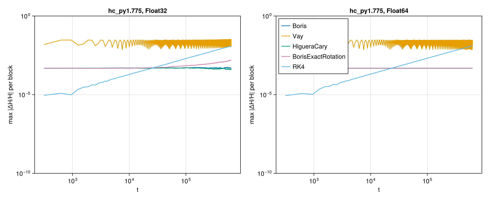
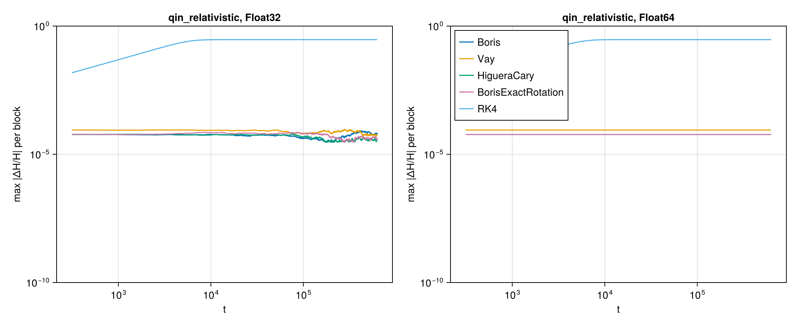

# WP-015: swappable relativistic pushers against exact orbits

| | |
|---|---|
| Work package | WP-015 (goals A1, A2, A6, A7, A8, A10) |
| Commits | code and tests: `716ddc08a7fd5a85648b59de5d1188e2447942db`, with Higuera and Cary's system added to T-236 in `3195804754a720c6a3dbc70a75a0ae280d8d88f8`; the energy run ran on the latter with a clean tree |
| Runs | `pushers-energy-20261101T100328` (`scripts/pushers/energy.jl`, 10⁵ periods of 2π per case). The test numbers come from `Pkg.test()` of `lib/ParticleMeshElectromagnetic` at `716ddc0` (92 887 tests passed, 21 min, one thread); the T-236 numbers for Higuera and Cary's system come from `test/pushers.jl` at `3195804` |
| Input hashes | SHA-256 of every input (module sources, the script, both manifests) in `pushers/pushers-energy-20261101T100328.manifest.toml` |
| Environment | Julia 1.13.3, CPU only; the energy run used 4 threads on an Intel Xeon at 2.80 GHz (cloud container); the numbers are single-particle and do not depend on the thread count |
| Figures | `pushers/energy_{hc_py1.625,hc_py1.775,qin_nonrelativistic,qin_relativistic}.png` with their JSON sidecars; `pushers/pushers-energy-20261101T100328.summary.json` |
| Status | measured, not independently reviewed. Every tolerance below is a proposal (A7), held in `lib/ParticleMeshElectromagnetic/test/tolerances.toml`. Papers were read in arXiv:1701.05605v1 (Higuera and Cary), whose equation numbers are used; the journal version was not read |

## 1. Setup

There are four pushers, `Boris`, `Vay`, `HigueraCary` and `BorisExactRotation`. Each is a `push_momentum` device function in `lib/ParticleMeshElectromagnetic/src/pushers.jl` that takes u, the gathered E and B, and qm_h = (q/m)Δt/2. The module step picks one by the `pusher` field of `EMNumerics` (A10). T-230 runs a Landau case with each pusher, and with `Boris` it gives the same bits as WP-014's default numerics.

- **Boris and Higuera–Cary** share the rotation u⁺ − u⁻ = (u⁺ + u⁻)×τ/γ, with τ = qm_h·B. Boris takes γ = γ(u⁻). Higuera–Cary takes the γ of their Eq. 20 applied to u⁻.
- **Vay** solves u⁺ = u′ + u⁺×τ/γ(u⁺), where u′ = u + qm_h(2E + u×B/γ(u)). It is solved in closed form, with the same Eq. 20 applied to u′.
- **`BorisExactRotation`** rotates u⁻ by Rodrigues' formula. The coefficients are cos θ, sin θ/θ and (1 − cos θ)/θ², taken as functions of θ² = |2τ/γ|². Below √eps(T) they come from a Taylor series, chosen by `ifelse` (a select, not a branch). Duals therefore stay finite at B = 0, where the derivative matches Boris's to roundoff (T-237).

`push_particle` is the test-particle step: drift Δt/2, push with the fields at the midpoint, drift Δt/2. The tests below use it, except where a test steps `push_momentum` alone.

## 2. Results

### Exactness and structure (T-231 to T-234)

Each entry is the largest measured err/(eps(T)·scale) over Float32, Float64 and `Dual{Float32,3}`, with the proposed C in brackets. The scales are given in `tolerances.toml`.

| | Boris | Vay | Higuera–Cary | Exact rotation |
|---|---|---|---|---|
| T-231 \|u\| in uniform B, per step | 0.72 [2] | 1.33 [3] | 0.67 [2] | 0.56 [2] |
| T-231 gyrophase against the closed form, per step | 0.27 [1] | 9.4 [20] | 0.43 [1] | 1.3 [3] |
| T-232 u in uniform E, per step | 0.42 [1] | 0.18 [1] | 0.42 [1] | 0.42 [1] |
| T-233 stays at E×B/B², per step (Float32, Float64) | (drifts, below) | 0.88 [2] | 0.14 [1] | (drifts, below) |
| T-234 det ∂u′/∂u against target, γ ≤ 10³ | 1.5 [3] | 4.0 [8] | 1.5 [3] | 2.5 [5] |

- T-231's closed-form angles are 2·atan(ΩΔt/2γ) for Boris and Vay, ΩΔt/γ for the exact rotation, and 2·atan(β/γ_new) for Higuera–Cary. All four hold to roundoff.
- Vay's larger phase constant is rounding in its γ⁺ accumulating as |u| wanders. It is not a scheme error: the first-step angle is within 0.1 eps for every pusher.
- Higuera–Cary written as a midpoint, as in the paper, measured 1.6 for |u| and 14 for the phase. The module writes it in Boris's rotation form, the same map in exact arithmetic (`questions/wp-015-pusher-choices.md` §2).
- T-234: the determinant is 1 for Boris, Higuera–Cary and the exact rotation. For Vay it is J(u⁻)/J(u⁺) with J(u) = 1 + (τ² + (u·τ)²)/γ⁴, derived in the test header and identical to Higuera and Cary's Eq. 41 (their β is τ). Neither constant grows with γ up to 10³. Over 1000 steps in constant fields, the product of Vay's determinants equals J(u⁰)/J(u¹⁰⁰⁰) to 2 eps in Float64 and 67 eps in Float32, and differs from 1 by 4·10⁻⁵.

### Uniform E: position error (T-232)

The momentum is exact, and in B = 0 the four pushers are the same map. The position error at t ≈ 10 is second order with either start:

| x¹ᐟ² from | error at ω₀Δt = 0.025 | observed order (0.05 → 0.025) |
|---|---|---|
| the exact solution | 1.89·10⁻⁵ | 2.02 |
| x₀ + (Δt/2)v₀ (a start at t = 0) | 3.73·10⁻⁵ | 2.00 |

The half-step start doubles the error constant but does not lower the order.

### Crossed fields: the drift error of Boris and the exact rotation (T-233)

The particle starts at v = E×B/B². The table gives the relative error of the mean vₓ over 10⁴ steps at ΩΔt = 0.1 (Float64; Float32 agrees to two digits), for v ⊥ B and for v with a component along B:

| E₀/B₀ | 0.1 | 0.5 | 0.9 | 0.99 |
|---|---|---|---|---|
| Boris | 1.2·10⁻⁵, 9.3·10⁻⁶ | 2.3·10⁻⁴, 1.8·10⁻⁴ | 1.9·10⁻⁴, 1.4·10⁻⁴ | 2.3·10⁻⁵, 1.9·10⁻⁵ |
| Exact rotation | 8.1·10⁻⁴, 6.1·10⁻⁴ | 3.9·10⁻⁴, 2.9·10⁻⁴ | 3.4·10⁻⁵, 2.5·10⁻⁵ | 7.4·10⁻⁶, 6.2·10⁻⁶ |
| Vay, Higuera–Cary | ≤ 1.9·10⁻¹³ (roundoff) | | | |

At E₀ = 0.1, over ΩΔt = 0.4, 0.2, 0.1, both drift errors fall with order 2.00. The exact rotation's error is 66 times Boris's there, so it is O((ΩΔt)²) even nonrelativistically, as Zenitani and Umeda state. The averaging window includes the unfinished gyration, which is small because the particle starts on the drift.

### The figure-8 orbit (T-235)

The errors are measured over one period, Float64. Each entry is error/Δt² at ω₀Δt = 0.025.

| | a₀ | Boris | Vay | Higuera–Cary | Exact rotation |
|---|---|---|---|---|---|
| γ − u_z | 0.5 | 0.0015 | 0.0033 | 0.0017 | 0.0027 |
| | 2 | 0.065 | 0.26 | 0.13 | 0.18 |
| u_x + qA_x | 0.5 | 0.010 | 0.011 | 0.010 | 0.010 |
| | 2 | 0.22 | 0.056 | 0.27 | 0.28 |
| closure | 0.5 | 0.023 | 0.0013 | 0.024 | 0.028 |
| | 2 | 1.9 | 9.8 | 0.37 | 2.2 |

- **Orders.** Every invariant error has an order within 0.07 of 2 over ω₀Δt = 0.2 → 0.025, in all three types (proposed tolerance 0.15). The closure order is within 0.18 of 2 on the asserted pair (proposed 0.35).
- **Vay's closure at a₀ = 0.5** changes sign near ω₀Δt ≈ 0.07, which is why its constant is small. Its order over the work package's range is pre-asymptotic, and it reaches 2.0 at 0.025 → 0.0125.
- **Duals.** With a₀ as a dual, the values give the same orders. The derivatives with respect to a₀ are finite but fall at irregular orders. The reason is that the last step, T_p − NΔt, depends on a₀ and jumps with N (`questions/wp-015-pusher-choices.md` §4).
- **Comparison at a₀ = 2.** No pusher is best on all three errors:
  - Boris has the smallest γ − u_z error.
  - Vay has the smallest u_x + qA_x error, but the largest closure error, 5× Boris's.
  - Higuera–Cary has the smallest closure error, 5× below Boris's.

  WP-016's scan over a₀·ω₀Δt is where this gets decided for laser runs.

### Long-run energy (T-236 and `scripts/pushers/energy.jl`)

The script runs each case for 10⁵ periods of 2π: 6.3·10⁶ steps for Higuera and Cary's system and 2·10⁶ for the other. The test runs 10⁴. The drift rate is the least-squares slope of ΔH/H against t, in units of ω₀.

**Higuera and Cary's integrable system** is their Sec. VI, Eqs. 43–51: E = −x x̂, B = 2y x̂, q = m = 1, H = γ + x²/2 = 4, p_z = 0, Δt = 1/10. The start, x = y = 0 with p_x from H, is assumed (`questions/wp-015-pusher-choices.md` §1).

| p_y,0 | Float64 | Boris | Vay | Higuera–Cary | Exact rotation | RK4 |
|---|---|---|---|---|---|---|
| 1.625 | max \|ΔH/H\| | 5.38·10⁻⁴ | 3.1·10⁻² | 5.38·10⁻⁴ | 5.38·10⁻⁴ | 1.4·10⁻² |
| | drift rate | 1.4·10⁻¹² | −2.9·10⁻¹¹ | 1.4·10⁻¹² | 1.4·10⁻¹² | −2.2·10⁻⁸ |
| | max \|ΔI_y\| (test, 10⁴ periods) | 1.1·10⁻¹³ | 0.66 | 2.5·10⁻¹³ | 1.3·10⁻¹³ | |
| | max \|Δp_z\| (test) | 1.9·10⁻² | 1.4·10⁻³ | 4.4·10⁻³ | 3.2·10⁻³ | |
| 1.775 | max \|ΔH/H\| | 4.79·10⁻⁴ | 3.0·10⁻² | 4.79·10⁻⁴ | 4.79·10⁻⁴ | 1.3·10⁻² |
| | drift rate | −7.8·10⁻¹³ | 3.8·10⁻¹³ | −7.8·10⁻¹³ | −7.8·10⁻¹³ | −2.1·10⁻⁸ |
| | max \|ΔI_y\| (test) | 1.4·10⁻¹³ | 0.60 | 4.7·10⁻¹³ | 2.7·10⁻¹³ | |
| | max \|Δp_z\| (test) | 2.1·10⁻² | 1.3·10⁻³ | 4.9·10⁻³ | 4.4·10⁻³ | |

- **Vay's energy error.** It oscillates with an amplitude of 3 % of H, δH ≈ 0.12, and does not grow over 10⁵ periods. Its drift rate changes sign between the two orbits and is below 3·10⁻¹¹ per unit time. This is the bounded, periodic error of about 3 % that our literature note attributes to Higuera and Cary's Figs. 3–4; those figures are not in arXiv v1, so the comparison is with the note, not the paper.
- **The other three pushers** stay about 60× smaller, at 5·10⁻⁴. In Float64 their energy errors agree to three digits, which suggests the error comes from the x oscillation in E, common to the three rotations.
- **I_y and p_z.** Vay also loses I_y = u_y² + u_z² by up to 0.66; the other three keep it to roundoff in Float64, because B lies along x and their rotation about B preserves it exactly. On p_z the order reverses: Vay errs least, Boris most, by up to 2·10⁻².
- **Float32.** The exact rotation's envelope creeps up by about a factor 3 over the run, while Boris's and Higuera–Cary's stay flat. That is rounding, since Float64 shows no such growth.
- **RK4** drifts linearly, to 1.3 % by the end.

**B = r ẑ with φ = 10⁻²/r**, the field of Qin et al. 2013, with q/m = 1 and H = γ + φ. Δt = π/10, x₀ = (0, −1, 0), and two initial momenta chosen here:

| u₀ | | Boris | Vay | Higuera–Cary | Exact rotation | RK4 |
|---|---|---|---|---|---|---|
| (0.1, 0.01, 0) | max \|ΔH/H\|, Float64 | 3.45·10⁻⁶ | 3.70·10⁻⁶ | 3.45·10⁻⁶ | 3.45·10⁻⁶ | 5.8·10⁻³ |
| | drift rate, Float64 | −3.7·10⁻¹⁵ | −7.6·10⁻¹⁵ | −6.7·10⁻¹⁵ | −5.0·10⁻¹⁵ | −1.1·10⁻⁹ |
| | drift rate, Float32 | 3.0·10⁻¹² | −1.6·10⁻¹³ | 7.5·10⁻¹³ | −2.3·10⁻¹² | −1.1·10⁻⁹ |
| (1, 0.1, 0), γ₀ ≈ 1.42 | max \|ΔH/H\|, Float64 | 5.88·10⁻⁵ | 8.81·10⁻⁵ | 5.89·10⁻⁵ | 5.90·10⁻⁵ | 0.295 |
| | drift rate, Float64 | −1.7·10⁻¹³ | −4.3·10⁻¹³ | −2.4·10⁻¹⁴ | 3.8·10⁻¹³ | −1.4·10⁻⁸ |
| | drift rate, Float32 | 4.9·10⁻¹¹ | −4.1·10⁻¹¹ | −2.6·10⁻¹¹ | −1.0·10⁻¹⁰ | −1.4·10⁻⁸ |

- **The four pushers.** The energy error stays bounded at the level it reaches in the first gyroperiods. In Float64 none shows a drift resolved above the oscillation: rates of order 10⁻¹³ per unit time give 10⁻⁷ over the run, against oscillations of 10⁻⁵.
- **Float32** rates are 10²–10³ times larger, and the envelope wanders. That is rounding, not the scheme.
- **Vay** again has the largest error amplitude in the relativistic case, 1.5× the others.
- **RK4** loses 30 % of its energy in the relativistic case before it saturates.

Proposed for A7, for these systems at these parameters, over 10⁵ periods in Float64: |ΔH/H| ≤ 10⁻³ on Higuera and Cary's system for Boris, Higuera–Cary and the exact rotation (Vay: 5·10⁻²), and ≤ 2·10⁻⁴ on the second system for all four. The tests assert only finiteness until the owner accepts a bound.

## 3. The SciML interface: answers to the work package's questions

The extension is `ParticleMeshElectromagneticOrdinaryDiffEqCoreExt`, with weak dependencies OrdinaryDiffEqCore 4 and SciMLBase 3. `pusher_algorithm(P)` returns a `PusherAlgorithm{P} <: OrdinaryDiffEqAlgorithm`, whose step is `push_particle`, so each pusher has one implementation. T-237 checks that a solve gives the same bits as `push_particle` stepped by hand, for every pusher in Float32, Float64 and `Dual{Float32,3}`.

- **Do the algorithm types wrap the pusher types, or are they the pusher types?** They wrap them. Making `Pusher` a subtype of `OrdinaryDiffEqAlgorithm` would make OrdinaryDiffEqCore a hard dependency of the module, which the work package rules out. The wrapper costs nothing: one field, and dispatch on its type.
- **How is the half-step stagger started, and how are saved states synchronized?** The algorithm drifts half a step, kicks, and drifts half a step. Every saved state therefore has x and u at the same time, and no stagger start is needed. This is the PIC leapfrog relabelled, with u at integer and x at half steps. It differs from one full drift only in rounding (`questions/wp-015-pusher-choices.md` §3). `dt` is required. The algorithm has no interpolant, so `saveat` should name step times.
- **Which problem type?** A plain `ODEProblem`, with the true right-hand side `lorentz_rhs!` rather than a placeholder. `particle_problem(x0, u0, tspan; qm, E, B)` builds it, with state `[x; u]`. The same problem then goes to a high-order solver: `Vern9` at tolerance 10⁻¹² closes the a₀ = 2 figure-8 to 3.4× the tolerance and holds both invariants to 0.74× the tolerance (proposed bound 10×). A `DynamicalODEProblem` would split x and u, but the pushers need neither the split nor its two functions, and Vern9 would lose nothing on the plain problem.
- **Can DiffEqGPU's `EnsembleGPUKernel` run these algorithms?** Not as built. This was checked on paper only, from DiffEqGPU's documented design and not against its source in this session. `EnsembleGPUKernel` runs its own kernel-compiled solvers (`GPUTsit5`, `GPUVern7`, `GPUVern9`, ...) on out-of-place problems with static-array state. A third-party `OrdinaryDiffEqAlgorithm` with an in-place cache is not one of them. Two routes would work:
  1. A DiffEqGPU-style kernel solver that calls `push_momentum` per particle. That is what the PIC kernel already does.
  2. `EnsembleGPUArray`, which runs ordinary algorithms on batched arrays. Our `perform_step!` indexes the state element by element, which would be scalar indexing on a GPU array.

  Neither is needed for the in-loop push, which stays a KernelAbstractions kernel (`sciml-reuse.md` §1).

## 4. Recommendation (a proposal against A2, for the owner)

The measurements give no reason to move the default away from Boris now.

- In the structural tests, Higuera–Cary matches Boris: |u|, phase and volume to roundoff. It also fixes the relativistic E×B drift exactly, and it has the smallest figure-8 closure error at a₀ = 2. For one extra square root, it is the candidate to replace Boris as the default once WP-016's a₀·ω₀Δt scan confirms the advantage at laser resolution.
- Vay is not volume-preserving. It has the largest closure error at a₀ = 2, and on Higuera and Cary's integrable system its energy error is 60× the others' and it loses the invariant I_y.
- The exact rotation removes the phase error but makes the E×B drift worse. It needs the series switch to stay smooth for duals. It is not a default candidate.
- All four are equally smooth for AD (A2's tie-break): T-234 and T-237 run duals through them with finite derivatives, including at B = 0.

Proposed edit of A2, after WP-016: "Boris, or Higuera–Cary where WP-016 shows the gain, with half-step momentum centring". This is not part of this package.

## 5. Open items

- WP-016 adds the quadratic-unitary pusher and the resolution rule to this report.
- The journal version of Higuera and Cary (Phys. Plasmas 24, 052104) was not read. The figures our literature note cites from it (Figs. 3–4, δH ≈ 0.1) and the p_y,0 values are not in arXiv v1.
