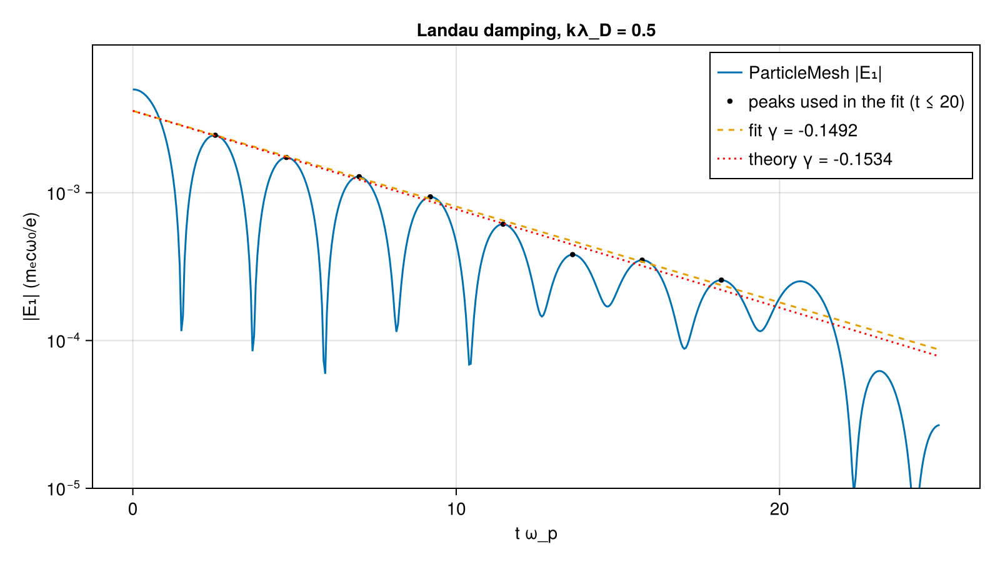
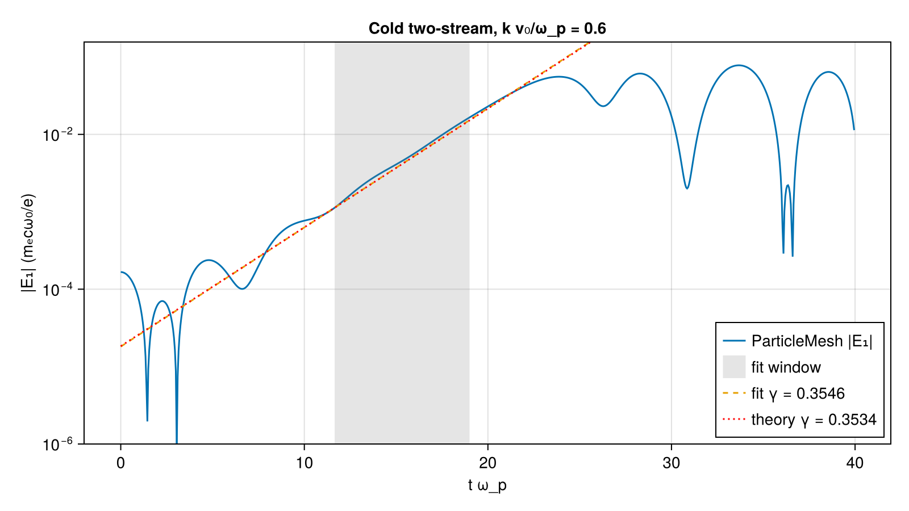
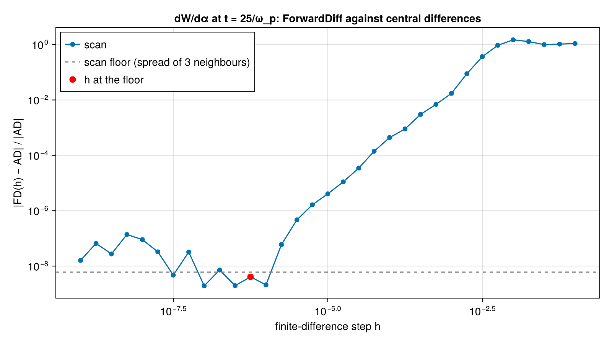

# Spike: 1D periodic electrostatic PIC with a checked gradient

| | |
|---|---|
| Work package | WP-010 (goals A0, A2, A3, A4, A5, A7, A8, A9) |
| Commit of the runs | `c7889e44758b2731838957f6c78729ed169b16b2` (clean tree) |
| Runs | `landau-20261031T165253`, `two_stream-20261031T165313`, `gradient-20261031T165325`, `timing-t1-20261031T165349`, `timing-t16-20261031T165406` |
| Input hashes | SHA-256 of every input file (core sources, `test/cases.jl`, `test/theory.jl`, the script, both manifests) in each run's manifest: `spike-electrostatic-1d/<run>.manifest.json` |
| Environment | Julia 1.13.3, KernelAbstractions 0.10.4 CPU backend, AcceleratedKernels 0.5.11, Atomix 1.7.0, Adapt 4.7.4, ForwardDiff 1.4.6; Intel Core i9-14900K, 1 and 16 threads |
| Figures | `spike-electrostatic-1d/*.png`, each with its JSON sidecar of the plotted scalars |
| Status | measured, not independently reviewed; no number here is to leave the repository before that review |

This is the input of the next planning round (A0): what was built, which of the parked packages' contracts (WP-004 to WP-009, `docs/plan/architecture-draft.md` §0.7) held and which broke, measurements, and a proposed list of next packages.

## 1. What was built

`lib/ParticleMeshCore`, a workspace member that the umbrella `ParticleMesh` re-exports. Every kernel is a KernelAbstractions kernel, generic in `T`, with static shapes and no host-side branching on device data. Only `N = 1` is implemented.

| Piece | Where | Notes |
|---|---|---|
| `PeriodicGrid{N,T}(n, dx, g)` | `src/grid.jl` | cell `i` covers `[(i-1)dx, i·dx)`; a field is an array of `n + 2g` with interior index `i ↦ i + g` |
| `Species{N,T}` | `src/species.jl` | SoA at fixed capacity: `cell::NTuple{N,Vector{Int32}}`, `offset::NTuple{N,Vector{T}}` in `[0,1)`, `u::NTuple{3}`, `w`, `status::UInt8`, `count` (1-element device array), `q`, `m` |
| `Shape{1}`, `Shape{2}`, `Node()`, `Center()` | `src/shapes.jl` | `shape_weights(shape, stagger, δ) -> (first node offset, weights)`; `guard_width(Shape{P}) = P`; `advance(cell, δ, Δ, n)` with the floor carry, the Float32 round-up case and the periodic wrap |
| `fill_guards!`, `fold_guards!` | `src/guards.jl` | the periodic adjoint pair |
| `philox4x32`, `box_muller`, `load_quiet!` | `src/philox.jl`, `src/loading.jl` | in-house Philox4x32-10; key `(seed, stream)`, counter `(cell, 0, 0, k << 16)`; lattice offsets `(k - 1/2)/ppc`; weights `density(x, p)/ppc` |
| `Workspace`, `sort_by_cell!` | `src/sort.jl` | key `cell·capacity + slot` (free slots after all cells), `AK.sortperm!` with a preallocated AK workspace, one permutation applied to every array, per-cell segment bounds, alive count |
| `gather!`, `deposit!(mode, ρ, s, shape, stagger, grid, ws)` | `src/transfers.jl` | `Fast()` (Atomix atomics), `Reference()` (one work item per node reducing the segments of the cells in its stencil, in fixed order, no scratch); `accumulation(T)` is `Atomic()` for Float32/Float64 and `Sorted()` otherwise, and `Fast()` on a `Sorted()` type runs `Reference()` |
| `Electrostatic` submodule | `src/Electrostatic/Electrostatic.jl` | `ESState`, `ESParams(dt, kmode)`, `initialize!` (half-step-back kick), `step!`, `run!`, the cases `landau_case`, `two_stream_case`, and the fits `fit_damping`, `fit_growth` |

The electrostatic step, in the module's order: sort (only when the effective mode is `Reference`), zero ρ, deposit `q·w` of every species, fold, Gauss solve, fill the guards of the field, record the diagnostics, then kick and drift every species. The solve is a prefix sum in one work item: `Ehalf[j] = Σ_{k≤j} (ρ_k − ρ̄) dx`, minus its mean, so `(Ehalf[j] − Ehalf[j−1])/dx = ρ_j − ρ̄` holds to roundoff and the mean field is zero. `Enode` (the gathered field) is the average of the two neighbouring half-node values, which with the same shape for deposit and gather is the momentum-conserving scheme. ρ and `Enode` sit at each shape's natural stagger: nodes at cell edges for order 1, cell centres for order 2. Normalized units (A1): ∂E/∂x = ρ, dv/dt = (q/m)E, and ω_p = √n₀ in units of ω₀; ions are an immobile uniform background (the mean of ρ).

## 2. Results

### Physics against linear theory (T-141, T-142)

Theory comes from the dispersion relations, computed in `test/theory.jl` (the derivation is in its header): Landau via Z(ζ) = i√π·erfcx(−iζ) with Newton's method from the Bohm–Gross estimate; cold two-stream in closed form. No value is taken from memory.

| Case | Setup | Theory | Measured | Relative error |
|---|---|---|---|---|
| Landau damping, kλ_D = 1/2 | 64 cells, 16384 ppc, α = 1/20, v_th = c/20, dt = 0.05/ω_p, quadratic, Reference; fit of the peaks of \|E₁\| for t ≤ 20/ω_p | ω = 1.41566, γ = −0.153359 | ω = 1.40519, γ = −0.149242 | ω −0.74 %, γ −2.7 % |
| Cold two-stream, kv₀/ω_p = 3/5 | 64 cells, 2 × 256 ppc, v₀ = c/10, α = 1/1000, dt = 0.05/ω_p, quadratic, Reference; fit over t ∈ [11.65, 19.0]/ω_p | γ = 0.353392 | γ = 0.354569 | +0.33 % |

Landau is noise-limited. With Philox thermal velocities on lattice positions, 4096 ppc gives γ between −0.142 and −0.181 depending on the fit window (t ≤ 10, 15, 20), and α = 1/100 is buried in noise after a few ω_p⁻¹. Hence α = 1/20 and 16384 ppc (1 M particles, 22 s in the test suite on one thread). The two-stream case is cold and quiet, and its fit is limited by the window choice, not by noise. The test asserts only finiteness and the sign of γ; the relative errors are recorded in `lib/ParticleMeshCore/test/tolerances.toml` as proposals (A7).

Phase space and field lineouts: `landau_phase_space.png`, `landau_field.png`, `two_stream_phase_space.png` (the trapping vortex forms at t ≈ 25/ω_p and breaks up by 40/ω_p).

### Conservation (T-137, plots)

- Gauss's law after every step, both modes, Float32, Float64 and `Dual{Float32,3}`: at most 1.84·eps·n·max|ρ|; in the runs at most 2.4·eps·n·max|ρ| (`*_conservation.json`).
- Total energy K + W (K at t − dt/2): the Landau run drifts at most 5.5e-5 relative; the two-stream run 1.0 %, growing through the nonlinear phase. The scheme is momentum-conserving, not energy-conserving; the two-stream number is a cold beam on 64 cells and is recorded, not explained.

### Gradient (T-143)

dW/dα of the field energy at t = 25/ω_p (32 cells, 64 ppc, quadratic, Reference, Float64; thermal travel ≈ 2 box lengths, so particles cross cells and the seam), ForwardDiff against central differences with common random numbers:

| | test (h = 10^(−1:−0.5:−9)) | script (h = 10^(−1:−0.25:−9)) |
|---|---|---|
| AD | 3.1143905899e-5 | same |
| relative difference at the floor's h | 1.94e-9 (h = 1e-7) | 4.08e-9 (h = 5.6e-7) |
| scan floor (spread of three neighbouring difference quotients) | 2.78e-9 | 6.05e-9 |

The floor is not eps·|f|/h. The same f evaluated through the Float64 and the `Dual` code paths differs by 5e-15 relative (about 25 eps) after 500 steps: rounding differences are amplified by the particle dynamics. That amplified roundoff sets the cancellation floor, about four orders of magnitude above eps·|f|/h. A floor estimated from the formula (my first version) gave 3e-11 and failed; the spread of neighbouring quotients measures the real one.

Whether `floor` strips partials (follow-up #47): `floor(Int32, x::Dual)` returns a plain integer, so the cell index carries no partials. The offset `δ′ = (δ + Δ) − T(k)` keeps the partials of `δ + Δ`. The position `(cell − 1 + δ)·dx` is continuous in α across a crossing, and so is its derivative, so the derivative through crossings is that of the continuous trajectory. The quadratic shape's weights are C¹ in δ, so the deposited density is too. T-143's agreement through about two box lengths of travel is the evidence.

### Exact identities (T-130 to T-140), measured err/(eps(T)·scale)

| Test | Float32 | Float64 | Dual{Float32,3} | proposed C |
|---|---|---|---|---|
| T-130 partition of unity | 1.0 | 1.0 | 1.0 | 2 |
| T-131 gather of a + b·x | 0.667 | 0.667 | 0.667 | 2 |
| T-132 deposit adjoint of gather (with fill/fold) | 1.36 | 2.04 | 1.36 | 8 |
| T-133 fill/fold adjoint | 0.316 | 0.262 | 0.288 | 1 |
| T-134 deposited total (scale count·max w) | 5.46 | 2.14 | 5.46 | 16 |
| T-135 Reference vs Fast per node (scale \|ρ_node\|, 400 ppc) | 11.2 | 11.5 | – | 32 |
| T-137 Gauss law (scale n·max\|ρ\|) | 1.84 | 1.53 | 1.48 | 8 |
| T-138 free streaming, non-dyadic (scale steps) | 0.1 | 0.1 | 0.1 | 1 |
| T-140 Dual partials vs exact derivative | – | – | 3.42 | 16 |

Dyadic free streaming (T-138) is bitwise exact for every type, partials included, over 400 steps across the seam. Philox matches the three `philox4x32 10` known-answer vectors of the Random123 distribution (`tests/kat_vectors`, DEShawResearch/random123 at 9545ff64, T-139).

### Determinism (T-136)

`Reference` is bitwise identical across in-process reruns (one step, all three types) and for the whole Landau run of T-141 in-process (1 thread) and in subprocesses with 1 and 4 threads. The scripts reproduce the test values bit for bit at 16 threads (γ = −0.1492419736219506, 0.3545690079405174).

### Performance (deliverable 6; no thresholds, CPU only)

ns per particle-step of the whole electrostatic step (64 cells, 50 steps after warm-up, so the per-step constant dominates the small counts). Sidecars: `timing_t1.json`, `timing_t16.json`.

| particles | F32 Fast, 1 thr | F32 Ref, 1 thr | F64 Fast, 1 thr | F64 Ref, 1 thr | F32 Fast, 16 thr | F32 Ref, 16 thr | F64 Fast, 16 thr | F64 Ref, 16 thr |
|---|---|---|---|---|---|---|---|---|
| 16 384 | 18.7 | 26.4 | 19.0 | 28.6 | 41.7 | 23.5 | 30.6 | 27.6 |
| 262 144 | 17.4 | 26.5 | 17.8 | 28.5 | 31.9 | 7.7 | 25.8 | 12.7 |

On one thread `Reference` (sort plus node-wise reduction) costs about 1.5× `Fast`. With 16 threads `Fast` gets slower than on one thread: every thread's atomics contend on a 64-node array. `Reference` scales (3.4× for Float32 at 262 k particles). The sort is the bulk of `Reference`'s cost. Scratch per particle (the `Workspace`): 33 B for Float32 and 37 B for Float64 (keys 8, permutation 8, three permutation buffers 4 + 4 or 8 + 1, AK sample-sort temp 8); the particle arrays themselves are 25 B and 45 B. The workspace is allocated in both modes, although `Fast` with primitive floats does not use it. Allocation per step after warm-up does not grow with the particle count or the grid size (T-144): on one thread, 1856 bytes per step in `Reference` mode (the sort's per-task bookkeeping, which AK documents) and zero in `Fast` mode, at all three sizes.

## 3. The parked contracts against the spike

Held, and worth keeping:

- Cell index (`Int32`) plus offset in `[0,1)` with a floor carry; the round-up-to-one case needs the explicit `ifelse` (T-138 exact for dyadic steps, also through the seam and for `Dual`).
- Fixed-capacity SoA with a status byte and a device-side count; no `push!`/`resize!`; the count is written by kernels (sort, load), never read inside the step.
- Philox4x32-10 with the key `(seed, stream)` and the counter `(cell, 0, 0, slot << 16 | draw)` (WP-005's layout), in Base integer arithmetic; known answers match.
- The total-order key `cell·capacity + slot` makes the sort deterministic whatever the algorithm: AK's threaded CPU sample sort gives bitwise identical results at 1, 4 and 16 threads.
- The simplest deterministic reduction from §0.7 (one work item per node reducing the segments of the cells in its stencil, no scratch) works, is bitwise reproducible, and outscales atomics on the CPU.
- `fill_guards!`/`fold_guards!` as an adjoint pair, and the guard convention "deposit into guards, then fold": both modes share it, and gather/deposit adjointness holds to roundoff.
- The accumulation trait (`Atomic`/`Sorted`) with `Fast` falling back to `Reference` for `Dual`: no ForwardDiff-specific code in the package, and the `Dual` matrix passes through the same kernels.
- No `DiffCache`: building the whole state in the execution type `T` (here `Dual`) was enough for ForwardDiff (§0.7).
- Parameters only through the weights (A3): `load_quiet!` takes `density(x, p)`, positions never see `p`; T-140 gives exact partials of the deposited density.
- The step order belongs to the module: `fields!` (sort, zero, deposit, fold, solve, fill) then push was the module's choice; nothing in the engine fixed it.

Broke or changed:

- "Value parts bitwise equal to the primal run" holds for deposition given the same weights, not for anything that passes through a transcendental function. Loading with `Dual` parameters gives weights 1 ulp off the Float32 kernel's in 6 of 512 particles, and the host evaluations of both types agree with the Float32 kernel. The suspected cause is that the `Dual` `cos` is inlined into the natively compiled kernel, where `muladd` in Base's polynomials may become FMAs; this was not verified at the LLVM level. Consequences: T-140 feeds the primal deposit the `Dual` weights' value parts; T-139 allows 2 ulp for `Dual` weights; and primal and `Dual` runs of the same case are not bitwise common-random-number twins (5e-15 relative apart after 500 steps). A4's bitwise property holds per compiled code path (same `T`, same backend, any thread count), which is what T-136 tests.
- The FD gradient floor needs a measured estimate, not a formula (see 2). Proposal for A7's gradient-check rule: the floor is the spread of three neighbouring difference quotients at its minimum, and AD must agree within it.
- WP-006's `deposit!(mode, field, species, shape, quantity, grid, gstate, ws)`: the spike needs no `quantity` (it deposits `q·w`) and no `gstate`; it does need the stagger explicitly. A module-supplied quantity is the next generalization (the electromagnetic module's current), not needed for electrostatics.
- WP-004's `GridState`, `StaggeredField` and field sets were not needed for a periodic 1D grid: plain arrays plus a `Stagger` type were enough. The dynamic grid state waits for the moving window (B1).
- Stagger: each shape's natural stagger (order 1 at nodes, order 2 at centres) gives a δ-independent stencil. The other two pairs need `floor` of the offset; they work and are tested (T-130 to T-135), but cost a wider `stencil_reach`.
- `CartesianIndex{N}` kernels were not written: the species carries `NTuple{N}` arrays, but every kernel is 1D. Generalizing the node-wise reduction means a tensor product of per-axis stencil reaches over neighbour cells. That is the main cost of N > 1 and the first thing the next package should measure.
- The Gauss solve is a serial kernel with one work item (fine on the CPU, O(n)). A GPU version needs a scan, and AK's scan must then be checked for bitwise thread or launch-shape independence.
- For the Reactant rules (§0.4, A9): the sorted deposition loops over data-dependent segment bounds, the solve is a one-work-item loop, and the sort is AK's. All three are candidates for raising trouble once Reactant is unparked; none is tested.
- FFT (follow-up #47): the prefix sum was used, as the package asked. The obstacle to an FFT solve is FFTW's element-type restriction, not FFTs in general; a generic-`T` FFT could carry duals.
- WP-003's TOML case files: the spike's cases are NamedTuples in `lib/ParticleMeshCore/test/cases.jl`, shared by the tests and `scripts/es1d/`. Aligning them with WP-003's case schema is a small step for the next package; nothing in the spike conflicts with it.

## 4. Proposed next packages

1. **Split engine and module.** Move `Electrostatic` into `lib/ParticleMeshElectrostatic`; settle names and signatures from section 3 (keep `Species`, `PeriodicGrid`, `Workspace`, `sort_by_cell!`, `deposit!`, `gather!`, `fill_guards!`/`fold_guards!`, `load_quiet!`, `Shape`/`Stagger`); write §0.7's contracts from this code; replace the parked WP-004 to WP-008.
2. **N-generic kernels, 2D electrostatic.** `CartesianIndex{N}` gather and deposit with tensor-product stencils, a 2D periodic Landau case, and a measurement of the node-wise reduction's cost in 2D (prerequisite of the 2D LWFA path).
3. **The spike on the RTX 4080 SUPER** through the GPU runner: `Fast` against `Reference` throughput, AK's sort and scan on CUDA, bitwise reproducibility on the GPU, and the Gauss solve as a scan.
4. **Benchmark thresholds.** Read WP-003's Smilei spread, turn T-141/T-142 into asserted A5 tolerances, align the case files with WP-003's schema, and add an optional velocity quiet start (or antithetic draws) so the Landau test can drop from 16384 ppc.
5. **Charge-conserving flux and the electromagnetic module** (re-derive WP-009): Esirkepov on these weights, Yee, Boris, then Weibel, the third A5 case.
6. **SciML harness** (§0.6): a `DiscreteProblem`/`FunctionMap` adapter around `run!`, with the gradient check repeated through it.
7. **Double32 trial** (A8): run the matrix with `Double32` on the `Sorted` path; drop it if something is missing.

## 5. Not done, open

- No GPU run, no N > 1, no Double32, no Reactant (all non-goals of WP-010).
- The two-stream energy drift (1 %) is recorded but not studied.
- The cause of the 1-ulp `Dual` loading difference is suspected, not verified at the LLVM level.
- Timings come from 50 steps on a desktop CPU and are noisy at small counts; they are a shape, not a budget.
