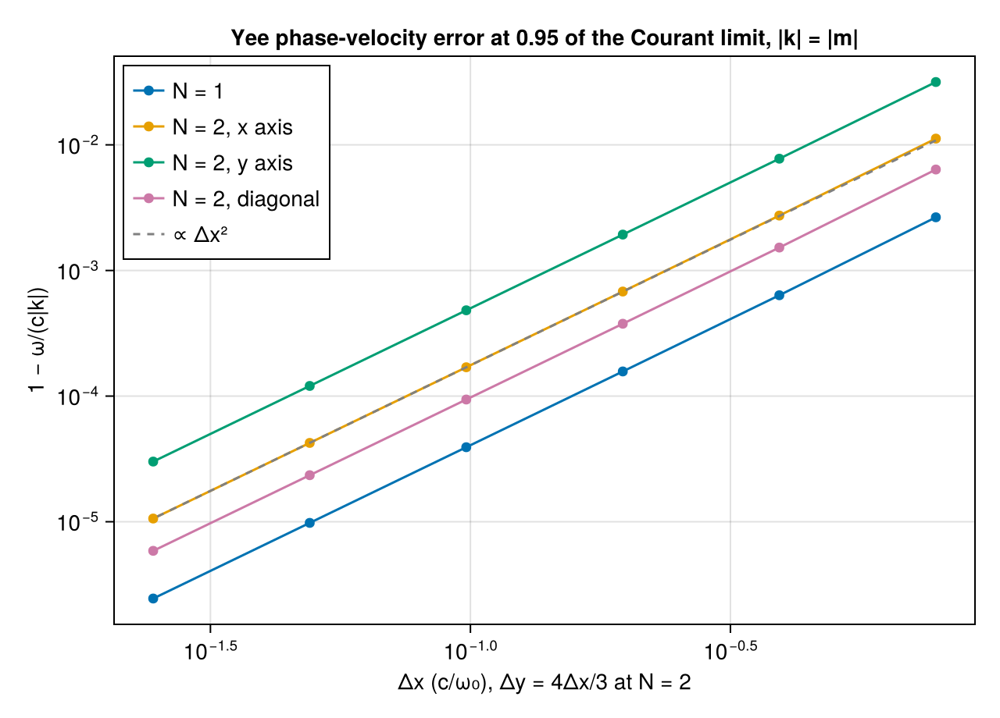

# WP-022: the Yee solver in N dimensions, its Courant limit, and its verification against the discrete theory

| | |
|---|---|
| Work package | WP-022 (goals A1, A2, A4, A7, A8, A9, A10) |
| Commits | the solver `effd07a`, the tests `526d3f5`, the plan, question and script `4399ae4`; this report in WP-022's pull request |
| Runs | `em2d-yee-convergence-20261101T183648` (commit `4399ae4`, `dirty = false`) |
| Input hashes | SHA-256 of every input file in the run's manifest: `wp-022-yee-nd/em2d-yee-convergence-20261101T183648.manifest.toml` |
| Environment | Julia 1.13.3, KernelAbstractions 0.10 CPU backend; Intel Xeon Processor @ 2.10GHz (the model string the CPU reports), 4 vCPUs of a shared cloud VM; 4 threads (the solver is bitwise across thread counts, T-327) |
| Figures | `wp-022-yee-nd/yee_convergence.png`, with its JSON sidecar `yee_convergence.json` (every row) |
| Status | measured, not independently reviewed; no number here is to leave the repository before that review |

## 1. Setup

WP-022 writes the electromagnetic module's field solver once for any number N of resolved axes (`lib/ParticleMeshElectromagnetic/src/layout.jl`, `yee.jl`): the layout rule `field_layout(Val(N))`, `solve_fields!(::Yee, f, grid::PeriodicGrid{N}, dt)` with one work item per interior node and the curl terms over the resolved axes chosen by dispatch, `courant_limit(::Yee, grid)` = 1/√(Σ_d 1/Δ_d²), and `check_courant(solver, grid, dt)`, which the state constructor calls. The contract text is the module's paragraph of `docs/plan/architecture-draft.md` §0.7; the choices the package left open are in `questions/wp-022-yee-nd.md`.

The 1D bits. Before the change a scratch script recorded 45 digests of the 1D solver and step: 200 vacuum steps from a mode at Δt/Δx = 1/2 and 9/10, with and without a current, from zero fields, with `workgroupsize = nothing` and 32, for Float32, Float64 and `Dual{Float32,3}`, and the T-218 runs of the three 1D cases (whose state digests include every field, so T-213's +0.0 fields). After the change all 45 were identical, at 1 and at 4 threads, so the generic kernels replaced the 1D ones. The digests were a scratch run, not committed; T-210 to T-221 pass unchanged.

The convergence measurement (`scripts/em2d/yee_convergence.jl`): a discrete eigenmode of polarization 2 (Ez, Bx, By) started at t = 0 and advanced through `solve_fields!` for one period at 0.95 of `courant_limit`, Float64; ω is the accumulated phase of the Fourier coefficient of Ez, and the error is 1 − ω/(c|k|). The box is 2π × 2π (|k| = |m|) with 16·s × 12·s cells, so Δy = 4Δx/3; N = 1 uses 16·s cells on 2π. s runs from 1/2 to 16 (8 to 256 cells per wavelength along x).

## 2. Convergence to Maxwell and the anisotropy

| cells (N = 2) | Δx | N = 1 | N = 2, x axis | N = 2, y axis | N = 2, diagonal |
|---|---|---|---|---|---|
| 8 × 6 | 0.785 | 2.651e-3 | 1.122e-2 | 3.165e-2 | 6.365e-3 |
| 16 × 12 | 0.393 | 6.352e-4 | 2.736e-3 | 7.762e-3 | 1.523e-3 |
| 32 × 24 | 0.196 | 1.572e-4 | 6.799e-4 | 1.931e-3 | 3.767e-4 |
| 64 × 48 | 0.0982 | 3.919e-5 | 1.697e-4 | 4.822e-4 | 9.393e-5 |
| 128 × 96 | 0.0491 | 9.791e-6 | 4.241e-5 | 1.205e-4 | 2.347e-5 |
| 256 × 192 | 0.0245 | 2.447e-6 | 1.060e-5 | 3.012e-5 | 5.866e-6 |
| observed orders | | 2.061, 2.015, 2.004, 2.001, 2.000 | 2.035, 2.009, 2.002, 2.001, 2.000 | 2.028, 2.007, 2.002, 2.000, 2.000 | 2.063, 2.015, 2.004, 2.001, 2.000 |

Every measured ω agrees with the exact discrete relation sin(ωΔt/2)/Δt = √(Σ_d sin²(k_dΔ_d/2)/Δ_d²) to within 4·10⁻¹⁵ relative (the sidecar's `omega_vs_discrete`), so these errors are those of the scheme, not of the code. They follow the leading term of the relation, 1 − ω/|k| ≈ (Σ_d k_d⁴Δ_d²/|k|² − |k|²Δt²)/24: along x the error is |k|²(Δx² − Δt²)/24 with Δt = 0.76Δx at 0.95 of the 2D limit, and the anisotropy ratios converge to that term's values, 2.841 for the y axis (the coarser axis, Δy = 4Δx/3) and 0.553 for the diagonal mode (1, 1) (whose |k|² is 2), against the x axis:

| cells | y axis / x axis | diagonal / x axis |
|---|---|---|
| 8 × 6 | 2.822 | 0.568 |
| 32 × 24 | 2.840 | 0.554 |
| 256 × 192 | 2.841 | 0.553 |

The test T-321 runs the 16, 32 and 64 cells per wavelength of this table for N = 1, the x axis and the diagonal, and asserts |order − 2| ≤ 0.05; the largest deviation is 0.0153 (16 → 32 cells, diagonal).

## 3. Tolerances (A7)

Measured on the CPU backend, the largest over N = 1 and N = 2; every value is a proposal in `lib/ParticleMeshElectromagnetic/test/tolerances.toml`, whose `scale` fields state the scaling.

| test | quantity | measured (Float32, Float64, Dual) | proposed C |
|---|---|---|---|
| T-320 | oblique eigenmode against the exact discrete mode, every component | 0.0797, 0.135, 0.0797 | 0.5 |
| T-320 | its phase and amplitude | 0.065, 0.121, 0.065 | 0.5 |
| T-321 | \|order − 2\| (Float64) | 0.0153 | 0.05 |
| T-322 | ∇·B kept | 0.0379, 0.0328, 0.0471 | 0.2 |
| T-322 | ∇·E change + Δt·∇·J | 0.354, 0.323, 0.388 | 1 |
| T-323 | energy form in vacuum | 0.00492, 0.00996, 0.0172 | 0.1 |
| T-323 | energy change minus the work term | 0.0998, 0.0969, 0.0828 | 0.5 |
| T-324 | y-invariant 2D against 1D | 0 (bitwise), 0, 0 | 0.1 |
| T-324 | axis exchange | 0.05, 0.0322, 0.0379 | 0.2 |
| T-325 | energy at 0.99 of the limit | 0.0365, 0.0383, 0.0365 | 0.25 |
| T-325 | closed form Mⁿ at 0.99 | 0.396, 0.612, 0.396 | 2 |
| T-325 | growth λⁿ at 1.01 | 3.16, 3.31, 3.16 | 10 |
| T-328 | Dual primal and partials against Float32 runs | 0 (bitwise) | 0.5 |

Recorded, not asserted: the y-invariant 2D run is the 1D run bit for bit for every element type (the y differences of equal values are exact zeros, added last); the axis-exchanged run is not bitwise (the two curl terms of Ez and Bz add in the other order); the `Dual` run's value and partials are bit for bit the Float32 runs of the value and of each partial at N = 1 and N = 2. At 1.01 of the limit the growth ratio is larger than the others because d log|λ|/dS = 2/√(S² − 1) ≈ 14 multiplies the rounding of S. One `solve_fields!` allocates 0 bytes after warm-up at both sizes of T-329.

The energy form E·E + B·B − (Δt/2)²·C⁺E·C⁺E is conserved by the one-step map for every Δt: it is an algebraic identity of the leapfrog, and above the limit the form is indefinite and the growing eigenvector is a null vector. A test that only checks the energy at 0.99 of the limit therefore passes with an unstable time step as long as nothing overflows (the fourth mutation below showed it in Float64); T-325 also holds the run to the closed form Mⁿ of the 2×2 one-step matrix of the highest mode and asserts |tr M/2| ≤ 1.

## 4. Mutations

Each mutation applied to `src/yee.jl` alone, T-210 and T-320 to T-329 run against it, then reverted (failing assertions per test; `E` an error):

| mutation | T-210 | T-320 | T-321 | T-322 | T-323 | T-324 | T-325 | T-326 | T-327 | T-328 | T-329 |
|---|---|---|---|---|---|---|---|---|---|---|---|
| Ex's update takes the forward difference of Bz along y (its y stagger transposed) | – | 12 | – | 5 | 6 | 3 | 9 | – | – | 4 | – |
| the sign of Ez's −∂_y Bx term flipped | – | 12 | 1 | 2 | 6 | 3 | 9 | – | – | 4 | – |
| a full step Δt in place of the first B half step | 18 | 48 | 4 + 1 E | 4 | 12 | 2 | 18 | – | – | 8 | – |
| the 1D limit min_d Δ_d as the limit at N = 2 | – | 12 | 2 | 2 | 5 + 1 E | 2 | 8 | 3 | – | 4 | – |

The first two mutations touch only terms that exist at N ≥ 2, so the 1D T-210 cannot see them. Under the fourth, T-325 fails its stability assertion |tr M/2| ≤ 1 and the closed form at 0.99 of the (wrong) limit for all three element types at N = 2, and T-326 fails because the limit is no longer below min_d Δ_d. T-328 fails under every mutation because the mutated runs overflow to NaN.

## 5. The layout against Smilei and PIConGPU

Read from the public sources on 2026-11-01:

- Smilei, `master` at `61aa917`: `src/ElectroMagnSolver/MF_Solver2D_Yee.cpp` annotates the 2D arrays as Ex "dual in x, primal in y,z", Ey "dual in y, primal in x,z", Ez "dual in z, primal in x,y", Bx "dual in y,z, primal in x", By "dual in x,z, primal in y", Bz "dual in x,y, primal in z"; `src/ElectroMagn/ElectroMagn2D.cpp` allocates Ex, Ey, Ez with `create2D(dimPrim, c, false, ...)` and Bx, By, Bz with `create2D(dimPrim, c, true, ...)`, J like E, and ρ on `dimPrim`, and `src/Field/Field2D.cpp` makes axis j dual when (j is the main axis and the field is not primal) or (j is not the main axis and it is primal). With dual = `Center()` and primal = `Node()` this is `field_layout(Val(2))` component by component, ρ at (Node, Node). Smilei indexes a dual point i half a cell to the left of the primal point i (its By update is `By[x] += dt/dx·(Ez[x] − Ez[x−1])`), where this module puts `Center()` index j half a cell to the right of `Node()` index j: the same geometry with the index shifted by one.
- PIConGPU, `dev` at `e66578e`: `include/picongpu/fields/YeeCell.hpp` gives, in 2D and in cell units, E_x at (0.5, 0), E_y at (0, 0.5), E_z at (0, 0), B_x at (0, 0.5), B_y at (0.5, 0), B_z at (0.5, 0.5), J at E's positions and the scalar field `FieldTmp` at (0, 0): the same layout (that PIConGPU deposits the charge density into `FieldTmp` is from memory, not read here). In 3D it lists E_z at (0, 0, 0.5) and B at (0, 0.5, 0.5), (0.5, 0, 0.5), (0.5, 0.5, 0), the standard Yee cell, which is the rule at N = 3.

Verified: the staggers of every component at N = 2 in both codes, as quoted. Not verified: how either code's solver kernel indexes its arrays beyond Smilei's 2D B update quoted above, and PIConGPU's solver kernels (only the position trait was read).

## 6. Open items

- No GPU run (WP-022 is CPU only); the kernels follow §0.4 and take `workgroupsize`.
- The engine docstring of `gradient_periodic!` (`lib/ParticleMeshCore/src/spectral.jl`) still cites §0.8 item 5 for the Yee layout, which now lives in the module's paragraph of §0.7; the package does not change engine code.
