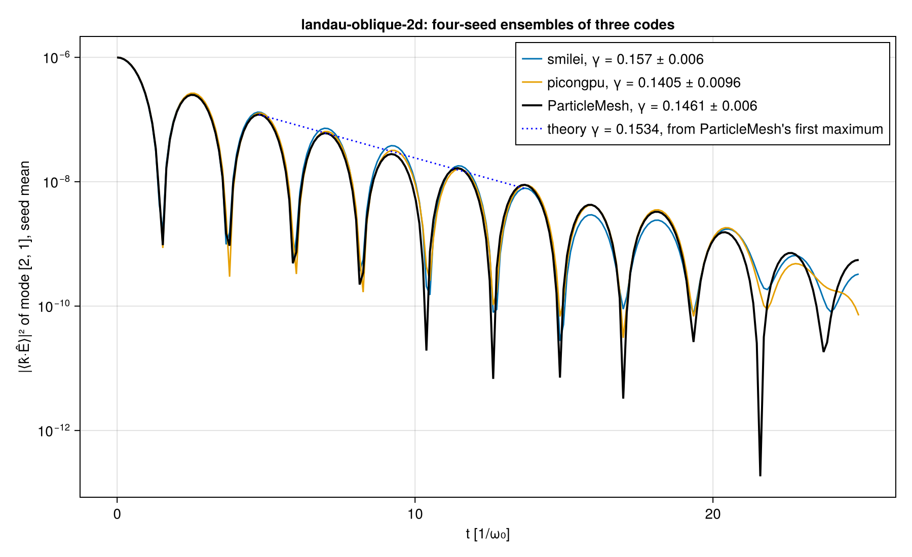
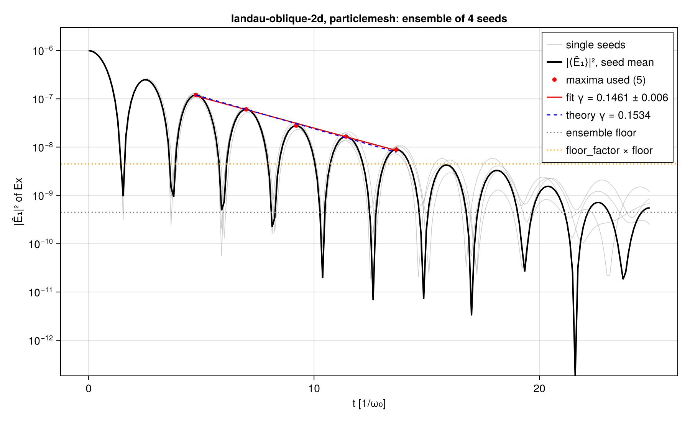
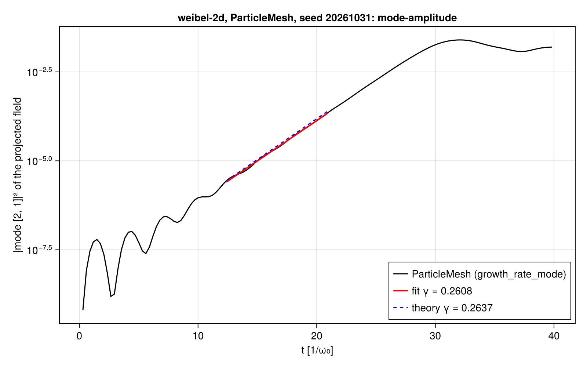
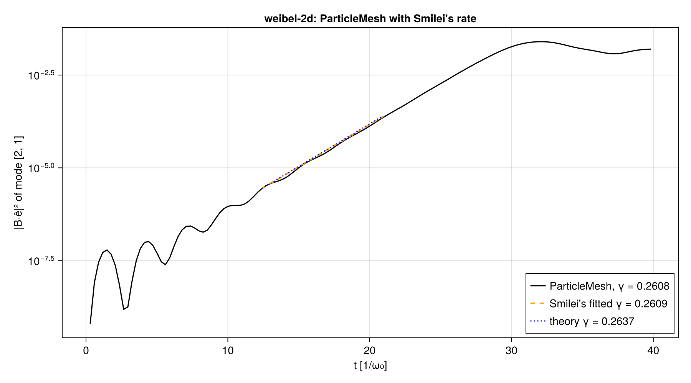

# WP-023: the periodic 2D3V electromagnetic step, validated

| | |
|---|---|
| Work package | WP-023 (goals A1, A2, A4, A5, A7, A8) |
| Code | the step `2ae4382` (`lib/ParticleMeshElectromagnetic/src/step2d.jl`, `problem.jl`, `diagnostics.jl`); the tests T-360 to T-369, T-380, T-381 and this report in WP-023's pull request |
| Runs | `em2d-pm-landau-oblique-2d-20261102T163231` (four seeds, commit `2ae4382`), `em2d-pm-weibel-2d-20261102T180125` (commit `8195786`); each directory under `wp-023-em-step-2d/` holds its `manifest.toml` with the SHA-256 of every input |
| Provenance note | the Weibel run was repeated at 24 threads from `8195786` (clean) after a change of the script's Gauss check; its observables equal those of a first run at 32 threads from `2ae4382` to every printed digit (Reference mode is bitwise across thread counts). The Landau manifest records `dirty = true`: test files were being edited in the worktree when it started. Every one of its 34 recorded inputs (the engine and module sources, the case, the scripts, both manifests) has the content of commit `2ae4382` (checked against `git show 2ae4382:<path>`), so the run is that commit's code |
| Case files | `scripts/crosscode/cases/landau-oblique-2d.toml` (`bc8fd6af…`, the four seeds of WP-017) and `weibel-2d.toml` (`dca1230a…`), unchanged; each run directory holds a copy (`case.toml`) |
| References | Smilei v5.1: WP-019's single runs (`reports/crosscode-smilei-2d/`) and WP-017's four-seed Landau ensemble; PIConGPU 0.8.0 FP64: WP-017's four-seed Landau ensemble (`reports/crosscode-picongpu/`). Theory: `scripts/crosscode/theory.jl` (T-160, T-273), the values of the case files |
| Environment | Julia 1.13.3, KernelAbstractions 0.10 CPU backend, Float64, `Reference()` mode; Intel Core i9-14900K, 32 threads (Landau) and 24 threads (Weibel), with other jobs on the machine (see Cost) |
| Status | measured, not independently reviewed; no number here is to leave the repository before that review |

## 1. What was built

The module's 2D step now deposits the charge-conserving current: `EMNumerics(; current = Esirkepov())`, the default at N = 1 and N = 2 (`NoCurrent()` stays for prescribed fields at N = 2). After the push the step sorts the species where the mode needs it (the old positions in the extras of `flux_extras(T, 2)` follow), zeroes Jx, Jy, Jz, adds each species' current with the engine's `deposit_flux!` (contract 13; ρ at (Node, Node), `q·w·u_z/γ` for Jz) and folds the guards, then deposits nothing else and runs the Yee solve, the 1D order. The state's workspaces hold the Reference flux patches. The 2D diagnostics also record the Fourier amplitudes of Bx, By and of ê·B with ê = ẑ × k̂, the observable of the Weibel case. `problem_from_case` reads schema-2 case files (an `EMProblem{2}` with an isotropic thermal spread in all three components, as Smilei's scalar temperature) and takes the default seed from the case (`case_seed`: the first of `seeds`, else `random_seed`; both or neither is refused), which fixes #183.

## 2. Exact identities and conservation (CI tests, CPU and CUDA)

Measured ratios are in `lib/ParticleMeshElectromagnetic/test/tolerances.toml`; the CUDA runs are T-380 and T-381 on the RTX 4080 SUPER (gpu-runner job `WP-023-em-step-2d-validation-emgpu-1`).

| Test | What | Largest measured ratio (CPU) | Bound |
|---|---|---|---|
| T-360 | Gauss's law after every step, two species of opposite charge crossing cells and both seams, 40 steps, both modes; per step in units of eps·(n₁ + n₂)·max\|ρ\|·√(k + 1) | 0.44 (Float64, Fast); CUDA 0.42 | 2 |
| T-360 | ∇·B after every step, in eps·(Σ 2/Δ)·max\|B\|·√k | 0.41; CUDA 0.35 | 2 |
| T-361 | a 2D run invariant along y, and one invariant along x rotated by 90°, against the 1D run: E, B, J on every line, 30 steps of two cold beams with drifts in all three components, in eps·k·(largest 1D value of the kind) | 1350 (Float32, Fast); Reference 311 | 4096 |
| T-362 | Reference against Fast, every field and current and the kinetic energy, in eps·k·max | 36 | 128 |
| T-363 | the Reference step bitwise across reruns, workgroup sizes 32 and 256, 1 and 4 threads, three element types; CUDA (T-381) across reruns and workgroup sizes 64 and 256 | bitwise | — |
| T-366 | the primal of a Dual{Float32,3} run against Float32, 10 steps, in eps·k·max | 1.49 | 8 |

Gauss's law is not re-solved: the initial field comes from the periodic spectral solve (T-353), and continuity of the Esirkepov current (T-300) with the transpose structure of the discrete curls keeps it. At full size the relative residual max|∇·E − (ρ − ρ̄)|/max|ρ| after 3390 steps is 1.9–2.6 × 10⁻¹³ in the four Landau seeds (3.7 × 10⁻¹³ at t = 0), and ∇·B/max|B| is 0.9–1.1 × 10⁻¹² (`seed-*/observables.json`, `checks`).

Deliberate breaks seen to fail (scratch runs, each reverted): no guard fold of Jy fails T-360 (6 of 18 checks) and T-361 (12 of 24); the y component of the momentum in place of the z component for Jz fails T-361 (12 of 24) and passes T-360, as it must (Jz has no divergence at N = 2); no sort before the Reference deposition fails T-360 (4 of 18) and T-361 (8 of 24). The breakers' mutations are in the pull request.

## 3. Linear theory and the reference codes

### Oblique Landau damping, four seeds (full size: 128 × 128 cells, 32 × 32 electrons per cell, 3390 steps)

The pre-registered observable `damping_rate_mode_ensemble`: γ from the maxima of |⟨k̂·Ê⟩|² of mode (2, 1), the seed mean of the complex coefficient, with the case's rules (`fit_start = 3`, `floor_factor = 10`), the jackknife over seeds as the error.

| | ParticleMesh | Smilei | PIConGPU FP64 | Theory |
|---|---|---|---|---|
| ensemble γ ± jackknife | **0.1461 ± 0.0060** | 0.1570 ± 0.0060 | 0.1405 ± 0.0096 | 0.15336 |
| relative to theory | −4.7 % (1.2 errors) | +2.4 % | −8.4 % | |
| maxima used, fit range | 5, t = 4.76 to 13.66 | 5, t = 4.75 to 13.70 | 7, t = 4.79 to 18.12 | |
| ω_r from the maxima | 1.4118 | 1.4051 | 1.4135 | 1.41566 |
| per-seed γ at the ensemble's maxima, mean ± std | 0.1435 ± 0.0139 | 0.1571 ± 0.0132 | 0.1366 ± 0.0066 | |
| `damping_rate_mode` per seed (WP-019's single-run rule) | 0.1602, 0.1459, 0.1271, 0.1472 | 0.1609, 0.1756, 0.1328, 0.1167 | 0.1635, 0.1257, 0.1731, 0.1463 | |
| its mean ± std | 0.1451 ± 0.0136 | 0.1465 ± 0.0267 | 0.1522 ± 0.0208 | |
| `energy_ratio`, t = 0 (Yee theory 3.9975909) | 3.99759091241 in every seed | 3.98629 | 3.99760 | |
| `energy_ratio_mode`, mean ± std | 4.028 ± 0.048 | 3.947 ± 0.053 | 4.088 ± 0.110 | |

Differences (`compare/landau-oblique-2d-comparison.json`; measurements, not thresholds):

- ParticleMesh − Smilei, ensembles: −0.0109, −1.29 combined jackknife errors, −0.82 Smilei seed spreads.
- ParticleMesh − PIConGPU, ensembles: +0.0056, +0.50 combined jackknife errors, +0.85 PIConGPU seed spreads.
- Single-run rule, difference of the seed means: −0.09 combined errors of the means against Smilei, −0.57 against PIConGPU.
- Seed 20261031 alone against WP-019's Smilei run of the same seed: 0.1602 ± 0.0079 against 0.1609 ± 0.0078 (−0.07 combined errors).

ParticleMesh lies between the two reference codes, which differ from each other by 1.5 combined errors on these four seeds (WP-017). With four seeds per code no difference here is resolved, and none sets a threshold (A7: the threshold rests on the measured Smilei–PIConGPU spread, which needs more seeds; that extension is another package's). The three ensemble curves overlay to the eye through the fitted window (`compare/landau-oblique-2d-three-ensembles.png`); the spread of the ensemble γ comes mostly from the third maximum, at t ≈ 9.2.

`energy_ratio` at t = 0 is the Yee value to 12 digits: the initial field is the discrete solution (T-353), with no uniform offset (Smilei adds one, #157). `damping_rate_energy` (the summed Ex and Ey energy) finds no fit in any seed, as pre-registered and as in both reference codes.

The initial kinetic energy is 7.473 × 10⁻³ (seed mean), 0.95 % above (3/2)nTL² = 7.402 × 10⁻³: the loader draws a Maxwellian in velocity (v_th = 0.05 per component) and converts to u = γv, so the kinetic energy carries the relativistic term (3/8)⟨v⁴⟩. Smilei draws the classical energy distribution (+0.016 %), PIConGPU a Maxwellian in momentum (−0.34 %). The velocity Maxwellian is the distribution linear theory assumes; the effect of the three loads on γ is not separated here.

The ensemble plot's y label reads "|Ê₁|² of Ex", the label of the shared ensemble code (`scripts/crosscode/ensemble_report.jl`); the series is |⟨k̂·Ê⟩|² of mode (2, 1), as in WP-017's 2D ensembles.

### 2D Weibel (full size: 256 × 256 cells, 8 × 8 per beam per cell, 2170 steps)

| Observable | ParticleMesh | Smilei (WP-019) | Theory | ParticleMesh − Smilei |
|---|---|---|---|---|
| `growth_rate_mode`: B·ê of mode (2, 1), window 10⁻⁴ to 10⁻² of saturation | **0.26084 ± 0.00191** (30 points, t = 12.39 to 20.94) | 0.26087 ± 0.00191 (same window) | 0.26373 | −1.1 × 10⁻⁴ relative |
| `growth_rate_energy`: WBx + WBy | **0.2610730 ± 0.0009127** (121 points, t = 12.31 to 21.16) | 0.2610729 ± 0.0009127 | 0.26373 | +4 × 10⁻⁷ relative |
| saturation of \|B·ê\|² | 0.0250581 at t = 32.148 | 0.0250565 at t = 32.148 | | |

Both codes sit 1.1 % below the cold-fluid rate, by the same amount: the cold, quiet-loaded beams leave no random noise, the two codes load the same lattice and drift, and the same Esirkepov, Yee and Boris schemes then give nearly the same discrete run. The −1.1 % is therefore a property of the discretization (and of the window), not of either code; it is not resolved further here. ∇·B/max|B| stays below 6.3 × 10⁻¹³ (end of the run) and the relative Gauss residual (to max|ρ| of the mobile charge) below 2.2 × 10⁻¹⁴ (end of the run; 9.8 × 10⁻¹⁶ at t = 0); the total energy changes by at most 2.0 × 10⁻⁴ of its initial value through saturation.

### Test size (CI, T-364 and T-365)

A quarter of the cells per axis, Δt four times the case's (Courant fraction 0.95 kept), every step's diagnostics: oblique Landau at 16 × 16 electrons per cell with a 5 % perturbation to t = 18 gives γ −1.1 % and ω +2.6 % from theory over three maxima, the field perpendicular to k at 0.9 % of the parallel one; 2D Weibel at 4 × 4 per beam gives γ −1.35 %, the B component along k at 5 × 10⁻⁴ of the perpendicular one. The bounds (10 % rate, 5 % frequency and transverse for Landau; 5 % rate and 1 % longitudinal for Weibel) are proposed in `tolerances.toml`: one seed and three maxima make the Landau rate bound a gross-error check. On CUDA the same tests give the same rates to 2.4 × 10⁻¹¹ (Landau) and 2 × 10⁻¹⁶ (Weibel) relative (T-381).

## 4. Cost

| | Landau (per seed) | Weibel |
|---|---|---|
| particles, steps | 1.68 × 10⁷, 3390 | 8.39 × 10⁶, 2170 |
| wall time of the steps | 1151 s, 1213 s, 1349 s, 1565 s | 592 s |
| ns per particle-step | 20.2, 21.3, 23.7, 27.5 (32 threads) | 32.5 (24 threads) |

The runs shared the machine with the test suites and other sessions' jobs, increasingly so over the Landau seeds, so these are upper bounds, not a throughput measurement (A5's fair comparison is on one card, not this package's). For orientation only: Smilei ran the same Landau seeds at 9.8 to 10.0 ns per particle-step on 16 threads of the same CPU (WP-017).

## 5. Verification status

- Verified: the identities of §2 on the CPU (Float32, Float64, Dual{Float32,3}) and on CUDA (Float32, Float64, Dual{Float32,3}); the full-size observables against theory, Smilei and PIConGPU as tabulated; the figures were inspected before the numbers were recorded.
- Not verified: an independent review of this report; the cause of the common −1.1 % of the Weibel rate; the effect of the three thermal loads on the Landau rate; seed ensembles large enough to resolve differences of a few per cent between the codes.

## 6. Open items

- The CI-size Landau test fits three maxima of one seed; its rate bound is loose by design.
- Throughput was not measured on an idle machine.
