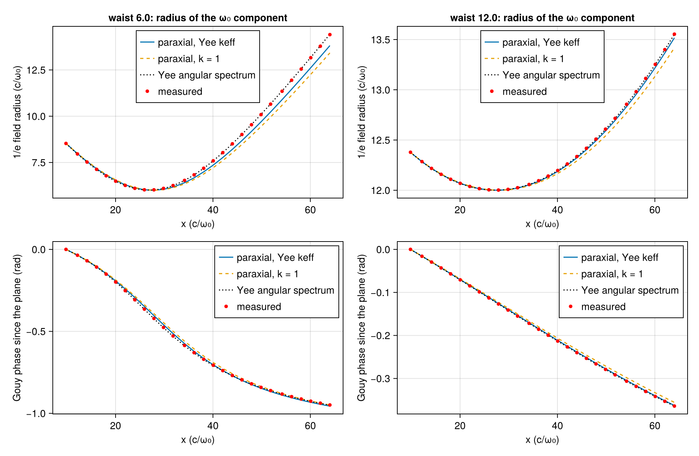
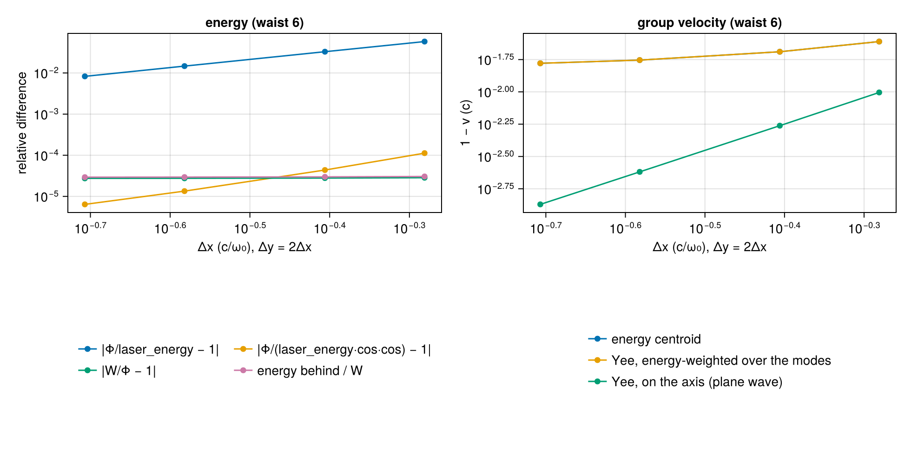

# WP-026: the laser antenna, a Gaussian beam launched through a total-field/scattered-field plane, against the Yee scheme's own propagation

| | |
|---|---|
| Work package | WP-026 (goals A2, A3, A4, A7, A8) |
| Commits | the antenna, its tests and the question file `2db3741`; the backward leak measured where it is, T-393 against the Yee prediction and T-395's flux bound `59aabd5`; T-394 tightened `c0df457`; the mutation survivors closed `40b2c30`; this report in WP-026's pull request |
| Runs | `em2d-antenna-20261103T131055` (commit `40b2c30`, `dirty = false`) |
| Input hashes | SHA-256 of every input file in the run's manifest: `wp-026-laser-antenna/em2d-antenna-20261103T131055/manifest.toml` |
| Environment | Julia 1.13.3, KernelAbstractions 0.10 CPU backend; Intel Xeon Processor @ 2.80GHz (the model string the CPU reports), 4 vCPUs of a shared cloud VM; 4 threads |
| Figures | `wp-026-laser-antenna/em2d-antenna-20261103T131055/antenna_beam.png` and `antenna_resolution.png`, each with its JSON sidecar (every row) |
| Status | measured, not independently reviewed; no number here is to leave the repository before that review |

## 1. Setup

The antenna is a source of the electromagnetic module at N = 2 (`lib/ParticleMeshElectromagnetic/src/antenna.jl`). Its contract is in the module's paragraph of `docs/plan/architecture-draft.md` §0.7. The choices the package left open are in `questions/wp-026-antenna.md`: the TF/SF plane, where it lives, the parameter conventions, the B correction, and the narrow band.

- `GaussianLaser(; a0, waist, duration, delay, focus, position, center, chirp, polarization, phase)` describes the pulse in A1 units.
- `EMProblem{2}` takes `lasers = (...)`. The state places each laser on its primal column as an `Antenna`.
- The 2D step's mesh solve, `solve_fields!(::Yee, f, grid, dt, antennas, t)`, adds the corrections after each Yee sub-step:
  - after each B half step, the incident E goes into the B column behind the plane;
  - after the E step, the incident B goes into the plane's E nodes. That B is E ∓ ½∂²E/∂y², taken half a cell earlier in the wave by the Yee wavenumber of ω₀.
- A plane wave at ω₀ is therefore launched exactly. A focused beam is launched to order (k_y/k)⁴.

Every measurement in this report uses Float64 and 0.95 of the 2D Courant limit. The pulse:

- waist 6 (or 12) c/ω₀;
- duration 8/ω₀, peaking at the plane at t = 48;
- plane at x = 10, focus at x = 28;
- in-plane polarization (Ey).

The box is 300 c/ω₀ long and periodic. Up to t = 140 the pulse stays within x ≤ 160, and the backward leak, which wraps round, stays beyond x = 170. The analysis lives in `lib/ParticleMeshElectromagnetic/test/antenna_cases.jl`, shared by the tests and the script.

- **The beam.** On 28 probe columns from x = 10 to 64 (two Rayleigh lengths past the focus), the script records the discrete-time Fourier transform at ω₀ = 1 of the fields. It compares these with three predictions:
  - the exact Yee angular-spectrum propagation of the incident field (per k_y, the scheme's k_x(ω₀, k_y), evanescent modes included);
  - the paraxial beam with the scheme's keff = sin(kΔx)/Δx;
  - the paraxial beam with the continuum's k = 1.
- **Resolution.** At 12, 16, 24 and 32 cells per wavelength along x (half as many along y), the script compares:
  - the Yee conserved energy W of the pulse's window at t = 140 against the discrete Poynting flux Φ of the incident field through the plane, and Φ against `laser_energy`;
  - the energy behind the plane;
  - the velocity of the energy centroid (a line fitted to eleven snapshots, t = 100 to 140) against the energy-weighted Yee group velocity of the snapshot's modes, and against the on-axis plane-wave value.

## 2. The beam: waist and Gouy phase

| waist | max \|w/w_angular − 1\| | max angular error | max \|w/w_paraxial − 1\| | max \|Gouy − Gouy_paraxial\| (rad) |
|---|---|---|---|---|
| 6 | 1.91e-3 | 1.72e-3 | 4.29e-2 | 1.69e-2 |
| 12 | 1.41e-4 | 1.17e-4 | 2.68e-3 | 1.59e-3 |

The angular error is the relative L² difference of the whole transverse profile from the angular-spectrum prediction.

- The measured beam is the scheme's own propagation of the incident field to the antenna's order. The angular error falls by 14.7 between waist 6 and 12, close to the factor 16 of the (k_y/k)⁴ term (questions §4).
- The paraxial beam is a worse model of the scheme than the scheme is of its input. Its error falls by 16 (radius) and 10.6 (Gouy) between the two waists, the 1/w0² of the non-paraxial terms. At waist 6 those terms widen the beam by 4 % two Rayleigh lengths out.
- The waist the scheme keeps is the prescribed one: the minimum radius is 6.00 near x = 28. In the figure, the Gouy phase of keff and that of k = 1 separate at waist 12. T-392 tells them apart through the angular spectrum, where the continuum's dispersion fails by far more than the antenna's error.

## 3. Energy and group velocity against resolution

| cells per wavelength (x × y) | W/Φ − 1 | energy behind / W | Φ/laser_energy − 1 | Φ/(laser_energy·cos(Δt/2)·cos(kΔx/2)) − 1 | v_centroid/v_spectral − 1 | 1 − v_spectral | 1 − v_axis |
|---|---|---|---|---|---|---|---|
| 12 × 6 | 2.85e-5 | 3.05e-5 | −5.80e-2 | 1.13e-4 | −6.5e-8 | 2.45e-2 | 9.90e-3 |
| 16 × 8 | 2.79e-5 | 2.99e-5 | −3.29e-2 | 4.38e-5 | −6.9e-8 | 2.04e-2 | 5.47e-3 |
| 24 × 12 | 2.76e-5 | 2.95e-5 | −1.47e-2 | 1.34e-5 | −7.6e-8 | 1.76e-2 | 2.40e-3 |
| 32 × 16 | 2.74e-5 | 2.94e-5 | −8.27e-3 | 6.40e-6 | −7.6e-8 | 1.66e-2 | 1.35e-3 |

- **Energy.** What the antenna puts past its plane is the discrete flux of its incident field, to 2.8·10⁻⁵ at every resolution. That is about the energy that leaks behind the plane (3·10⁻⁵): what the plane fails to launch forward goes backward. Neither number falls with Δx. They are set by the pulse's band around ω₀, at which alone the antenna is exact (questions §5), not by the grid.
- **Flux.** `laser_energy` is the continuum flux. The discrete flux converges to it at second order, −5.8 % at 12 cells and −0.83 % at 32 (T-395 holds it to 0.25·(Δt² + Δx²)).
- **The cos·cos factor.** Dividing by cos(Δt/2)·cos(kΔx/2), the staggered time and space averages of a plane wave, leaves 10⁻⁴ to 6·10⁻⁶. This is observed, not derived for the beam, and no test asserts it: a breaker showed that a relation fitted to one configuration does not hold across them.
- **Group velocity.** The energy centroid moves at the energy-weighted Yee group velocity of the pulse's modes to 7·10⁻⁸ relative at every resolution.
- **The on-axis value is not the beam's velocity.** The plane-wave value along the axis differs from it by 1.5 % at 16 cells. That difference does not vanish with Δx: the beam's modes travel at an angle. As an estimate (not asserted), ⟨k_y²⟩/2 = 1/(2w0²) = 0.014 at waist 6, near the 0.0166 measured at 32 cells, where the remaining Yee dispersion is about the 1.35·10⁻³ of the axis.

## 4. Tolerances (A7)

Measured on the CPU backend. Every value is a proposal in `lib/ParticleMeshElectromagnetic/test/tolerances.toml`, whose `scale` fields state the scaling. Measured values are in the units of C, so a test passes when measured ≤ C (Float32, Float64, `Dual{Float32,3}` where the test runs all three).

| test | quantity | measured | proposed C |
|---|---|---|---|
| T-391 | energy behind the plane, A8 runs (waist 4, duration 5) | 1.51e-3, 1.51e-3, 1.51e-3 | 3e-3 |
| T-391 | the same, physics runs (waist 6, duration 8) | 2.99e-5 | 1e-4 |
| T-391 | linearity in a0 through the dual | 0 | 10 |
| T-392 | angular error, Ey and Ez, over (3/16)√105/w0⁴ | 1.16, 0.714 | 1.5 |
| T-392 | plane wave, over eps(T)·√steps | 0.529, 0.754, 0.529 | 2 |
| T-393 | radius and Gouy phase against the angular spectrum | 1.32 | 2 |
| T-393 | radius against the paraxial beam, over 3/w0² | 0.547 | 1 |
| T-393 | Gouy phase against the paraxial beam, over 1/w0² | 0.609 | 1 |
| T-393 | beam centroid from the laser's axis, over Δy | 9.2e-6 | 1e-4 |
| T-394 | \|v_centroid/v_spectral − 1\| | 6.9e-8 | 1e-6 |
| T-395 | \|W/Φ − 1\| over 1/w0⁴ | 0.0362 | 0.2 |
| T-395 | \|Φ/laser_energy − 1\| over Δt² + Δx² | 0.124 | 0.25 |
| T-396 | Gauss and ∇·B off and on the plane's columns | 0.201, 0.158, 0.173 | 1 |
| T-397 | AD against the finite-difference floor, focus and chirp | 0.112, 0.113 | 1 |
| T-399 | axis off the middle against the centred run shifted, over eps(T)·√steps | 1.30, 1.04 | 4 |

T-390 is exact to its quadrature (absolute 10⁻¹²) and T-398 checks input errors, so neither has a measured ratio. The whole antenna suite takes 3 min 18 s on 4 threads.

## 5. Mutations

A mutation breaker planted 54 mutations of `antenna.jl`, `step2d.jl` and `problem.jl`, one per run of T-390 to T-398. 49 were caught. They covered:

- every stagger, sign, coefficient, sub-step time and column of the corrections;
- the half-cell delay and the B correction;
- the profile's phase, envelope, amplitude, Rayleigh length and Gouy factor;
- `laser_energy`, the dual conversion, and the input checks.

The survivors all involve the transverse row geometry or the plane's bound. Each now has a test (commit `40b2c30`). Rerun against the mutated sources:

| mutation (`antenna.jl`) | caught by now |
|---|---|
| R02: the Node rows (Ez, By) evaluated half a row off | T-393 axis centroid, 0.50 Δy against 10⁻⁴ (pol π/2 and 0.6) |
| M42: every row one row off | T-393 axis centroid, 1.0 Δy (four assertions), and the Gouy check as before |
| M24: the nearest-image wrap removed | T-399, up to 6·10¹⁴ of its bound (all six runs) |
| M43: the box height one row short | T-399, up to 2·10¹⁴ of its bound (all six runs) |
| M44: the guard rows no longer the bits of their interior images | T-399's bitwise guard check (17 assertions) |
| M37: the lower bound g + 1 in place of g + 2 | T-398, column 4 refused |

Before these tests, every reference (the incident DTFT, the flux, the surface charges) called the same `antenna_dy` as the kernels, and every run put the axis in the middle of the box. So R02 and M42 were self-consistent, and the wrap never acted.

## 6. Open items

- **No GPU run.** The kernels follow §0.4 and take `workgroupsize`, but CUDA is untested: this session has no GPU.
- **Narrow band (questions §5).** The antenna is exact at ω₀ only. A broadband or strongly chirped pulse needs a B per frequency.
- **Nonlocal B (questions §4).** A per-k_y B would remove the (k_y/k)⁴ term at small waists, at the cost of an FFT along the plane per step.
- **Plane position.** The plane snaps to the nearest primal column, so `position` is not differentiable. The pulse travels along +x only, with linear polarization only.
- **Cross-code check.** The injected field has not been compared in vacuum with Smilei's boundary injection or PIConGPU's `incidentField` (`questions/wp-017-lwfa-case.md` §3); that comparison precedes any cross-code plasma run.
