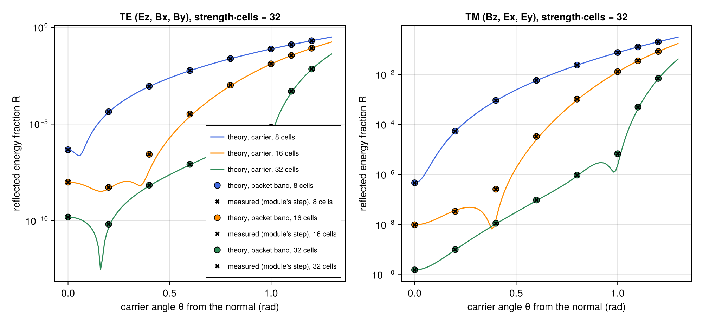
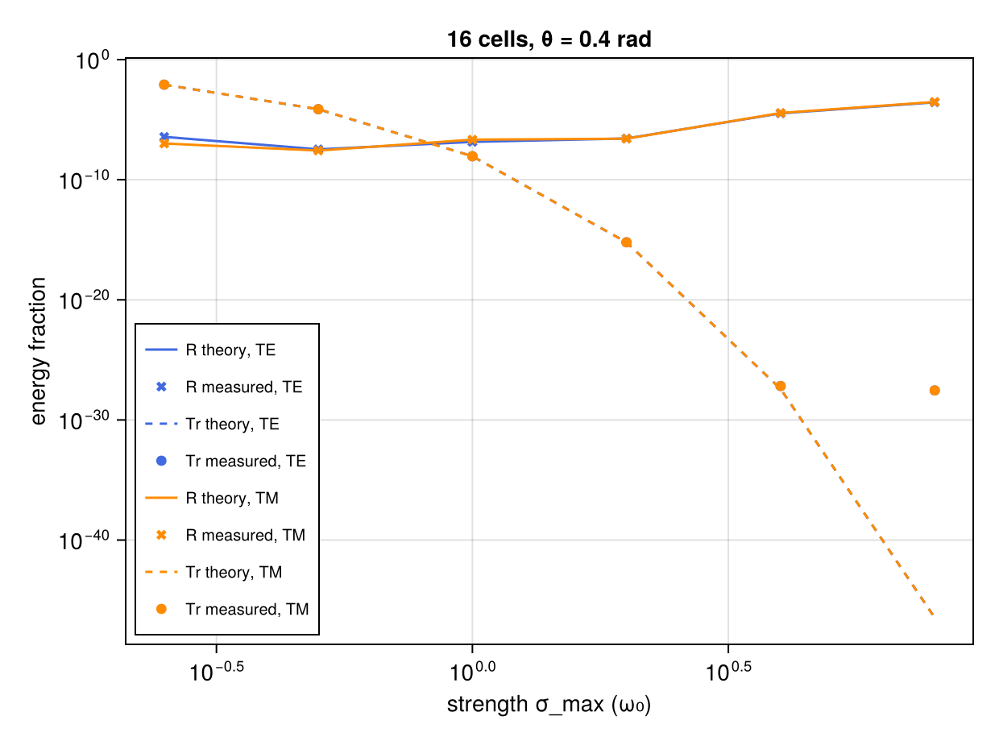
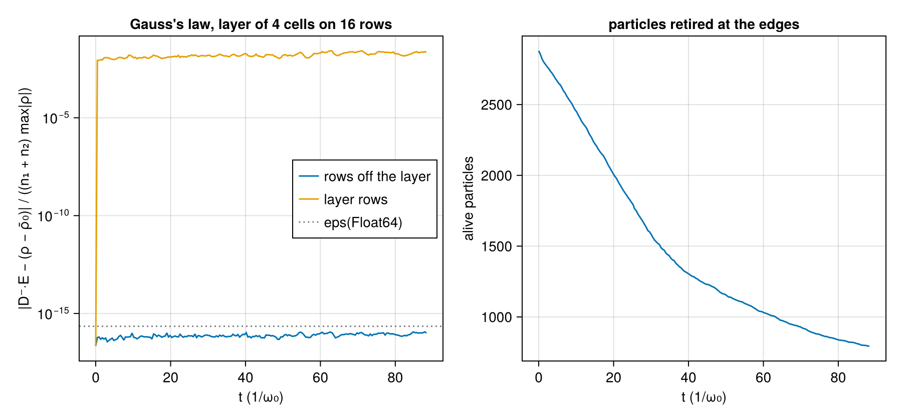

# WP-027: open transverse boundaries, a matched absorbing layer against the scheme's own discrete theory, and particles retired at the edge

| | |
|---|---|
| Work package | WP-027 (goals A2, A4, A7, A8, A10) |
| Commits | the layer, the retirement, the tests and the script `aa222d4`; the symmetric splitting and the integer profile after the physics breaker `d5d9203`; this report in WP-027's pull request, where the merge with main moved the test ids from T-430–T-437 (taken by WP-030) to T-450–T-457 with no other change, so the run's manifest hashes the files before that renaming |
| Runs | `em2d-absorbing-layer-20261103T210731` (commit `d5d9203`, `dirty = false`) |
| Input hashes | SHA-256 of every input file in the run's manifest: `wp-027-open-boundaries/em2d-absorbing-layer-20261103T210731/manifest.toml` |
| Environment | Julia 1.13.3, KernelAbstractions 0.10 CPU backend; Intel Xeon Processor @ 2.10GHz (the model string the CPU reports), 4 vCPUs of a shared cloud VM; 4 threads |
| Figures | `wp-027-open-boundaries/em2d-absorbing-layer-20261103T210731/layer_reflection.png`, `layer_strength.png` and `layer_gauss.png`, each with its JSON sidecar (every row) |
| Status | measured, not independently reviewed; no number here is to leave the repository before that review |

## 1. Setup

The open boundary is split between the problem and the numerics (A10). The code is `lib/ParticleMeshElectromagnetic/src/boundaries.jl`, the contract is in the module's paragraph of `docs/plan/architecture-draft.md` §0.7, and the choices the package left open are in `questions/wp-027-open-boundaries.md`.

- The problem: `EMProblem{2}(...; boundaries = (:periodic, :open))`. A case file gives `grid.boundaries = ["periodic", "open"]`.
- The numerics: `EMNumerics(; absorber = AbsorbingLayer(; cells, strength, order = 2))`. A case file gives `[numerics.absorbing_layer]`.
- The fields: the layer is the outer `cells` rows on each side of the box along y. The two layers meet at the periodic seam as one slab of 2·cells rows. In it σ = strength·(depth/thickness)^order damps E and B alike (the matched lossy medium), the depth counted in integer half rows. Before and after each Yee sub-step of length τ, each component it updates is multiplied by exp(−σ·τ/2) at its own row stagger (symmetric splitting).
- The particles: a particle whose cell along y jumps across the seam in a step is marked free after the current of that move is deposited.

Every reflection measurement is a vacuum run of the module's step in Float64 at 0.95 of the 2D Courant limit, 16 cells per wavelength along x and 8 along y.

- **The slab packet.** One wavenumber k_x along x, exactly one period of the box, and a Gaussian envelope along y, 3/cos θ wavelengths wide (1/e half width of the field). It is built from the scheme's upward eigenmodes, E at t = 0 and B at Δt/2 from the discrete Faraday and Ampère relations, then B taken back to t = 0 by the solver's own half step, so in vacuum it travels one way to roundoff. Its carrier angle θ from the layer's normal is tan θ = k_x/k_y0, with |k| = 1.
- **The measurement.** The packet starts in the middle of the interior and hits the top layer. At the measurement time, what came back is two packets 8 envelope widths apart and from the layers: the reflection going down in the upper half of the interior and the transmission through both layers and the seam going up in the lower half. R and Tr are their energies ½Σ(E² + B²) over the initial one.
- **The theory.** With every field ∝ e^{ik_x x}·λⁿ, λ = e^{−iωΔt} at the mode's Yee ω, the x-differences become iκ_x, and a sub-step with its damping becomes X′ = e^{−στ}·X + e^{−στ/2}·U(X), with U the undamped increment. Eliminating the components without a y-difference leaves a three-point recurrence along y: for Ez on the Node() rows (TE: Ez, Bx, By) or for the half-step Bz on the Center() rows (TM: Bz, Ex, Ey). It is iterated from an outgoing wave above the slab down through it and split below into the incident and reflected vacuum roots (`layer_rt`, `lib/ParticleMeshElectromagnetic/test/boundaries_cases.jl`). The prediction for the packet is |r|² and |t|² weighted over its modes. The theory shares only the profile formula with the kernels.

## 2. Reflection against angle and thickness

At the nominal attenuation strength·cells = 32 (order 2), R in TE (TM is in the sidecar; it differs from TE by up to a factor 15 where R is small, near the zeros of one polarization):

| cells | θ = 0 | 0.2 | 0.4 | 0.6 | 0.8 | 1.0 | 1.1 | 1.2 rad |
|---|---|---|---|---|---|---|---|---|
| 8 | 4.7e-7 | 4.3e-5 | 9.0e-4 | 5.9e-3 | 2.4e-2 | 7.7e-2 | 0.128 | 0.206 |
| 16 | 9.9e-9 | 5.3e-9 | 2.7e-7 | 3.3e-5 | 1.0e-3 | 1.3e-2 | 3.5e-2 | 8.4e-2 |
| 32 | 1.6e-10 | 6.6e-11 | 6.9e-9 | 8.3e-8 | 9.1e-7 | 6.8e-6 | 5.0e-4 | 7.0e-3 |

- **The module's step against the theory.** Across the 48 runs, the measured R matches the discrete theory to at most 1.4·10⁻¹⁰ relative, and to 10⁻¹⁵ to 10⁻¹² where R is not tiny. That is roundoff: an energy fraction X is known to about eps·√steps·2√X (T-450's scale). The kernels and `layer_rt` share only the profile. A breaker's independent direct solve of the one-step map reproduced `layer_rt`'s |r| to 10⁻¹⁵ to 3·10⁻¹¹ on the first version of the layer (Breakers, below).
- **Thickness.** At a fixed nominal attenuation, the thicker layer is the smoother one. Up to 1 rad, R falls by a factor of 6 to 8000 from 8 to 16 cells and of 40 to 1900 from 16 to 32 cells, least at the largest angle.
- **Angle.** R grows with the angle. Normal incidence is reflectionless only in the continuum. The scheme's reflection there falls as about Δ⁴ (T-450: |r|² = 4.6·10⁻¹⁰, 7.6·10⁻¹² and 4.4·10⁻¹³ at 16, 32 and 64 cells per wavelength, for a one-wavelength layer of strength 2). At the carrier alone R is not monotonic: TE at 32 cells has a zero near 0.16 rad and TM at 16 cells one near 0.38 rad. The packet's band fills these in.
- **Grazing.** Beyond 1 rad the matched layer degrades, as an isotropic absorber must: R reaches 0.2 at 1.2 rad for 8 cells, and 7·10⁻³ for 32. That is the PML's job (A2: later).
- **Transmission.** Tr matches the theory to roundoff, except at 1.2 rad, where an absolute floor of about 10⁻¹⁷ (16 cells) and 3·10⁻¹⁹ (32 cells) of the incident energy shows in the lower half of the interior. That floor is not explained (open items). It is 15 orders of magnitude below R there.

## 3. Strength

At 16 cells and 0.4 rad:

| strength (ω₀) | 0.25 | 0.5 | 1 | 2 | 4 | 8 |
|---|---|---|---|---|---|---|
| R (TE) | 3.7e-7 | 3.4e-8 | 1.4e-7 | 2.7e-7 | 3.4e-5 | 2.8e-4 |
| Tr | 8.2e-3 | 7.4e-5 | 9.0e-9 | 6.2e-16 | roundoff | roundoff |

- **Too weak**, and the wave crosses the slab and comes back from the other side.
- **Too strong**, and the gradient reflects.
- **For 16 cells** the balance is near strength 1 to 2: at 2, R = 2.7·10⁻⁷ and Tr = 6·10⁻¹⁶.
- **Roundoff floor.** At strength 4 and 8 the measured Tr is the roundoff floor of about 3·10⁻²⁸, which T-450's scale bounds.

## 4. Gauss's law with particles leaving

The plasma of T-451 (`open_plasma_2d`): 10 × 16 cells, a layer of 4 cells at strength 1, 2880 particles of two species drifting through both edges, 200 steps, Float64, Reference. Results:

- **Off the layer.** On the node rows whose four E faces are undamped (j₀ = 5 … 11), the residual |D⁻·E − (ρ − ρ̄₀)| stays at or below 1.2·10⁻¹⁶ of (n₁ + n₂)·max|ρ|.
- **In the layer.** On the layer rows it is 8·10⁻³ to 2.6·10⁻² of that scale.
- **Particles.** 2087 of the 2880 particles leave.

A breaker went row by row: rows 5 to 11 are at 0.06–0.08 eps, the first rows into each layer (4 and 12) already at 10¹² eps. So the rows the test calls free are exactly the undamped ones.

## 5. Tolerances (A7)

Measured on the CPU backend at 4 threads. Every value is a proposal in `lib/ParticleMeshElectromagnetic/test/tolerances.toml`, whose `scale` fields state the scaling. A test passes when measured ≤ C.

| test | quantity | measured (Float32, Float64, Dual) | proposed C |
|---|---|---|---|
| T-450 | \|R − R_theory\|, \|Tr − Tr_theory\| over eps·√k·(2√X + eps·√k), Float64 | —, 0.372, — | 10 |
| T-451 | Gauss's law off the layer, T-360's scale | 0.33, 0.378, 0.198 | 1 |
| T-451 | ∇·B off the layer, T-360's scale | 0.363, 0.429, 0.297 | 2 |
| T-455 | as T-450, one run in each element type | 0.0228, 0.23, 0.0228 | 10 |

The constants leave room for the breaker's configurations outside the suite: a layer as thin as the guard width reached 5.1 on T-450's scale, a Tr at the roundoff floor 4.9, and ∇·B 1.2 at order 1 with 3 cells. The suite's other tests are exact or structural:

- T-452: the retired set is exactly the particles that crossed the y seam.
- T-453: the zero-strength layer is the periodic step bit for bit, and the factors are the closed form.
- T-454: the Reference step is bitwise across reruns, workgroup sizes 32 and 256, and 1 and 4 threads.
- T-456: the input checks.
- T-457: allocation is flat, 384 B per Fast step at every size.

The whole new suite takes about 4 min on 4 threads, T-454's worker runs included.

## 6. Breakers

- **Physics breaker** (on `aa222d4`).
  - *First-order splitting.* It found that damping only after each sub-step is first order in Δt. Its normal-incidence |r|² fell as Δ², and it over-absorbed: |t|² was 100 times below the continuum at 8 cells per wavelength. The symmetric splitting of `d5d9203` falls as Δ⁴, and its |t|² converges to the continuum's exp(−4·strength·thickness/3) (5.25·10⁻⁸ at 64 cells against 5.29·10⁻⁸).
  - *Order 0.* At grading order 0, roundoff at the inner edge decided whether that row was damped (asymmetric layers, different between Float32 and Float64), and the TM branch of `layer_rt` evaluated it differently from the kernel. The profile is now evaluated at integer half rows in both, and T-450 checks TE = TM at normal incidence for orders 0 to 2.
  - *Confirmed on `aa222d4`.* An independent solve of the one-step map, the continuum limit at oblique incidence (|r|² 2.357·10⁻⁴ at 256 cells per wavelength against the continuum's 2.371·10⁻⁴ at 0.4 rad), other resolutions, Courant fractions, orders, Linear shape, seeds, drifts up to 0.97 c, and a laser antenna in an open box (Gauss's law off the layer and the antenna columns at 0.03 of the scale).
- **Mutation breaker.** On `aa222d4`, 44 runs: 43 mutations one at a time, plus a baseline. Caught:

- every stagger, sub-step length, placement and omission of the damping, and the swapped factor tables;
- the row ranges that miss a layer row;
- the profile's alias, depth and normalization;
- retirement before the deposit, of x-seam crossers, in one direction only, of one species only;
- each input check dropped;
- every theory-only mutation of `layer_rt`.

Survivors and what was done:

- **Outermost guard row or column not damped** (latent, since every sub-step refills the guards first). T-453 now checks that after a damped solve every guard is its interior image bit for bit. It fails on that mutation in all three element types.
- **`depth >= 0` at order 0.** This is the physics breaker's edge row, removed by the integer profile; T-453 checks the factors at order 0.
- **Retirement after the kinetic energy.** T-452 now checks that the kinetic energy at n + ½ is that of the particles still in the box. It fails on that mutation at every step.
- **A threshold of 2 instead of 1 for the seam jump.** This is equivalent on every grid the layer admits (n₂ ≥ 2·cells + 1 ≥ 7, so the jump is n₂ − 1 ≥ 6). Nothing to test.
- **Joint errors of kernel and theory** (B damped at the wrong rate, or not at all, in both). Only the angle-ordering assertion caught these. T-450 now also bounds R < 10⁻⁷ at 16 cells and normal incidence, and requires the theory's normal-incidence |r|² to fall about as Δ⁴, which an unmatched layer cannot (its continuum reflection is not zero).

## 7. Open items

- **No GPU run.** The kernels are elementwise and within §0.4, but CUDA is untested: this session has no GPU.
- **Grazing incidence.** The matched layer reflects 10⁻² to 0.2 at 1.2 rad. A PML (A2: later) is the remedy if the LWFA case needs it.
- **The Tr floor at 1.2 rad**, about 10⁻¹⁷ of the incident energy, is not explained.
- **Initial field.** It is still the periodic solve (questions §5).
- **Parameters.** The LWFA case has no layer parameters yet (questions §3).
