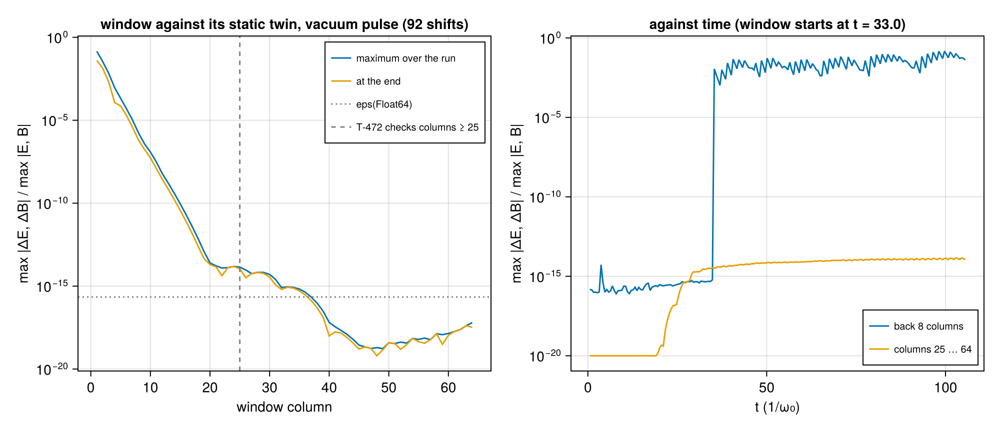
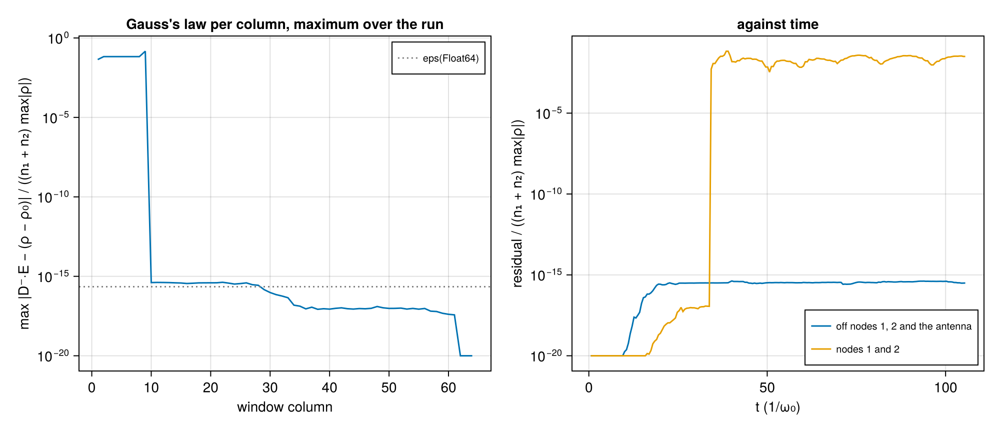

# WP-028: the moving window, a memory shift with a refill one column behind the front, held to Gauss's law across shifts

| | |
|---|---|
| Work package | WP-028 (goals A2, A3, A4, A7, A8) |
| Commits | the window, its tests and the script `7e1a0d6`; the script's import `fd63c19`; the plot floor `3879cc4`; the warm-plasma front `d354572`; `c21573f`, the run's commit |
| Runs | `em2d-moving-window-20261105T115422` (commit `c21573f`, `dirty = false`) |
| Input hashes | SHA-256 of every input file in the run's manifest: `wp-028-moving-window/em2d-moving-window-20261105T115422/manifest.toml` |
| Environment | Julia 1.13.3, KernelAbstractions 0.10 CPU backend; Intel Xeon Processor @ 2.10GHz (the model string the CPU reports), 4 vCPUs of a cloud VM; 1 thread |
| Figures | `wp-028-moving-window/em2d-moving-window-20261105T115422/window_vacuum.png` and `window_gauss.png`, each with its JSON sidecar (every row) |
| Status | measured, not independently reviewed; no number here is to leave the repository before that review |

## 1. Setup

The code is `lib/ParticleMeshElectromagnetic/src/window.jl`. The contract is in the module's paragraph of `docs/plan/architecture-draft.md` §0.7. The choices the package left open are in `questions/wp-028-moving-window.md`.

- **The problem.** `EMProblem{2}(...; boundaries = (:window, ·), window = MovingWindow(; start), profile = DensityRamp(; vacuum, ramp))`. The box moves at c along axis 1 by whole cells: after step k it has moved `max(0, floor((kΔt − start)/Δx₁))` cells. The profile is zero up to `vacuum`, then sin² over `ramp`, then one. It multiplies every species' density and enters through the weights (A3).
- **The shift.** The window shifts at the end of a step. E and B move one column back through the scratch ρ, and the front column and the x-guards become zero, except Ex on the front face, which is carried along. The particles move one cell back, and those of the back column are retired. The sort then compacts the slots, and the fresh plasma of the injection column n₁ − 1 − r − P (r the shape's stencil reach past its cell, 2 for the quadratic shape; P the filter passes) is loaded behind the alive count, read on the device. It is loaded with the engine's 2D quiet start at the global cell (`quiet_particle_2d`, factored out of `load_quiet!`).
- **The edges.** The outside is field-free. After every Yee sub-step the x-guards of the updated components are zero. The current and the charge in the x-guards are dropped before the fold, and the binomial filter sees zero x-guards in every pass. A particle that crosses an x edge is retired before the current of that move.
- **The plasma.** It starts neutral against an immobile background of its own profile, so E⁰ = 0. Gauss's law reads D⁻·E = ρ − ρ₀(s), where ρ₀(s) is the charge of the cold quiet start of the window's plasma columns at its position s.
- **The antennas.** An antenna plane stays in the lab frame, and the state refuses a laser whose pulse is not over before the window passes the plane.

The run is `window_lwfa` of `lib/ParticleMeshElectromagnetic/test/window_cases.jl`, in Float64 and Reference mode:

- the grid: 64 × 16 cells at 8 cells per wavelength (Δx = π/4), Δt at 0.95 of the 2D Courant limit;
- the laser: an antenna at x = 6 with a₀ = 1, waist 6, duration 3 and delay 18;
- the plasma: cold electrons of 0.02 n_c behind a vacuum of 24 c/ω₀ and a ramp of 8, at 2 × 2 particles per cell;
- the window: it starts at t = 33, when the antenna has finished, and makes 92 shifts in 200 steps.

The vacuum case is the same without the plasma. Its static twin is the same problem on 164 columns with a window that never moves.

## 2. A vacuum pulse with and without the window

- **Before the window moves.** The two runs have the same back edge. They differ only where the pulse's precursor and Gaussian tail reach the window's front edge, which the twin does not have: at most 1.7 × 10⁻¹⁴ of the largest field (T-472).
- **After it moves.** The difference is largest at the back edge, 0.15 of the largest field in the back 8 columns. In two dimensions a pulse leaves a trailing field behind it, and the window's field-free outside reflects it there. The difference falls by about an order of magnitude per two columns towards the front. Through Yee's stencil it can reach forward one cell per step, while the window moves 0.67 cells per step. It reaches roundoff by column 20. On columns 25 to 64, the comparison T-472 makes, it is at most 1.4 × 10⁻¹⁴ (65·eps). Ahead of the pulse it falls to 10⁻¹⁹, where both fields are tiny.
- **The antenna.** It stays in the lab frame and keeps launching while the window moves, until the window passes it. That is why the twin, whose antenna never leaves, agrees.

## 3. Gauss's law across shifts

The laser drives the plasma to |u| ≈ 0.4. The window moves 92 cells, more than its 64, so the whole plasma in it at the end has entered through the front.

- **Off the excluded columns.** In units of (n₁ + n₂)·max|ρ| (T-360's scale), the residual of D⁻·E − (ρ − ρ₀(s)) stays at most 4.2 × 10⁻¹⁶. That is about 2·eps(Float64), on every node except nodes 1 and 2 and the antenna's two columns.
- **The excluded columns.** In the per-column maximum over the run, columns 1 to 9 carry about 0.1. These are the columns the antenna's plane crosses, in the lab frame, as the window moves past it. The plane carries the surface charges of the antenna's sheets, and, for this pulse of one carrier period, a remainder of its zero-frequency content (T-406). Once the window has passed the plane, those charges leave the box.
- **The back nodes.** Nodes 1 and 2 jump to 10⁻² when the window starts moving and stay there. Node 1's difference reads the zero x-guard in place of the field behind the box. Node 2 is the reach of the charge of particles retired at the back edge. Neither residual can spread: the next shift drops it.

At test size, T-473 runs this case to 200 steps in all three element types and both modes. Its worst ratio, with T-360's additional √(k + 1), is 0.20 (Float64), 0.23 (Float32) and 0.23 (Dual{Float32,3}), against the proposed C = 1. T-473 also runs a warm plasma (thermal speeds 0.1 c, 24 × 6 cells, 60 steps, no laser), whose worst ratio off nodes 1 and 2 is 0.064 (Float64), 0.059 (Float32) and 0.060 (Dual{Float32,3}).

How the residual was found and removed, in the order the measurements showed it:

1. **The front column.** With the fresh plasma loaded into the front column, particles faster than 1/(2·ppc₁) passed the front between shifts. Their charge left a residual at the front, which the shifts carried into the box.
2. **Fields at the front.** In a box shorter than the pulse's six durations, the pulse's own tail reached the front. Zeroing the new front column then broke Gauss's law there. The test geometry was changed so that the box holds the pulse.
3. **Particles crossing the back edge.** With retirement after the deposit, as at WP-027's open y edge, the current of a particle that left through the back landed at the front. The engine places a crossing particle's flux stencil at its new cell, across the seam. Particles crossing an x edge are now retired before their current is deposited (T-476).
4. **A warm plasma at the front.** The review found that a thermal plasma (0.1 c or 0.02 c) broke Gauss's law at the front from the first shift and that the shifts carried it through the box. With the plasma loaded into column n₁ − 1, the residual off nodes 1 and 2 reached 2.4 × 10¹² (0.1 c) and 6.4 × 10¹¹ (0.02 c) of eps·(n₁ + n₂)·max|ρ| on every column within 60 steps, while a drift of 0.3 c along x or y stayed below 0.2. Two things were wrong, and each alone leaves most of it. The quadratic stencil of a particle in column n₁ − 1 reaches the front face (node n₁ + 1, an x-guard), where the step drops the current and holds Ey at zero, so that node's law is not kept, and the next shift makes it the new front node. And the shift zeroed Ex on the front face, which the fields of a warm plasma reach. The plasma is now loaded r + P + 1 columns behind the front, so nothing it deposits reaches the face, and the shift carries the face's Ex along: the residual is then 0.06 to 0.1 of the scale on every column but 1 and 2. With only the margin it stays at 1.7 × 10¹⁰, and with only the carried Ex at 3 × 10¹². The reason is in `questions/wp-028-moving-window.md` §4.

## 4. The other checks

- **T-470.** The refill is the engine's quiet start of the whole domain at the global cell, bit for bit in cells, offsets and weights, and to 4 ulp in the momenta γv (host against kernel arithmetic). That holds for a thermal plasma in all three types. With the ramp length a dual, the positions carry no partials, and the weights carry the closed-form ∂w/∂L.
- **T-471.** A cold plasma at rest stays what it is while the window renews it, 29 shifts of a 24-column window. The fields stay +0.0. The window holds exactly the particle set of a fresh load at its position. ρ = ρ₀(s) holds bit for bit in Reference mode and to roundoff with Fast mode's atomics. The plateau's nodes all carry the same bits.
- **T-474.** The Reference step is bitwise across reruns and launch shapes 32 and 256 in all three types. Fast and Reference fields agree to 1.0 × 10⁻¹⁵ relative after 120 steps.
- **T-475.** The field energy after 30 steps of a plasma drifting into the window, against the ramp length: ForwardDiff agrees with the finite differences to 1.0 × 10⁻⁸ relative, against an fd_scan floor of 3.7 × 10⁻⁷.
- **T-476.** A plasma drifting backwards at 0.9 c crosses the back edge between shifts (36 particles in 20 steps). Exactly the particles that cross it are retired, and Gauss's law does not change on nodes 3 … n₁ in those steps. A dilute plasma streaming forward at 0.5 c overflows a buffer with no headroom: 228 particles are counted as lost. With a headroom of 3/2 none is lost.
- **T-477.** The input checks.
- **T-478.** The filter does not wrap along x. The allocation per window step is the same at 4 and 36 particles per cell and at 3 × 3 times the grid: 9856 bytes for three steps.

## 5. The cost of a shift

On the run's state after 150 steps (3904 particles, 64 × 16 cells, one thread):

| | median |
|---|---|
| a step without a shift | 3.7 ms |
| a step with a shift | 4.8 ms |
| `shift_window!` alone | 1.1 ms |

Two steps in three shift at this Courant number. The shift costs about a quarter of a step: six field copies, a sort, and the refill. These are single-run timings on a shared VM, not benchmark numbers. A ring buffer would avoid the copies (`questions/wp-028-moving-window.md` §2).

## 6. Verification status and open issues

- **Not run.** The 1- and 4-thread bitwise check (T-474 has no worker run) and the harness.
- **CUDA.** T-560 reruns T-470 to T-476, the filter of T-478 and T-479 on CUDA with the CPU's tolerances, T-561 bounds the CPU–CUDA difference of the window's fields, and T-562 the allocation per step (RTX 4080 SUPER).
- **The back edge.** The field-free outside reflects the trailing field that reaches it. A PML at the back (A2's "later") would remove the 0.15 difference of §2.
- **The static phase.** Before the window starts moving its front is a fixed edge, and a particle that reaches it is retired with its charge; the shifts would carry the residual into the box. So `EMProblem` refuses a window with `start > 0` for a species with a drift or a thermal speed (T-477). A cold plasma at rest can still be set moving by a laser before the window starts; a case must start the window before the laser reaches the plasma at the front.
- **The case files.** There is no schema for the window and the profile yet, and the cross-code generators do not map the window's axis.
- **The thermal load.** The loader draws the thermal spread in velocity, so its Gaussian tail can pass c (#257). The window's initial load refuses such a draw with an `ArgumentError`, as `initialize!` does for a static load. A refill cannot raise inside a step (§0.4), so it loads such a particle at the drift velocity, keeping its charge, and counts it (`window_superluminal`, T-479). Drawing the spread in momentum would remove the case; that is #330.
