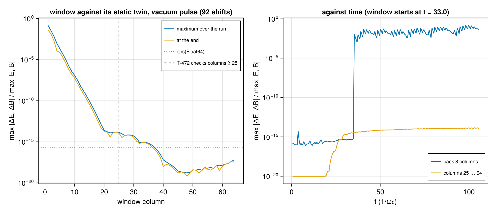

# WP-028: the moving window, a memory shift with a refill one column behind the front, held to Gauss's law across shifts

| | |
|---|---|
| Work package | WP-028 (goals A2, A3, A4, A7, A8) |
| Commits | the window, its tests and the script `7e1a0d6`; the script's import `fd63c19`; the plot floor `3879cc4`, the run's commit |
| Runs | `em2d-moving-window-20261104T025337` (commit `3879cc4`, `dirty = false`) |
| Input hashes | SHA-256 of every input file in the run's manifest: `wp-028-moving-window/em2d-moving-window-20261104T025337/manifest.toml` |
| Environment | Julia 1.13.3, KernelAbstractions 0.10 CPU backend; Intel Xeon Processor @ 2.80GHz (the model string the CPU reports), 4 vCPUs of a shared cloud VM, other Julia sessions running beside it; 1 thread |
| Figures | `wp-028-moving-window/em2d-moving-window-20261104T025337/window_vacuum.png` and `window_gauss.png`, each with its JSON sidecar (every row) |
| Status | measured, not independently reviewed; no number here is to leave the repository before that review |

## 1. Setup

The code is `lib/ParticleMeshElectromagnetic/src/window.jl`. The contract is in the module's paragraph of `docs/plan/architecture-draft.md` §0.7. The choices the package left open are in `questions/wp-028-moving-window.md`.

- **The problem.** `EMProblem{2}(...; boundaries = (:window, ·), window = MovingWindow(; start), profile = DensityRamp(; vacuum, ramp))`. The box moves at c along axis 1 by whole cells: after step k it has moved `max(0, floor((kΔt − start)/Δx₁))` cells. The profile is zero up to `vacuum`, then sin² over `ramp`, then one. It multiplies every species' density and enters through the weights (A3).
- **The shift.** The window shifts at the end of a step. E and B move one column back through the scratch ρ, and the front column and the x-guards become zero. The particles move one cell back, and those of the back column are retired. The sort then compacts the slots, and the fresh plasma of column n₁ − 1 is loaded behind the alive count, read on the device. It is loaded with the engine's 2D quiet start at the global cell (`quiet_particle_2d`, factored out of `load_quiet!`).
- **The edges.** The outside is field-free. After every Yee sub-step the x-guards of the updated components are zero. The current and the charge in the x-guards are dropped before the fold, and the binomial filter sees zero x-guards in every pass. A particle that crosses an x edge is retired before the current of that move.
- **The plasma.** It starts neutral against an immobile background of its own profile, so E⁰ = 0. Gauss's law reads D⁻·E = ρ − ρ₀(s), where ρ₀(s) is the charge of the cold quiet start of the window's plasma columns at its position s.
- **The antennas.** An antenna plane stays in the lab frame, and the state refuses a laser whose pulse is not over before the window passes the plane.

The run is `window_lwfa` of `lib/ParticleMeshElectromagnetic/test/window_cases.jl`, in Float64 and Reference mode:

- the grid: 64 × 16 cells at 8 cells per wavelength (Δx = π/4), Δt at 0.95 of the 2D Courant limit;
- the laser: an antenna at x = 6 with a₀ = 1, waist 6, duration 3 and delay 18;
- the plasma: cold electrons of 0.02 n_c behind a vacuum of 24 c/ω₀ and a ramp of 8, at 2 × 2 particles per cell;
- the window: it starts at t = 33, when the antenna has finished, and makes 92 shifts in 200 steps.

The vacuum case is the same without the plasma. Its static twin is the same problem on 164 columns with a window that never moves.

## 2. A vacuum pulse with and without the window

- **Before the window moves.** The two runs have the same back edge. They differ only where the pulse's precursor and Gaussian tail reach the window's front edge, which the twin does not have: at most 1.7 × 10⁻¹⁴ of the largest field (T-472).
- **After it moves.** The difference is largest at the back edge, 0.15 of the largest field in the back 8 columns. In two dimensions a pulse leaves a trailing field behind it, and the window's field-free outside reflects it there. The difference falls by about an order of magnitude per two columns towards the front. Through Yee's stencil it can reach forward one cell per step, while the window moves 0.67 cells per step. It reaches roundoff by column 20. On columns 25 to 64, the comparison T-472 makes, it is at most 1.4 × 10⁻¹⁴ (65·eps). Ahead of the pulse it falls to 10⁻¹⁹, where both fields are tiny.
- **The antenna.** It stays in the lab frame and keeps launching while the window moves, until the window passes it. That is why the twin, whose antenna never leaves, agrees.

## 3. Gauss's law across shifts

The laser drives the plasma to |u| ≈ 0.4. The window moves 92 cells, more than its 64, so the whole plasma in it at the end has entered through the front.

- **Off the excluded columns.** In units of (n₁ + n₂)·max|ρ| (T-360's scale), the residual of D⁻·E − (ρ − ρ₀(s)) stays at most 4.2 × 10⁻¹⁶. That is about 2·eps(Float64), on every node except nodes 1 and 2 and the antenna's two columns.
- **The excluded columns.** In the per-column maximum over the run, columns 1 to 9 carry about 0.1. These are the columns the antenna's plane crosses, in the lab frame, as the window moves past it. The plane carries the surface charges of the antenna's sheets, and, for this pulse of one carrier period, a remainder of its zero-frequency content (T-406). Once the window has passed the plane, those charges leave the box.
- **The back nodes.** Nodes 1 and 2 jump to 10⁻² when the window starts moving and stay there. Node 1's difference reads the zero x-guard in place of the field behind the box. Node 2 is the reach of the charge of particles retired at the back edge. Neither residual can spread: the next shift drops it.

At test size, T-473 runs this case to 200 steps in all three element types and both modes. Its worst ratio, with T-360's additional √(k + 1), is 0.20 (Float64), 0.23 (Float32) and 0.23 (Dual{Float32,3}), against the proposed C = 1.

How the residual was found and removed, in the order the measurements showed it:

1. **The front column.** With the fresh plasma loaded into the front column, particles faster than 1/(2·ppc₁) passed the front between shifts. Their charge left a residual at the front, which the shifts carried into the box. The plasma is now loaded into column n₁ − 1; the reason is in `questions/wp-028-moving-window.md` §4.
2. **Fields at the front.** In a box shorter than the pulse's six durations, the pulse's own tail reached the front. Zeroing the new front column then broke Gauss's law there. The test geometry was changed so that the box holds the pulse.
3. **Particles crossing the back edge.** With retirement after the deposit, as at WP-027's open y edge, the current of a particle that left through the back landed at the front. The engine places a crossing particle's flux stencil at its new cell, across the seam. Particles crossing an x edge are now retired before their current is deposited (T-476).

## 4. The other checks

- **T-470.** The refill is the engine's quiet start of the whole domain at the global cell, bit for bit in cells, offsets and weights, and to 4 ulp in the momenta γv (host against kernel arithmetic). That holds for a thermal plasma in all three types. With the ramp length a dual, the positions carry no partials, and the weights carry the closed-form ∂w/∂L.
- **T-471.** A cold plasma at rest stays what it is while the window renews it, 29 shifts of a 24-column window. The fields stay +0.0. The window holds exactly the particle set of a fresh load at its position. ρ = ρ₀(s) holds bit for bit in Reference mode and to roundoff with Fast mode's atomics. The plateau's nodes all carry the same bits.
- **T-474.** The Reference step is bitwise across reruns and launch shapes 32 and 256 in all three types. Fast and Reference fields agree to 1.0 × 10⁻¹⁵ relative after 120 steps.
- **T-475.** The field energy after 30 steps of a plasma drifting into the window, against the ramp length: ForwardDiff agrees with the finite differences to 1.0 × 10⁻⁸ relative, against an fd_scan floor of 3.7 × 10⁻⁷.
- **T-476.** Exactly the particles that cross the back edge are retired, and Gauss's law does not change on nodes 3 … n₁ in those steps. A dilute plasma streaming forward at 0.5 c overflows a buffer with no headroom: 276 particles are counted as lost. With a headroom of 3/2 none is lost.
- **T-477.** The input checks.
- **T-478.** The filter does not wrap along x. The allocation per window step is the same at 4 and 36 particles per cell and at 3 × 3 times the grid: 9856 bytes for three steps.

## 5. The cost of a shift

On the run's state after 150 steps (4032 particles, 64 × 16 cells, one thread):

| | median |
|---|---|
| a step without a shift | 3.6 ms |
| a step with a shift | 4.9 ms |
| `shift_window!` alone | 1.3 ms |

Two steps in three shift at this Courant number. The shift costs about a third of a step: six field copies, a sort, and the refill. These are single-run timings on a shared VM, not benchmark numbers. A ring buffer would avoid the copies (`questions/wp-028-moving-window.md` §2).

## 6. Verification status and open issues

- **Not run.** The 1- and 4-thread bitwise check (T-474 has no worker run), the CUDA backend and the harness.
- **The back edge.** The field-free outside reflects the trailing field that reaches it. A PML at the back (A2's "later") would remove the 0.15 difference of §2.
- **The static phase.** A particle that reaches the front before the window starts moving is retired with its charge. The residual it leaves is then shifted into the box. Cases should start the window before the plasma at the front can move.
- **The case files.** There is no schema for the window and the profile yet, and the cross-code generators do not map the window's axis.
- **The thermal load.** The window's loader converts drawn velocities to γv in its own kernel, so a refusal of drawn speeds ≥ c in `initialize!` (#257) does not cover the window's load.
