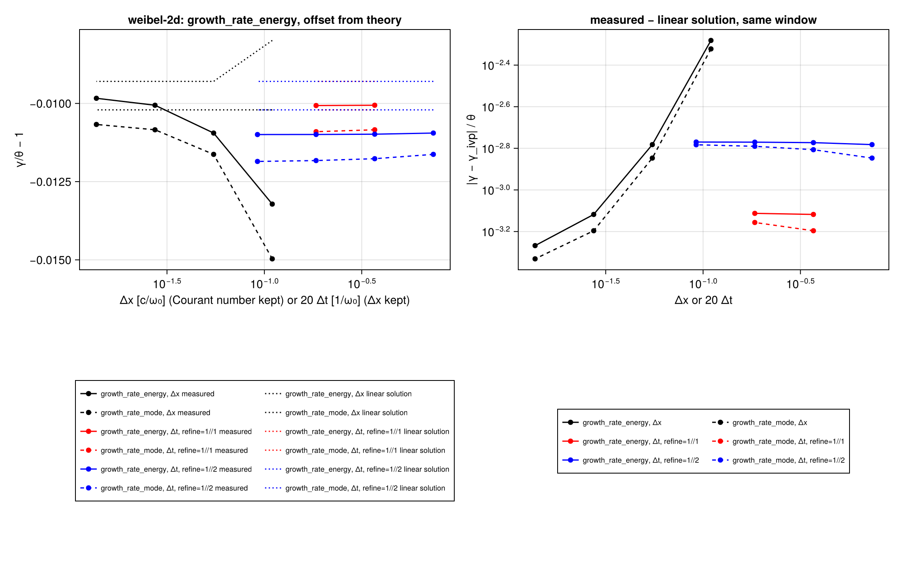
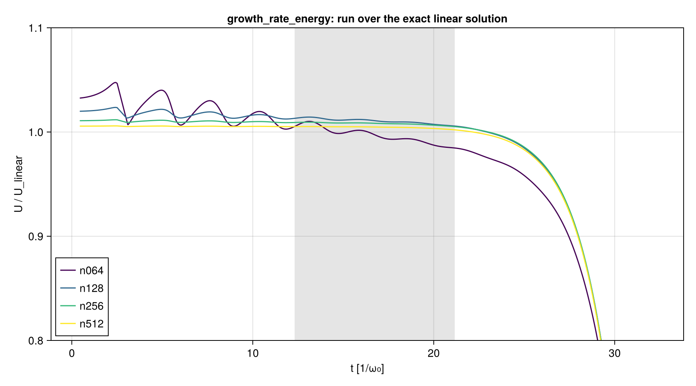
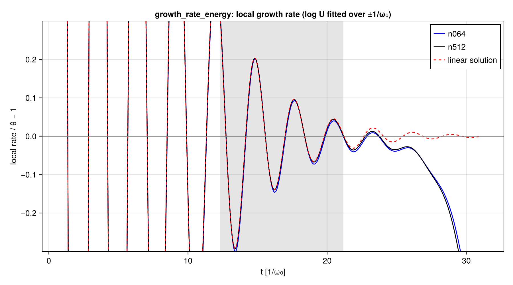

# WP-031: the common offsets from linear theory are not discretization error

| | |
|---|---|
| Work package | WP-031 (goals A5, A7) |
| Question | Are the offsets of the cold cases' growth rates from linear theory, common to Smilei, PIConGPU and ParticleMesh, discretization error? Two-stream −1.5 % (#168, #226), 2D Weibel −1.1 % (`reports/wp-023-em-step-2d.md`, "not verified"), 1D Landau below theory (#167) |
| Code | `scripts/crosscode/convergence.jl` (scan points, box request, summary, report), `convergence_report.jl`, `convergence_pm.jl` (ParticleMesh on the same points), `theory.jl` (`cold_ivp`: the exact linear solution); tests T-410 to T-416 |
| Scans | `scripts/crosscode/scans/two-stream-offset.toml`, `weibel-2d-offset.toml`, fixed before the runs; points derived from the committed case files by `derive_case` (T-412: the 128- and 256-cell two-stream points give the committed namelists of `two-stream.toml` and `two-stream-256.toml`) |
| Runs | Smilei v5.1 (CPU image `localhost/particlemesh-smilei:e4f0148b8952fc87`, id `7e2b08d0…`) on the CPU box, AMD EPYC 9655, 16 cores: branch `runs/wp031-two-stream-1` (13 points, 21 min) and `runs/wp031-weibel-2d-2` (13 points, 50 min; an earlier submission of the same scan, `runs/wp031-weibel-2d-1-rerun`, was cut off after 7 points when the box was replaced and is not used); ParticleMesh (electromagnetic module, Reference mode, Float64) on an Intel Core i9-14900K, 16 threads, commit `f014378` |
| Outputs | `wp-031-offset-convergence/two-stream/`, `weibel-2d/`, `pm-two-stream/`: each holds `summary/` (the box's or the local run's series per point, the derived cases, the manifests), `results.json`, the figures with their JSON sidecars and `manifest.toml` |
| Status | measured, not independently reviewed; no number here is to leave the repository before that review |

## 1. Method

A rate observable of these cases is a least-squares fit of log U over the samples where U lies in a window below saturation (`growth_from_window`). Linear theory gives the growing root of the dispersion relation; a run starts from a density perturbation, which excites every root, and the window samples the sum. So the offset of a fitted rate from the root has three possible parts:

1. **the transient**: the other roots, still present in the window. It is a property of the case's initial state and fit rule, the same in every correct code at any resolution;
2. **the onset of saturation**: the window reaches up to 3 × 10⁻² (two-stream) or 10⁻² (Weibel) of the saturated energy, where nonlinearity already slows the growth; also independent of the resolution;
3. **discretization error**, which goes to zero with Δx and Δt.

The first part is computed exactly. `cold_ivp` (theory.jl) writes the linearized cold-fluid equations of the case's mode as dy/dt = M y, with the case's initial state (the loaded density perturbation, velocities unperturbed, B = 0, E from Gauss's law), and solves them by the matrix exponential. Its eigenvalues are the dispersion roots (T-410, to 10⁻¹²), Gauss's law is conserved along it (T-411, 10⁻¹³), and the field grows at the root on the growing eigenvector (T-411). The report step applies the run's fit to this solution at the **same sample times** as the run's window, giving γ_lin. The **residual** (γ − γ_lin)/θ, θ the root, removes part 1 exactly and is zero for a run that follows the linear solution (T-413: zero on the solution itself, and exactly δ on a solution distorted by e^{2δt}). What the residual keeps is parts 2 and 3; the scan separates them: part 3 goes to zero as Δx and Δt do, part 2 does not, and part 2 stays fixed when the perturbation amplitude α changes (the window sits at the same fraction of saturation), while part 1 changes with α (the window comes after more or fewer e-foldings).

Each scan varies Δx at the case's Courant number (Δt ∝ Δx), Δt at fixed Δx, α × 1/10 and × 10, the particles per cell, and the seed. The output cadence in steps scales with Δt so that every point writes at the case's output times. The cases are cold with regular positions: no random number enters, and the points `seed1` give results identical to all printed digits, so one run per point suffices.

## 2. Two-stream (`two-stream.toml`, θ = 0.350876)

`growth_rate`, the field energy of Ex, window [10⁻³, 3 × 10⁻²] of saturation (`two-stream/results.json`):

| point | cells | Δt | γ | γ/θ − 1 | linear solution, same samples | residual | U/U_lin at window start, end | wall (s) |
|---|---|---|---|---|---|---|---|---|
| n0064 | 64 | 0.0152302 | 0.345310 | −1.586 % | −1.035 % | −0.552 % | 1.0098, 0.9886 | 3 |
| n0128 (the case) | 128 | 0.0076151 | 0.345612 | −1.500 % | −1.035 % | −0.466 % | 1.0072, 0.9884 | 7 |
| n0256 | 256 | 0.00380755 | 0.345926 | −1.411 % | −0.961 % | −0.450 % | 1.0039, 0.9858 | 40 |
| n0512 | 512 | 0.00190377 | 0.345938 | −1.407 % | −0.961 % | −0.447 % | 1.0018, 0.9838 | 121 |
| n1024 | 1024 | 0.000951887 | 0.345939 | −1.407 % | −0.961 % | −0.446 % | 1.0006, 0.9827 | 480 |
| n0128-dt2 | 128 | 0.00380755 | 0.345841 | −1.435 % | −0.961 % | −0.474 % | 1.0020, 0.9832 | 13 |
| n0128-dt4 | 128 | 0.00190377 | 0.345832 | −1.437 % | −0.961 % | −0.477 % | 0.9994, 0.9806 | 24 |
| n0128-dt8 | 128 | 0.000951887 | 0.345828 | −1.439 % | −0.961 % | −0.478 % | 0.9981, 0.9794 | 46 |
| n0512-dt4 | 512 | 0.000475944 | 0.345932 | −1.409 % | −0.961 % | −0.448 % | 0.9999, 0.9819 | 461 |
| n0128-a0.1 | 128 | 0.0076151 | 0.349748 | −0.321 % | +0.169 % | −0.490 % | 1.0063, 0.9872 | 9 |
| n0128-a10 | 128 | 0.0076151 | 0.290401 | −17.235 % | −16.754 % | −0.482 % | 1.0121, 0.9889 | 12 |
| n0128-ppc0.1 (100 per beam) | 128 | 0.0076151 | 0.345612 | −1.500 % | −1.035 % | −0.466 % | 1.0072, 0.9884 | 4 |
| n0128-seed1 | 128 | 0.0076151 | 0.345612 | −1.500 % | −1.035 % | −0.466 % | 1.0072, 0.9884 | 10 |

The 128- and 256-cell points reproduce the committed i9-14900K runs of WP-012 (0.3456117, 0.3459258) to the printed digits.

- **The offset does not go to zero.** It converges to −1.407 % (1024 cells, Courant number kept; −1.409 % at 512 cells and a quarter of the Δt). Between the case and the finest point it moves by 0.09 %, of which 0.07 % is the window taking one sample fewer from 256 cells on (163 instead of 164; the linear solution over the same samples moves by the same 0.07 %).
- **The transient is −0.96 % to −1.04 %**, the linear solution through the run's own samples.
- **The residual converges to −0.446 %** along the Δx family (Courant number kept, so Δt ∝ Δx): observed orders 2.5, 2.1, 3.7 (the last where the differences are 3 × 10⁻⁶ θ); Richardson to order 2: −0.4462 %. At the case's resolution its discretization part is −0.019 % of θ, with Δx and Δt shrinking together.
- **Δt alone** (128 cells): −0.466 % → −0.478 % at Δt/8, converging at first order (observed orders 1.8, then 1.0; extrapolated to first order −0.479 %), as a term from the time of the loaded momenta does: Smilei takes them at −Δt/2, the linear solution at t = 0 (U/U_lin at the window start moves 1.0072 → 0.9981 from Δt to Δt/8). This first-order term rides along the Δx family too, where it is mixed with the second-order Δx term: n0512 → n0512-dt4 moves the residual by −0.0018 %, so the limit in both is about −0.4475 % rather than −0.4462 % (the physics breaker's estimate; a difference of 10⁻⁵ θ).
- **The residual is the onset of saturation.** At α × 1/10 and × 10 the offset moves from −0.32 % to −17.2 %, the linear solution with it (+0.17 %, −16.75 %), while the residual stays at −0.49 % and −0.48 %. It sits at a fixed fraction of saturation, as nonlinearity does. The run follows the linear solution to 0.2 % until the window (U/U_lin at its start: 1.0006 at 1024 cells), then falls behind it to 0.983 at the window's end at every resolution (`ratio-to-linear.png`); the local rate (`local-rate.png`) overlays the linear solution's to t ≈ 16 and drops below it inside the window.
- **Particles per cell and the seed do not enter**: 100 instead of 1000 electrons per beam and cell, and seed 1 instead of 20261031, give the same γ to all printed digits.

So the −1.500 % at the case's resolution is −1.035 % transient, −0.446 % (in the limit) onset of saturation and −0.019 % discretization. The secondary estimate from |Ê₁|² of the dumps (20 points, #168's second question) is the same story at a coarser cadence: −3.94 % in the limit, −3.65 % transient, −0.30 % residual, independent of Δx beyond 256 cells.

**The window sensitivity (#168), labelled post hoc.** Over five windows at 1024 cells the measured offset and the linear solution's move together, and the residual grows with the window's upper end:

| window (fraction of saturation) | points | γ/θ − 1 | linear solution | residual |
|---|---|---|---|---|
| [10⁻³, 3 × 10⁻²] (registered) | 163 | −1.407 % | −0.961 % | −0.446 % |
| [10⁻³, 10⁻²] | 112 | −4.974 % | −4.757 % | −0.217 % |
| [3 × 10⁻³, 3 × 10⁻²] | 106 | +2.854 % | +3.556 % | −0.702 % |
| [10⁻², 3 × 10⁻²] | 51 | +0.377 % | +1.506 % | −1.129 % |
| [3.3 × 10⁻⁴, 3 × 10⁻²] | 208 | −1.748 % | −1.420 % | −0.328 % |

The several-per-cent swings between windows are the transient (column 4); the residual is largest in the window nearest saturation.

### ParticleMesh at the same Δt (#226)

ParticleMesh (`convergence_pm.jl`, the settings of `scripts/em1d/crosscode.jl`) on the 128-cell points at Δt, Δt/2, Δt/4, Δt/8 against Smilei on the same points (`pm-two-stream/comparison.json`): the fit over Smilei's window samples, and U_PM/U_Smilei.

| Δt | γ_PM/γ_Smilei − 1, same samples | U_PM/U_Smilei at t = 0 | at window start | at window end | ParticleMesh's own rule: offset, residual |
|---|---|---|---|---|---|
| 0.0076151 | −9.92 × 10⁻⁵ | 1.000171 | 0.98992 | 0.98975 | −1.417 %, −0.485 % |
| 0.0038076 | −4.84 × 10⁻⁵ | 1.000171 | 0.99503 | 0.99494 | −1.417 %, −0.485 % |
| 0.0019038 | −2.39 × 10⁻⁵ | 1.000171 | 0.99760 | 0.99755 | −1.417 %, −0.485 % |
| 0.0009519 | −1.16 × 10⁻⁵ | 1.000171 | 0.99888 | 0.99886 | −1.417 %, −0.485 % |

The difference #226 found, 1 % in U and 10⁻⁴ in γ, halves with each halving of Δt: it is first order in Δt and vanishes in the limit, as the half-step kick of the initial momenta (ParticleMesh takes the loaded momenta at t = 0, Smilei at −Δt/2) predicts. The constant 1.00017 at t = 0 is the other term #226 names (per-particle against cell-centred density sampling); it does not depend on Δt. Each code's own fit gives a residual of −0.485 % (ParticleMesh) and −0.466 % (Smilei) at 128 cells, 0.019 % apart; over Smilei's samples ParticleMesh's is −0.4754 %, 0.0097 % from Smilei's. ParticleMesh was run here at 128 cells; the physics breaker ran it from 64 to 1024 cells over Smilei's samples (Breakers in the pull request): its residual converges at second order to −0.4470 %, and ParticleMesh − Smilei halves with each refinement (−0.0097 % to −0.0012 % of θ). ParticleMesh's own window keeps 164 samples at every resolution where Smilei's keeps 163 from 256 cells on; with them its limits are −1.386 % (offset) and −0.453 % (residual): the residual is a constant of the samples a window takes, to 10⁻⁴ θ.

## 3. 2D Weibel (`weibel-2d.toml`, θ = 0.263725)

`growth_rate_mode` (B·ê of mode [2, 1] from the dumps, every 16 steps at 256², 30 samples) and `growth_rate_energy` (the in-plane magnetic energy, every 4 steps, 121 samples), window [10⁻⁴, 10⁻²] of saturation (`weibel-2d/results.json`):

| point | cells | Δt | γ, mode | γ/θ − 1 | linear solution | residual | energy: γ/θ − 1 | linear solution | residual | wall (s) |
|---|---|---|---|---|---|---|---|---|---|---|
| n064 | 64² | 0.0737333 | 0.259778 | −1.497 % | −1.021 % | −0.476 % | −1.322 % | −0.799 % | −0.523 % | 5 |
| n128 | 128² | 0.0368666 | 0.260659 | −1.163 % | −1.021 % | −0.142 % | −1.095 % | −0.930 % | −0.165 % | 31 |
| n256 (the case) | 256² | 0.0184333 | 0.260866 | −1.084 % | −1.021 % | −0.064 % | −1.006 % | −0.930 % | −0.076 % | 220 |
| n512 | 512² | 0.00921666 | 0.260911 | −1.067 % | −1.021 % | −0.047 % | −0.984 % | −0.930 % | −0.054 % | 1719 |
| n128-dt2 | 128² | 0.0184333 | 0.260622 | −1.177 % | −1.021 % | −0.156 % | −1.098 % | −0.930 % | −0.169 % | 57 |
| n128-dt4 | 128² | 0.00921666 | 0.260607 | −1.183 % | −1.021 % | −0.162 % | −1.099 % | −0.930 % | −0.170 % | 109 |
| n128-dt8 | 128² | 0.00460833 | 0.260599 | −1.185 % | −1.021 % | −0.165 % | −1.099 % | −0.930 % | −0.170 % | 210 |
| n256-dt2 | 256² | 0.00921666 | 0.260850 | −1.090 % | −1.021 % | −0.070 % | −1.007 % | −0.930 % | −0.077 % | 428 |
| n128-a0.1 | 128² | 0.0368666 | 0.263193 | −0.202 % | −0.051 % | −0.151 % | −0.194 % | −0.035 % | −0.159 % | 29 |
| n128-a10 | 128² | 0.0368666 | 0.258025 | −2.161 % | −1.575 % | −0.587 % | +1.568 % | +1.712 % | −0.144 % | 30 |
| n128-ppc0.5 (4 × 4 per beam) | 128² | 0.0368666 | 0.260659 | −1.163 % | −1.021 % | −0.142 % | −1.095 % | −0.930 % | −0.165 % | 8 |
| n128-ppc2 (16 × 16) | 128² | 0.0368666 | 0.260659 | −1.163 % | −1.021 % | −0.142 % | −1.095 % | −0.930 % | −0.165 % | 114 |
| n128-seed1 | 128² | 0.0368666 | 0.260659 | −1.163 % | −1.021 % | −0.142 % | −1.095 % | −0.930 % | −0.165 % | 30 |

The 256² point reproduces WP-019's Smilei run (0.26087 and 0.2611, `reports/crosscode-smilei-2d/`).

- **The offset does not go to zero**: −1.067 % (mode) and −0.984 % (energy) at 512², heading for about −1.06 % and −0.98 %.
- **The transient is −1.021 % (mode) and −0.930 % (energy)** at every resolution from 128² (the window takes the same samples); it is almost all of the offset.
- **The residual converges at second order in Δx** (observed orders 2.1, 2.2 for the mode; 2.0, 2.0 for the energy) to −0.041 % (mode) and −0.047 % (energy), Richardson to order 2. At the case's 256² its discretization part is −0.023 % (mode) and −0.029 % (energy) of θ. Δt alone at 128² adds +0.023 % (mode, about first order, observed 1.2, 1.1) and +0.005 % (energy, second order); at 256², Δt/2 moves the residual by −0.006 % (mode) and −0.001 % (energy).
- **What remains is the onset of saturation.** Over the window variants at 512² the residual grows with the window's upper end: −0.022 % ([10⁻⁴, 3.3 × 10⁻³]), −0.047 % (registered), −0.078 % ([3 × 10⁻⁴, 10⁻²]), −0.131 % ([3.3 × 10⁻³, 10⁻²]) for the mode, and −0.029 %, −0.054 %, −0.076 %, −0.179 % for the energy. At α × 1/10 the residual at 128² is −0.151 % (mode) and −0.159 % (energy) against −0.142 % and −0.165 %. At α × 10 the window opens at t ≈ 5.9 instead of 12.4, where the transient still swings the local rate by tens of per cent; the energy series (every 4 steps) gives −0.144 %, the mode series (every 16 steps, 22 samples) −0.587 %, so its residual there is the grid's error on the early transient (the physics breaker saw the same at early windows, at second order in Δx), not saturation.
- **Particles per cell and the seed do not enter**: 4 × 4 and 16 × 16 per beam and seed 1 give the same rates to all printed digits.
- The run follows the linear solution to within 0.5 % (512²) before the window and departs from it only near saturation (`ratio-to-linear.png`); the energy series carries a constant factor of 1.005 to 1.013 that falls with Δx (the in-plane energy of the grid's other modes and the discrete curl; constant factors do not change a slope).

So the −1.08 % (mode) at the case's resolution is −1.02 % transient, −0.04 % onset of saturation and −0.02 % discretization; the −1.01 % (energy) is −0.93 %, −0.05 % and −0.03 %. ParticleMesh, which sits 1 × 10⁻⁴ from Smilei on this case (WP-023), shares all three. The physics breaker's ParticleMesh runs at 64² to 256² gave the same energy residuals within 0.002 % (−0.524 %, −0.165 %, −0.076 %), mode residuals within 0.04 % (−0.519 %, −0.163 %, −0.074 %; each code over its own window), and the same limits (−0.045 % mode, −0.047 % energy).

## 4. 1D Landau (#167): not scanned

The 1D Landau ensemble rate is noise-limited: the 8-seed ensembles have standard errors of 0.012 to 0.016 (8 % to 10 % of θ, WP-012), and the deficit #167 asks about is 2.0 pooled errors. The discretization parts measured here are 2 × 10⁻⁴ of θ (two-stream, kΔx = 0.049) and 3 × 10⁻⁴ (Weibel, kΔx = 0.055); at the Landau case's kΔx = 0.098 a second-order error would be about four times the two-stream one, near 10⁻³ (an extrapolation, not measured). Resolving a change of 10⁻³ against a 9 % standard error takes about 8 × 10³ times the eight seeds per resolution, far beyond any affordable scan, so the same scan cannot resolve it and was not run. Part of #167's deficit is the relativistic push with each code's load (#268: −3.6 % to −4.6 % in 2D at this temperature); the rest stays a question of noise.

## 5. Verification status

- Verified: T-410 to T-416 on the CPU; the scans' Smilei runs reproduce the committed WP-012 and WP-019 runs; the figures were inspected before the numbers were recorded. The physics breaker of the pull request reproduced the two-stream residuals of all 13 points to every printed digit from its own formulation of the linear problem (second-order density equations, RK4), and the Weibel linear solution from its own Cartesian system to 4 × 10⁻¹².
- Not verified: an independent review of this report; the linear systems against the literature (both are this repository's derivations; the two independent implementations share the cold-fluid model, and the Weibel relation is unverified against the literature, `theory.jl`).

## 6. Cost

Smilei on the AMD EPYC 9655 (16 cores; one thread per patch, so the 1024-cell two-stream point ran 32 threads on 16 cores, the 2D points 16). Wall times per point in the tables; the scans took 21 min and 50 min on the box. ParticleMesh two-stream at 128 cells, 16 threads of the i9-14900K: 60 s, 118 s, 236 s, 476 s for Δt to Δt/8.
