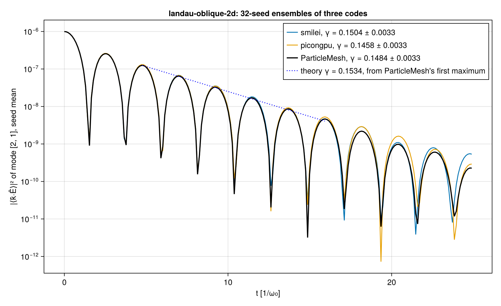
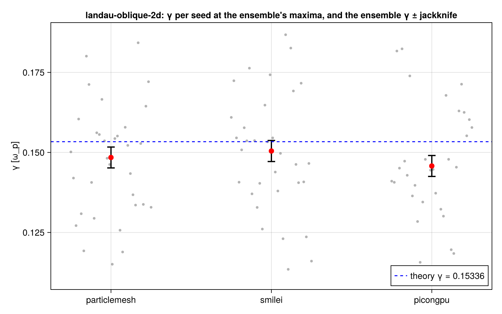
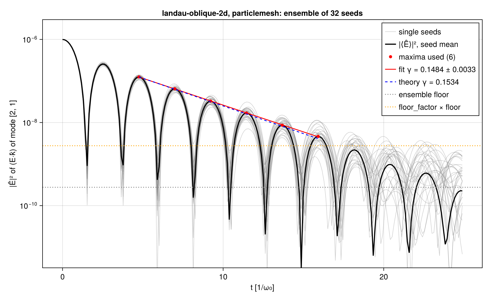

# WP-032: ParticleMesh's oblique Landau ensemble over the 32 seeds

| | |
|---|---|
| Work package | WP-032 (goals A5, A7) |
| Code | the runs: `1ad212f` (`scripts/em2d/landau_ensemble.jl` `run`, through `scripts/em2d/crosscode.jl`'s `run_one`; the engine and the module as on `main` at `d2eb94c`); the merge, comparison, checks and figure: `1e2b912` (clean tree; first merged at `6826cc6` with the same numbers); tests T-490, T-491 |
| Runs | eight CPU box requests `runs/wp032-pm-r1` to `runs/wp032-pm-r8` (four seeds each; request commits `897654b`, `984cfb4`, `f29fea3`, `8b2a54e`, `5c53c3a`, `695849c`, `459b15d`, `f76ba1f`, each on `1ad212f`), batch `wp032-pm-landau`; r1 also ran Smilei's seed 20261031. Merged into `wp-032-pm-landau-ensemble/em2d-pm-landau-oblique-2d-32/` (its `manifest.toml` lists every request, its host and box status, and the SHA-256 of every input and output); the requests' own manifests and box status files are in `requests/r<n>/`, Smilei's seed in `smilei-seed-20261031/` |
| Case file | `scripts/crosscode/cases/landau-oblique-2d.toml`, SHA-256 `431f4192…` (WP-025's 32 seeds), unchanged; a copy in the run directory |
| References | WP-025's 32-seed runs on the same case file: Smilei v5.1 `reports/crosscode-picongpu/smilei-landau-oblique-2d-431f4192/`, PIConGPU 0.8.0 FP64 `picongpu-landau-oblique-2d-fp64-431f4192/` (their seed coefficients, per-seed observables and ensemble records); WP-023's four ParticleMesh seeds `reports/wp-023-em-step-2d/em2d-pm-landau-oblique-2d-20261102T163231/`. Theory: the case file's values (`scripts/crosscode/theory.jl`, T-160, T-273) |
| Environment | the CPU box: AMD EPYC 9655, 16 cores, one boot for all eight requests (boot id `1186c900…`, booted 2026-11-03T14:07:22Z), one request at a time, so nothing else ran on it. ParticleMesh: Julia 1.13.3, KernelAbstractions CPU backend, 16 threads, Float64, `Reference()` mode. Smilei: image `localhost/particlemesh-smilei:e4f0148b8952fc87` (id `faf32c6a…`), 16 OpenMP threads, one MPI rank |
| Start | the loaded momenta taken at t = 0 and kicked back half a step in E⁰ and the density profile evaluated at each particle (`initialize!`'s defaults; the manifests have no `momenta_at` or `density_at` key), while Smilei and PIConGPU take the loaded momenta at −Δt/2 and sample the profile at cell centres (#226); `scripts/em2d/crosscode.jl` takes both of their conventions (`scripts/crosscode/README.md`), so a rerun of these seeds through it starts otherwise |
| Status | measured, not independently reviewed; no number here is to leave the repository before that review |

## 1. What was built

`scripts/em2d/landau_ensemble.jl` runs named seeds of the case into a fixed directory (a box request names its outputs exactly), with the per-seed series, observables and standard plots of `crosscode.jl`'s `run_one` and a manifest that also records the machine's boot id and boot time, so a request that ran on a new box shows it. `merge` takes the requests' directories, refuses a missing, repeated or foreign seed and requests whose inputs, case file or parameters differ, and writes the ensemble with the shared code (`write_ensemble`, `write_seed_coefficients`), with the seeds in the case's order. Where git could not read the checkout on the box, a request's commit comes from its `box-status.toml`. T-490 checks that seeds run in two requests and merged give the ensemble of the same seeds run in one process, bit for bit (the γ, its jackknife error, the frequency, the floor, the leave-one-out rates, the per-seed energy fits and every seed's coefficient), and each refusal; it fails when the merge takes the seeds in request order instead of the case's (four failures, seen). `crosscode.jl compare` now takes the reference ensembles by the first 8 hex of the run's case file (`bc8fd6af`, WP-017's four seeds; `431f4192`, WP-025's 32), checked by T-491. `checks` and `figure` write the post-hoc checks and the three-code figure.

## 2. Reproduction on the box

- **WP-023's four seeds**, rerun at `1ad212f` on the EPYC at 16 threads, equal WP-023's runs (commit `2ae4382`, Intel Core i9-14900K, 32 threads) bit for bit: every per-seed observable and every series of `series.json` (the mode coefficients, the field and total energies). The step and the loader therefore did not change between the two commits for this case, and the Reference mode gives the same bits on the two CPUs at these thread counts. WP-023 recorded its Gauss residual relative to max|ρ − ρ̄| (the script at `2ae4382`, SHA-256 `c25511a5…`), the merged script relative to max|ρ|, so the recorded values differ (2.1 to 2.5 × 10⁻¹³ there, 1.5 to 1.6 × 10⁻¹⁴ here) while the fields are the same.
- **Smilei's seed 20261031** on the box, from the namelist of WP-025's run (SHA-256 `9c0baf35…` in both manifests), gives WP-025's measured value of that seed in every per-seed observable, to every digit (`damping_rate_mode` 0.1609299586220137, `energy_ratio` 3.986286510278891, `energy_ratio_mode` 3.945003677041125), on another CPU and image build. It is not bitwise in everything recorded: the noise floor of `damping_rate_mode` differs in the 16th digit (6.344718447183057 against 6.34471844718306 × 10⁻¹⁰), so the field series differ at roundoff; the dumps were not compared.

Checks over the 32 ParticleMesh seeds (`seed-*/observables.json`): Gauss's law after 3390 steps at most 1.8 × 10⁻¹⁴ of max|ρ|, ∇·B at most 1.2 × 10⁻¹² of max|B|, the total energy within 2.0 × 10⁻⁷ of its initial value. The initial kinetic energy is 7.4725 × 10⁻³ (seed mean, standard error 2.6 × 10⁻⁷), 0.95 % above (3/2) n T L² = 7.4022 × 10⁻³, the velocity Maxwellian of WP-023 (§3 there).

## 3. The three ensembles

The pre-registered observable `damping_rate_mode_ensemble`, as in WP-017 and WP-025: γ from the maxima of |⟨k̂·Ê⟩|² of mode (2, 1), the seed mean of the complex coefficient, with the case's rules (`fit_start = 3`, `floor_factor = 10`), the jackknife over seeds as the error. Numbers from `em2d-pm-landau-oblique-2d-32/observables.json` and `compare/landau-oblique-2d-comparison.json`; the reference columns are WP-025's records.

| | ParticleMesh | Smilei | PIConGPU FP64 | Theory |
|---|---|---|---|---|
| ensemble γ ± jackknife | **0.14842 ± 0.00326** | 0.15045 ± 0.00329 | 0.14577 ± 0.00327 | 0.15336 |
| relative to theory | −3.2 % (−1.5 errors) | −1.9 % (−0.9) | −4.9 % (−2.3) | |
| fit's own standard error | 0.00095 | 0.0022 | 0.0025 | |
| maxima used, fit range | 6, t = 4.76 to 15.92 | 5, t = 4.76 to 13.69 | 6, t = 4.76 to 15.91 | |
| ω_r from the maxima | 1.4073 | 1.4066 | 1.4090 | 1.41566 |
| ensemble floor; floor / (ln 2 × noise of the mean) | 2.76 × 10⁻¹⁰; 25.7 | 4.70 × 10⁻¹⁰; 51.0 | 3.53 × 10⁻¹⁰; 41.6 | |
| per-seed γ at the ensemble's maxima, mean ± std | 0.1472 ± 0.0178 | 0.1499 ± 0.0189 | 0.1450 ± 0.0191 | |
| `damping_rate_mode` per seed (single-run rule), mean ± std | 0.1472 ± 0.0165 | 0.1454 ± 0.0183 | 0.1465 ± 0.0212 | |
| `energy_ratio_mode`, mean ± std (Yee 3.99759) | 4.019 ± 0.110 | 4.033 ± 0.138 | 3.980 ± 0.168 | |
| `damping_rate_energy` | none in any seed, as pre-registered | none | none | |

Differences (measurements, not thresholds):

- ParticleMesh − Smilei: **−0.0020, −0.44 combined jackknife errors**, −0.11 Smilei seed spreads. Single-run rule, difference of the seed means: +0.42 combined errors of the means; `energy_ratio_mode`: −0.45.
- ParticleMesh − PIConGPU: **+0.0027, +0.57 combined jackknife errors**, +0.14 PIConGPU seed spreads. Single-run rule: +0.15; `energy_ratio_mode`: +1.08.
- For comparison, WP-025's PIConGPU − Smilei: −0.0047, 1.01 combined errors.
- Seed 20261031 alone against WP-019's single Smilei run: 0.1602 ± 0.0079 against 0.1609 ± 0.0078 (−0.07 combined errors).

So the three 32-seed ensembles agree within their combined jackknife errors, and both of ParticleMesh's differences are smaller than the Smilei–PIConGPU difference on which A7 rests the 2D thresholds. All three lie below the case's non-relativistic theory, by 0.9 to 2.3 of their own errors (the same direction as the 1D ensembles, #167). The three codes load different thermal distributions, and WP-025's post-hoc linear theory with the relativistic push and each code's load (`reports/crosscode-picongpu/landau-relativistic-431f4192/landau-relativistic.json`, the grid not included) moves the theory values apart:

| | load | theory γ with that load | ensemble − theory | in the code's jackknife errors |
|---|---|---|---|---|
| ParticleMesh | Maxwellian in velocity, u = γv | 0.15255 (ω 1.4110) | −0.0041 | −1.26 |
| Smilei | classical energy distribution | 0.14780 (ω 1.4101) | +0.0026 | +0.80 |
| PIConGPU | Maxwellian in momentum | 0.14626 (ω 1.4097) | −0.0005 | −0.15 |

With each code's load theory taken out, the code differences become −0.0068 against Smilei (−1.46 combined errors) and −0.0036 against PIConGPU (−0.79): the loads predict ParticleMesh 0.0047 above Smilei and 0.0063 above PIConGPU, and the measured ensembles do not show that offset. Both readings, the raw differences and the load-corrected ones, stay within 1.5 combined errors; neither resolves a code difference at 32 seeds. Over the first five maxima, where Smilei's rule stops, ParticleMesh's 0.15001 is 0.0025 below its load theory.

**The fit windows differ.** The rule takes six maxima in ParticleMesh and PIConGPU and five in Smilei. The floor is not a noise level here: it is 26 to 51 times its noise-only value (the table above), and the seeds' scatter gives the same per-seed noise in the three codes (4.4 to 5.2 × 10⁻¹⁰ at t = 21 to 25, ParticleMesh's flat over the run at 4.9 × 10⁻¹⁰ from t = 3 to 8), so the floor measures the damped wave's late signal, which sits highest in Smilei. ParticleMesh's sixth maximum (t = 15.92, |⟨Ê⟩|² = 4.64 × 10⁻⁹) clears ten times its floor (2.76 × 10⁻⁹) with room, while Smilei's sixth maximum (t = 15.93, 4.6925 × 10⁻⁹) misses ten times Smilei's floor (4.6950 × 10⁻⁹) by 0.05 %. Smilei's five-maximum γ is thus one maximum from its six-maximum value, 0.15010 (table below). With the same first k maxima after `fit_start` in both runs (post hoc, `subensembles-vs-*/subensembles.json`, `first_maxima`):

| k (last maximum) | ParticleMesh γ ± jackknife | Smilei − ParticleMesh | PIConGPU − ParticleMesh |
|---|---|---|---|
| 3 (t = 9.20) | 0.15000 ± 0.00270 | −0.0049 (−1.26 combined) | −0.0023 (−0.62) |
| 4 (t = 11.44) | 0.14984 ± 0.00284 | −0.0032 (−0.73) | +0.0015 (+0.34) |
| 5 (t = 13.68) | 0.15001 ± 0.00288 | +0.0004 (+0.10) | −0.0004 (−0.09) |
| 6 (t = 15.93) | 0.14842 ± 0.00326 | +0.0017 (+0.37; beyond Smilei's rule) | −0.0027 (−0.57) |

Up to the six maxima the rule allows, the difference stays within 1.3 combined errors; with a seventh (below every code's rule) Smilei − ParticleMesh is −1.02 and PIConGPU − ParticleMesh −1.46 combined errors. ParticleMesh's γ is 0.150 for three to five maxima, −2.2 % from theory, and the sixth maximum lowers it to 0.148.

**Sensitivity to the rule** (post hoc, the physics breaker's recomputation from the committed coefficients, §8). With `fit_start` from 2 to 7 every difference stays within 0.72 combined errors; with `floor_factor` 15, 20 or 30 within 1.02. Lower factors take more, later maxima: at `floor_factor` 5 and 7 ParticleMesh − PIConGPU is +1.46 combined errors, and at 3 (eight maxima) +2.41, with ParticleMesh − Smilei +1.56. The ordering of the three codes is not stable either: under the pre-registered rule ParticleMesh lies between PIConGPU and Smilei, at three maxima and at `floor_factor` 5 above both, and a least-squares fit of a damped cosine to Re and Im of ⟨Ê⟩ over t = 3 to 16 gives 0.1503 ± 0.0019 (ParticleMesh), 0.1483 ± 0.0021 (Smilei), 0.1489 ± 0.0022 (PIConGPU), every difference within 1.05 combined errors. The agreement therefore holds at the pre-registered rule and at stricter floors, and the order of the codes is noise. Smilei's rule sits at its fifth or sixth maximum depending on the seeds: 15 of its 32 leave-one-out fits take six, which mixes two windows in its jackknife (0.00329 against 0.00343 with the window held at five maxima).

**Error estimates** (post hoc, same files): over 300 random splits of ParticleMesh's seeds into groups of four, the spread of the four-seed γ over their mean jackknife error has a median of 0.90 (5 % to 95 %: 0.50 to 1.36), as in WP-025's runs (0.97 and 0.93), so the four-seed jackknife is consistent with an unbiased one. A bootstrap of each run's seeds gives an sd of the two-run difference of 0.0045 against Smilei and 0.0047 against PIConGPU, against the combined jackknife errors of 0.0046 in both cases. The group-by-group differences of consecutive groups scatter with sd 0.0116 (g = 4), 0.0115 (g = 8) and 0.0038 (g = 16) against Smilei.

## 4. Throughput on the idle box

| | ParticleMesh | Smilei |
|---|---|---|
| what is timed | the steps (`run!`, diagnostics every step included), per seed | the whole container run (`container.txt`); Smilei's own time loop is 721.56 s of the 724.85 s, its diagnostics 10.8 s inside it |
| wall time per seed | 1509 s to 1565 s (32 seeds) | 724.85 s (one seed) |
| ns per particle-step (16 777 216 electrons × 3391 steps) | 26.53 to 27.51, median 26.91 | 12.74 (time loop: 12.68) |

ParticleMesh takes 2.11 times Smilei's time per particle-step on the same idle 16 cores (2.12 against Smilei's time loop). The ions are immobile in both and not counted. The spread over the 32 ParticleMesh seeds is ±1.8 %; Smilei was timed on one seed. On the i9-14900K, WP-025's Smilei ran at 9.83 ns per particle-step on 16 threads and WP-023's ParticleMesh at 20 to 28 ns on a shared machine; this is the first throughput measurement of the 2D step on an idle machine. Where the time goes is not measured here (#93 and #197 are the known costs of the Reference deposition and the sort).

## 5. Cost

Eight requests of about 1 h 42 min each (6106 s to 6258 s for four ParticleMesh seeds), plus 12 min for the Smilei seed and its analysis: 13 h 53 min of box time, 2026-11-03T20:07Z to 2026-11-04T10:04Z. The results of r3 to r8 reached their branches at about 12:20Z, after a fault of the box's result relay (#320); their `box-status.toml` records `ok` as inferred (every seed's observables present and the run manifest updated at the end of the step) because the step's exit code was lost. Nothing was rerun.

## 6. Verification status

- Verified: the merge against a single-process ensemble, bit for bit (T-490); the reproduction of WP-023's four seeds bit for bit and of Smilei's seed 20261031 in every measured value; the conservation checks of §2 on every seed; the figures were inspected before the numbers were recorded.
- Not verified: an independent review of this report; the load theory of §3 on the grid (it is the continuum relation with each load and the relativistic push); why all three ensembles sit below the non-relativistic theory (#167); a profile of ParticleMesh's step on the CPU.

## 7. Open items

- The rule's window depends on each code's late signal through the floor (§3), and at `floor_factor` ≤ 5 ParticleMesh and PIConGPU separate by 1.5 to 2.4 combined errors; comparing codes at a fixed number of maxima, as the post-hoc table does, would remove the window's dependence, but it is not the pre-registered observable.
- The 32 seeds here ran with WP-023's start (the Start row), not the reference codes'; the effect of the two starts on the 2D Landau rate is not measured.

## 8. Independent checks (the PR's breakers)

Two fresh agents, given only the branch, the work package and the changed files.

- **Physics breaker.** It recomputed the report's numbers from the committed coefficients and per-seed files in its own code (Python), and all match: the three ensemble rates, jackknife errors, fit errors, maxima and floors; the differences in combined errors; the per-seed statistics; the equal-window table; the bootstrap; the throughput. Its robustness checks are in §3:
  - the floor is late signal, not noise;
  - the floor_factor and fit_start sensitivity;
  - the code ordering under other estimators, including a least-squares damped-cosine fit;
  - Smilei's switching between 5 and 6 maxima in its jackknife.

  Its seed subsets all stay within 1.3 combined errors: without WP-023's four seeds, even and odd seeds, first and last 16, and each request left out. Its reduced-size reruns (64² cells, 8 × 8 per cell, seed 20261031) matched bit for bit across 2 and 4 threads and between the run commit `1ad212f` and the branch head. Fast() deposition against Reference(): the mode coefficient agrees to 8.6 × 10⁻¹⁶ of its maximum, with no growth. It found the request-manifest gap fixed in §1 (a seed directory moved between requests).
- **Mutation breaker.** It planted 32 defects in the changed code; 15 were caught at first. The 17 uncaught were in code no test ran (`compare`, `checks`, the figure), in fields no test compared (the throughput fields, the per-run energy fits, the commit record) and in refusals no test exercised. The tests were extended to cover each (T-490 to T-492), and the merge now validates everything before it writes.
