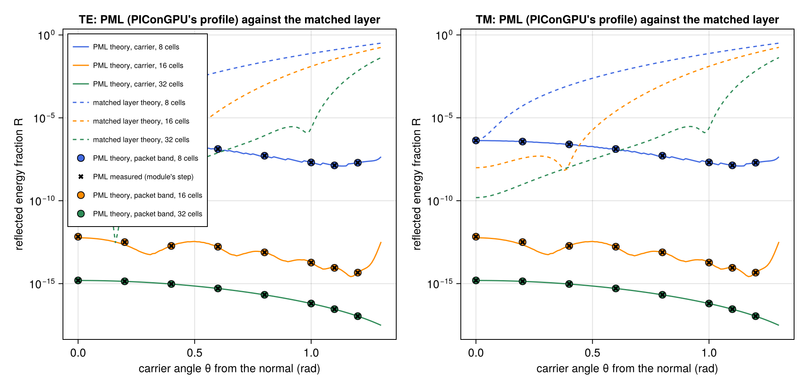
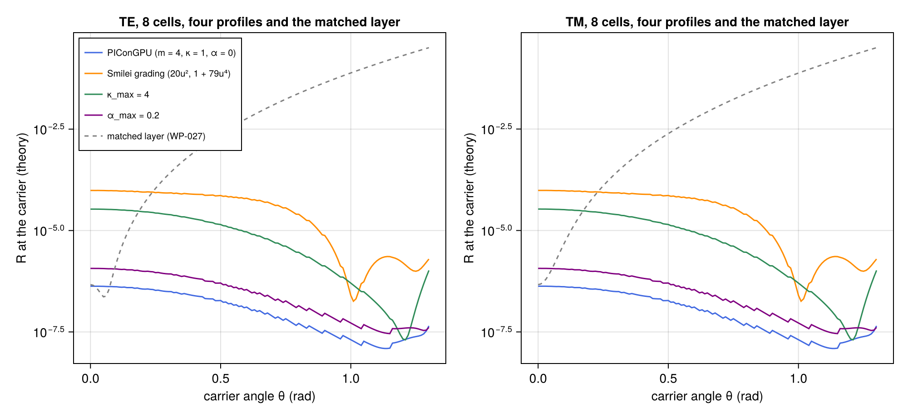
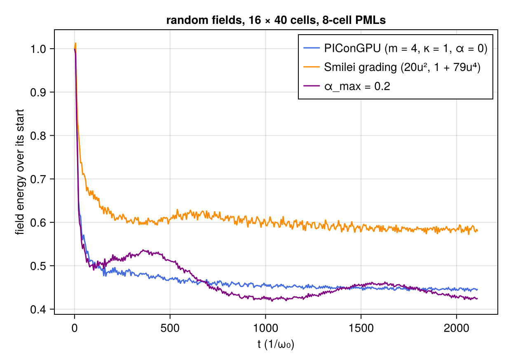
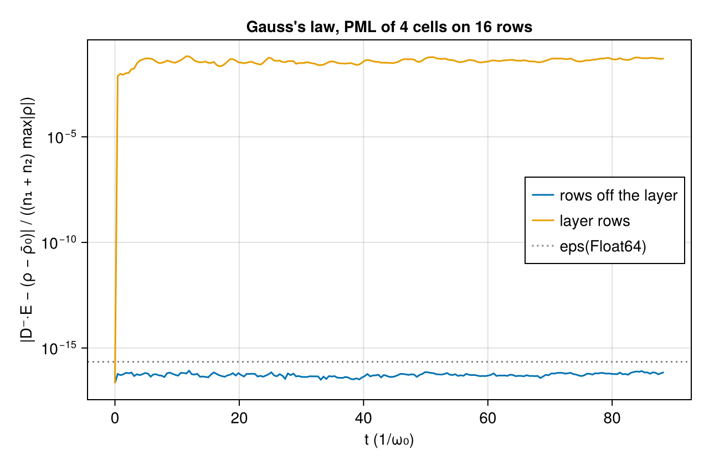

# WP-034: a convolutional PML on the open transverse axis, against the scheme's own discrete theory

| | |
|---|---|
| Work package | WP-034 (goals A2, A4, A7, A8, A10) |
| Commits | the PML, its tests and the script `2aa82b1`; the B convolution advanced once per step, as PIConGPU does, after the physics breaker, with the mutation breaker's tests `17ee7ce`; the merge with main `79a55bd`; this report `6eb431d`; the PML inside WP-028's moving window (T-549), after main took WP-028, in the commit after the second merge with main, which leaves the step without a window bit for bit as measured here; the back edge `15b776d`, after its physics breaker `18397bf`, its discrete theory after its mutation breaker `2ebb12e`, a figure's legend `7d83c42` |
| Runs | `em2d-pml-20261105T183921` (commit `79a55bd`). Its manifest says `dirty = true`: the one modified tracked file at its start was `questions/wp-034-pml.md`, which is not an input, and all 34 input hashes in the manifest equal the files at `79a55bd`. The back edge (§7): `em2d-pml-back-20261105T215131` (commit `7d83c42`, clean) |
| Input hashes | SHA-256 of every input file in each run's manifest: `wp-034-pml/em2d-pml-20261105T183921/manifest.toml` and `wp-034-pml/em2d-pml-back-20261105T215131/manifest.toml` |
| Environment | Julia 1.13.3, KernelAbstractions 0.10 CPU backend; Intel Xeon Processor @ 2.10GHz (the model string the CPU reports), 4 vCPUs of a shared cloud VM; 4 threads |
| Figures | `wp-034-pml/em2d-pml-20261105T183921/pml_reflection.png`, `pml_profiles.png`, `pml_long_run.png` and `pml_gauss.png`; `wp-034-pml/em2d-pml-back-20261105T215131/pml_back_theory.png`, `pml_back_reflection.png` and `pml_back_long_run.png`; each with its JSON sidecar (every row) |
| Status | measured, not independently reviewed; no number here is to leave the repository before that review |

## 1. Setup

The PML is a second `absorber` of the open y axis, next to WP-027's matched layer. The code is `lib/ParticleMeshElectromagnetic/src/pml.jl`. The choices the package left open are in `questions/wp-034-pml.md`.

- **The numerics.** `EMNumerics(; absorber = PML(; cells, sigma_max, order, kappa_max, kappa_order, alpha_max, alpha_order))`. A case file gives `[numerics.pml]`, with exactly one of it and `[numerics.absorbing_layer]` when axis 2 is open.
- **The formulation.** The complex-frequency-shifted stretched-coordinate PML in the recursive-convolution form of Roden and Gedney (2000), with PIConGPU 0.8.0's coefficients and time rule. Along y, ∂_y becomes (1/κ)∂_y + ψ, and each ψ advances once per step as ψ ← bψ + c·D_yF, with b = exp(−(σ/κ + α)Δt) and c = σ(b − 1)/(κ(σ + κα)).
  - E's convolution fields (from D⁻_yBz and D⁻_yBx) advance in the E step.
  - B's (from D⁺_yEz and D⁺_yEx) advance in the second B half step, from E^{n+1}. The first B half step of the next step reads the same E and reuses them.
  - This is PIConGPU's rule: `updatePsiB` is true in `updateBFirstHalf` only, in `fields/MaxwellSolver/FDTD/FDTDBase.hpp` and `fields/absorber/pml/Pml.kernel`, read at its pinned commit.
- **How it enters the step.** As a correction after each Yee sub-step, on the layer rows only: X ← X ± τ·((1/κ − 1)·D_yF + ψ). The Yee kernels and the antennas are untouched. Off the layer the correction is exactly zero.
- **Where it sits.** WP-027's rows: the outer `cells` rows on each side along y, meeting at the periodic seam. The depth is counted in integer half rows.
- **The profiles.** σ = σ_max·r^m, κ = 1 + (κ_max − 1)·r^{m_κ} and α = α_max·(1 − r)^{m_α}. The default is PIConGPU's: m = 4, σ_max = 0.8(m + 1)/Δy, κ_max = 1, and α = 0 (PIConGPU's 0.2 S/m is about 10⁻⁵ ω₀). Smilei's grading (σ = 20u², κ = 1 + 79u⁴) is expressible; Smilei's own uniaxial discretization is not implemented.
- **Particles.** Retired at the seam as with the matched layer.
- **In a moving window** (WP-028, `boundaries = (:window, :open)`). The window's zero x-guards are applied after the PML's correction in each sub-step, and each shift moves the convolution fields one column back with E and B, the front column zero.

Every reflection measurement is WP-027's vacuum slab packet: the module's step in Float64 at 0.95 of the 2D Courant limit, 16 cells per wavelength along x and 8 along y. Here the envelope is 4/cos θ wavelengths wide, not WP-027's 3/cos θ, because the PML's much smaller R at large angles needs the slow modes of the incident packet further away at the measurement time.

**The theory** (`pml_rt`, `lib/ParticleMeshElectromagnetic/test/pml_cases.jl`). With every field ∝ e^{ik_x x}·λⁿ, λ = e^{−iωΔt}, the once-per-step ψ makes the half-step B equal to ∓G·D_yE with G = (Δt/2)·(2/κ + 2c/(1 − b/λ))/(1 − 1/λ). The E step's stretched difference is S·D_yB with S = 1/κ + λc/(λ − b). Eliminating By (TE) or Ey (TM) leaves a three-point recurrence along y, solved as `layer_rt` solves WP-027's. It shares only the profile function with the kernels.

## 2. Reflection against angle and thickness

R with PIConGPU's profile, TE. TM agrees with TE to the digits shown:

| cells | θ = 0 | 0.2 | 0.4 | 0.6 | 0.8 | 1.0 | 1.1 | 1.2 rad |
|---|---|---|---|---|---|---|---|---|
| 8 | 4.3e-7 | 3.7e-7 | 2.5e-7 | 1.3e-7 | 5.2e-8 | 2.0e-8 | 1.4e-8 | 2.0e-8 |
| 16 | 6.8e-13 | 3.2e-13 | 1.9e-13 | 1.7e-13 | 7.7e-14 | 1.9e-14 | 9.0e-15 | 4.6e-15 |
| 32 | 1.6e-15 | 1.4e-15 | 9.5e-16 | 5.1e-16 | 2.1e-16 | 6.3e-17 | 2.9e-17 | 1.1e-17 |

The theory of WP-027's matched layer at the same thickness and its nominal attenuation, TE:

| cells | θ = 0 | 0.2 | 0.4 | 0.6 | 0.8 | 1.0 | 1.1 | 1.2 rad |
|---|---|---|---|---|---|---|---|---|
| 8 | 4.7e-7 | 4.2e-5 | 8.9e-4 | 5.8e-3 | 2.4e-2 | 7.7e-2 | 0.13 | 0.21 |
| 16 | 9.9e-9 | 4.7e-9 | 1.5e-7 | 2.9e-5 | 1.0e-3 | 1.3e-2 | 3.5e-2 | 8.4e-2 |
| 32 | 1.5e-10 | 5.6e-11 | 6.6e-9 | 8.1e-8 | 8.9e-7 | 4.6e-6 | 4.7e-4 | 6.9e-3 |

- **The step against the theory.** Across the 48 runs, the measured R matches the theory to at most 1.0·10⁻⁶ relative, and that worst case is 32 cells at 1.2 rad, where R = 1.1·10⁻¹⁷ and the difference is 10⁻²³ of the incident energy, within roundoff (T-450's scale). Where R is above 10⁻¹⁰ the agreement is 10⁻¹⁵ to 10⁻¹¹. The transmission through both layers matches too, down to the roundoff floor of about 4·10⁻²⁸, where the theory gives as little as 10⁻⁵⁵.
- **Against the matched layer.** At 8 cells and normal incidence the two are alike (4.3·10⁻⁷ and 4.7·10⁻⁷). Everywhere else the PML is far better: at 0.8 rad by 5·10⁵ (8 cells) to 10¹⁰ (16 cells), and at 1.2 rad by 10⁷ (8 cells) to 10¹⁴ (32 cells). Its R falls with the angle up to 1.1 rad at 8 cells and up to 1.2 rad at 16 and 32, while the matched layer's rises to 0.2.
- **Thickness.** R falls by about 10⁶ from 8 to 16 cells and by about 400 from 16 to 32 cells.
- **The first time rule.** The first version advanced B's convolution in both half steps with Δt/2. It is stable and matched its own theory to roundoff too, but it reflected 9.5·10⁻⁶ at 8 cells and normal incidence (21× more) and 5.1·10⁻⁸ at 16 cells and 0.4 rad (2.7·10⁵× more), and its continuum reflection fell as Δ² instead of Δ⁴ (the physics breaker's runs, below).

## 3. Profiles

The theory at the carrier, 8 cells, TE (TM is the same to two digits):

| profile | θ = 0 | 0.4 | 0.8 | 1.0 | 1.2 rad |
|---|---|---|---|---|---|
| PIConGPU (m = 4, κ = 1, α = 0) | 4.2e-7 | 2.5e-7 | 5.1e-8 | 2.0e-8 | 2.0e-8 |
| α_max = 0.2 | 1.2e-6 | 6.7e-7 | 1.4e-7 | 5.3e-8 | 3.9e-8 |
| κ_max = 4 | 3.4e-5 | 1.9e-5 | 2.9e-6 | 5.0e-7 | 2.1e-8 |
| Smilei grading (20u², 1 + 79u⁴) | 9.7e-5 | 7.8e-5 | 2.5e-5 | 2.5e-7 | 1.6e-6 |
| matched layer (WP-027) | 4.6e-7 | 8.7e-4 | 2.4e-2 | 7.7e-2 | 0.21 |

In this vacuum test, PIConGPU's profile is the best of the four at every angle. κ > 1 costs reflection near normal incidence on this grid. Smilei's grading is tuned for Smilei's own discretization and its 10-cell layer, so its numbers here are not Smilei's reflection. Comparing with the codes themselves is separate work.

## 4. A long run

Random fields in every component, in an open vacuum box of 16 × 40 cells with 8-cell PMLs, 8000 steps (about 40 crossings of the box along y). The energy of E and B over the box against its start, sampled every 20 steps:

| profile | max | mean of the second quarter | mean of the last quarter | end |
|---|---|---|---|---|
| PIConGPU | 0.997 | 0.459 | 0.447 | 0.446 |
| Smilei grading | 1.014 | 0.610 | 0.584 | 0.579 |
| α_max = 0.2 | 0.989 | 0.448 | 0.441 | 0.425 |

What remains is the part that cannot reach the layers: modes with k_y = 0 and the static fields. It fluctuates and does not grow. The 1.4 % rise above the start with Smilei's grading comes in the first steps. The box's E and B energy is not the PML's energy, since the convolution fields hold some, so T-542 bounds the maximum by 1.05, not 1.

## 5. Gauss's law with particles leaving

The plasma of T-451 (`open_plasma_2d`): 10 × 16 cells, a PML of 4 cells, 2880 particles of two species drifting through both edges, 200 steps, Float64, Reference.

- **Off the layer.** The residual |D⁻·E − (ρ − ρ̄₀)| stays at or below 8.4·10⁻¹⁷ of (n₁ + n₂)·max|ρ|.
- **In the layer.** It is 7.7·10⁻³ to 6.6·10⁻² of that scale, because the correction changes Ex on the layer rows and Ey not at all.
- **∇·B** off the layer is at most 1.3·10⁻¹⁵ of its scale.
- **Particles.** 2070 of the 2880 leave.

## 6. Plasma inside the layer

With the default α = 0, a plasma that fills the layer builds up a large field there, because the current deposited in the layer is not damped. These are single runs of `open_plasma_2d` on 16 × 32 cells (2 × 2 particles per cell per species, 6000 steps, Float64, Reference), at commit `17ee7ce`'s kernels, from a scratch script that is not part of the run above. The numbers are ½Σ(E² + B²) at step 6000:

| absorber | interior | layer rows |
|---|---|---|
| matched layer, 4 cells | 0.54 | 0.0024 |
| PML, 4 cells, default | 188 | 180 |
| PML, 8 cells, default | 83 | 546 |
| PML, 4 cells, α_max = 0.2 | 0.93 | 6.7 |
| PML, 4 cells, α_max = 1 | 2.3 | 6.3 |

The energy is still rising at the end of every PML run. The likely mechanism is the CPML's low-frequency limit: with α = 0, s_y = κ + σ/(iω) diverges at ω → 0, so a slow current in the layer meets no y-curl. The default stays PIConGPU's, for the comparison across codes. The docstring and the questions file say to set `alpha_max` or keep the plasma out of the layer. Damping the current in the layer is #343.

## 7. The moving window's back edge

The window's x-guards are its field-free outside (WP-028). In 2D a pulse leaves a trailing field behind it, and the outside reflects that field at the back edge. `EMNumerics(; back_absorber = PML(; cells))` puts the same PML along x on the window's first `cells` columns, graded towards the back face. It corrects the four x-difference terms (By, Bz, Ey, Ez) with their own convolution fields, on the same once-per-step rule. The profile moves with the window, and each shift moves the convolution fields one column back with E and B. The choices are in `questions/wp-034-pml.md` §6. The run is `em2d-pml-back-20261105T215131` (`scripts/em2d/pml_back.jl`).

**Against its discrete theory** (T-576, `pml_back_theory.png`). WP-027's slab packet, turned on its side, travels along −x into the back edge of a window that never moves. Behind the layer the zero x-guards reflect what is left, so nothing is transmitted. `back_rt` (`lib/ParticleMeshElectromagnetic/test/pml_back_cases.jl`) is the scheme's time-harmonic reflection of the layer with that termination, derived as `pml_rt` is (§1) with x the layer's axis: TE has no By in the guard column behind node 0, and TM has the guard's Bz at zero. The grid has 8 cells per wavelength along x and 16 along y, so Δx ≠ Δy, at 0.95 of the Courant limit. The profile is PIConGPU's.

| θ (rad) | R, 8 cells | R, 16 cells |
|---|---|---|
| 0 | 4.41·10⁻⁷ | 7.35·10⁻¹³ |
| 0.2 | 3.76·10⁻⁷ | 3.92·10⁻¹³ |
| 0.4 | 2.56·10⁻⁷ | 1.92·10⁻¹³ |
| 0.6 | 1.35·10⁻⁷ | 1.79·10⁻¹³ |
| 0.8 | 5.27·10⁻⁸ | 7.40·10⁻¹⁴ |

- **Agreement.** Run and theory agree to 3.4·10⁻¹² relative at 8 cells and to 1.5·10⁻⁹ at 16 cells. A 10⁻¹³ energy is near the roundoff floor of the measurement.
- **The two polarizations.** TE and TM give the same R to 12 digits at every angle, in the theory as in the runs.
- **The test.** T-576 runs 0 and 0.4 rad, both polarizations, with PIConGPU's profile, Smilei's grading with α, and κ_max = 4 with α_max = 0.2. It reaches at most 0.0089 of T-540's scale. A zero profile reflects everything in the theory (|r| = 1 to 10⁻¹⁴).

**The trailing field of a pulse** (T-570, `pml_back_reflection.png`). The pulse is T-472's vacuum pulse in the window of `back_lwfa`: `window_lwfa` without plasma, with its antenna at x = 10 and 72 × 16 cells, 200 steps, 92 shifts. The reference is free space: a static box with 100 more columns behind and the antenna moved by as many, whose bare back is too far away to matter within the run. The table gives the largest difference on the eight columns behind the layer (columns 1 to 8 for the field-free outside), relative to the reference's largest field.

| back edge | 8 columns behind the layer |
|---|---|
| field-free outside (WP-028) | 0.095 |
| PML, 4 cells | 1.4·10⁻³ |
| PML, 8 cells | 3.2·10⁻⁴ |
| PML, 8 cells, α_max = 0.2 | 3.0·10⁻⁴ |
| PML, 8 cells, κ_max = 5 | 1.2·10⁻³ |
| PML, 8 cells, Smilei's grading | 8.7·10⁻³ |
| field-free outside, antenna at x = 16, 80 columns | 0.070 |
| PML, 8 cells, the same | 9.7·10⁻⁵ |
| PML, 16 cells, the same | 1.9·10⁻⁵ |

- **The reflection.** 8 cells take it down by a factor of 300, and 16 cells by a factor of 3700.
- **The shift's mechanics.** Against the static twin with the same back edge, the window is the same as the twin before it moves (≤ 10⁻³⁰). After it moves it keeps T-472's agreement from column 25 on (≤ 5.7·10⁻¹⁴; 6·10⁻¹² with 16 cells, whose layer ends 9 columns before column 25).
- **Where the antenna sits.** The antenna must stay out of the layer while it emits, and the state refuses a plane that the layer would reach earlier. `window_lwfa`'s plane at x = 6 (columns 8 and 9) lies inside a 16-cell layer: that run damped the pulse by 15 %, and a twin with the same distorted source did not show it. So the 16-cell rows use the plane at x = 16.
- **Why free space.** A twin with the same back edge has its own back reflection, which can cancel part of the window's (by up to 10× in the physics breaker's runs), so T-570 uses free space.

**A long run** (T-575, `pml_back_long_run.png`). Random fields in the empty window of `back_lwfa` with an 8-cell back edge, 12000 steps.

- **Static window, α = 0.** The energy ends at 0.39 of its start. The field-free outside alone stays at 1.16.
- **Static window, α > 0.** With α_max = 0.2 it reaches 4.1 and with α_max = 1 it reaches 10.3, still rising. The growing part is a box-wide uniform Bz driven by the static part of E that is not divergence-free (#357).
- **Moving window.** Every profile ends at 0.020, as does the field-free outside: what does not travel with the window leaves through its back edge either way. That run checks that the moving layer is stable, not how much it absorbs.
- **The test.** T-575 runs the default profile for 4000 steps, static and moving.

**With plasma.**

- **Moving window.** In the laser–plasma run of T-473 the back-edge PML shows no build-up like that of §6. Gauss's law holds across the shifts to roundoff off the layer columns and the antenna (T-572: 0.24 of T-473's constant in the three types and both modes). The physics breaker ran 2000 steps at 0.02 and 0.1 n_c and found Gauss's law off the layer at 0.04 to 0.36 of that constant.
- **Static window.** With plasma filling the layer at α = 0, the layer builds up field as in §6. In the breaker's run at 0.1 n_c, the field energy in the layer reached 19 after 4000 steps, against 1.9 without the layer (#343). α_max = 0.2 or 1 avoids this, but in vacuum it grows the uniform Bz above.
- **So no single α is safe for a long static phase.** In a moving window the default α = 0 is.

**A zero profile** is the window's step bit for bit (T-571). With an open y axis, the y-PML's step and the matched layer's apply the same back-edge corrections.

## 8. Tolerances (A7)

Measured on the CPU backend at 2 threads. Every value is a proposal in `lib/ParticleMeshElectromagnetic/test/tolerances.toml`. A test passes when measured ≤ C.

| test | quantity | measured (Float32, Float64, Dual) | proposed C |
|---|---|---|---|
| T-540 | \|R − R_theory\|, \|Tr − Tr_theory\| on T-450's scale, Float64 | —, 4.08, — | 10 |
| T-541 | as T-540, 16 cells at 1.2 rad, packet 12 wavelengths wide | —, 0.0065, — | 10 |
| T-543 | Gauss's law off the layer, T-451's constant | 0.33, 0.38, 0.20 | 1 |
| T-543 | ∇·B off the layer, T-451's constant | 0.37, 0.36, 0.31 | 2 |
| T-546 | as T-540, one run in each element type | 0.0166, 4.06, 0.0166 | 10 |
| T-570 | back-edge difference against free space with 8 cells over the field-free outside's | —, 0.0033, — | 0.01 |
| T-572 | Gauss's law off the back-edge layer across shifts, T-473's constant | 0.24, 0.24, 0.24 | 1 |
| T-575 | long run: static peak and end over the bare window's, moving energy after 450 steps, Float64 | —, 0.894 / 0.391 / 0.0305, — | 1 / 0.5 / 0.05 |
| T-576 | back edge of a static window, \|R − R_theory\| on T-450's scale, Float64 | —, 0.0089, — | 10 |

The largest T-540 and T-546 ratios are a transmission at the roundoff floor: the profile with κ_max = 80 and α, theory 2·10⁻⁵², measured 3.4·10⁻²⁸. Every R ratio is below 0.01. The suite's other tests are exact or structural:

- T-542: the long runs stay below 1.05 of their start, end below 0.7, and do not grow.
- T-544: a zero profile is the periodic step bit for bit; the coefficients are the closed form; each of the four corrections changes only its own component on its layer rows; the first B half step leaves ψ_B alone; step 1 zeroes ψ; guards are their interior images.
- T-545: the Reference step with particles is bitwise across reruns, workgroup sizes 32 and 256, and 1 and 4 threads, with the convolution fields in the digest.
- T-547: the input checks, the case file's defaults, and the refusal of filter passes with an open axis.
- T-548: allocation is flat, 384 B per Fast step at every size.
- T-571: a zero-profile back-edge PML is the window's step bit for bit; with an open y axis the y-PML's step and the matched layer's apply the same back-edge corrections bit for bit; each x correction changes only its two components on the layer columns; the shift and the reset of its convolution fields.
- T-573: the back edge's input checks (a PML only, a window only, none at N = 1, the guard width, fewer than half the columns, an antenna that the layer would reach while it emits).
- T-574: the window's Reference step with the back-edge PML is bitwise across reruns and workgroup sizes 32 and 256.
- T-549: in a moving window, a zero profile is the zero-strength matched layer bit for bit, the convolution fields shift with the fields, and Gauss's law holds off the layer across the shifts (T-473's constant; measured 0.036, 0.046 and 0.036 in Float32, Float64 and Dual).

The PML tests take about 9 min on 2 threads, most of it T-545's worker runs.

## 9. Breakers

- **Physics breaker** (on `2aa82b1`).
  - *Time rule.* It found that PIConGPU advances B's convolution once per step with Δt coefficients, while the first version advanced it in both half steps with Δt/2, and measured the cost: 21× to 2.7·10⁵× more reflection, and a continuum reflection falling as Δ² against Δ⁴. `17ee7ce` takes PIConGPU's rule. Section 2's numbers are the new rule's.
  - *Plasma in the layer.* It found the field build-up of section 6. The runs there repeat it on the new rule.
  - *Theory at large σ.* `pml_rt` returned NaN for σ_max at 100× the default and above, where S vanishes to roundoff deep in the layer. It now throws instead.
  - *T-542's wording.* A static field reaching into the layer rose 8 % above its start, so the claim that the energy never exceeds its start was true only for T-542's state. The bound is now 1.05 and the comment says why.
  - *Harness limits.* At 4 cells per wavelength along y and at 1.4 rad the slab packet's measurement time is too early. Neither is in the suite.
  - *Confirmed.* The coefficients against PIConGPU's source; an independent G for a different time rule, run through the kernels (agreement 10⁻¹⁴ to 4·10⁻¹⁰); convergence of the theory to the continuum PML; the spectral radius of the one-step map at most 1 + 1.7·10⁻¹³ over 10 profiles and 4 grid settings; Gauss's law and ∇·B with fast particles crossing the layer and other shapes; a laser antenna in an open box (1.7·10⁻⁴ to 4.2·10⁻⁴ from a periodic box five times taller, against 1.5·10⁻² for the matched layer).
- **Mutation breaker** (on `2aa82b1`). 47 mutations, one at a time, against T-540 to T-547 except T-545 and T-548. 46 were caught: every sign, stagger, coefficient set, sub-step length, row map, omission of a correction, grading, default σ_max, reset and guard fill, and every theory-only mutation of `pml_rt`. What was done:
  - *Survivor: the case file's κ order default.* Replacing it with 4 passed, since no case gave `order` without `kappa_order`. T-547 now does.
  - *Weak spots.* A dropped Bz correction and Ex taking the Center() coefficients were seen only by T-540. T-544 now checks each correction on its own, and that the first B half step does not advance ψ_B.

- **Physics breaker on the back edge** (on its first commit `15b776d`, about 30 min).
  - *The antenna inside the layer.* Nothing refused a 16-cell layer over `window_lwfa`'s antenna (columns 8 and 9). The pulse came out 15 % weaker, and the static twin hid it because the twin had the same source. The first version of this report had a 16-cell row from such a run. The state now refuses an antenna that the layer reaches while it emits. The back-edge tests use the antenna at x = 10 (`back_lwfa`), and the 16-cell rows use x = 16.
  - *The twin metric.* The twin's own back reflection can cancel part of the window's, by up to 10× in other geometries. T-570 now measures against free space. In T-570's own geometry the breaker found the two agree within 1.1× for 8 cells.
  - *A long static phase.* With α_max > 0 a static window grows a uniform Bz (§7, #357). With plasma at α = 0 the layer builds up field (#343). T-575 covers the bounded cases.
  - *Confirmed.* Float32 and Dual give the same ratios as Float64. A late start works. Plasma passing through the moving layer for 2000 steps is fine in both modes and three types. The corner with the y-PML shows no defect, and the residual there is the y-layer's own reflection. The matched layer's path gives a zero profile bit for bit.
- **Mutation breaker on the back edge** (on `15b776d`, about 70 min). 31 mutations, of which 16 survived and 1 was equivalent (the E correction before the Yee E step).
  - *Why so many survived.* T-570 sees one polarization at κ = 1 and α = 0 on square cells, and its bound is a threshold, not a theory. The survivors were signs and staggers of By and Ez, the coefficient index, ψ_B advanced in both half steps or never, κ and α ignored, σ_max from Δy, the rows shifted by one, the q·D term dropped, and the first back correction of the y-PML's window step dropped. Some of these even lowered T-570's number.
  - *What changed.* T-576 compares the back edge with its own discrete theory, in both polarizations, with κ and α active, on cells that are not square. Rechecked against it, the coefficient index, both time-rule mutations, the Bz sign, the row shift and σ_max from Δy are all caught in at least one polarization, at 1.4·10⁹ times the scale or more. T-571 now checks the y-PML's window step against the matched layer's with a back edge, which catches the dropped back correction.

## 10. Open items

- **The back edge in a long static phase.** With α_max > 0 a static window grows a uniform Bz from random fields (#357), and with plasma in the layer at α = 0 it builds up field (#343). Its thickness and profile for the LWFA case are not chosen yet.
- **No case-file key** for the back edge, since a case file cannot describe a moving window yet.
- **No GPU run.** The kernels are elementwise and within §0.4, but CUDA is untested: this session has no GPU.
- **Plasma inside the layer** at α = 0 (section 6, #343).
- **Smilei's discretization** (uniaxial, bilinear time rule) is not implemented, only its grading.
- **Comparing with the codes' own PMLs** (Smilei, PIConGPU) is not part of this package.
