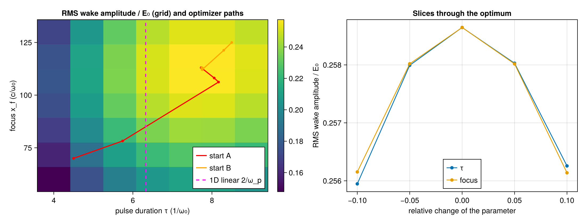

# WP-045: the first 2D optimization, wake amplitude over pulse duration and focus

| | |
|---|---|
| Work package | WP-045 (goals A0, A1, A3, A7) |
| Commits | the case, maximizer, T-600 and run script `b7f5d49`; this report and the run's figure in the commit after it |
| Runs | `optim-wake2d-20261109T114655` (commit `b7f5d49`, clean, 4 threads). A run of the same code before it was committed gave the same numbers to every printed digit |
| Input hashes | SHA-256 of every input file in the run's manifest: `wp-045-wake-optimization/manifest.toml` |
| Environment | Julia 1.13.3, KernelAbstractions 0.10.4 CPU backend; Intel Xeon @ 2.30GHz (the model string the CPU reports), 4 vCPUs of a shared cloud VM |
| Figures | `wp-045-wake-optimization/wake2d.png`, with its JSON sidecar `wake2d.json` (every number of the run) |
| Status | measured, not independently reviewed; no number here is to leave the repository before that review |

## 1. Setup

The problem is user-layer code in `scripts/optim/` (F3): the case (`wake2d_case.jl`), a small box-constrained maximizer (`maximize.jl`, tested by T-600) and the run (`wake2d.jl`).

- **The case.** This is WP-043's small 2D LWFA run, with the parameters moved so that the optimum lies inside the box.
  - Laser: a₀ = 1, waist 10 (z_R = 50).
  - Plasma: n₀ = 0.1 n_c (ω_p ≈ 0.316, λ_p ≈ 20 c/ω₀), behind 64 c/ω₀ of vacuum and an 8 c/ω₀ sin² ramp; cold electrons and immobile ions.
  - Grid: 16 cells per λ₀ and Δy = 4Δx, with 224 × 64 cells (88 × 101 c/ω₀, periodic in y). Δt is 0.95 of the Courant limit, and the run takes 512 steps (t ≈ 186).
  - Timing: the pulse's delay is 54 and the moving window starts at 108 = 54 + 6·9, after the antenna has finished, for durations up to 9.
- **The objective.** The RMS wake amplitude √(2·⟨E_x²⟩) of the on-axis E_x at the last step, read past the window's back band (WP-044), in units of the cold wave-breaking field E₀ = √n₀. For a sinusoid over whole periods this is its amplitude. Larger is better.
- **The parameters.**
  - The two free parameters are the duration τ (the 1/e half width of the field envelope) and the focus x_f.
  - The box is τ ∈ [4, 9], x_f ∈ [60, 130]. The parameters are scaled to O(1) as A1 asks: z = (τ/6, x_f/90).
  - They enter through the antenna (A3).
  - a₀ and n₀ are fixed. With either one free, an absolute wake amplitude runs to a bound, so they come with the witness-energy objective.
- **The gradient.**
  - ForwardDiff runs through the whole simulation, in Float64 with Reference deposition.
  - The dual carries three partials, and the third is left unseeded. With `Dual{Float64,2}` the step segfaults on the CPU backend (#375: KernelAbstractions 0.10.4 picks a workgroup whose private memory exceeds the stack; 0.10.6 fixes it).
- **The maximizer.**
  - It is a projected BFGS with Armijo backtracking. The inverse Hessian is reset when the set of coordinates held at a bound changes.
  - It stops when the projected gradient is below 10⁻⁴ in every scaled coordinate.
  - T-600 checks it on analytic objectives:
    - quadratic maxima inside the box, on a lower bound and on an upper bound, each to 10⁻⁸, and with the stop on the projected gradient;
    - a start outside the box, which is projected first;
    - a non-quadratic bump, to a gradient below 10⁻⁸;
    - monotone ascent.
- **The checks.** The run asserts these checks and stops with an error if one fails:
  - the dual's value equals the plain run's value;
  - AD agrees with central FD;
  - the two starts agree and both stop on the gradient;
  - the optimizer's value is at least the grid's best;
  - the slices fall on both sides of the optimum.

## 2. Results

**The gradient against finite differences** at the first start, (τ, x_f) = (4.5, 70), using central differences in z:

| h | relative error ∂/∂z₁ (τ) | relative error ∂/∂z₂ (focus) |
|---|---|---|
| 10⁻² | 4.5 × 10⁻⁵ | 9.9 × 10⁻⁵ |
| 10⁻³ | 3.2 × 10⁻⁷ | 8.5 × 10⁻⁷ |
| 10⁻⁴ | 1.2 × 10⁻⁸ | 8.8 × 10⁻⁹ |

The error falls with h over the whole range, so the scan stays in the truncation regime and does not reach a cancellation floor.

**The optimizer** converges from two starts on opposite sides of the box to the same point:

| start (τ, x_f) | evaluations | optimum (τ, x_f) | J = E_x,rms/E₀ | ∇J (scaled) at the end |
|---|---|---|---|---|
| (4.5, 70) | 6 | (7.742, 112.96) | 0.2586462 | (−1.9, 0.6) × 10⁻⁵ |
| (8.5, 125) | 7 | (7.742, 112.97) | 0.2586462 | (−1.0, −2.0) × 10⁻⁵ |

Each evaluation is one run with a dual and costs about 2.5 primal runs.

**The grid scan** (7 × 7 over the box, 49 runs) has its best cell at (8.17, 118.3) with J = 0.257380. That is the grid cell next to the optimizer's point, and 0.49 % below the optimizer's value.

**The slices** through the optimum at ±5 % and ±10 % in each parameter fall on both sides, so the point is a maximum in both directions:

| parameter | −10 % | −5 % | 0 | +5 % | +10 % |
|---|---|---|---|---|---|
| τ | 0.25595 | 0.25799 | 0.25865 | 0.25803 | 0.25626 |
| x_f | 0.25615 | 0.25802 | 0.25865 | 0.25802 | 0.25614 |

**Resolution and box width.** J at τ·(0.95, 1, 1.05) and the optimum's x_f, recorded and not asserted:

| variant | J at 0.95 τ | J at τ | J at 1.05 τ | change at τ |
|---|---|---|---|---|
| base (2 × 2 ppc, Δy = 4Δx, 64 rows) | 0.25799 | 0.25865 | 0.25803 | |
| 4 × 4 particles per cell | 0.25843 | 0.25909 | 0.25848 | +0.17 % |
| box twice as wide (128 rows of 4Δx) | 0.25809 | 0.25876 | 0.25816 | +0.04 % |
| Δy = 2Δx (128 rows, same box) | 0.25290 | 0.25218 | 0.25035 | −2.5 % |

Particles per cell and box width leave the optimum in place: the values change by under 0.2 %, and the τ slice stays symmetric. The finer Δy does not. It lowers J by 2.5 % and moves the τ optimum below 0.95·τ, so **the optimum is not converged in Δy**. A separate check at focus ±10 % (not in the run's record) gave 0.25618 and 0.25635 in the wide box, against 0.25615 and 0.25614 in the base box, so the focus optimum does not depend on the box width either.

**Against theory.**
- In 1D linear theory, a ponderomotive drive a² ∝ exp(−2t²/τ²) excites a wake ∝ τ·exp(−ω_p²τ²/8). That is largest at ω_p·τ = 2 (derived here, not taken from a source), which gives τ = 6.32 for n₀ = 0.1.
- The optimum at a₀ = 1 is at 7.74, 22 % longer.
- The physics review (below) found that at a₀ = 0.3 the optimum of the on-axis peak in the earlier 32-row box is τ ≈ 6.47. That agrees with 2/ω_p divided by the antenna's measured launch factor 0.974, which gives 6.49.
- So the linear limit is reproduced, and the longer optimum at a₀ = 1 is attributed to nonlinearity, 2D diffraction and the unconverged Δy. These causes are not separated here.

**Cost.** The run took 1465 s on 4 threads: 49 grid runs, 13 gradient evaluations, 7 FD and value runs, 10 slice runs and 9 resolution runs.

## 3. Review findings and what changed

Two breakers reviewed the first version of this package, in which the objective was a soft maximum (β = 200) of the on-axis E_x in a 32-row box.

**Physics review (about 30 min).**
- **The optimum sat where two wake crests tie.** At that point the soft maximum gains log 2/β, which outweighed the crests' own change, and the hard maximum had a local minimum there. The objective is now the RMS amplitude, which has no ties.
- **The focus optimum was set by the narrow periodic box.**
  - The box was 50 c/ω₀ wide. The beam radius at the antenna plane was up to 28, against a half-box of 25.
  - Doubling the width raised J by 9.6 %, and the focus optimum left the old position of 92.8.
  - The box is now 64 rows. The table above shows that a further doubling changes J by 0.04 %.
  - A separate check of the antenna found it accurate across τ = 4 to 9 (duration error under 0.4 %, peak under 0.15 %), and found the same periodic-image effect at 32 rows.
- **The value was not converged in Δy or Δx.**
  - In the old case, J changed by +3.6 % with Δy = 2Δx and by +6.1 % with Δx = λ₀/32.
  - The optimum moved with the final step: τ went from 7.2 to 7.7 between 484 and 539 steps.
  - The Δy part is measured again above. Δx and the final step are not; both are left to the convergence study.

**Mutation review (about 31 min).**
- **Gradient wiring.** Mutants that miswire the gradient changed the FD agreement by 0.7 to 89 in relative error: swapped partials, the scaling applied twice or not at all, and the E₀ normalization on one path only. Some of them still reached the optimum on a surrogate. The run printed the FD check but asserted nothing; it now asserts every check, including that the dual's value equals the plain run's.
- **T-600 gaps.** T-600 missed four kinds of defect:
  - the upper-bound half of the active set;
  - a stop condition that never fires on the projected gradient;
  - an unprojected start.
  It now covers them.
- **Not caught by design.** Defects that change the value and its gradient together are not caught by any check: the back band ignored, the normalization dropped from both paths, or the wrong axis row. Only a comparison against an expected value would catch them, and the case has none.

## 4. Open issues

- **Convergence.** The optimum is not converged in Δy. Convergence in Δx and in the final step is not checked. Until these are, the numbers above belong to this discretization, not to the physical problem.
- **#375.** `Dual{Float64,2}` crashes the step on KernelAbstractions 0.10.4. The third partial is a workaround until the compat moves to 0.10.6.
- **The objective.** It is a proxy for the target, the witness energy gain, and the owner chose it as the first step.
