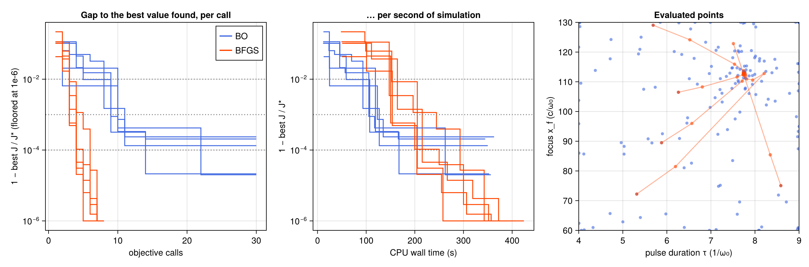

# WP-048: Bayesian optimization against gradient-based BFGS on the WP-045 problem

| | |
|---|---|
| Work package | WP-048 (goals A0, A1, A7) |
| Commits | the optimizer, its tests and the comparison script `6766bff`; this report and the run's figure in the commit after it |
| Runs | `optim-bo_compare-20261109T123027` (commit `6766bff`, clean, 4 threads, 3718 s) |
| Input hashes | SHA-256 of every input file in the run's manifest: `wp-048-bayesian-baseline/manifest.toml` |
| Environment | Julia 1.13.3, KernelAbstractions 0.10.4 CPU backend; Intel Xeon @ 2.10GHz (the model string the CPU reports), 4 vCPUs of a shared cloud VM |
| Figures | `wp-048-bayesian-baseline/bo_compare.png`, with its JSON sidecar `bo_compare.json` |
| Status | measured, not independently reviewed; no number here is to leave the repository before that review |

## 1. Setup

- **The problem** is WP-045's, unchanged (`scripts/optim/wake2d_case.jl`; `reports/wp-045-wake-optimization.md` §1): maximize the RMS on-axis wake amplitude J of the small 2D LWFA case over the pulse duration τ ∈ [4, 9] and the focus x_f ∈ [60, 130], at a₀ = 1 and n₀ = 0.1, in the scaled coordinates z = (τ/6, x_f/90). Every call is a full 512-step run.
- **BFGS** is WP-045's projected BFGS (`maximize.jl`), with ForwardDiff gradients through the run and WP-045's stop (projected gradient below 10⁻⁴). Each call is one run with a dual and returns the value and the gradient.
- **Bayesian optimization** (`scripts/optim/bayes.jl`) is a textbook GP-EI loop, written out here so it adds no dependency:
  - A Gaussian process on the unit box with a Matérn-5/2 kernel, one length scale per parameter, a signal variance and a noise variance, on values standardized after every call.
  - Hyperparameters by maximum marginal likelihood (the WP-045 maximizer with ForwardDiff on the log-hyperparameters, from three fixed starts and the previous fit). Bounds: length scales 0.02 to 5 box widths, signal variance 0.01 to 100, noise variance 10⁻⁸ to 10⁻¹.
  - Expected improvement with margin ξ = 0.01 (standardized units), maximized over 2048 counter-based candidates and refined from the best five with gradients.
  - A 5-point Latin hypercube first, then one point per call. Each call is a plain run and returns the value only. There is no stopping rule; every run spends its budget of 30 calls.
  - The randomness is counter-based (splitmix64 of seed and counter), so a seed repeats bit for bit.
- **Tests** (`scripts/optim/test/bayes.jl`, included from `runtests.jl`): T-620 the Latin hypercube's stratification and reproducibility; T-621 the GP interpolates its data, fits a length scale in range, EI's limits and its ForwardDiff gradient against central differences; T-622 BO reaches the Branin minimum 5/(4π) within 0.02 in 40 calls from three seeds (measured gaps 0.0064, 0.0069, 0.0105; Branin spans about 300 on its box) and repeats bit for bit.
- **The comparison** (`scripts/optim/bo_compare.jl`): five seeds. Seed s gives BO its Latin hypercube and BFGS its start (that design's first point), so the two methods start from the same information. Both kinds of call are compiled before any timing. Every call is logged with its kind and wall time.
- **The measure.** J* is the largest value any of the ten runs evaluated. A run reaches tolerance ε at its first call whose best value so far is within ε·J* of J*. Time is the summed wall time of the simulation calls; the GP's own work is not counted, and the whole run's wall time exceeds the summed calls by 14 s over 125 BO proposals, so it is negligible here.

## 2. Results

J* = 0.2586462, at (τ, x_f) = (7.742, 112.97), the point WP-045 reports. Each entry is calls / simulation seconds to reach the tolerance; "—" is not reached within the budget.

| method | seed | calls | 1 % | 0.1 % | 0.01 % | best J | at (τ, x_f) | 1 − best/J* |
|---|---|---|---|---|---|---|---|---|
| BO | 1 | 30 | 10 / 119 s | 10 / 119 s | — | 0.2585931 | (7.739, 111.32) | 2.1e-04 |
| BO | 2 | 30 | 8 / 93 s | 11 / 127 s | — | 0.2586117 | (7.798, 114.03) | 1.3e-04 |
| BO | 3 | 30 | 5 / 59 s | 9 / 107 s | 14 / 167 s | 0.2586406 | (7.735, 113.48) | 2.1e-05 |
| BO | 4 | 30 | 2 / 25 s | 10 / 123 s | — | 0.2585852 | (7.660, 114.21) | 2.4e-04 |
| BO | 5 | 30 | 9 / 105 s | 9 / 105 s | 22 / 262 s | 0.2586410 | (7.774, 113.19) | 2.0e-05 |
| BFGS | 1 | 8 | 3 / 147 s | 5 / 244 s | 6 / 293 s | 0.2586462 | (7.742, 112.97) | 1.7e-09 |
| BFGS | 2 | 8 | 3 / 164 s | 4 / 215 s | 4 / 215 s | 0.2586461 | (7.742, 112.96) | 6.6e-09 |
| BFGS | 3 | 7 | 3 / 153 s | 4 / 205 s | 4 / 205 s | 0.2586462 | (7.742, 112.97) | 0 |
| BFGS | 4 | 8 | 3 / 154 s | 3 / 154 s | 4 / 204 s | 0.2586462 | (7.742, 112.97) | 1.8e-09 |
| BFGS | 5 | 7 | 3 / 150 s | 3 / 150 s | 5 / 250 s | 0.2586461 | (7.744, 112.99) | 1.1e-07 |

**Cost of a call.** The median plain run took 11.8 s and the median run with a dual (three partials) 50.6 s, a ratio of 4.3. WP-045's report gives about 2.5 for the same ratio; the two were measured differently (there the dual against a primal run inside a longer job) and the difference is not explained here.

**What the numbers say.**
- **Calls.** BFGS reaches every tolerance in fewer calls: 3 calls for 1 %, 3 to 5 for 0.1 %, 4 to 6 for 0.01 %, and then stops on its own. BO needs 2 to 10 calls for 1 %, 9 to 11 for 0.1 %, and reaches 0.01 % in only 2 of 5 runs (14 and 22 calls) within 30.
- **Time.** Because a gradient call costs 4.3 plain runs, BO is ahead in simulation time at the loose tolerances: 1 % in 25 to 119 s against 147 to 164 s, 0.1 % in 105 to 127 s against 150 to 244 s. At 0.01 % BFGS is ahead: 204 to 293 s in every run, against 167 and 262 s in the two BO runs that got there and not within about 350 s in the other three.
- **Location.** BFGS finds the optimum to four digits in τ and x_f from every start. BO's best points lie within 0.09 in τ and 1.7 in x_f of it: the optimum is flat (J changes by 2 × 10⁻⁴ there), and BO only locates what its samples resolve.
- **Why BO stalls near 10⁻⁴.** The fitted length scales grow to 3.5 to 5 box widths by the end of every run, and sit at the upper bound of 5 in 3 to 9 of the 25 fits of four of the five runs: the GP sees a smooth, nearly quadratic surface. Expected improvement with ξ = 0.01 of the standardized spread then keeps spending calls on the box's edges and corners (the right panel), where the GP's uncertainty is largest, rather than refining a maximum it already knows to a few 10⁻⁴.

**In short**, on this smooth two-parameter problem with a cheap gradient (4.3 plain runs), the gradient method is the better optimizer: it converges in 4 to 6 calls with a stopping rule and locates the optimum to four digits, while a standard BO is quicker only to a 1 % or 0.1 % answer. The balance would shift against gradients with more parameters only if the gradient's cost grew with them (forward mode does, about one partial per parameter; reverse mode would not) and in favour of BO with noisy or non-smooth objectives, neither of which is tested here.

## 3. Open issues

- The BO is a baseline with standard choices (Matérn-5/2, EI with ξ = 0.01, refit every call), not a tuned one. A smaller ξ, a trust-region or local phase, or a GP that also takes gradients would likely close part of the gap at 0.01 %; none is tried here.
- The comparison is one problem, two parameters, five seeds and one discretization. WP-045's optimum is not converged in Δy, so the location is this discretization's, not the physical problem's.
- The dual's cost uses three partials for two parameters (#375); with the KernelAbstractions bump a gradient call should cost somewhat less, which favours BFGS further.
