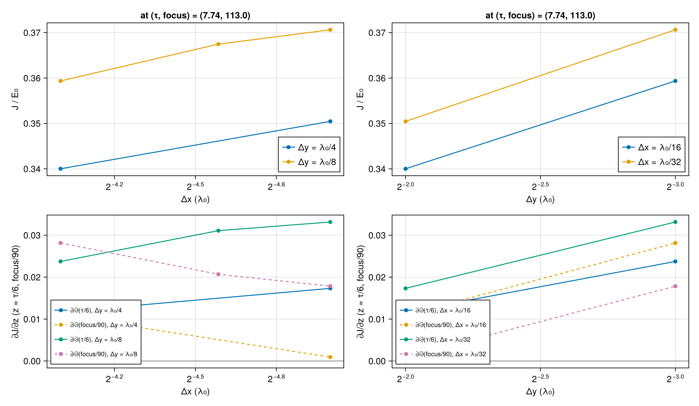
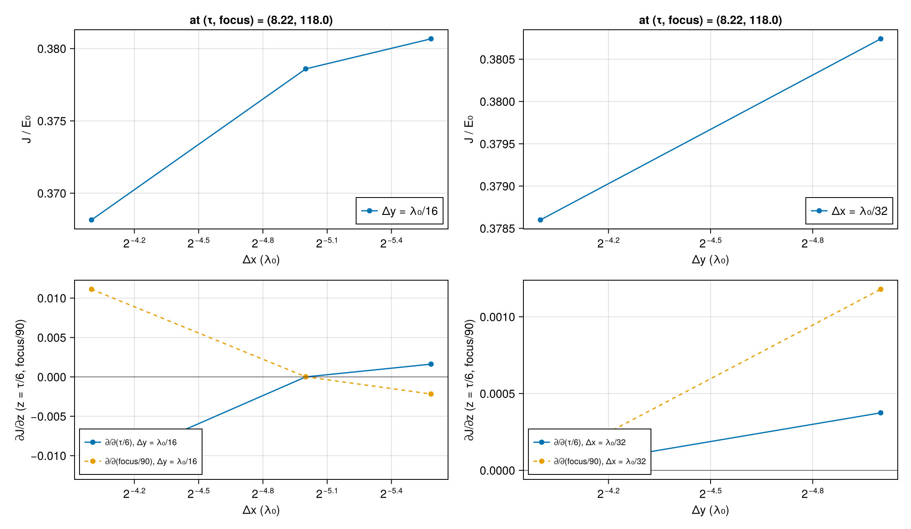
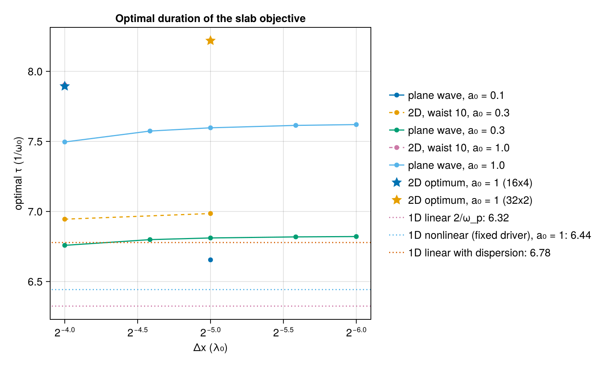

# WP-051: a converged 2D wake optimization

| | |
|---|---|
| Work package | WP-051 (goals A0, A1, A3, A7), building on WP-045 |
| Commits | code `38d3e9a` (objective, theory, driver), `90858a7` (the tauscan fix), `41a52b5` and `8443254` (figures; no change to the runs' code paths); this report in the commit after |
| Runs | CPU box (AMD EPYC 9655, 16 threads), each a branch: `runs/wp051-r1` (theory, plane-wave scans at 16 and 32 cells/λ₀; its fifth step failed on a TOML bug and was rerun in r3), `runs/wp051-r2` (probe at the WP-045 point, fine grids), `runs/wp051-r3` (plane-wave scans at 24, 48, 64 cells/λ₀, 2D scans, probe at the WP-045 point, optimization at the base grid), `runs/wp051-r4` (optimization at λ₀/32 × λ₀/16, 2D a₀ = 0.3 scan), `runs/wp051-r5` (Hessian and refinement at the optimum). One plane-wave scan at a₀ = 0.1 ran in the cloud session (4 vCPUs, commit `90858a7`, clean). Every run directory has its `manifest.toml` with the commit and the SHA-256 of its inputs |
| Input hashes | the figure run's manifest: `wp-051-converged-optimization/manifest.toml`; the source runs' manifests are on the run branches |
| Environment | Julia 1.13.3, KernelAbstractions 0.10.6 CPU backend, Float64, Reference mode |
| Figures | `wp-051-converged-optimization/*.png`, each with its JSON sidecar |
| Status | measured, not independently reviewed; no number here is to leave the repository before that review |

## 1. Summary

- **WP-045's optimum was set by its read-out time.** Its objective, the RMS of the on-axis E_x over the whole window at the last step, has a gradient at its optimum (7.74, 113) that changes sign within ±5 c/ω₀ of the read-out time t = 185.3 (figure `readout.png`). The new objective cannot depend on the read-out time: it averages the wake over a fixed lab-frame plasma slab, each column sampled at a fixed delay behind the light front.
- **The optimum converges at Δx = λ₀/32, Δy = λ₀/16.** There the optimum is (τ, focus) = (8.22, 118.0), J = 0.3786 E₀. Refining further moves it by an estimated +0.05 in τ and −0.5 in focus, 0.6 % and 0.4 %. J itself converges at second order and is about 1.7 % below its limit at that grid. WP-045's grid (λ₀/16 × λ₀/4) puts the optimum at (7.89, 115.8), 4 % short in τ, and J 10 % low.
- **The τ offset from 2/ω_p = 6.32 has three parts.**
  - Group-velocity dispersion of the pulse in the plasma (n₀ = 0.1 n_c) takes it to 6.78 in an exact linear 1D model. A plane-wave run of the code at a₀ = 0.3 gives 6.82.
  - At a₀ = 1 the plane-wave optimum is 7.62. A 1D nonlinear cold-fluid wake with an unchanging driver moves the optimum by only 0.1, so most of this 12 % is the pulse's own evolution in the plasma. That attribution is not tested further here.
  - The 2D geometry adds 2.6 % in the linear regime (6.99 against 6.82) and 8 % at a₀ = 1 (8.22 against 7.62).
  - The three factors multiply to 6.32 · 1.077 · 1.12 · 1.08 = 8.2.

## 2. The objective

The plasma behind the pulse rings in place: at a fixed lab position x the on-axis E_x oscillates at ω_p with the amplitude the pulse left there. `scripts/optim/slab.jl` samples each plasma column of the slab x ∈ [72, 152] at the delays s = t − x ∈ [72, 102] behind the vacuum light front, with a Hann weight in s. The slab is the density plateau from its start, four plasma wavelengths long. The objective is

J² = 2·Σ w·E_x² / Σ w, in units of E₀² = n₀,

the mean squared wake amplitude over the slab, the first one and a half plasma periods after the pulse. More steps add no samples once the last column is read, so J is the same at every read-out time by construction.

- **Timing.** The pulse's peak passes s = 51.6. At s = 72 a pulse of τ ≤ 9 has fallen below e⁻⁸ of its peak intensity, also after the group delay it gathers in the slab (≤ 4.3). The window's back band reaches s = 108 − band, which bounds s₂.
- **The weight.** A Hann weight 1.5 plasma periods long has a spectral zero at 2ω_p, the ripple of E_x². T-661 checks that it averages sin² to ½ at every phase, at the case's Δt. Every run checks that each slab column received its full weight to 1 %, and refuses otherwise.
- **The window is a choice, and the physics depends on it.** The local amplitude grows with the delay behind the pulse in 2D. At the WP-045 point, the window a quarter period earlier (`early`) gives 1.1 % less J, a one-period window (`short`) 7.8 % less, and the first half of the slab (`half`) 0.6 % less (probe at λ₀/16 × λ₀/4). In the plane wave the windows agree to 1 % in J and 0.1 in the optimal τ, because there the wake is stationary.
- **The gradient.** AD against central FD at the WP-045 point (λ₀/16 × λ₀/4) has relative errors of 8 × 10⁻⁴ and 1.5 × 10⁻⁴ at h = 10⁻², and 8 × 10⁻⁶ and 2 × 10⁻⁶ at h = 10⁻³.
- **The old objective is kept.** WP-045's objective is still computed in every probe, read at its own time and interpolated between steps. At the base grid it reproduces WP-045's 0.2586462 to every digit.

`scripts/optim/wake2d_case.jl` gained `ppl` (cells per λ₀), `a0` and `waist` keywords. The box stays 14 λ₀ × 16 λ₀ at every resolution, the antenna stays at x = 3λ₀/8, and the defaults reproduce WP-045 bitwise.

## 3. Convergence

**At the WP-045 point (7.74, 113).**

| Δx | Δy | J | ∂J/∂(τ/6) | ∂J/∂(focus/90) | box run time |
|---|---|---|---|---|---|
| λ₀/16 | λ₀/4 | 0.34001 | 0.0117 | 0.0109 | 66 s |
| λ₀/16 | λ₀/8 | 0.35936 | 0.0237 | 0.0282 | 161 s |
| λ₀/24 | λ₀/8 | 0.36746 | 0.0311 | 0.0207 | 940 s |
| λ₀/32 | λ₀/8 | 0.37062 | 0.0332 | 0.0178 | 510 s |
| λ₀/48 | λ₀/8 | 0.37281 | 0.0345 | 0.0158 | 846 s |
| λ₀/32 | λ₀/4 | 0.35045 | 0.0173 | 0.0009 | 332 s |
| λ₀/32 | λ₀/16 | 0.37647 | 0.0379 | 0.0229 | 1828 s |
| λ₀/32 | λ₀/32 | 0.37851 | 0.0382 | 0.0243 | 5638 s |
| λ₀/16 | λ₀/16 | 0.36643 | 0.0241 | 0.0334 | 1464 s |

- **The order of convergence.** The Δx steps at Δy = λ₀/8 (16 → 24 → 32 → 48) change J by 0.0081, 0.0032 and 0.0022. Second order predicts 0.0089 and 0.0022 from the middle step. The Δy steps at Δx = λ₀/32 (λ₀/4 → /8 → /16 → /32) change it by 0.0202, 0.0059 and 0.0020, ratios of 3.4 and 2.9.
- **The run times.** Each is one run with duals, wall clock on the box. The box's speed varied by up to a factor of five between requests.

**At the optimum (8.2192, 118.039), found at λ₀/32 × λ₀/16.**

| Δx | Δy | J | ∂J/∂(τ/6) | ∂J/∂(focus/90) |
|---|---|---|---|---|
| λ₀/16 | λ₀/16 | 0.36815 | −0.01186 | 0.01112 |
| λ₀/32 | λ₀/16 | 0.37860 | 0.0000009 | 0.000014 |
| λ₀/48 | λ₀/16 | 0.38068 | 0.00162 | −0.00217 |
| λ₀/32 | λ₀/32 | 0.38074 | 0.00037 | 0.00118 |

- **The Hessian at λ₀/32 × λ₀/16** comes from two more runs with duals, at τ + 0.3 and focus + 3. It is diag(−0.445, −0.404) in z = (τ/6, focus/90). The off-diagonal terms are 0.0015 and −0.00004, which is effectively diagonal.
- **Richardson extrapolation of the gradient**, second order, from λ₀/32 and λ₀/48 in Δx and from λ₀/16 and λ₀/32 in Δy, gives a limit that differs from the λ₀/32 × λ₀/16 gradient by (+0.0034, −0.0024).
- **The optimum's shift**, −H⁻¹ times that difference, is (+0.0076, −0.0059) in z, which is **+0.046 in τ and −0.5 in focus**. The optimum of the λ₀/48 × λ₀/16 gradient alone moves by (+0.022, −0.48).
- **J's limit** by the same extrapolation is about 0.385, 1.7 % above the value at λ₀/32 × λ₀/16. The location converges faster than the value.

**The optimizations.**

| grid | start | evaluations | optimum (τ, focus) | J | final ∇J (scaled) |
|---|---|---|---|---|---|
| λ₀/16 × λ₀/4 (WP-045's) | (7.742, 112.97) | 5 | (7.894, 115.83) | 0.34033 | (−3 × 10⁻⁵, −1 × 10⁻⁵) |
| λ₀/32 × λ₀/16 | (8.2, 118.0) | 3 | (8.219, 118.04) | 0.37860 | (−4 × 10⁻⁷, 1.4 × 10⁻⁵) |

Both runs stopped on the projected gradient (gtol 10⁻⁴). The start of the fine run was estimated from the probe's gradient at the WP-045 point and a curvature read off WP-045's slices, so a single start was enough. The second start and the grid scan of WP-045's checks were not repeated at the fine grid. Each dual run there costs 11 to 30 minutes on the box.

## 4. The pulse duration against theory

**Theory** (`slab.jl`, the `theory` run, T-660):

- **1D linear, quasi-static.** A drive ⟨a²⟩ ∝ exp(−2t²/τ²) gives J ∝ τ·exp(−ω_p²τ²/8), largest at ω_pτ = 2, so τ = 6.32. This is derived here. The wake's phase velocity β and the WKB gain of a² entering the plasma, both 1/β with β = √(1 − n₀), scale J by 1/β² but leave the optimum in place.
- **1D nonlinear cold fluid, with a driver that does not change.** This is `wake1d`, φ'' = k_p²γ²(β/√(1 − (1 + ⟨a²⟩)/(γ²(1 + φ)²)) − 1). The equation is the standard one for a wake of phase velocity β; it is quoted from memory, not checked against a source. It reduces to the linear limit to 0.08 % at a₀ = 0.05.
  - The optimal τ is 6.33 at a₀ = 0.2, 6.37 at 0.5 and 6.44 at 1.0, all with β = √(1 − n₀).
  - With β = 1 it is 6.47 at a₀ = 1.
- **1D linear with the plasma's full dispersion.** This is `wake1d_dispersive`. The pulse enters at x = 68 with transmission η^(−1/2), spreads and chirps with k(ω) = √(ω² − n₀), and drives the linear wake at every depth. The amplitude formula is derived here and reduces to the first bullet without dispersion.
  - Averaged over the slab, the optimum is τ = 6.78.
  - Over the slab's first half it is 6.51.

**Runs of the code** (optimal τ by a parabola through the best three of 10 samples, τ = 4.5 … 9; plane wave: waist 10⁵, 8 rows):

| case | λ₀/16 | λ₀/24 | λ₀/32 | λ₀/48 | λ₀/64 |
|---|---|---|---|---|---|
| plane wave, a₀ = 0.3 | 6.758 | 6.799 | 6.811 | 6.819 | 6.821 |
| plane wave, a₀ = 1 | 7.496 | 7.574 | 7.597 | 7.614 | 7.620 |
| 2D, a₀ = 0.3 (focus 113 at λ₀/16 × λ₀/4; 118 at λ₀/32 × λ₀/16) | 6.945 | | 6.985 | | |
| 2D, a₀ = 1 (the optimizer) | 7.894 | | 8.219 | | |

The plane-wave values converge at second order in Δx. In the linear plane wave, the converged 6.82 agrees with the dispersive theory's 6.78 to 0.6 %, so dispersion accounts for the 8 % between 6.32 and the code.

**Not explained here.**
- **The amplitude.** The linear plane-wave J is 8 % above the dispersive model, at both a₀ = 0.1 and 0.3 (λ₀/32: 0.00429 against 0.00399 at τ = 6.5 and a₀ = 0.1). A 4 % error in the launched a₀ or a factor the model misses would both do it. It does not move the optimal τ.
- **The first half of the slab.** There the plane-wave optimum is 6.25, against the model's 6.51. A second effect that shortens the optimum near the plasma's start is not identified.
- **The a₀ = 0.1 scan** has only four samples (τ = 6 … 7.5). Its 6.66 against 6.81 at a₀ = 0.3 is within what a parabola through four samples 0.5 apart resolves, so it is not read as a trend.

**The nonlinear and 2D parts.**
- **Nonlinearity.** In 1D, a₀ = 1 lengthens the optimum by 12 % (7.62 against 6.82), while the 1D theory with an unchanging driver gives 1.6 %. The rest is attributed to the pulse's evolution over the 80 c/ω₀ of plateau: relativistic self-phase modulation, and compression in the wake's density. This is an attribution; no run here separates it.
- **2D.** The linear 2D optimum is 2.6 % longer than the plane wave's. At a₀ = 1 the 2D optimum is 8 % longer than the plane wave's, so diffraction and self-focusing add to the nonlinear lengthening. In the linear quasi-static theory the on-axis wake keeps the 1D time dependence, so 2D alone should not move the optimum. The 2.6 % is therefore read as finite-spot propagation, not the wake's geometry. This too is an attribution.

## 5. Cost

On the box:

| request | wall clock |
|---|---|
| r1 | 8 min |
| r2 | 164 min |
| r3 | 131 min |
| r4 | 69 min |
| r5 | 206 min |

The total is about 9.6 hours of the 16-core box, all compute. The local runs (smoke tests, the plane-wave Δx checks before the box's copies arrived, the a₀ = 0.1 scan) took under an hour of the session's 4 vCPUs.

## 6. Open issues

- **The amplitude and the slab's first half** disagree with the dispersive model (section 4).
- **The new objective's window** (slab [72, 152], delays [72, 102]) is a choice. Another window gives another optimum: the slab's first half prefers τ = 7.05 at the base grid (a₀ = 1, focus 113), where the full slab prefers 7.90. The witness-energy objective will replace it as the target.
- **The fine-grid optimization** has one start and no grid scan. The base-grid run and the gradient probes support a single interior maximum, but the WP-045-style checks were not rerun at λ₀/32 × λ₀/16 because of cost.
- **The box's speed** varied by up to five times between requests for the same work, so the run times above are not benchmarks.
