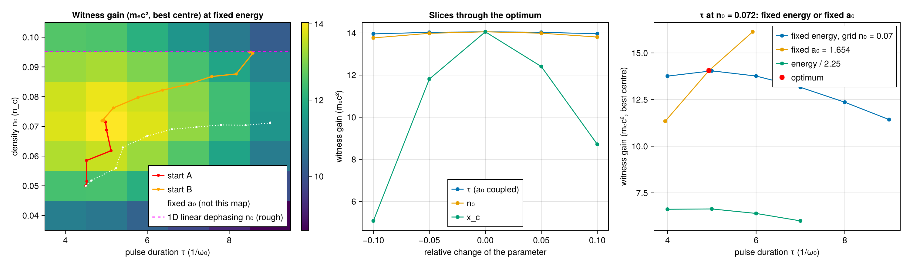

# WP-052: the 2D optimization at a fixed laser energy

| | |
|---|---|
| Work package | WP-052 (goals A0, A1, A3, A7) |
| Commits | the run `3dcb0fd` (clean); the resolution run `20dadfa`, flagged dirty because the figure's legend positions in `witness2d.jl`, not one of its inputs, were edited while it ran (committed as `5fdd957`) |
| Runs | `optim-witness2d-20261109T162854` (4 threads, 5022 s); `optim-witness2d-resolution-20261109T175317` (4 threads, 1049 s) |
| Input hashes | SHA-256 of every input in the runs' manifests: `wp-052-fixed-energy-optimization/manifest.toml`, `resolution-manifest.toml` |
| Environment | Julia 1.13.3, KernelAbstractions CPU backend; Intel Xeon @ 2.30GHz (the model string the CPU reports), 4 vCPUs of a shared cloud VM |
| Figures | `wp-052-fixed-energy-optimization/witness2d.png`, with its JSON sidecar `witness2d.json` (every number of the run); the resolution run's numbers in `resolution.json` |
| Status | measured, not independently reviewed; no number here is to leave the repository before that review |

## 1. Setup

User-layer code in `scripts/optim/` (F3): the case (`witness2d_case.jl`), the run (`witness2d.jl`), a resolution run (`witness2d_resolution.jl`), the maximizer of WP-045 (`maximize.jl`, with a step cap added), and T-600, T-680 to T-682 in `scripts/optim/test/runtests.jl`.

- **The case.** WP-045's small 2D LWFA run (224 × 64 cells, Δx = λ₀/16, Δy = 4Δx, periodic in y, waist 10, vacuum 64 and an 8 c/ω₀ ramp, the moving window from t = 108), focused at x = 80 and run for 830 steps (t ≈ 300).
- **The objective.** The WP-047 witness bunch's weighted mean energy gain at the last step, in mₑc². Test electrons of u₀ = 30 are injected at t = 150 on a fixed lattice (2 × 1 points per cell on the two axis rows, window x ∈ (24, 56)); the bunch's centre x_c enters only through Gaussian weights of rms length 2 (A3).
- **The fixed energy.** a₀ = `a0_at_energy(τ)`, the inverse of `laser_energy` = π·a₀²·w·τ/4·(1 + 1/(2w²)), at the energy of a₀ = 1.5, τ = 6. The parameters are (τ, n₀, x_c), scaled to O(1) as z = (τ/6, n₀/0.07, x_c/40) in the box τ ∈ [4, 9], n₀ ∈ [0.04, 0.10], x_c ∈ [30, 50] (A1).
- **The gradient.** ForwardDiff through the whole run, a three-partial dual, Float64, Reference mode.
- **The maximizer.** WP-045's projected BFGS, with trial steps capped at 0.1 in z (`maxstep`; the default stays uncapped).

**How the case got here** (the commits on the branch record each step):
- At a₀ = 1 for τ = 6 and witnesses of u₀ = 10, an exploration scan (not in a run record) found the gain at fixed energy still rising towards τ = 4 at n₀ = 0.1. The energy was raised to that of a₀ = 1.5.
- With u₀ = 10, witnesses in the decelerating phase behind the bucket fall behind the window's back edge, which `witness_energy_gain` refuses. Cutting the lattice in front of them then cut the Gaussian weights, and the centre ran to its lower bound twice: the best phase is the bucket's rear edge, right in front of the decelerating phase. At u₀ = 30 no witness is lost over the box, so the lattice reaches 6 bunch lengths behind the optimum's centre.

## 2. Results

**The fixed energy in the simulation.** The field energy launched into vacuum (300 steps, no plasma) is 104.627, 104.600 and 104.574 at τ = 4, 6.5 and 9: a spread of 5.0 × 10⁻⁴, and 0.982 of `laser_energy` (106.559). `laser_energy` of the coupled pulse equals the case's energy to roundoff at every τ (T-680 also checks that its τ derivative through a dual is zero).

**The gradient** at the first start (τ, n₀, x_c) = (4.5, 0.05, 36), central differences in z:

| h | rel. error ∂/∂z₁ (τ) | ∂/∂z₂ (n₀) | ∂/∂z₃ (x_c) |
|---|---|---|---|
| 10⁻² | 8.5 × 10⁻⁵ | 9.6 × 10⁻⁵ | 4.7 × 10⁻³ |
| 10⁻³ | 8.0 × 10⁻⁷ | 9.5 × 10⁻⁷ | 4.7 × 10⁻⁵ |
| 10⁻⁴ | 9.5 × 10⁻⁹ | 1.1 × 10⁻⁸ | 4.7 × 10⁻⁷ |

**The optimizer** from two starts:

| start (τ, n₀, x_c) | evaluations | optimum (τ, n₀, x_c) | a₀ | J (mₑc²) | max \|∇J\| (z) |
|---|---|---|---|---|---|
| (4.5, 0.05, 36) | 10 | (4.9356, 0.072002, 36.556) | 1.654 | 14.0537979 | 9.7 × 10⁻⁵ |
| (8.5, 0.095, 47) | 15 | (4.9356, 0.072002, 36.556) | 1.654 | 14.0537979 | 1.1 × 10⁻⁵ |

The optimum lies 19 %, 47 % and 33 % of the box's width from the nearest bound in τ, n₀ and x_c.

**The grid scan** (6 τ × 7 n₀ runs, the centre maximized on a 0.25 grid from each run's gains, which T-681 shows is exact): best cell (5.0, 0.07, x_c = 36.5), J = 14.0391, 0.10 % below the optimizer.

**Slices** through the optimum at ±5 % and ±10 % fall below it on both sides in every parameter:

| parameter | −10 % | −5 % | 0 | +5 % | +10 % |
|---|---|---|---|---|---|
| τ | 13.956 | 14.030 | 14.054 | 14.030 | 13.962 |
| n₀ | 13.766 | 13.983 | 14.054 | 13.989 | 13.806 |
| x_c | 5.08 | 11.81 | 14.054 | 12.41 | 8.71 |

The τ optimum is flat (−0.7 % at ±10 %); the centre is sharp, as the bucket's rear edge is.

**Fixed a₀ instead of fixed energy** (a₀ = 1.654): the gain rises with τ, 11.337, 14.052 and 16.131 at τ·(0.8, 1, 1.2), and the optimizer from start A ends with τ on its upper bound (τ = 9, ∂J/∂z₁ = 2.38 > 0, J = 19.19, n₀ = 0.0712, x_c = 36.62, 47 evaluations). The coupling is what keeps the optimum inside.

**At a lower energy** (1/2.25, a₀ = 1 at τ = 6), n₀ = 0.072: J = 6.619, 6.636, 6.395, 5.997 at τ = 4, 5, 6, 7. The duration optimum stays near τ ≈ 4.5 to 5 in this case.

**Resolution.** The best-centre gain on slices through the optimum; the τ slice at n₀ = 0.072, the n₀ slice at τ = 4.936, each with the vertex of the parabola through its three points. The end time is kept (`t_end`).

| variant | J at τ = 4 / 4.936 / 6 | τ vertex | J at n₀ = 0.064 / 0.072 / 0.080 | n₀ vertex |
|---|---|---|---|---|
| base (Δx = λ₀/16, Δy = λ₀/4, 2 × 2 ppc) | 13.764 / 14.052 / 13.789 | 5.02 | 13.853 / 14.052 / 13.891 | 0.0724 |
| 4 × 4 particles per cell | 13.765 / 14.052 / 13.789 | 5.02 | | |
| Δy = λ₀/8 | 13.880 / 14.105 / 13.788 | 4.91 | | |
| Δx = λ₀/32 | 14.273 / 14.671 / 14.468 | 5.16 | | |
| Δx = λ₀/32, Δy = λ₀/16 | 14.311 / 14.707 / 14.501 | 5.15 | 14.516 / 14.707 / 14.520 | 0.0720 |

The first four rows are from the main run, the last from the resolution run. **The value is not converged in Δx**: J rises by 4.7 % from the base to λ₀/32 × λ₀/16, and the τ vertex moves from 5.02 to 5.15, while the density vertex stays at 0.072. Particles per cell change J by under 10⁻⁴. The optimum stays inside the box at the finer grid. Whether λ₀/32 is converged is not checked here (WP-051 studies the convergence of this case family).

**Against theory.**
- In 1D linear theory at fixed energy the wake amplitude grows as τ → 0 (∝ exp(−k_p²τ²/8) at fixed a₀²τ), so the interior duration optimum is not a linear 1D effect. The physics breaker measured the pulse's on-axis length in the plasma: between t = 150 and 300 it grows by 2.8× at τ = 4 and 1.9× at τ = 6, consistent with plasma group-velocity dispersion (|k''| = 0.08 at n₀ = 0.072) spreading short pulses faster. The antenna's own error at τ = 4 (a launched peak about 5 % low) is small next to that. These are the breaker's numbers, not this run's.
- A 1D linear dephasing estimate (`linear_density_optimum`, derived in its docstring) gives n₀ ≈ 0.095 over the run's acceleration distance of 150 c/ω₀; with a 2D group velocity it gives 0.091, and with a nonlinear wake's slip 0.05. The measured 0.072 lies in that range, which sets only the scale.

**Cost.** 5022 s on 4 threads for the main run (vacuum runs, the FD check, two optimizations of 10 and 15 evaluations, 42 grid runs, slices, the fixed-a₀ optimization of 47 evaluations and the resolution rows); 1049 s for the resolution run.

## 3. Review findings and what changed

**Mutation breaker** (about 15 min). 28 planted defects: 20 caught; 3 equivalent (a ppc loop order that only matters for ppc₂ > 1, a promotion that the duals make redundant, the step cap before an unreachable reset). Five real gaps, all closed:
- `gain_at_centers` without its lost-witness refusal: T-681 now refuses a lost witness.
- `witness_problem` ignoring its `inject` keyword: T-680 checks `inject`, `nsteps` and `focus` reach the problem.
- the maximizer's default `maxstep` changed: T-600 now pins the uncapped first step (0.6).
- the slice check passed a slice cut by a bound (points on one side only): `is_interior_max` requires a point on each side, tested by T-682.
- the fixed-a₀ comparison never checked that a₀ was fixed, and never ran the optimizer: the run now asserts both, including τ on its upper bound.

**Physics breaker** (about 55 min).
- Δx = λ₀/32 raises J by 4 % and moves the τ vertex to 5.2: now a row of the run's resolution table, and the λ₀/32 × λ₀/16 run added after WP-051's convergence finding.
- The τ optimum is flat and moves with the injection time (τ vertex 4.55 at t = 150 − 30, 5.83 at + 30), the horizon (4.75 at 700 steps, 4.85 at 1000) and the bunch length (4.68 at length 4); the density vertex moves with the horizon (0.084 at 700 steps, 0.062 at 1000) as dephasing predicts. These are properties of the objective, recorded here, not changed.
- Δy = 2Δx with a fixed step count ended the run 23 c/ω₀ early (Δt follows Δy): `witness_problem` now takes `t_end`.
- `linear_density_optimum`'s docstring misdescribed the slip past π, and the case's docstring called 150 c/ω₀ the dephasing length's order (it is about half of 320): both corrected, and the estimate labelled rough.
- Confirmed: the launched energy at τ = 4 to 9 (spread 5 × 10⁻⁴; the invariant breaks just below τ = 4, at τ = 3 by 0.5 %), particles per cell, u₀ = 100 (J + 0.2 %), and no truncation of the weights.

## 4. Open issues

- **Convergence.** J changes by 4.7 % from λ₀/16 × λ₀/4 to λ₀/32 × λ₀/16; λ₀/32 is not shown converged. The optimum's location moves by 3 % in τ and less than 1 % in n₀.
- **The objective's set-up.** The τ optimum depends on the injection time, the horizon and the bunch length (§3), so the optimum is that of this objective, not a property of the laser alone. An objective that also frees the injection time, or reads the gain at the dephasing point, would remove part of that dependence.
- **No beam loading.** The witnesses are test particles (WP-047).
