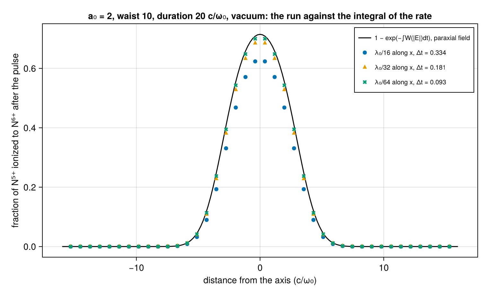

# WP-059: field ionization without random numbers: the rates, a pulse over test atoms, and the derivatives of an injection run

**Summary.**
- The ADK rates of the user layer (`scripts/ionization/atomic.jl`) agree with the rates FBPIC 0.27.1's three coefficient lines give to 1.8·10⁻⁸ for all 28 levels of H, He, N and Ar at 0.8 µm and a₀ = 0.25 to 8, when both use the atomic unit of energy the formula is written in. Against FBPIC as shipped, which takes hydrogen's measured ionization energy as that unit, they differ by up to 4.1 % (rates above 10⁻¹² ω₀).
- A Gaussian pulse of a₀ = 2 in vacuum over test atoms with nitrogen's sixth level (N⁵⁺ → N⁶⁺): the fraction released next to the axis is 0.624, 0.685 and 0.700 at λ₀/16, λ₀/32 and λ₀/64 along x, against 0.7085 from the integral of the rate in the paraxial field.
- That shortfall is the quadratic gather's: a particle sees a plane wave's amplitude times sinc³(π/n) at n cells per wavelength. The integral with the field reduced by that factor and by the run's measured peak gives 0.622, 0.686 and 0.702. The rate is steep (d ln W/d ln E = field/(3E) − power = 10.2 at E = 2, from the level's numbers in the sidecar), so 2.1 % of field at λ₀/16 is 12 % of ionized fraction.
- ForwardDiff through the small ionization-injection run of the tests agrees with central differences (h = x·2⁻¹⁰) to between 2·10⁻¹² and 6·10⁻⁵ in a₀, the dopant's density, the level's prefactor and the section's start; a scan of a₀ from 0.6 to 1.4 shows no step in either objective, with the tangents of nine dual runs on it.
- None of this is a comparison with another code's run, and the rate has no barrier-suppression correction and takes no energy from the field.

| | |
|---|---|
| Work package | WP-059 (`trace/wp/WP-059-field-ionization.md`); goals A0, A1, A2, A3, A4, A7, A8 |
| Commits | the run's code `1887b1e` (`dirty = false`); the `table` command of the script came after the run, in the commit that adds this report |
| Runs | `ionization-ionization-20261115T010018`, from `julia +1.13 --project=scripts -t 2 scripts/ionization/ionization.jl` |
| Input hashes | SHA-256 of every input file in `wp-059-field-ionization/ionization-ionization-20261115T010018/manifest.toml` |
| Environment | Julia 1.13.4, Float64, Reference mode, the KernelAbstractions CPU backend; Intel Xeon Processor @ 2.10GHz (the model string the CPU reports), 4 vCPUs of a cloud VM, 2 threads |
| Figures | `adk_rates.png`, `vacuum_fraction.png`, `objective_scan.png` in the run's directory, each with its JSON sidecar |
| Status | measured, not independently reviewed; no number here is to leave the repository before that review |

## Setup

The rates: `adk_level` makes a level's three normalized numbers (prefactor, field, power) from an ionization energy and a wavelength; `fbpic_reference.py` evaluates FBPIC's coefficient lines with FBPIC's table of energies, once with half a Hartree as the unit of energy and once with FBPIC's own. The vacuum runs: a pulse of a₀ = 2, waist 10 c/ω₀ and duration 20/ω₀ from an antenna, focused 56 c/ω₀ further on, over atoms of zero weight on every cell (they release nothing into the grid, so the field stays the vacuum field), Δy = λ₀/8, Δt at 0.95 of the Courant limit. The injection run: `ion_window` of `lib/ParticleMeshElectromagnetic/test/ionization_cases.jl`, 64 × 16 cells and 110 steps, a pulse of a₀ = 1 over a doped section in a moving window, with a model level (prefactor 1/5, field 3, power 1); its objectives are the born electrons' charge and kinetic energy.

## Results

| measure | value |
|---|---|
| rates against FBPIC's coefficient lines with the formula's unit of energy, every rate: largest relative difference | 1.849e-8 |
| the same with FBPIC's unit of energy, rates above 1e-12 ω₀; above 1e-3 ω₀ | 0.04071; 0.02042 |
| vacuum pulse at λ₀/16 (Δt = 0.3337, 738 steps), fraction released next to the axis: the run; the integral; the integral with the field times 0.9792; largest difference to the integral over the column | 0.6236; 0.7085; 0.6222; 0.0873 |
| vacuum pulse at λ₀/32 (Δt = 0.181, 1360 steps), fraction released next to the axis: the run; the integral; the integral with the field times 0.9945; largest difference to the integral over the column | 0.6852; 0.7085; 0.6864; 0.027 |
| vacuum pulse at λ₀/64 (Δt = 0.09255, 2659 steps), fraction released next to the axis: the run; the integral; the integral with the field times 0.9983; largest difference to the integral over the column | 0.6999; 0.7085; 0.7017; 0.01289 |
| born charge, ForwardDiff derivative in a0, density, prefactor, start | 0.1447; 23.15; 0.4509; -0.01713 |
| born charge, relative difference to a central difference | 1.221e-7; 2.295e-12; 3.692e-8; 6.475e-5 |
| born energy, ForwardDiff derivative in a0, density, prefactor, start | 0.03126; 2.055; 0.03801; -0.001411 |
| born energy, relative difference to a central difference | 1.095e-6; 5.014e-11; 5.163e-8; 5.815e-5 |

The table is the output of `julia +1.13 --project=scripts scripts/ionization/ionization.jl table reports/wp-059-field-ionization/ionization-ionization-20261115T010018`. "Next to the axis" is the atom half a cell (0.39 c/ω₀) from it. The factor in the third number of a vacuum row is sinc³(π/n) times the run's largest |Ey| on the Ey node next to the focus (interpolated in time) over the paraxial field's there; the integral with it is computed by the `table` command, not by the run. The central differences use one step h = x·2⁻¹⁰, so the 6·10⁻⁵ of the section's start holds the difference's own truncation error; T-778 scans the step and finds 2·10⁻⁹ there.

## What is not shown

- A run of the same doped target in another code. FBPIC's ionization draws a random number per macro-particle (read in its source), and Smilei's and PIConGPU's do as far as the author remembers (their documentation could not be reached from the session), so a comparison is one of ensemble means.
- The rate above the barrier-suppression field, where the ADK form overestimates, and the energy the ionization takes from the laser: neither is modelled (`questions/wp-059-field-ionization.md`, sections 1 and 4).
- The gather's attenuation with another shape, or along y, or in a plasma; and whether other codes' ionization sees the same reduced field (a code that gathers the field with the particle's shape does, by the same argument, which is not checked here).
- Trapping: the injection run is too short and too coarse for an electron to be trapped, and its level is a model level, not an element's.
- The comparison with FBPIC is of formulas and constants read from its source, not of a run of FBPIC.

## Where the data is

`reports/wp-059-field-ionization/ionization-ionization-20261115T010018/`: `adk_rates.json` (every level's three numbers and its rates at six fields, with both reference variants), `vacuum_fraction.json` (per run the released fraction of every atom of the focal column, the integral at its place, the peak field), `objective_scan.json` (the 33 objective values, the nine tangents, the derivative table) and `manifest.toml`. The tests that hold the same quantities to tolerances are T-770 to T-783 in `lib/ParticleMeshElectromagnetic/test/ionization.jl`, with the measured values in `tolerances.toml`.
