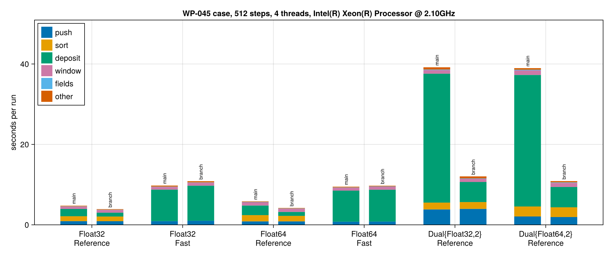

# WP-061: what the 2D Reference flux deposition cost besides its arithmetic

**Summary.**
- On the CPU backend the WP-045 run (224 × 64 cells, 4 particles per cell, 512 steps, 4 threads) takes 12.0 s instead of 40.1 s with `Dual{Float64,2}` elements and 4.03 s instead of 5.79 s with `Float64`. A gradient run with two partials now costs 3.0 plain runs, which is the size of its numbers; on `main` it cost 6.9 (#442).
- Three things cost the time, none of them the arithmetic. The largest by far, for duals only: the CPU backend's tuned work-group makes one cell of the patch kernel 4 to 11 times dearer than a work-group of one (#451, reduced to KernelAbstractions alone). Second, for every element type: the patch stored cell-major puts a cell's 108 values a cell count apart, which costs 1.4 to 2.7 times the kernel with one column per cell. Third and smallest: the closures of the stencil's outer products stayed out of line.
- The deposited bits are the same: the engine's recorded Reference digests (T-303) hold, and the digests of the module's runs on `main` and on the branch are equal in every group but the workspaces', which hold the patch.
- Both choices are the CPU backend's alone. On any other backend the patch stays cell-major and the work-group the backend's own; nothing here was run on a GPU, so only the inlined stencil reaches it.
- Fast mode is not changed and stays 2.5 times slower than Reference on this CPU (atomic adds).

| | |
|---|---|
| Work package | WP-061 (`trace/wp/WP-061-flux-deposition-cost.md`); goals A7, A8, A4 |
| Commits | `main` at `e141e09`; the branch at `382894a` (the kernels as merged, with `main`'s three packages of the day merged into it; the later commits change docstrings and tests) |
| Runs | `optim-step-timing-cpu-20261115T045557` (`main`, the script copied into its tree) and `optim-step-timing-cpu-20261115T050338` (branch), both clean, one after the other on one machine; `optim-step-timing-compare-20261115T050829` puts them side by side |
| Input hashes | SHA-256 of every input in each run's manifest: `wp-061-flux-deposition-cost/cpu-main/manifest.toml`, `cpu-branch/manifest.toml`, and `manifest.toml` for the comparison |
| Environment | Julia 1.13.4, KernelAbstractions 0.10.6 with its PoCL CPU backend, 4 threads; Intel Xeon @ 2.10GHz (the model string the CPU reports), 4 vCPUs of a shared cloud VM |
| Figures | `wp-061-flux-deposition-cost/step_timing_compare.png` with its sidecar `step_timing_compare.json`; per run `step_timing.png`, `step_timing.json` and `tables.md` |
| Status | measured on one shared machine, not independently reviewed; no number here is to leave the repository before that review |

## 1. Setup

`scripts/optim/step_timing.jl` runs WP-045's case (`wake2d_case.jl`, duration 7, focus 100) per element type and mode with the module's `step!` copied into a function that times each phase and waits for the backend after it. Every case runs twice in one process and the second run is timed; the plain `run!` of the same case is timed next to it and is the number in the table, a run of its own and not the sum of the phases (it is 0.95 to 1.19 times that sum). On the run's last state it then times, as the least of 15 calls, `deposit_flux!`, its two kernels, the patch kernel with fixed work-groups, and (on the branch) the deposition with each patch layout. `step_timing.jl compare` reads the sidecars of several runs and writes the table and figure below. The run has 196 window shifts and ends with 56571 of 71680 slots alive.

## 2. Results

Seconds per run of 512 steps and in its deposit phase (4 threads, Intel(R) Xeon(R) Processor @ 2.10GHz); the runs: main = `optim-step-timing-cpu-20261115T045557` at `e141e09`, branch = `optim-step-timing-cpu-20261115T050338` at `382894a`.

| element type | mode | `run!` main | `run!` branch | deposit main | deposit branch |
|---|---|---|---|---|---|
| `Float32` | Reference | 5.12 | 4.29 | 1.81 | 0.96 |
| `Float32` | Fast | 10.1 | 10.5 | 7.84 | 8.71 |
| `Float64` | Reference | 5.79 | 4.03 | 2.39 | 0.99 |
| `Float64` | Fast | 9.94 | 10.5 | 7.73 | 7.92 |
| `Dual{Float32,2}` | Reference | 46.7 | 11.4 | 32.1 | 4.99 |
| `Dual{Float64,2}` | Reference | 40.1 | 12.0 | 32.7 | 5.06 |

**The split**, from the per-call times in the two runs' sidecars (`kernels`), for the patch kernel, which is most of `deposit_flux!`:

- **Work-group.** On `main` the patch kernel takes 51.4 ms per call with `Dual{Float64,2}` in the backend's tuned work-group and 13.5 ms in work-groups of one (70.4 and 10.6 ms with `Dual{Float32,2}`); on the branch 63.5 and 7.85 ms. With `Float64` the two tie on `main` (3.15 and 3.11 ms). Fixed work-groups of 8, 64 and 512 lie between or above (`by_workgroup`, whose `nothing` is the backend's tuned group through `launcher`, not the branch's default launch). #451 reproduces this with a ten-line kernel and no package of this repository: a work item whose loop carries 216 doubles runs 28 to 100 times slower in a work-group larger than one (the effect starts near 100 doubles), and the object code shows why: PoCL's work-group function keeps each carried value in its own per-item stack array and loses the packed arithmetic. The engine now launches this one kernel in work-groups of one on the CPU backend (`item_launcher`), unless a `workgroupsize` is given.
- **Patch layout.** On the branch, in one process, with work-groups of one: cell-major 3.12 ms and stencil-major 1.17 ms per call with `Float64`, 1.89 and 1.08 with `Float32`, 9.47 and 5.52 with `Dual{Float32,2}`, 11.1 and 8.18 with `Dual{Float64,2}`; the reduce kernel 0.46 to 0.98 ms against 0.26 to 0.88 (`by_layout`). WP-020 measured the two as a tie on 64 × 48 cells at 64 particles per cell, where the store is a small part of the work, and took cell-major for a GPU; that expectation is still unmeasured, so the layout is the workspace's (`flux_layout`), stencil-major by default on the CPU backend and cell-major on every other.
- **Inlining.** Left to the compiler's cost model, the closures that `ntuple` calls in `outer` and `outer2` were not inlined: 36 calls per particle at order 2 for `Float32` and `Float64`, 108 for a dual, counted in the typed code on `main`; the branch has none (T-800). Its share is what is left between the two trees at equal work-group and layout: 13.5 ms (`main`, work-group of one) against 11.1 ms (branch, cell-major) with `Dual{Float64,2}`, 10.6 against 9.47 with `Dual{Float32,2}`, and nothing measurable with `Float64` (3.11 against 3.12). The largest work-group PoCL accepts for the `Dual{Float32,3}` patch kernel moved as well, from the 983 of #297 on `main` to 3269 on the branch on this machine, and CI's runners ran the backend's 4096 (T-500); which of the three changes moved it was not separated.

## 3. Verification status

- **Bits, engine.** T-303 compares the 2D Reference flux with digests recorded on a commit of WP-037 (`lib/ParticleMeshCore/test/recorded_2d.jl`), for Float32, Float64 and `Dual{Float32,3}`, both orders, across reruns, thread counts and work-groups, and T-266 does the same for the sort and `deposit!`, which share the workspace; both hold with the recorded file untouched. T-803: the two patch layouts give the same bits, for those types and `Dual{Float64,2}`.
- **Bits, module.** `scripts/digest/digest.jl` on `main` (`e141e09`) and on the branch (`102b869`), one thread each so that Fast mode's atomic adds are ordered: 138 runs (23 cases, Float32, Float64 and `Dual{Float32,3}`, Reference and Fast) and 24 harness solves. The state digest and the histories digest are equal in all 138 lines and the harness lines are equal; the workspaces digest differs in the 90 lines of the 15 2D cases that deposit a current, and in no other. With the branch's CPU default set back to cell-major, the workspaces of three such cases (18 lines) have `main`'s digest too, so the patch's order is the whole difference; a fourth, a moving-window case, was run and its workspace is not comparable between any two runs (#422).
- **Tests.** T-800 holds the stencil to code with no call left out of line for Float32, Float64, `Dual{Float32,3}` and `Dual{Float64,2}`, both shapes and four stagger pairs (it failed with the `@inline` taken from `outer` or from `outer2`). T-801 holds the launch: work-groups of one on the CPU backend, a fixed size kept, another backend's own choice, and the deposit's call site (it failed with the call site on `launcher`, with the CPU method making no choice, and with a fixed size overridden). T-802 compares every cell's patch with a host sum of its particles' stencils in slot order, in both layouts and deposits again into a patch filled with ones (it failed with Jy and Jz swapped in the patch, with the particles summed in reverse, with two entries of the cell-major index swapped, and with nothing written for an empty cell). T-803 holds the default layout per backend, equal bits with either, and the refusal of a patch array of the other layout's size (it failed with the CPU default set to cell-major, in `flux_patch_layout` or in the constructor alone).
- **Suites.** CI on `06c5785` (the kernels and tests as merged; the commit after it adds this report): the engine's two test groups, the module's five, the root package and the trace check passed on Julia 1.13, and the same groups on the pre-release 1.14.0-beta1. On the first run (`102b869`) the engine's second group failed on both versions: T-500 required a refusal that CI's runners no longer give for the smaller kernel, and T-800's scan misread Julia 1.14's typed code. Both tests were corrected; no kernel changed.

## 4. What is not shown

- **No GPU.** The layout and the work-group are not measured there and are left as they were; the inlined stencil does reach a GPU kernel, where the compiler may contract its products differently, so CUDA bits may differ from `main`'s at roundoff (no GPU digest is recorded across commits, only compared across reruns and launch shapes).
- **One machine, shared.** Repeats of one measurement on this VM during the session, the first of each on an earlier commit of its tree, differed by up to 25 % (the `Dual{Float32,2}` run on `main` 37.1, 38.8 and 46.7 s; the `Float64` run on the branch 3.62, 4.06 and 4.03 s), so differences below that between two cells of the table mean nothing; the layout's factor for `Dual{Float64,2}` (1.4) is within it, the one for `Float64` (2.7) is not. Only 4 threads were run.
- **A fixed `workgroupsize`.** The work-group of one is the launch for `workgroupsize = nothing` only. A caller that fixes it keeps that group's cost in the patch kernel: 35 to 103 ms per call for the duals at 8, 64 and 512 on the branch, against 5.5 and 7.9 ms.
- **What the deposition still costs.** With `Dual{Float64,2}` the deposit phase is 5.1 times the `Float64` one, where the size of the numbers gives 3, and 42 % of the run. Each of the 36 entries of Jz is divided by `T(12)`, a dual division, and each entry of Jx and Jy takes two dual products where the common factor could go into one axis' 6 values first; neither was changed, because that changes the deposited bits, and what either would save is not measured.
- **The other phases.** The sort (2.4 s of 12.0 with duals, 1.4 of 4.0 plain) and the window's own sort at each of the 196 shifts are the next costs; the push with `Dual{Float32,2}` takes 4.0 s where `Dual{Float64,2}` takes 1.9 s, not looked into.
- **Fast mode.** Its deposit is 7.7 to 8.7 s per run for both plain types and was not touched.

## 5. Where the data is

`wp-061-flux-deposition-cost/`: `cpu-main/` and `cpu-branch/` hold each run's manifest, sidecar (every number above, with the per-work-group and per-layout times), figure and printed tables; `step_timing_compare.json`, `step_timing_compare.png`, `tables.md` (the table of section 2, as printed) and `manifest.toml` are the comparison's. The tool is `scripts/optim/step_timing.jl`; the tests are T-800 and T-802 in `lib/ParticleMeshCore/test/flux2d.jl` and T-801 and T-803 in `test/launch.jl`.
