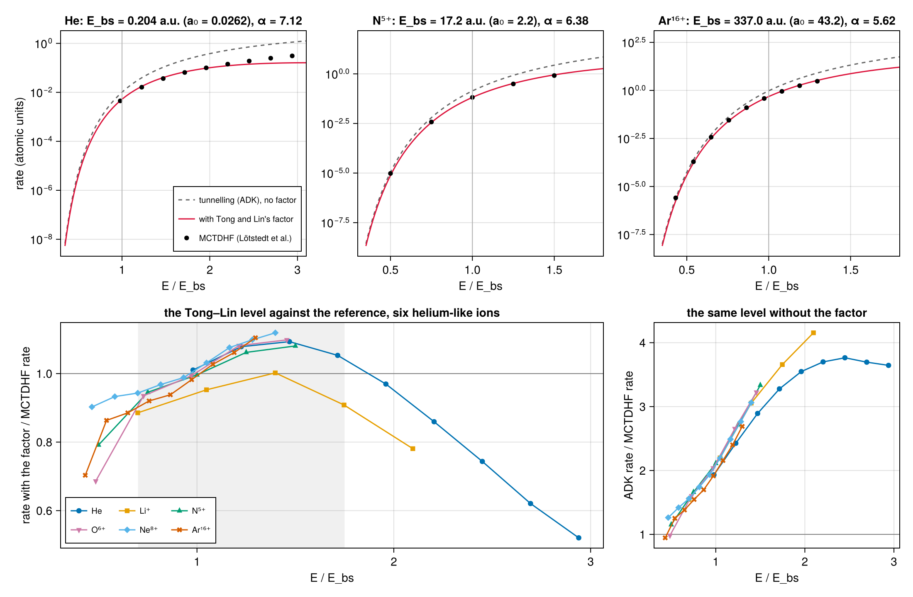
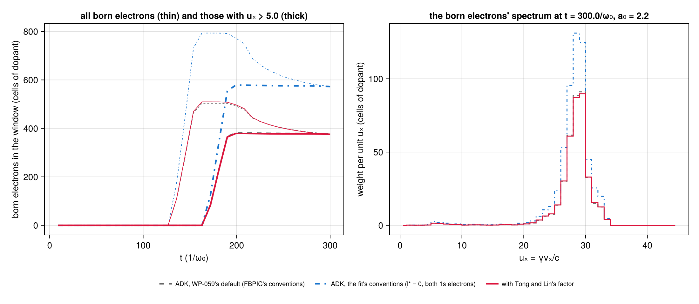

# WP-063: barrier-suppression ionization: the rate against published rates, a pulse over test atoms, and an injection run with and without it

**Summary.**
- The level `tong_lin_level` builds from an ionization energy (`scripts/ionization/atomic.jl`) is the tunnelling rate times Tong and Lin's factor. Against the static-field rates Lötstedt, Ciappina and Yamanouchi computed with MCTDHF for helium-like ions (42 rows of He, Li⁺, N⁵⁺, O⁶⁺, Ne⁸⁺ and Ar¹⁶⁺) it is within 12 % from 0.7 to 1.75 times the field E_bs at which the barrier is gone, up to 31 % low below that and up to 48 % low above it (He and Li⁺ only, to 2.9 E_bs).
- The same level without the factor is 1.9 to 4.2 times the reference from 0.95 E_bs on.
- For N⁵⁺ at 0.8 µm, E_bs is a₀ = 2.2. A Gaussian pulse in vacuum ionizes half of the N⁵⁺ on its axis at a₀ = 1.889 with the factor and at 1.797 without it. WP-059's default level, which follows FBPIC's conventions (l* of the neutral atom, one electron), gives 1.899: its smaller coefficient and the missing factor nearly cancel for this level.
- Runs of that pulse at λ₀/32 with the factor release 0.3056 and 0.9561 next to the axis at a₀ = 1.8 and 2.2, against 0.3066 and 0.9565 from the integral of the rate in the field the atoms see.
- A coarse 2D ionization-injection run (a₀ = 2.2, nitrogen's two K-shell levels) ends with 572 cells of dopant in born electrons of uₓ > 5 without the factor and 376 with it, 34 % less; WP-059's default level gives 377. The spectrum's shape and its largest uₓ (33.8 to 33.9) do not change.
- None of this is a comparison with another code's run, and the reference rates rest on a reading of a table that does not state its units (below).

| | |
|---|---|
| Work package | WP-063 (`trace/wp/WP-063-barrier-suppression.md`); goals A1, A2, A3, A4, A7, A8, A10 |
| Commits | the run's code `176b369` (`dirty = false`) |
| Runs | `ionization-barrier-suppression-20261117T011420`, from `julia +1.13 --project=scripts -t 4 scripts/ionization/barrier_suppression.jl` |
| Input hashes | SHA-256 of every input file in `wp-063-barrier-suppression/ionization-barrier-suppression-20261117T011420/manifest.toml` |
| Environment | Julia 1.13.4, Float64, Reference mode, the KernelAbstractions CPU backend; Intel Xeon Processor @ 2.10GHz (the model string the CPU reports), 4 vCPUs of a cloud VM, 4 threads |
| Figures | `bsi_rates.png`, `bsi_fraction.png`, `bsi_injection.png` in the run's directory, each with its JSON sidecar |
| Status | measured, not independently reviewed; no number here is to leave the repository before that review |

## Setup

The rates: `tong_lin_level` makes a level's four normalized numbers (prefactor, field, power, suppression = 4α·n*²) from an ionization energy and a wavelength, with α from `scripts/ionization/tong_lin.toml` (6 for hydrogen-like ions, the fitted table of Lötstedt et al. for helium-like ions) and the conventions of that fit (l* = 0, both 1s electrons counted). The reference rates are the rows of the same paper's supplementary table for the six ions whose energies `ionization_energies.toml` has. The vacuum runs: WP-059's pulse (waist 10 c/ω₀, duration 20/ω₀, focused 56 c/ω₀ past the antenna) over atoms of zero weight with nitrogen's sixth level, λ₀/32 along x, Δy = λ₀/8, Δt at 0.95 of the Courant limit. The injection run: 448 × 128 cells at λ₀/32 along x, a moving window with PML at the back and the sides, a pulse of a₀ = 2.2 into a plasma of 0.072 n_c with a dopant of 1 % of that density over x = 76 to 100 c/ω₀, nitrogen's levels 6 and 7 with a birth every step, to t = 300/ω₀. It is run three times: with WP-059's default ADK levels, with ADK levels in the fit's conventions, and with the Tong–Lin levels.

## Results

| measure | value |
|---|---|
| the Tong–Lin level against the MCTDHF rates of six helium-like ions, largest \|W/W_ref − 1\|: fields from 0.7 to 1.75 E_bs; below 0.7 E_bs; above 1.75 E_bs | 0.1191; 0.3138; 0.4794 |
| the same level without the factor (ADK) over the MCTDHF rate, fields from 0.95 E_bs on: least; largest | 1.915; 4.155 |
| N⁵⁺ → N⁶⁺ at 0.8 µm: E_bs in atomic units; as a laser amplitude a₀; the level's suppression 4α·n*² | 17.15; 2.197; 22.64 |
| N⁵⁺ at 0.5, 0.75, 1, 1.25 and 1.5 E_bs, rate with the factor over the MCTDHF rate | 0.7917; 0.9455; 0.9964; 1.062; 1.081 |
| the same without the factor | 1.153; 1.661; 2.112; 2.716; 3.335 |
| vacuum pulse, the a₀ at which half of N⁵⁺ is ionized on the axis: ADK, WP-059's default (FBPIC's conventions); ADK, the fit's conventions (l* = 0, both 1s electrons); with Tong and Lin's factor | 1.899; 1.797; 1.889 |
| vacuum pulse of a₀ = 1.8 at λ₀/32 with the factor (1360 steps), fraction next to the axis: the run; the integral; the integral with the field times 0.9945 | 0.3056; 0.3234; 0.3066 |
| vacuum pulse of a₀ = 2.2 at λ₀/32 with the factor (1360 steps), fraction next to the axis: the run; the integral; the integral with the field times 0.9945 | 0.9561; 0.9632; 0.9565 |
| vacuum pulse of a₀ = 2.6 at λ₀/32 with the factor (1360 steps), fraction next to the axis: the run; the integral; the integral with the field times 0.9945 | 1.0; 1.0; 1.0 |
| injection run, ADK, WP-059's default (FBPIC's conventions): born electrons in the window at the end (cells of dopant); those with uₓ > 5; largest uₓ; births that found no slot | 378.0; 377.5; 33.92; 0 |
| injection run, ADK, the fit's conventions (l* = 0, both 1s electrons): born electrons in the window at the end (cells of dopant); those with uₓ > 5; largest uₓ; births that found no slot | 573.3; 572.3; 33.8; 0 |
| injection run, with Tong and Lin's factor: born electrons in the window at the end (cells of dopant); those with uₓ > 5; largest uₓ; births that found no slot | 376.2; 375.6; 33.92; 0 |

The table is the output of `julia +1.13 --project=scripts scripts/ionization/barrier_suppression.jl table reports/wp-063-barrier-suppression/ionization-barrier-suppression-20261117T011420`. E_bs = I²/(4Z) in atomic units, with I the ionization energy and Z the charge of the ion left behind. "Next to the axis" is the atom half a cell (0.39 c/ω₀) from it, and the factor in a vacuum row is the gather's attenuation times the run's peak field over the paraxial one, as in WP-059's report. "Cells of dopant" is the born electrons' weight over the dopant's density.

## What is not shown

- Tong and Lin's own paper was not read; the factor is taken as the two papers that use it state it (`questions/wp-063-barrier-suppression.md`, section 1).
- That the reference table holds unscaled rates in atomic units at the scaled field 8F/Z³, and which fields its five-entry rows belong to, are readings of a file that states neither (the questions file, section 3). With the other reading of the rates the level would miss every ion but helium by Z²/4.
- The rate above about 2 E_bs. The factor is a fit up to there; beyond it the rate falls with rising field and reaches zero, which is wrong. The level is 48 % low at 2.9 E_bs for helium already.
- Any level but a hydrogen-like or helium-like one. No α is in the table for other shells, and the comparison says nothing about them.
- A run of the same target in another code, and any physical value of the injection run: it is 2D, coarse, and its dopant section and pulse are chosen to show the levels' difference, not to model an experiment. The 34 % is the difference between two rate laws in this one case.
- Why WP-059's default and the Tong–Lin level agree to 0.5 % in the injection run: the first has a coefficient about half the second's and no suppression. That holds for N⁵⁺ near its E_bs and is not a property of the two rates.
- The energy the ionization takes from the laser, which neither level models.

## Where the data is

`reports/wp-063-barrier-suppression/ionization-barrier-suppression-20261117T011420/`: `bsi_rates.json` (per ion its numbers and the three rates at the reference's fields, the summary by band of fields), `bsi_fraction.json` (the ionized fraction against a₀ for the three levels, the three runs), `bsi_injection.json` (per run the born electrons' number in time and their spectrum) and `manifest.toml`. The tests that hold the rate and its derivatives to tolerances are T-820 to T-827 in `lib/ParticleMeshElectromagnetic/test/barrier_suppression.jl` and `gpu.jl`, with the measured values in `tolerances.toml`.
