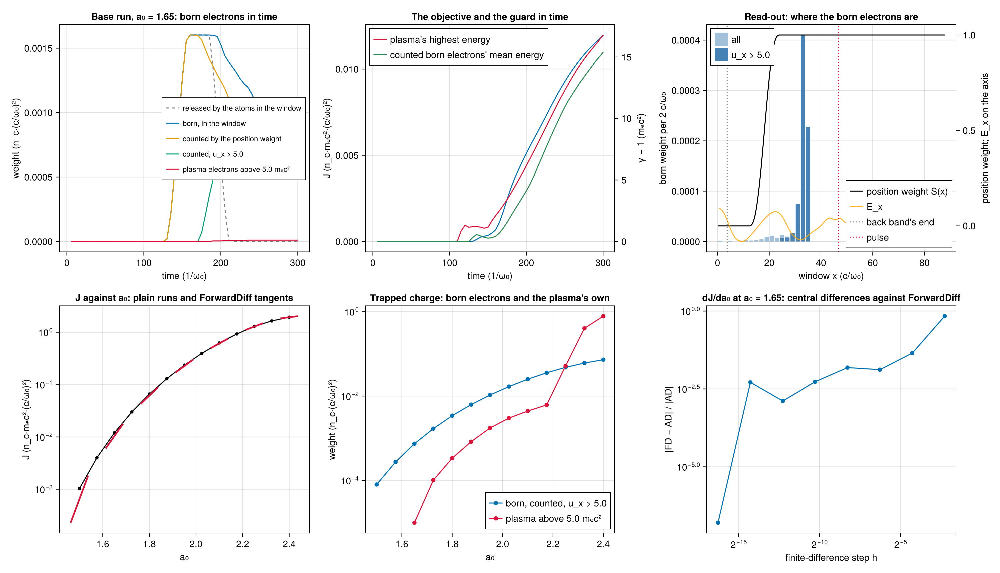

# WP-064: can the energy of ionization-born electrons be an optimization objective?

**Summary.**
- A 2D LWFA run at λ₀/16 whose pulse ionizes a nitrogen dopant's K shell inside the wake traps born electrons at every a₀ from 1.5 to 2.4. At a₀ = 1.65, 46 % of the born weight is in the first bucket above u_x = 5 at t = 300, at a mean energy of 15 mₑc².
- The objective J, the kinetic energy of the born species times a smooth position weight, rises by a factor 1900 over that range without a step between the 13 runs; at a₀ = 1.65 d ln J / d ln a₀ is 22.
- ForwardDiff's derivative is the local slope: a central difference at h = 1.3·10⁻⁵ agrees to 1.6·10⁻⁷. Secants over wider steps do not settle on it: between h = 5·10⁻⁵ and 0.013 they differ from it by 0.1 % to 1.5 %, and the slope across the 33 fine-scan runs (a₀ ± 0.0064) by 1.7 %. J has structure on those scales at the percent level of its slope.
- The guard is needed. Plasma electrons of non-zero weight are above 5 mₑc² from a₀ = 1.65 (1.3 % of the trapped born weight there, 18 % at a₀ = 2.1), and from a₀ = 2.25 they outweigh the born ones (11 times at a₀ = 2.4), where J's slope halves. J does not see them.
- A plain run takes 32 s on 4 threads, a run with one dual 59 s.
- Two runs at λ₀/32 (a₀ = 1.6 and 2.0, exploratory, not in the run record) gave J 22 % and 11 % higher and the trapped born weight 20 % and 8 % higher, with no plasma electron above 5 mₑc² at 1.6 and 0.0025 against 0.0028 of them at 2.0.
- The rates are ADK without barrier suppression and the ionization takes no energy from the field (WP-059), so the injected charge is not a physical prediction. No optimizer has run.

| | |
|---|---|
| Work package | WP-064 (`trace/wp/WP-064-born-electron-objective.md`); goals A0, A1, A3, A4, A7 |
| Commits | the run's code `55c4ffd` (`dirty = false`); the `table` and `replot` commands read the figure's sidecar since the commit that adds this report, which also moved one legend |
| Runs | `optim-born2d-20261117T012425`, from `julia +1.13 --project=scripts -t 4 scripts/optim/born2d.jl 16` (2504 s) |
| Input hashes | SHA-256 of every input file in `wp-064-born-electron-objective/optim-born2d-20261117T012425/manifest.toml` |
| Environment | Julia 1.13.4, Float64, Reference mode, the KernelAbstractions CPU backend; Intel Xeon Processor @ 2.10GHz (the model string the CPU reports), 4 vCPUs of a cloud VM, 4 threads |
| Figures | `born2d.png` in the run's directory, with its JSON sidecar (every number of the run) |
| Status | measured, not independently reviewed; no number here is to leave the repository before that review |

## Setup

The case (`scripts/optim/born2d_case.jl`): a moving window of 14 λ₀ × 128 cells of Δy = π/4 with PMLs, a pulse of waist 10 and duration 6 focused at x = 80 into a plasma of 0.072 n_c, and nitrogen at 1 % of that density on the 36 rows around the axis in the section x = 76 to 100, with the levels N⁵⁺ → N⁶⁺ → N⁷⁺ at 0.8 µm (WP-059's `FieldIonization`, a birth at every step). The objective is `born_energy`: J = Δx·Δy·Σ w(γ − 1)S(x) over the alive electrons of the born species, with S a C² step from 0 at window x = 12 to 1 at x = 24; the back band ends at x = 3.5, the first bucket lies between x = 27 and 40 and the pulse is at x = 47 at the read-out (t = 300, 900 steps). The guard is `plasma_peak_energy` and `plasma_fast_weight`, over the plasma's electrons of non-zero weight ahead of x = 12. The scan goes through the Optimization.jl problem of `problem.jl` in z = a₀/2.

## Results

| a₀ | J | dJ/da₀ (ForwardDiff) | born electrons trapped | plasma electrons above 5.0 mₑc² | plasma's highest γ − 1 | born mean energy |
|---|---|---|---|---|---|---|
| 1.5 | 0.001028 | 0.02129 | 8.038e-5 | 0.0 | 0.2911 | 11.62 |
| 1.575 | 0.003997 |  | 0.0002743 | 0.0 | 0.3249 | 13.64 |
| 1.65 | 0.01198 | 0.1589 | 0.0007441 | 1.001e-5 | 16.79 | 15.41 |
| 1.725 | 0.03004 |  | 0.001689 | 0.0001018 | 22.62 | 17.2 |
| 1.8 | 0.06596 | 0.621 | 0.003433 | 0.0003377 | 24.79 | 18.95 |
| 1.875 | 0.1301 |  | 0.006262 | 0.0008303 | 26.34 | 20.56 |
| 1.95 | 0.2357 | 1.732 | 0.01057 | 0.001753 | 27.87 | 22.13 |
| 2.025 | 0.3962 |  | 0.01675 | 0.003008 | 29.35 | 23.56 |
| 2.1 | 0.6266 | 3.491 | 0.02512 | 0.004424 | 30.79 | 24.89 |
| 2.175 | 0.9302 |  | 0.0356 | 0.00616 | 32.17 | 26.1 |
| 2.25 | 1.301 | 5.087 | 0.0479 | 0.05165 | 33.55 | 27.14 |
| 2.325 | 1.65 |  | 0.06049 | 0.403 | 34.86 | 27.25 |
| 2.4 | 1.944 | 2.468 | 0.07268 | 0.7811 | 36.07 | 26.72 |

| Quantity | Value |
|---|---|
| Grid, steps, threads | λ₀/16, 900 steps, 4 threads |
| Base run (a₀ = 1.65): born weight, trapped and counted | 0.001602, 0.0007441 (46.44 %) |
| Base run: plasma electrons above 5.0 mₑc², against the trapped born weight | 1.001e-5 (1.345 %) |
| J and dJ/da₀ at the base | 0.01198, 0.1589 |
| Steepness d ln J / d ln a₀ | 21.89 |
| Best abs(FD − AD)/abs(AD), at h | 1.607e-7, 1.259e-5 |
| The floor of A7: the spread of the three difference quotients around that step, over abs(AD) | 0.005138 |
| Fine scan (33 runs, spacing 0.0004028): largest and RMS departure from a cubic, in changes of J per spacing | 0.04519, 0.01673 |
| Seconds per plain run (49 runs) | 31.69 |
| Seconds per run with one dual (8 runs) | 58.54 |

The tables are the output of `julia +1.13 --project=scripts scripts/optim/born2d.jl table reports/wp-064-born-electron-objective/optim-born2d-20261117T012425`. Weights are in n_c·(c/ω₀)², J in n_c·mₑc²·(c/ω₀)², both per unit length along z. "Trapped" is the born weight with u_x > 5 times the position weight. The roughness row divides the departure of the 33 fine-scan values from the least-squares cubic through them by abs(dJ/da₀) times the spacing.

## Verification status

- T-830 to T-834 (`scripts/optim/test/runtests.jl`): the position weight's closed form and derivatives; J against the closed form on hand-placed electrons, with the plasma's species, free slots and electrons behind the weight leaving its bits unchanged; the guard; ForwardDiff against central differences in a₀ and in the dopant's density through a λ₀/8 run to t = 150 (within 10⁻⁵); the summary.
- The run asserts that born electrons are trapped, that the trapped ones lie where S = 1, that a run with duals returns the plain run's J, and that the best central difference is within 10⁻⁴ of ForwardDiff.
- The finite-difference check follows A7's scan over the step, but its quotients do not form a plateau: the spread of the three around the best step is 0.5 % of the derivative, set by the structure of J named in the summary, not by rounding.

## Not shown

- Where the percent-level structure comes from. The back-edge retirements of the plasma's particles are known to roughen the interior fields late in a run (#370); whether that or the births cause it here was not separated.
- Any other parameter than a₀, any read-out time but t = 300, and the dependence on the position weight's edges.
- A converged resolution, the GPU, Float32.
- Whether the plasma's injection at a₀ ≥ 1.65 starts at the density ramp or is a property of the grid.
