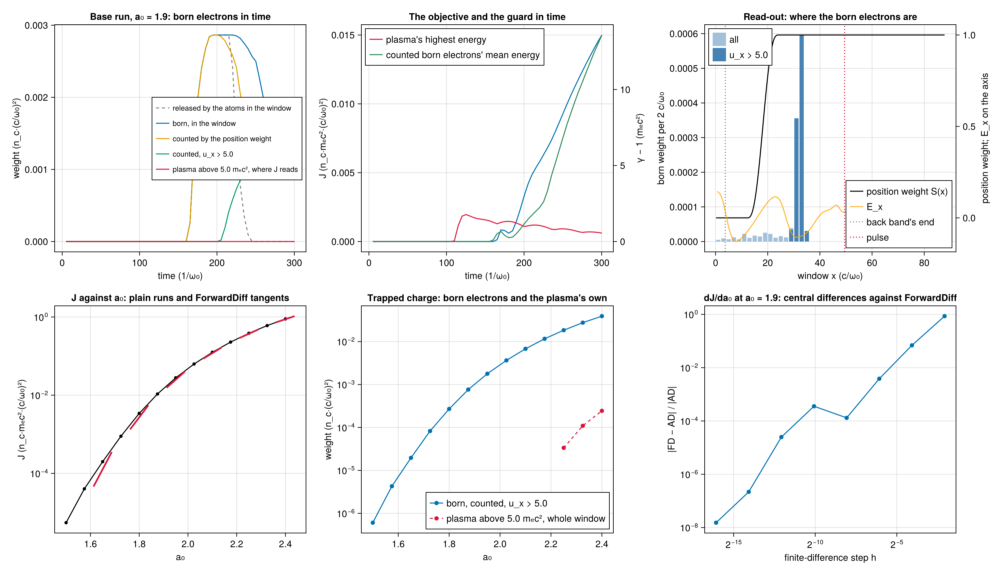

# WP-064: can the energy of ionization-born electrons be an optimization objective?

**Summary.**
- A 2D LWFA run at λ₀/16 whose pulse ionizes a nitrogen dopant's K shell inside the wake, behind a density ramp of 40 c/ω₀, traps born electrons at every a₀ from 1.5 to 2.4. At a₀ = 1.9, 35 % of the born weight is in the first bucket above u_x = 5 at t = 300, at a mean energy of 14 mₑc².
- With that ramp the plasma does not inject itself over most of the range (#465): from a₀ = 1.5 to 2.175 no plasma electron is above 5 mₑc² anywhere in the window ahead of the back band, and the plasma's highest energy is below 0.8 mₑc². From a₀ = 2.25 plasma electrons above 5 mₑc² appear behind window x = 12, where J does not read, at 0.2 % to 0.6 % of the trapped born weight; ahead of x = 12 there are none at any a₀.
- At λ₀/32 (three runs, exploratory, not in the run record) the plasma is as clean at a₀ = 1.9, shows 3·10⁻⁶ of weight above 5 mₑc² at 2.175 (0.02 % of the trapped born weight) and 0.45 at 2.4, which is 9.6 times the trapped born weight, all of it behind x = 12. So the clean range ends near a₀ = 2.1, and its upper end is not converged in resolution. Behind a ramp of 8 c/ω₀ the plasma injected at every a₀ of the scan (8 to 79 times the trapped born weight).
- The objective J, the kinetic energy of the born species times a smooth position weight, rises by a factor 1.6·10⁵ over the range without a step between the 13 runs; at a₀ = 1.9 d ln J / d ln a₀ is 25.
- ForwardDiff's derivative is the local slope: at a₀ = 1.9 the central differences converge onto it, from 0.4 % at h = 0.015 to 2·10⁻⁷ at h = 5.8·10⁻⁵ and 1.5·10⁻⁸ at h = 1.4·10⁻⁵, with one step out of order (3.6·10⁻⁴ at h = 9·10⁻⁴ after 1.3·10⁻⁴ at h = 0.0037); the floor of A7 is 2.5·10⁻⁵.
- J is smooth but steep: the slope across the 33 fine-scan runs (a₀ ± 0.0074) differs from the local one by 0.2 %, and the fine-scan values leave a cubic by at most 2.7 % of the change of J per spacing.
- J is not converged at λ₀/16: at λ₀/32 it is 59 %, 34 % and 23 % higher at a₀ = 1.9, 2.175 and 2.4, and the trapped born weight 55 %, 30 % and 19 % higher.
- A plain run takes 41 s on 4 threads, a run with one dual 72 s. J at a₀ = 1.9 has the same bits on 1 and on 4 threads.
- The rates are ADK without barrier suppression (WP-063's level is not used yet) and the ionization takes no energy from the field (WP-059), so the injected charge is not a physical prediction. J rises with a₀ over the whole range, so an optimization on it needs a constraint such as a fixed pulse energy. No optimizer has run.

| | |
|---|---|
| Work package | WP-064 (`trace/wp/WP-064-born-electron-objective.md`); goals A0, A1, A3, A4, A7 |
| Commits | the run's code `d3b6dc7` (`dirty = false`) |
| Runs | `optim-born2d-20261117T090638`, from `julia +1.13 --project=scripts -t 4 scripts/optim/born2d.jl 16` (3241 s) |
| Input hashes | SHA-256 of every input file in `wp-064-born-electron-objective/optim-born2d-20261117T090638/manifest.toml` |
| Environment | Julia 1.13.4, Float64, Reference mode, the KernelAbstractions CPU backend; Intel Xeon Processor @ 2.10GHz (the model string the CPU reports), 4 vCPUs of a cloud VM, 4 threads |
| Figures | `born2d.png` in the run's directory, with its JSON sidecar (every number of the run) |
| Status | measured, not independently reviewed; no number here is to leave the repository before that review |

## Setup

The case (`scripts/optim/born2d_case.jl`): a moving window of 14 λ₀ × 128 cells of Δy = π/4 with PMLs, a pulse of waist 10 and duration 6 focused at x = 80 into a plasma of 0.072 n_c behind a linear ramp from x = 64 to 104, and nitrogen at 1 % of that density on the 36 rows around the axis in the section x = 108 to 132, with the levels N⁵⁺ → N⁶⁺ → N⁷⁺ at 0.8 µm (WP-059's `FieldIonization`, a birth at every step). The objective is `born_energy`: J = Δx·Δy·Σ w(γ − 1)S(x) over the alive electrons of the born species, with S a C² step from 0 at window x = 12 to 1 at x = 24; the back band ends at x = 3.5, the first bucket lies between x = 27 and 40 and the pulse is at x = 49 at the read-out (t = 300, 900 steps). The guard is `plasma_peak_energy`, `plasma_fast_weight` and `plasma_fast_energy`, over the plasma's electrons of non-zero weight above 5 mₑc², read twice: ahead of x = 12, where J reads, and over the whole window ahead of the back band. The scan goes through the Optimization.jl problem of `problem.jl` in z = a₀/2.

## Results

| a₀ | J | dJ/da₀ (ForwardDiff) | born electrons trapped | born mean energy | plasma above 5.0 mₑc², where J reads: weight | its energy | its highest γ − 1 | plasma above 5.0 mₑc², whole window: weight | its energy |
|---|---|---|---|---|---|---|---|---|---|
| 1.5 | 5.47e-6 | 0.0001737 | 6.049e-7 | 5.198 | 0.0 | 0.0 | 0.3138 | 0.0 | 0.0 |
| 1.575 | 4.022e-5 |  | 4.275e-6 | 6.68 | 0.0 | 0.0 | 0.3529 | 0.0 | 0.0 |
| 1.65 | 0.0001991 | 0.004085 | 1.958e-5 | 8.018 | 0.0 | 0.0 | 0.394 | 0.0 | 0.0 |
| 1.725 | 0.0008911 |  | 8.245e-5 | 9.679 | 0.0 | 0.0 | 0.4373 | 0.0 | 0.0 |
| 1.8 | 0.003421 | 0.05578 | 0.0002698 | 11.28 | 0.0 | 0.0 | 0.4845 | 0.0 | 0.0 |
| 1.875 | 0.01073 |  | 0.0007627 | 13.04 | 0.0 | 0.0 | 0.5367 | 0.0 | 0.0 |
| 1.95 | 0.02788 | 0.3303 | 0.001781 | 14.66 | 0.0 | 0.0 | 0.5907 | 0.0 | 0.0 |
| 2.025 | 0.06266 |  | 0.003648 | 16.22 | 0.0 | 0.0 | 0.6493 | 0.0 | 0.0 |
| 2.1 | 0.1255 | 1.064 | 0.006788 | 17.82 | 0.0 | 0.0 | 0.7105 | 0.0 | 0.0 |
| 2.175 | 0.2283 |  | 0.01161 | 19.24 | 0.0 | 0.0 | 0.7764 | 0.0 | 0.0 |
| 2.25 | 0.384 | 2.444 | 0.0184 | 20.42 | 0.0 | 0.0 | 0.8438 | 3.349e-5 | 0.0005671 |
| 2.325 | 0.6036 |  | 0.02758 | 21.59 | 0.0 | 0.0 | 0.9165 | 0.0001094 | 0.00252 |
| 2.4 | 0.8936 | 4.229 | 0.03909 | 22.62 | 0.0 | 0.0 | 0.9899 | 0.0002437 | 0.006097 |

| Quantity | Value |
|---|---|
| Grid, steps, threads | λ₀/16, 900 steps, 4 threads |
| Base run (a₀ = 1.9): born weight, trapped and counted | 0.002865, 0.001016 (35.48 %) |
| Base run: plasma electrons above 5.0 mₑc² where J reads (window x ≥ 12.0), against the trapped born weight | 0.0 (0.0 %) |
| Base run: the same over the whole window ahead of the back band | 0.0 (0.0 times) |
| J and dJ/da₀ at the base | 0.015, 0.1936 |
| Steepness d ln J / d ln a₀ | 24.51 |
| Best abs(FD − AD)/abs(AD), at h | 1.521e-8, 1.45e-5 |
| The floor of A7: the spread of the three difference quotients around that step, over abs(AD) | 2.486e-5 |
| Fine scan (33 runs, spacing 0.0004639): largest and RMS departure from a cubic, in changes of J per spacing | 0.02707, 0.01584 |
| Seconds per plain run (49 runs) | 41.42 |
| Seconds per run with one dual (8 runs) | 71.65 |

The tables are the output of `julia +1.13 --project=scripts scripts/optim/born2d.jl table reports/wp-064-born-electron-objective/optim-born2d-20261117T090638`. Weights are in n_c·(c/ω₀)², J in n_c·mₑc²·(c/ω₀)², both per unit length along z. "Trapped" is the born weight with u_x > 5 times the position weight. The roughness row divides the departure of the 33 fine-scan values from the least-squares cubic through them by abs(dJ/da₀) times the spacing. The column of the plasma's highest γ − 1 reads ahead of x = 12; over the whole window it is the same up to a₀ = 2.175 and 19 to 26 mₑc² from 2.25 (the sidecar's `plasma_peak_window`).

| a₀, at λ₀/32 | J | born electrons trapped | plasma above 5.0 mₑc², where J reads: weight | whole window: weight | plasma's highest γ − 1, whole window |
|---|---|---|---|---|---|
| 1.9 | 0.02385 | 0.001577 | 0.0 | 0.0 | 0.5532 |
| 2.175 | 0.3065 | 0.01507 | 0.0 | 3.223e-6 | 20.76 |
| 2.4 | 1.098 | 0.04661 | 0.0 | 0.4455 | 25.85 |

The λ₀/32 rows are single runs of `born_state(a₀; ppl = 32)` with `born_summary`, at the run's commit, 118 to 120 s each on 4 threads; they have no manifest.

## Verification status

- T-830 to T-835 (`scripts/optim/test/runtests.jl`): the position weight's closed form and derivatives; J against the closed form on hand-placed electrons, with the plasma's species, free slots and electrons behind the weight leaving its bits unchanged; the guard on hand-placed plasma particles; ForwardDiff against central differences in a₀ (with the case's weight and with one that cuts through the electrons) and in the dopant's density through a λ₀/8 run to t = 190 (within 10⁻⁵); the summary on hand-placed electrons.
- The run asserts that born electrons are trapped, that no plasma electron is above 5 mₑc² in the whole window in the base run, that at every a₀ the trapped born electrons lie where S = 1 (the smallest counted share is 0.99999), that a run with duals returns the plain run's J, and that the best central difference is within 10⁻⁴ of ForwardDiff.
- The finite-difference check follows A7's scan over the step: the quotients approach ForwardDiff's value as h falls, and the spread of the three around the best step is 2.5·10⁻⁵ of the derivative.

## Not shown

- A converged resolution: J still rises by 23 % to 59 % from λ₀/16 to λ₀/32, and the a₀ at which the plasma starts to inject moves down (between 2.175 and 2.25 at λ₀/16, at or below 2.175 at λ₀/32). No run at λ₀/48.
- Whether the plasma's injection above a₀ ≈ 2.2 is physical, and which bucket it sits in; it was counted behind x = 12, not studied.
- Where the remaining structure of J comes from (the one finite-difference step out of order, the 2.7 % in the fine scan). The back-edge retirements of the plasma's particles are known to roughen the interior fields late in a run (#370); whether that or the births cause it here was not separated.
- Any other parameter than a₀, and any other ramp than 40 c/ω₀ in a recorded run: the ramp was chosen from single exploratory runs (#465).
- The dependence of J on the read-out time, on the edges of the position weight, on the birth cadence and on the `Fast()` deposition for this ramp; behind the ramp of 8 c/ω₀ these changed J by 23 % (t = 250), up to 0.6 %, 1 % and 2·10⁻¹⁵.
- The born weight as a fraction of what was released, at any a₀ but the base: by t = 300 the atoms have left the window, and only the base run records the released weight in time.
- The GPU, Float32 (the case promotes to Float64), the seconds per run on another machine.
