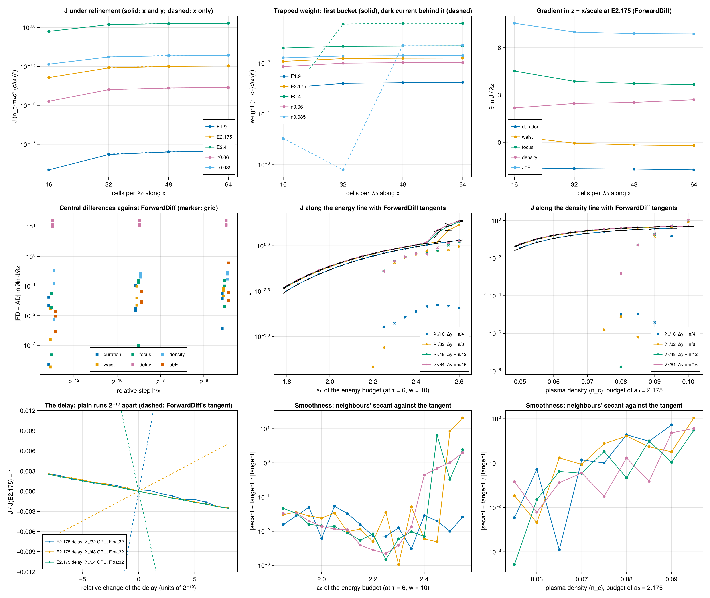

# WP-065: the trapped-beam objective at fixed laser energy under refinement, and its gradient

**Summary.**
- J, the kinetic energy of the trapped electrons of the first bucket (born by ionization or the plasma's own) at a fixed laser energy, converges with Δx and Δy refined together: from λ₀/48 to λ₀/64 it changes by 1.0 % to 2.5 % at the five points of the study, from λ₀/32 to /48 by 3.0 % to 7.7 %, from /16 to /32 by 22 % to 57 %. Refining y as well changes J by at most 1.2 % against x alone.
- ForwardDiff's gradient in the four free parameters (duration, waist, focus, density) and the budget's a₀ settles with J: at a₀ = 2.175 its log-gradient ∂ln J/∂z moves by at most 0.17 from λ₀/48 to /64 (duration −1.69 → −1.74, waist −0.16 → −0.20, focus 3.73 → 3.65, density 2.53 → 2.70, budget 6.89 → 6.87). The waist's part is small and changes sign between λ₀/16 and /32 at two of the five points.
- At λ₀/32 in Float64, central differences at a relative step of 2⁻¹³ agree with ForwardDiff to 0.06 in ∂ln J/∂z in duration, waist, focus and the budget, and to 0.007, 0.12 and 0.33 in the density at a₀ = 1.9, 2.175 and 2.4. In the delay they do not agree at all: ForwardDiff gives 11 to 16, the differences −0.33 to 0.55. Plain runs 2⁻¹⁰ apart in the delay show a smooth J with the same slope (d ln J/d ln delay ≈ −0.32) on all three fine grids, while ForwardDiff's slope there is 9.4, 0.9 and −7.9; the delay stays fixed in the optimization (the owner agreed).
- Along the density at a₀ = 2.175, J is smooth, but ForwardDiff's slope departs from the neighbours' secant by at most 13 % up to 0.07 n_c and by up to 60 % (λ₀/64) above it. At 0.085 n_c and λ₀/32 the GPU's Float32 gradient and the CPU's Float64 one differ by 2.0 in ∂ln J/∂z while their J agree to 6·10⁻⁵: the gradient there is ill-conditioned.
- Along the energy budget, the plasma's own electrons enter the first bucket from a₀ = 2.55 at λ₀/32, 2.50 at /48 and 2.45 at /64 (never at /16), and J jumps: at λ₀/64 from 1.13 at a₀ = 2.40 to 7.2 at 2.50 and 24 at 2.60. Below the onset ForwardDiff's slope matches the secant to 5 %; it does not see the onset coming, and across it its values are noise (−167 to 197).
- The RTX 5090 runs in Float32: against Float64 on the CPU at the same point and grid, J agrees to 8·10⁻⁵ and ∂ln J/∂z to 0.05 except at 0.085 n_c (above). A λ₀/64 run with six partials took 8 min with two runs sharing the card.
- The ionization is ADK without barrier suppression and takes no energy from the field (WP-059, WP-063), so the trapped charge is not a physical prediction. No optimizer has run.

| | |
|---|---|
| Work package | WP-065 (`trace/wp/WP-065-trapped-resolution.md`); goals A0, A1, A3, A4, A7 |
| Commits | the runs' code: `e84d08c` (RTX 5090 runs), `2981023` (CPU box runs, request commits `0730d43`, `c438df8`, `0341e85`), `2981023`, `3799047` and `40aa95d` (λ₀/16 runs); each `dirty = false` in its manifest |
| Runs | `wp065-gpu-conv-v2`, `wp065-gpu-fine-v2`, `wp065-gpu-energy-v2`, `wp065-gpu-density-v2` (branches `runs/wp065-5090-<kind>-v2`); `wp065-conv`, `wp065-fd32`, `wp065-xonly`, `wp065-energy32`, `wp065-density32` (CPU box, branches `runs/wp065-conv`, `runs/wp065-fd32`, `runs/wp065-lines32`); `wp065-local16-converge`, `wp065-local16-energy`, `wp065-local16-density`, `wp065-l16-density`; all from `scripts/optim/trapped2d.jl campaign` |
| Input hashes | SHA-256 of every input file in each run directory's `manifest.toml` under `wp-065-trapped-resolution/` |
| Environment | Julia 1.13.4 (GPU, λ₀/16) and 1.13.3 (box); Reference mode. NVIDIA GeForce RTX 5090, KernelAbstractions CUDA, Float32, two runs at a time with 2 threads each; AMD EPYC 9655 (16 cores), KernelAbstractions CPU, Float64, 4 runs of 4 threads; Intel Xeon Processor @ 2.10GHz (4 vCPUs of a cloud VM), Float64, 4 threads |
| Figures | `wp-065-trapped-resolution/trapped2d.png` with its JSON sidecar `trapped2d.json` (every number of the figure and tables) |
| Status | measured, not independently reviewed; no number here is to leave the repository before that review |

## Setup

The case is WP-064's (`scripts/optim/born2d_case.jl`: a 14 λ₀ moving window with PMLs, a pulse focused into a plasma behind a 40 c/ω₀ ramp, nitrogen ionized in a section inside the wake, read at t = 300) with a₀ tied to duration and waist so that the pulse energy is fixed (`scripts/optim/trapped2d_case.jl`, `a0_for_energy`), the dopant at 1 % of the density, and the objective `trapped_energy`: J = Δx·Δy·Σ w(γ − 1)S(x)R(u_x) over every alive electron, S rising from 0 at window x = 12 to 1 at 24 (the first bucket), R from 0 at u_x = 3 to 1 at 5. The points are the budgets of a₀ = 1.9, 2.175 and 2.4 at the base pulse (τ = 6, w = 10, focus 80, delay 54) and density 0.072 n_c, and densities 0.06 and 0.085 at the middle budget. Grids refine x and y together (λ₀/ppl in x, Δy = π/(4·ppl/16)); the x-only runs keep Δy = π/4. Gradients are ForwardDiff duals in all six directions in one run; z = x/scale with the base values as scales. Central differences are Float64 runs on the CPU at relative steps 2⁻⁵, 2⁻⁹ and 2⁻¹³. The fine scans are 17 plain runs a relative 2⁻¹⁰ apart. The "dark current" columns are the plasma's weight above u_x = 5 ahead of the back band, most of it in the buckets behind the first, which J does not read.

## Results

The tables are the output of `julia +1.13 --project=scripts scripts/optim/trapped2d.jl report reports/wp-065-trapped-resolution reports/wp-065-trapped-resolution/wp065-*` (in `wp-065-trapped-resolution/tables.md`); the convergence and gradient ones:

| point | grid | J (first bucket) | change from the coarser grid | its trapped weight | dark current: plasma weight above u_x = 5 in the window | a₀ | seconds (threads) |
|---|---|---|---|---|---|---|---|
| E1.9 | λ₀/16, Δy = π/4 | 0.01483 |  | 0.001033 | 0.0 | 1.9 | 36 (2) |
| E1.9 | λ₀/32, Δy = π/8 | 0.02335 | 57.46 % | 0.001579 | 0.0 | 1.9 | 85 (2) |
| E1.9 | λ₀/48, Δy = π/12 | 0.02515 | 7.702 % | 0.001691 | 0.0 | 1.9 | 210 (2) |
| E1.9 | λ₀/64, Δy = π/16 | 0.02578 | 2.517 % | 0.00173 | 0.0 | 1.9 | 471 (2) |
| E2.175 | λ₀/16, Δy = π/4 | 0.2278 |  | 0.01167 | 0.0 | 2.175 | 35 (2) |
| E2.175 | λ₀/32, Δy = π/8 | 0.3028 | 32.95 % | 0.01495 | 0.0 | 2.175 | 91 (2) |
| E2.175 | λ₀/48, Δy = π/12 | 0.316 | 4.365 % | 0.01552 | 0.0 | 2.175 | 229 (2) |
| E2.175 | λ₀/64, Δy = π/16 | 0.3205 | 1.405 % | 0.01572 | 0.0 | 2.175 | 491 (2) |
| E2.4 | λ₀/16, Δy = π/4 | 0.8929 |  | 0.03922 | 0.0002437 | 2.4 | 36 (2) |
| E2.4 | λ₀/32, Δy = π/8 | 1.089 | 21.93 % | 0.04614 | 0.3427 | 2.4 | 94 (2) |
| E2.4 | λ₀/48, Δy = π/12 | 1.121 | 3.001 % | 0.04728 | 0.3699 | 2.4 | 228 (2) |
| E2.4 | λ₀/64, Δy = π/16 | 1.132 | 0.9827 % | 0.04766 | 0.3657 | 2.4 | 508 (2) |
| n0.06 | λ₀/16, Δy = π/4 | 0.1129 |  | 0.007255 | 0.0 | 2.175 | 35 (2) |
| n0.06 | λ₀/32, Δy = π/8 | 0.1589 | 40.74 % | 0.009901 | 0.0 | 2.175 | 90 (2) |
| n0.06 | λ₀/48, Δy = π/12 | 0.167 | 5.098 % | 0.01038 | 0.0 | 2.175 | 221 (2) |
| n0.06 | λ₀/64, Δy = π/16 | 0.1697 | 1.631 % | 0.01055 | 0.0 | 2.175 | 492 (2) |
| n0.085 | λ₀/16, Δy = π/4 | 0.3382 |  | 0.01597 | 1.072e-5 | 2.175 | 33 (2) |
| n0.085 | λ₀/32, Δy = π/8 | 0.4183 | 23.66 % | 0.01893 | 6.232e-7 | 2.175 | 75 (2) |
| n0.085 | λ₀/48, Δy = π/12 | 0.4328 | 3.466 % | 0.01947 | 0.05071 | 2.175 | 206 (2) |
| n0.085 | λ₀/64, Δy = π/16 | 0.4378 | 1.161 % | 0.01967 | 0.05052 | 2.175 | 475 (2) |

| point | grid | direction | ForwardDiff's ∂ln J/∂z | |FD − AD| in ∂ln J/∂z at h/x = 2^-5, 2^-9, 2^-13 |
|---|---|---|---|---|
| E1.9 | λ₀/32, Δy = π/8 | duration | -1.38 | 0.003756, 0.01513, 0.0002273 |
| E1.9 | λ₀/32, Δy = π/8 | waist | 0.3401 | 0.07192, 0.02285, 0.0001842 |
| E1.9 | λ₀/32, Δy = π/8 | focus | 6.37 | 0.02016, 0.0009956, 0.0004707 |
| E1.9 | λ₀/32, Δy = π/8 | delay | 12.01 | 12.33, 12.23, 11.95 |
| E1.9 | λ₀/32, Δy = π/8 | density | 4.727 | 0.2567, 0.2012, 0.007332 |
| E1.9 | λ₀/32, Δy = π/8 | a0E | 12.34 | 0.607, 0.06605, 0.002901 |
| E2.175 | λ₀/32, Δy = π/8 | duration | -1.658 | 0.03754, 0.01779, 0.02176 |
| E2.175 | λ₀/32, Δy = π/8 | waist | -0.04843 | 0.04622, 0.03953, 0.001526 |
| E2.175 | λ₀/32, Δy = π/8 | focus | 3.88 | 0.1009, 0.1304, 0.01887 |
| E2.175 | λ₀/32, Δy = π/8 | delay | 10.89 | 11.22, 11.2, 10.34 |
| E2.175 | λ₀/32, Δy = π/8 | density | 2.414 | 0.172, 0.2609, 0.1204 |
| E2.175 | λ₀/32, Δy = π/8 | a0E | 6.989 | 0.06117, 0.03095, 0.01401 |
| E2.4 | λ₀/32, Δy = π/8 | duration | -1.375 | 0.05697, 0.1037, 0.04236 |
| E2.4 | λ₀/32, Δy = π/8 | waist | -0.0357 | 0.08289, 0.09877, 0.01712 |
| E2.4 | λ₀/32, Δy = π/8 | focus | 2.749 | 0.1556, 0.1546, 0.05584 |
| E2.4 | λ₀/32, Δy = π/8 | delay | 16.28 | 16.62, 16.56, 16.5 |
| E2.4 | λ₀/32, Δy = π/8 | density | 1.491 | 0.2973, 0.2505, 0.3348 |
| E2.4 | λ₀/32, Δy = π/8 | a0E | 4.572 | 0.033, 0.02752, 0.009657 |

| energy line, grid | points | J from … to | largest |secant − tangent|/|tangent| | where the dark current first exceeds the trapped weight's 1 % | where the plasma's own electrons first make 1 % of J |
|---|---|---|---|---|---|
| λ₀/16, Δy = π/4 | 17 | 0.003362 … 1.996 | 0.05395 | nowhere | nowhere |
| λ₀/32, Δy = π/8 | 17 | 0.005632 … 14.09 | 20.56 | 2.3 | 2.55 |
| λ₀/48, Δy = π/12 | 17 | 0.006191 … 21.17 | 6.441 | 2.25 | 2.5 |
| λ₀/64, Δy = π/16 | 17 | 0.006395 … 23.72 | 1.994 | 2.25 | 2.45 |

| density line, grid | points | J from … to | largest |secant − tangent|/|tangent| | where the dark current first exceeds the trapped weight's 1 % | where the plasma's own electrons first make 1 % of J |
|---|---|---|---|---|---|
| λ₀/16, Δy = π/4 | 10 | 0.03535 … 0.3965 | 0.7235 | 0.095 | nowhere |
| λ₀/32, Δy = π/8 | 11 | 0.05329 … 0.4834 | 1.041 | 0.09 | not recorded |
| λ₀/48, Δy = π/12 | 11 | 0.05653 … 0.4952 | 0.5515 | 0.085 | nowhere |
| λ₀/64, Δy = π/16 | 11 | 0.0576 … 0.4991 | 0.6046 | 0.08 | nowhere |

## Not shown

The rest of `tables.md`: J and the gradient at every point and grid with the run times, the x-only runs, and the fine scans in the budget (ForwardDiff predicts J's change over ±8·2⁻¹⁰ to 0.6 %, and the runs scatter about a parabola by 1.6·10⁻⁵ to 6·10⁻⁵ of J, Float32's level). The CPU box's Float64 fine scans at λ₀/32 (`runs/wp065-fine`) and the box's λ₀/48 and /64 gradient runs, which ran out of born-electron slots before `trapped_capacity` (`runs/wp065-conv`, ok = false), are not used.

## Open

- Why ForwardDiff's slope in the delay, and at high density in the density, differs from the slope of a J that is smooth on the scale of the steps: the dual is the exact derivative of the discrete run (T-912 at λ₀/8 agrees with differences at 2⁻¹⁸ to 10⁻⁵), so J must carry structure below 2⁻¹³ of the delay whose local slope dominates. A test of that is a scan at steps of 2⁻¹⁶ to 2⁻²⁰ in Float64.
- The plasma's own injection into the first bucket starts at a₀ = 2.45 to 2.55 depending on the grid and makes J jump fivefold within 0.1 in a₀; a gradient-based optimizer starting below it will not find it, and one that crosses it will see noise for a gradient.
- The waist's part of the gradient is close to zero at the base point, so its sign is not settled below λ₀/48.

## Data

Each run directory under `wp-065-trapped-resolution/` holds the jobs' JSON results (J, the summary of `trapped_summary`, the gradient), `jobs.json` and `manifest.toml`; the run branches on GitHub hold the same with the logs.
