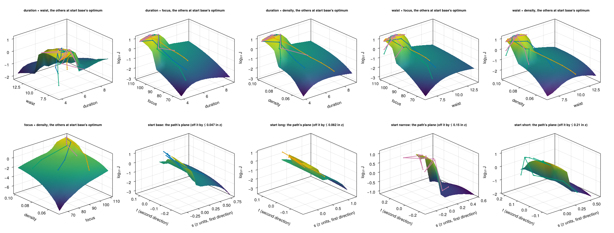

# WP-068: the first optimizations of the trapped-electron objective on the GPU

**Summary.**
- L-BFGS-B from four starts maximized WP-065's J (the kinetic energy of the trapped electrons of the first bucket, any origin) at the a₀ = 1.9 energy budget, at λ₀/32 with the compensated gather in Float32 on an RTX 5090. All four ended in the same corner of the box: focus 110 and density 0.10 n_c on their upper bounds, duration 4.96 to 5.08, waist 6.3 to 7.9, a₀ 2.33 to 2.62. The best, from the base point, is J = 10.93 at (τ, w, focus, n) = (4.98, 7.90, 110, 0.10), a₀ = 2.34, against J = 0.026 at the base point (×420).
- At that optimum 98.4 % of J is the plasma's own electrons injected into the first bucket; the ionization-born electrons give J_born = 0.173 (0.026 at the base point). Every path crossed the plasma's own injection within its first 3 to 6 points, between a₀ ≈ 2.0 (no plasma share) and 2.15 to 2.28 at 0.09 to 0.10 n_c, where J jumped twenty- to thirtyfold from one point to the next and the gradient's components reached 20 to 150 in d ln J/dz. The highest J with no plasma share in the runs is 0.27 (a₀ 2.01 to 2.05, density 0.095 to 0.10, focus 110), with a dark current weight of 0.35 to 0.66 in the buckets behind.
- At the optimum the gradient in duration and waist is near zero (d ln J/dz 0.046 and −0.030, Float64) and in focus and density positive (3.62, 2.24): the box's bounds hold the optimum, not an interior maximum. Float64 central differences at 2⁻¹³ agree with ForwardDiff to 0.003, 0.005 and 0.006 in duration, waist and density and to 0.21 (6 %) in focus. Float32 and Float64 J agree to 1.3·10⁻⁵.
- At λ₀/48 the optimum's J is 11.80 (+8 %) and its gradient in duration and waist is 1.14 and 0.44, so the optimum in those two is not converged at λ₀/32; focus and density keep pushing on their bounds (2.17, 1.10).
- Cost on the RTX 5090, sharing the card with another campaign throughout: a run with duals in the four free directions takes 10.6 s (median of 163; 22 s while the card was more loaded), a plain run 5.4 s with two at a time; 163 points of the optimizers took 40 minutes, the scan of 1,013 plain runs 44 minutes.
- The ionization is ADK without barrier suppression and takes no energy from the field (WP-059, WP-063), so the trapped charge is not a physical prediction.

| | |
|---|---|
| Work package | WP-068 (`trace/wp/WP-068-first-gpu-optimizations.md`); goals A0, A3, A7, A8 |
| Commits | optimizers and check `5d502f1` (`dirty = false` in the manifest); scan `db1309a`; report `eee5099` (the scan and report commits change only the scan, the report and tests, not the case or the runs; the scan figure is saved at 1 px per unit by the report script at the pull request's head, to stay within F3's 1 MB per file) |
| Run | `wp068-opt` on branch `runs/wp068-opt-5090`; `scripts/optim/trapped2d_opt.jl opt`, `check`, `scan` (n = 11, two shards) and `report` |
| Input hashes | SHA-256 of every input in `wp-068-first-gpu-optimizations/wp068-opt/manifest.toml` |
| Environment | Julia 1.13.4; NVIDIA GeForce RTX 5090, KernelAbstractions CUDA, Float32 (Float64 for the check's gradient and differences), Reference mode; AMD Ryzen 9 9950X host |
| Figures | `wp-068-first-gpu-optimizations/trapped2d_opt.png` (paths) and `trapped2d_opt_scan.png` (log₁₀ J over the scan's grids with the paths), each with its JSON sidecar |
| Status | measured, not independently reviewed; no number here is to leave the repository before that review |

## Setup

The case is WP-065's (`scripts/optim/trapped2d_case.jl`) with `gather = CompensatedGather()`, at λ₀/32 and Δy = π/8, the delay fixed at 54, the budget of a₀ = 1.9 at τ = 6, w = 10. `TRAPPED_BOX` is duration 4 to 9, waist 6 to 14, focus 64 to 110, density 0.05 to 0.10 n_c, z = x/(6, 10, 80, 0.072). Starts: base (6, 10, 80, 0.072), long (8, 12, 100, 0.06), short (5, 8, 70, 0.09), narrow (7, 7, 104, 0.08). L-BFGS-B (OptimizationLBFGSB) with `maxiters = 25` and `pgtol` = 2⁻⁶ of the base point's largest gradient component in z (0.00255). Each point is one run with duals in the four free directions, which gives J and the gradient L-BFGS-B asks for separately; its record (J, gradient, a₀, `trapped_summary` with the dark current) is a JSON file named by the point's bits, so a stopped optimization continues from its records. The check runs the best optimum at λ₀/48 (plain and with duals, Float32) and at λ₀/32 in Float64 with duals and with central differences at 2⁻¹³. The scan runs J plain on 11 × 11 grids: in the plane of each path and over the box for each pair of parameters through the best optimum.

## Results

From `wp-068-first-gpu-optimizations/tables.md` (printed by `trapped2d_opt.jl report`):

| start | from (τ, w, focus, n) | a₀ | J there | to (τ, w, focus, n) | a₀ | J there | J ratio | on the box's bounds | stop | iterations | points run | largest dark current weight on the path | largest J_plasma/J on the path |
|---|---|---|---|---|---|---|---|---|---|---|---|---|---|
| base | 6.0, 10.0, 80.0, 0.072 | 1.9 | 0.02601 | 4.98, 7.897, 110.0, 0.1 | 2.343 | 10.93 | 420.1 | focus=hi, density=hi | Success | 10 | 28 | 0.4029 | 0.991 |
| long | 8.0, 12.0, 100.0, 0.06 | 1.503 | 0.007473 | 4.957, 6.331, 110.0, 0.1 | 2.617 | 8.094 | 1083.0 | focus=hi, density=hi | Success | 9 | 36 | 0.567 | 0.991 |
| short | 5.0, 8.0, 70.0, 0.09 | 2.324 | 0.01231 | 5.083, 7.398, 109.8, 0.1 | 2.395 | 10.46 | 850.0 | density=hi | MaxIters | 25 | 64 | 0.8062 | 0.9874 |
| narrow | 7.0, 7.0, 104.0, 0.08 | 2.097 | 0.1188 | 5.066, 7.868, 110.0, 0.1 | 2.328 | 10.91 | 91.82 | focus=hi, density=hi | Success | 12 | 34 | 0.6622 | 0.991 |

| run at the optimum of `base` | J | d ln J/dz (τ, w, focus, n) | dark weight | J_plasma/J | seconds |
|---|---|---|---|---|---|
| optimization: λ₀/32, Float32, duals | 10.927 | 0.024, -0.0194, 3.71, 2.27 | 0.2679 | 0.9842 | 22.5 |
| λ₀/32, Float64, duals | 10.9269 | 0.0461, -0.0304, 3.62, 2.24 | 0.2679 | 0.9842 | 40.8 |
| λ₀/48, Float32, plain | 11.7973 | – | 0.1936 | 0.9865 | 30.5 |
| λ₀/48, Float32, duals | 11.7976 | 1.14, 0.441, 2.17, 1.1 | 0.1936 | 0.9865 | 42.3 |

| direction | ForwardDiff d ln J/dz, Float64 | central difference at 2^-13, Float64 | difference |
|---|---|---|---|
| duration | 0.04609 | 0.0429 | 0.0032 |
| waist | -0.03043 | -0.02595 | 0.0045 |
| focus | 3.623 | 3.837 | 0.21 |
| density | 2.24 | 2.234 | 0.0058 |

## Not shown

The rest of `tables.md`: every point each solver reported, with J, the plasma's share, the dark current and the gradient. After converging, L-BFGS-B's line search asked again and again for points within roundoff of the optimum (the last 15 to 20 rows of three starts); those came from the records and cost no run. The `short` start stopped at 25 iterations, still creeping up along the focus and density bounds.

## Open

- The objective counts the plasma's own electrons, by the owner's choice (any origin, the first bucket), and at this budget the optimizer finds them: it drives the density and the focus to their bounds and lives on the plasma's own injection, where the gradient across the onset is noise. An optimum of the born electrons alone, or J with the plasma's injection kept out, needs a different objective or a constraint on the plasma's share.
- With focus and density on their bounds, the optimum moves with the box; the box was set by the draft, not by physics.
- The λ₀/48 gradient in duration and waist: whether the λ₀/32 optimum in those two moves at a finer grid needs an optimization at λ₀/48 (about 4 times the cost per point).

## Data

`wp-068-first-gpu-optimizations/wp068-opt/` holds the run's `manifest.toml` and `published.toml`, which names the run branch `runs/wp068-opt-5090` with every point's record, each start's `result.json`, the check's and the scan's runs and the SHA-256 of each; `scripts/rundata/run-data.sh fetch reports/wp-068-first-gpu-optimizations/wp068-opt/published.toml` brings them back into `scripts/runs/wp068-opt/`, and `julia +1.13 --project=scripts scripts/optim/trapped2d_opt.jl report reports/wp-068-first-gpu-optimizations scripts/runs/wp068-opt` rebuilds the figures and tables.
