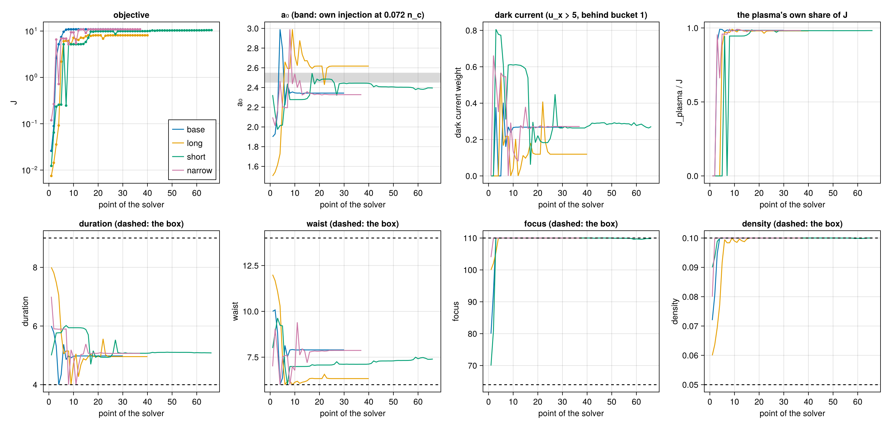
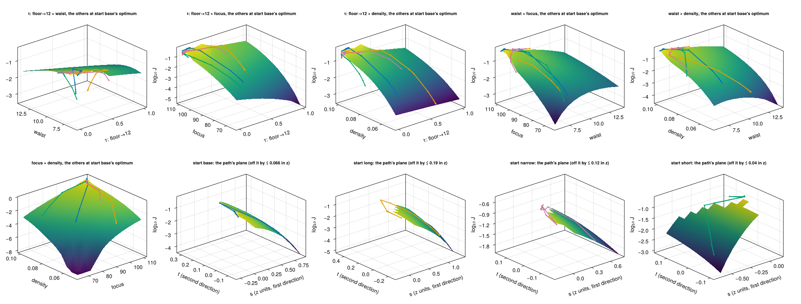

# WP-068: the first optimizations of the trapped-electron objective on the GPU

**Summary.**
- L-BFGS-B maximized WP-065's J (the kinetic energy of the trapped electrons of the first bucket, any origin) at the a₀ = 1.9 energy budget, at λ₀/32 with the compensated gather in Float32 on an RTX 5090, from four starts, in two runs: in WP-068's box, and under a peak power cap that at the fixed energy is a floor on the duration (CETAL-PW's 1 PW at 25 J carried to the case by τ/λ_p: τ ≥ 2.45/√n, up to τ = 12).
- In the box, all four starts ended at focus 110 and density 0.10 n_c, their upper bounds. The best is J = 10.93 at (τ, w, focus, n) = (4.98, 7.90, 110, 0.10), a₀ = 2.34, against 0.026 at the base point. 98.4 % of it is the plasma's own electrons injected into the first bucket.
- Under the cap, all four again ended at focus 110 and 0.10 n_c, with τ at or just above the floor of 7.76 there. The best is J = 0.444 at (8.24, 6.47, 110, 0.10), a₀ = 2.01, and the others reached 0.23 to 0.31. 60 % of the best is still the plasma's own injection: at focus 110 and 0.10 n_c it sets in above a₀ ≈ 2.05 with the box's short pulses and already near 1.83 with the floor's longer ones. Without any plasma share, the highest J the capped run met is 0.20, at a₀ = 1.85.
- The born electrons' part is about the same at both optima (J_born 0.173 and 0.178) and converged in resolution: at λ₀/48 the capped optimum's J_born is 0.1785 against 0.1778, while its J_plasma falls from 0.266 to 0.147. J at λ₀/48 is +8 % at the box's optimum and −27 % at the capped one.
- The gradient holds in the box: Float64 ForwardDiff agrees with central differences to 0.003 to 0.006 in d ln J/dz in duration, waist and density, and in focus to 5·10⁻⁴ at a step of 2⁻¹⁶ (0.21 at 2⁻¹³, where J's roughness dominates). Under the cap the optimum sits on the injection's onset, where the gradient is noise: Float32 and Float64 duals give −0.77 and 20.1 in waist, and central differences −19.0.
- Cost on the RTX 5090: a run with duals in four directions 10.6 s in the box (card shared) and 13.3 s under the cap (alone, with the window 3 λ₀ longer). A plain run is 4 to 5.4 s with two at a time. Each run's optimizations took 28 to 40 minutes, its scan of about 1,000 plain runs 35 to 44 minutes.
- The ionization is ADK without barrier suppression and takes no energy from the field (WP-059, WP-063), so the trapped charge is not a physical prediction.

| | |
|---|---|
| Work package | WP-068 (`trace/wp/WP-068-first-gpu-optimizations.md`); goals A0, A3, A7, A8 |
| Commits | box run: optimizers and check `5d502f1`, scan `db1309a`, report `eee5099` (`dirty = false`); capped run: `a56b788` (`dirty = false`). The later commits before each change only the scan, the report and tests. The figures here are rebuilt by the report script at the pull request's head, the scan figures at 1 px per unit to stay within F3's 1 MB per file |
| Runs | `wp068-opt` on branch `runs/wp068-opt-5090`, `wp068-power` on `runs/wp068-power-5090`; `scripts/optim/trapped2d_opt.jl opt` (`cap=cetal25` for the second), `check`, `scan` (n = 11, two shards) and `report` |
| Input hashes | SHA-256 of every input in each run's `manifest.toml` under `wp-068-first-gpu-optimizations/` |
| Environment | Julia 1.13.4; NVIDIA GeForce RTX 5090, KernelAbstractions CUDA, Float32 (Float64 for the check's gradient and differences), Reference mode; AMD Ryzen 9 9950X host |
| Figures | `wp-068-first-gpu-optimizations/trapped2d_opt.png`, `trapped2d_opt_scan.png` (box) and `power/` (cap), each with its JSON sidecar |
| Status | measured; the box run's four headline numbers were rerun by a physics breaker on the CPU in Float64, Fast deposition and a longer window, and agree; not independently reviewed, so no number here is to leave the repository before that review |

## Setup

The case is WP-065's (`scripts/optim/trapped2d_case.jl`) with `gather = CompensatedGather()`, at λ₀/32 and Δy = π/8, the delay fixed at 54, the budget of a₀ = 1.9 at τ = 6, w = 10. `TRAPPED_BOX` is duration 4 to 9, waist 6 to 14, focus 64 to 110, density 0.05 to 0.10 n_c, z = x/(6, 10, 80, 0.072). Starts: base (6, 10, 80, 0.072), long (8, 12, 100, 0.06), short (5, 8, 70, 0.09), narrow (7, 7, 104, 0.08). L-BFGS-B (OptimizationLBFGSB), `maxiters = 25`, `pgtol` 2⁻⁶ of the base point's largest gradient component in z. Each point is one run with duals in the four free directions, recorded as JSON by the point's bits, so a stopped optimization continues from its records. The check runs the best optimum at λ₀/48 (plain and with duals, Float32) and at λ₀/32 in Float64 with duals and central differences at 2⁻¹³; the scan runs J plain on 11 × 11 grids in the plane of each path and over the box for each pair of parameters through the best optimum.

Under the cap (`cap=cetal25`, `cetal_cap`): at a fixed energy the peak power is W/τ_FWHM whatever the waist, so the cap is τ_FWHM ≥ (25 fs/T_p)·λ_p with T_p = 2π/ω_p at 4.2·10¹⁸ cm⁻³, the middle of CETAL's jet: τ ≥ 2.455/√n, 7.76 at 0.10 n_c and 10.98 at 0.05 n_c. The duration lies between that floor and 12, and the solver's first coordinate is its place between the two, from 0 to 1 (`Coords`); the starts keep their waist, focus and density, with the duration at the same place between floor and 12 as it had between 4 and 9. A pulse of τ = 12 is still being emitted when the case's window passes its antenna, so every capped run has the window 3 λ₀ longer behind (`window_extend`) with the objective's position weight moved back by 6π; that leaves J unchanged to 10⁻¹² at λ₀/16 (T-976).

## Results

From `wp-068-first-gpu-optimizations/tables.md` and `power/tables.md` (printed by `trapped2d_opt.jl report`), in the box:

| start | from (τ, w, focus, n) | a₀ | J there | to (τ, w, focus, n) | a₀ | J there | J ratio | on the box's bounds | stop | iterations | points run | largest dark current weight on the path | largest J_plasma/J on the path |
|---|---|---|---|---|---|---|---|---|---|---|---|---|---|
| base | 6.0, 10.0, 80.0, 0.072 | 1.9 | 0.02601 | 4.98, 7.897, 110.0, 0.1 | 2.343 | 10.93 | 420.1 | focus=hi, density=hi | Success | 10 | 28 | 0.4029 | 0.991 |
| long | 8.0, 12.0, 100.0, 0.06 | 1.503 | 0.007473 | 4.957, 6.331, 110.0, 0.1 | 2.617 | 8.094 | 1083.0 | focus=hi, density=hi | Success | 9 | 36 | 0.567 | 0.991 |
| short | 5.0, 8.0, 70.0, 0.09 | 2.324 | 0.01231 | 5.083, 7.398, 109.8, 0.1 | 2.395 | 10.46 | 850.0 | density=hi | MaxIters | 25 | 64 | 0.8062 | 0.9874 |
| narrow | 7.0, 7.0, 104.0, 0.08 | 2.097 | 0.1188 | 5.066, 7.868, 110.0, 0.1 | 2.328 | 10.91 | 91.82 | focus=hi, density=hi | Success | 12 | 34 | 0.6622 | 0.991 |

Under the cap:

| start | from (τ, w, focus, n) | a₀ | J there | to (τ, w, focus, n) | a₀ | J there | J ratio | on the box's bounds | stop | iterations | points run | largest dark current weight on the path | largest J_plasma/J on the path |
|---|---|---|---|---|---|---|---|---|---|---|---|---|---|
| base | 10.29, 10.0, 80.0, 0.072 | 1.451 | 0.001794 | 8.235, 6.472, 110.0, 0.1 | 2.009 | 0.4439 | 247.5 | focus=hi, density=hi | Success | 8 | 31 | 0.2487 | 0.6084 |
| long | 11.6, 12.0, 100.0, 0.06 | 1.248 | 0.0003632 | 7.762, 7.093, 110.0, 0.1 | 1.979 | 0.2967 | 817.0 | τ: floor→12=lo, focus=hi, density=hi | Success | 6 | 31 | 0.2834 | 0.2574 |
| short | 8.946, 8.0, 70.0, 0.09 | 1.737 | 0.003457 | 7.762, 8.288, 110.0, 0.1 | 1.833 | 0.2338 | 67.64 | τ: floor→12=lo, focus=hi, density=hi | Success | 7 | 30 | 0.6921 | 0.1166 |
| narrow | 10.67, 7.0, 104.0, 0.08 | 1.698 | 0.02262 | 8.016, 7.462, 110.0, 0.1 | 1.899 | 0.3075 | 13.6 | focus=hi, density=hi | Success | 10 | 33 | 0.6612 | 0.3517 |

The checks at each run's best optimum:

| run at the optimum of `base` | J | d ln J/dz (τ, w, focus, n) | dark weight | J_plasma/J | seconds |
|---|---|---|---|---|---|
| box: λ₀/32, Float32, duals | 10.927 | 0.024, -0.0194, 3.71, 2.27 | 0.2679 | 0.9842 | 22.5 |
| box: λ₀/32, Float64, duals | 10.9269 | 0.0461, -0.0304, 3.62, 2.24 | 0.2679 | 0.9842 | 40.8 |
| box: λ₀/48, Float32, duals | 11.7976 | 1.14, 0.441, 2.17, 1.1 | 0.1936 | 0.9865 | 42.3 |
| cap: λ₀/32, Float32, duals | 0.443914 | 3.29, -0.773, 9.85, 18.9 | 0.2043 | 0.5995 | 13.3 |
| cap: λ₀/32, Float64, duals | 0.44386 | 4.51, 20.1, 8.81, 26.4 | 0.1966 | 0.5994 | 50.5 |
| cap: λ₀/48, Float32, duals | 0.325655 | -11.2, 2.48, -5.65, 0.872 | 0.2673 | 0.4519 | 50.3 |

## Not shown

The rest of each `tables.md`: every point each solver reported, the plain λ₀/48 runs (equal to the dual runs' J), and the central differences at 2⁻¹³ against Float64 ForwardDiff (box: 0.003, 0.005, 0.21, 0.006 in d ln J/dz; cap: 0.36, 39.0, 5.0, 9.8). Along the capped paths, d ln J/dz jumps between −141 and +145 in waist among points 10⁻³ apart once the plasma's share is above zero; the solver stopped on its relative change in J with a projected gradient of 1.03 against `pgtol` 2.4·10⁻⁴, and its base start passed J = 0.458 at point 9 before ending at 0.444. After converging, L-BFGS-B's line search asked again for points within roundoff of the optimum; those came from the records and cost no run. The box run's scan (`trapped2d_opt_scan.png`) and the physics breaker's runs: CPU and GPU J agree to 2·10⁻¹³ in Float64, Fast and Reference deposition to 5·10⁻¹³, the plain gather gives 7.5 % less J than the compensated one, and the counted bunch sits at window x ≈ 31 to 34, inside the depleted pulse's remnant (on-axis |E_y| peak at 29.6).

## Open

- Neither run finds an optimum of the born electrons: both end on the plasma's own injection at the box's focus and density bounds. Under the cap that optimum sits on the injection's onset, where J is not converged in resolution (−27 % at λ₀/48, all of it in J_plasma) and the gradient is noise. An optimum away from the onset needs the plasma's share kept out of J or a constraint on it; that is the owner's choice.
- Focus and density are on their bounds in both runs, so the optima move with the box; the box was set by the draft, not by physics.
- At the box's optimum the λ₀/48 gradient in duration and waist (1.14, 0.44) says that optimum is not converged in those two at λ₀/32.

## Data

`wp-068-first-gpu-optimizations/wp068-opt/` and `wp068-power/` hold each run's `manifest.toml` and `published.toml`, which names its run branch with every point's record, each start's `result.json`, the check's and the scan's runs and the SHA-256 of each. `scripts/rundata/run-data.sh fetch reports/wp-068-first-gpu-optimizations/<run>/published.toml` brings a run back into `scripts/runs/<run>/`, and `julia +1.13 --project=scripts scripts/optim/trapped2d_opt.jl report <out dir> scripts/runs/<run>` rebuilds its figures and tables (`reports/wp-068-first-gpu-optimizations` for `wp068-opt`, its `power` subdirectory for `wp068-power`).
