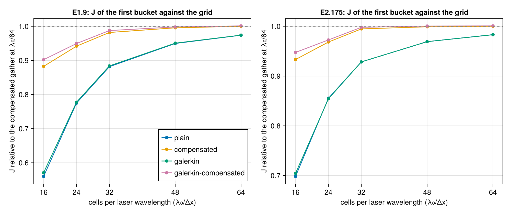

# WP-070: the Galerkin gather, the transpose of the charge-conserving current

**Summary.**
- With `GalerkinGather()` the particles read each field component one shape order lower along every axis on which it sits at a cell centre. E's weights are then Esirkepov's current per unit move (T-991, to roundoff of the current's scale) and the gathered B follows Faraday's law with the gathered E (T-992, to roundoff).
- The 1D cases of T-214 to T-217 (quadratic shape) keep their total energy 9.5 times (Landau), 89 times (two-stream) and 24 times (Weibel) better than today's gather: largest relative changes 2.2·10⁻⁷, 6.4·10⁻⁶ and 1.2·10⁻⁵ against 2.1·10⁻⁶, 5.7·10⁻⁴ and 2.8·10⁻⁴ (T-994). The growth rates move by 10⁻⁴ or less, and the total momentum is unchanged (to roundoff in the cold cases, within 1 % of today's change in Landau).
- What is left is the time integrator's error: in the Weibel case it falls by 4.03 and 3.97 per halving of Δt, and in two-stream by 4.05 and 3.99, while today's error does not fall (ratios 1.03 and 1.01; T-995). With the linear shape, the lower order is the nearest grid point, and the error falls only by about 2.2 per halving (a breaker's measurement, not a test).
- On the trapped-beam objective J of WP-065 (table), the Galerkin gather alone changes J by at most 2 % against the plain gather. The loss to the laser's dispersion stays: the laser's Ey sits on x nodes, so it is still read at full order along x.
- The two gathers compose. Galerkin with the compensated gather is the closest of the four at every grid: 9.8 %, 5.0 % and 1.2 % below the reference at λ₀/16, /24 and /32 at a₀ = 1.9, against 11.7 %, 5.8 % and 1.8 % for the compensated gather alone. Both reach the same J on the finest grid, within 0.12 %.
- The four gathers take the same time per run: within 4 % of each other at λ₀/48 and /64.

| | |
|---|---|
| Work package | WP-070 (`trace/wp/WP-070-galerkin-gather.md`); goals A2, A7, A8 |
| Commits | the runs' code: `ea20d50f`, submitted as request commit `d947fe9a` on `runs/wp070-gathers` (`dirty = false` in the manifest); the 1D numbers are the T-994 and T-995 runs of this PR's tests |
| Runs | `wp070-gathers` (CPU box, `scripts/optim/trapped2d.jl campaign` of kind `gathers`: 2 points × 5 grids × 4 gathers), data on branch `runs/wp070-galerkin-gather` |
| Input hashes | SHA-256 of every input file in `wp-070-galerkin-gather/wp070-gathers/manifest.toml` |
| Environment | Julia 1.13.3; Reference mode; AMD EPYC 9655 (16 cores), KernelAbstractions CPU, Float64, 4 runs of 4 threads |
| Figures | `wp-070-galerkin-gather/gathers.png` with its JSON sidecar `gathers.json` (every number of the figure and the table) |
| Status | measured, not independently reviewed; no number here is to leave the repository before that review |

## Setup

The trapped-beam case of WP-065 (`scripts/optim/trapped2d_case.jl`: WP-064's case at a fixed laser energy, J the kinetic energy of the trapped electrons of the first bucket), at the budgets of a₀ = 1.9 and 2.175 with the base pulse and density. Five grids refine x and y together (λ₀/ppl in x, Δy = π/(4·ny)), each run with the four `gather` settings of `EMNumerics`: `nothing` (plain), `CompensatedGather()`, `GalerkinGather()` and `GalerkinGather(compensate = CompensatedGather())`. The reference at each point is the compensated gather's J at λ₀/64.

## Results

The output of `julia +1.13 --project=scripts scripts/optim/trapped2d.jl report-gathers reports/wp-070-galerkin-gather scripts/runs/wp070-galerkin-gather/wp070-gathers` (also `wp-070-galerkin-gather/gathers.md`):

| point | grid | J, plain | J, compensated | J, galerkin | J, galerkin-compensated | from the reference, plain | from the reference, compensated | from the reference, galerkin | from the reference, galerkin-compensated |
|---|---|---|---|---|---|---|---|---|---|
| E1.9 | λ₀/16, Δy = π/4 | 0.01483 | 0.02338 | 0.01512 | 0.0239 | -44.0 % | -11.7 % | -42.9 % | -9.8 % |
| E1.9 | λ₀/24, Δy = π/8 | 0.02052 | 0.02495 | 0.0206 | 0.02515 | -22.5 % | -5.8 % | -22.2 % | -5.0 % |
| E1.9 | λ₀/32, Δy = π/8 | 0.02335 | 0.02601 | 0.02341 | 0.02616 | -11.8 % | -1.8 % | -11.6 % | -1.2 % |
| E1.9 | λ₀/48, Δy = π/12 | 0.02516 | 0.02637 | 0.02518 | 0.02644 | -5.0 % | -0.4 % | -4.9 % | -0.2 % |
| E1.9 | λ₀/64, Δy = π/16 | 0.0258 | 0.02649 | 0.0258 | 0.02652 | -2.6 % | 0.0 % | -2.6 % | 0.1 % |
| E2.175 | λ₀/16, Δy = π/4 | 0.2278 | 0.3044 | 0.2298 | 0.309 | -30.2 % | -6.7 % | -29.6 % | -5.3 % |
| E2.175 | λ₀/24, Δy = π/8 | 0.279 | 0.3158 | 0.2786 | 0.3172 | -14.5 % | -3.2 % | -14.6 % | -2.7 % |
| E2.175 | λ₀/32, Δy = π/8 | 0.3028 | 0.3245 | 0.3028 | 0.3255 | -7.2 % | -0.5 % | -7.2 % | -0.2 % |
| E2.175 | λ₀/48, Δy = π/12 | 0.3161 | 0.3258 | 0.3161 | 0.3263 | -3.1 % | -0.1 % | -3.1 % | 0.0 % |
| E2.175 | λ₀/64, Δy = π/16 | 0.3207 | 0.3262 | 0.3206 | 0.3264 | -1.7 % | 0.0 % | -1.7 % | 0.1 % |

## Not shown

- Gradients: the campaign runs plain values only. T-998 checks ForwardDiff against central differences with the Galerkin gather, in the small ionization run.
- 3D: only the plain Galerkin gather is allowed there. A compensated gather is refused in 3D, inside Galerkin too.
- The GPU: T-999 reruns the identities on CUDA. No trapped-beam run was made on the GPU.
- Points beyond these two: the WP-065 points at a₀ = 2.4 and at the other densities were not run.

## Data

The run's JSON, logs, manifest and `published.toml` are on branch `runs/wp070-galerkin-gather`. `scripts/rundata/run-data.sh fetch reports/wp-070-galerkin-gather/wp070-gathers/published.toml` brings them back into `scripts/runs/wp070-galerkin-gather/wp070-gathers` and checks their hashes.
