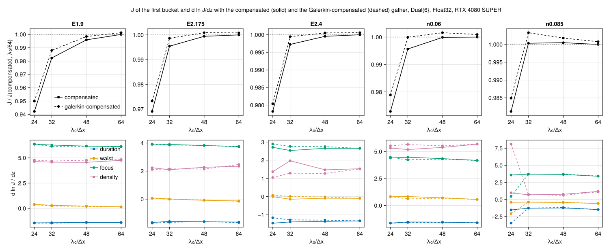

# WP-078: Enzyme's reverse mode on the trapped-beam case at production size

**Summary.**
- Enzyme's reverse pass runs through the whole λ₀/32 trapped-beam case of WP-065 on an RTX 5090: 1799 steps with antenna, moving window, PMLs, field ionization, the compensated gather, Reference mode and Float32. With at most 20 steps per reversed segment, its gradient of J in the four free parameters agrees with Dual{4} to 1.6·10⁻⁴ relative or better (table). dJ/dn = 1.652 splits into −0.113 through the initial load and +1.765 through the parameters during the run.
- With more than 20 steps per segment the gradient drifts: 4.9·10⁻⁴ at C = 30 and 10 % at C = 40 (#548). The drift does not depend on the heap or on where the checkpoints are kept. Repeated reverse runs agree to about 10⁻⁶ relative, not bitwise; Dual{4} is bitwise reproducible.
- Cost of one gradient, compiled. In one gradient's process: primal with checkpoints plus reverse is 26.6 s (device checkpoints) to 30.8 s (host) at C = 10 or 20, against 16.5 s for Dual{4}, which includes about 2 s of its compilation. In the optimization's process: 40.0 s per gradient (window 3 λ₀ longer), against 13.3 s for WP-068's Dual{4} under the same cap. A reverse step costs about 10 times a primal step: 9.3 against 0.92 ms over 16 steps. Compilation takes about 7 minutes per process.
- On the WP-023 periodic plasma at 448×256 (B1), the reverse pass costs 7.1 times the primal and 0.34 times Dual{4} (`cost.md`). That Dual{4} is 12 times its Dual{1}. On the trapped case the reverse gradient costs 1.6 to 3 times Dual{4}.
- L-BFGS-B with the reverse gradient reaches WP-068's born-only optimum from all four starts: J_born = 0.22160 at τ = 7.762 (the floor of the power cap), w = 7.346 to 7.349, focus 110, n = 0.10. WP-068 reached 0.2216 at w = 7.346 to 7.348 with duals. Near the optimum the reverse gradient is rough: d ln J/dz changes by up to 0.44 for Δw = 1.6·10⁻⁵ (`opt/tables.md`), while J is flat there.
- At WP-065's five points, the Galerkin-compensated gather raises J over the compensated gather by 0.2 to 0.8 % at λ₀/24 and by 0.06 to 0.13 % at λ₀/64. At λ₀/32 it is closer to the finest grid's J at four of the points: 0.01 to 1.2 % below it, against 0.27 to 1.8 %. A Galerkin-compensated run takes 10 to 18 % less time.
- The two gathers' d ln J/dz differ by up to 0.68 at λ₀/32 and 0.21 at λ₀/48 and /64. With either gather, the density component still moves by up to 0.5 between λ₀/48 and /64 (figure). One λ₀/24 run (n0.085, Galerkin-compensated) is an outlier, with d ln J/dn = 8.1 against 0.97.
- The reverse pass needs workarounds in the scripts, none in `lib/`. Three are upstream bugs filed as #545, #546 and #547. Two are still to be filed. A group of five was found unnecessary and stays as run. Not measured: Dual{1}, and the memory each method needs on the trapped case (Open issues).

| | |
|---|---|
| Work package | WP-078 (`trace/wp/WP-078-reverse-mode-at-production-size.md`); goals A0, A3, A7, A8 |
| Commits | B1 and the gather campaign `d5351531` (`dirty = false`). The reverse gradients `32a2a6fc` (C = 20, host), `493fef38` (device checkpoints) and `8ffbb0a8` (the rest). The optimization `32a2a6fc` with `trapped.jl` of `7be04bf8`. Those manifests say `dirty = true` because the run's scripts were committed after the run; every input hash in them matches a file of the named commit. The milestone-1 runs are `770ffff0` to `1efde42f`. The `trapped.jl` hash of `enzyme-trapped-steps-20261120T164202` matches no commit; only its timings are used here |
| Runs | `wp078-b1-cost-5090` (`scripts/enzyme/cost.jl`, Reference and Fast), `wp078-b2-trapped-5090` (`scripts/enzyme/trapped.jl steps` and `grad`, logs), `wp078-opt-born-reverse-5090` (`scripts/optim/trapped2d_opt.jl opt gradient=enzyme-reverse objective=born cap=cetal25`) and `wp078-gathergrad-4080` (`scripts/optim/trapped2d.jl campaign gathergrad 24x2,32x2,48x3,64x4 float=32 backend=cuda`), each on branch `runs/<run>` |
| Input hashes | SHA-256 of every input in each run's `manifest.toml` under `wp-078-reverse-mode-at-production-size/<run>/` |
| Environment | Julia 1.13.4 (1.13.3 for the gather campaign); Enzyme 0.13.221, KernelAbstractions 0.10.8 (the root manifest of `d5351531`; this PR's head has `main`'s 0.10.6, so a rerun takes that manifest); NVIDIA GeForce RTX 5090 with an AMD Ryzen 9 9950X host; the gather campaign on an NVIDIA GeForce RTX 4080 SUPER; KernelAbstractions CUDA, Float32, Reference mode |
| Figures | `wp-078-reverse-mode-at-production-size/gathergrad.png` with its sidecar `gathergrad.json`; the gradient table's numbers in `gradient.json` |
| Status | measured, not independently reviewed, so no number here is to leave the repository before that review. No breaker reran the GPU runs, because this PR's session has no GPU |

## Setup

The case is WP-065's trapped-beam case (`scripts/optim/trapped2d_case.jl`) at the base point (τ, w, focus, n) = (6, 10, 80, 0.072), a₀ = 1.9 budget, λ₀/32 and Δy = π/8, with `CompensatedGather()`.

`trapped.jl grad` runs the primal once and stores the state every C steps, on the host or on the device. It then reverses the segments from the last. Each segment is one `Enzyme.autodiff` through C calls of `step!`, from its checkpoint, with the state `Duplicated` and the parameters `Active`. The adjoint of the initial state is contracted with the tangent of `initialize!` (a Dual start), and the parameters' adjoint with dp/dθ. Both contractions are in Float64.

The reference is one Dual{4} run of the same case, in the same process; its 16.5 s includes about 2 s of compilation. The reverse time excludes the two segments that compile (`reverse_seconds` in `scripts/enzyme/wp078_report.jl`). The start tangent (the Dual{4} `initialize!`) is shown apart: in a fresh process it is mostly compilation, and in the optimization's process it takes 0.007 s. The memory is nvidia-smi's peak for the whole card over the whole process, the Dual{4} run included. It counts CUDA.jl's pool of freed blocks, so 31.4 GiB means the card was full; it bounds nothing from below.

## Results

The first table of `julia +1.13 --project=scripts scripts/enzyme/wp078_report.jl reports/wp-078-reverse-mode-at-production-size scripts/runs/wp078-b2-trapped-5090 scripts/runs/wp078-gathergrad-4080 scripts/runs/wp078-opt-born-reverse-5090`. All of its output is in `wp-078-reverse-mode-at-production-size/gradient.md`, which also holds the per-step times without checkpoints and the optimization's cost per gradient:

| gradient | checkpoints | every C steps | device heap (GiB) | dJ/dτ | dJ/dw | dJ/dfocus | dJ/dn | largest relative difference from Dual{4} | primal with checkpoints (s) | reverse, no compilation (s) | reverse per step (ms) | primal + reverse (s) | start tangent, first call (s) | card memory in use, peak (GiB) |
|---|---|---|---|---|---|---|---|---|---|---|---|---|---|---|
| Dual{4} | | | | -0.00616894 | 0.000767155 | 0.00203787 | 1.65191 | | | | | 16.5 | | |
| reverse | device | 20 | 1 | -0.00616924 | 0.000767048 | 0.00203783 | 1.65187 | 1.4e-04 | 6.5 | 20.1 | 11.2 | 26.6 | 5.1 | 31.4 |
| reverse | device | 40 | 1 | -0.00607272 | 0.000846864 | 0.00203008 | 1.64241 | 1.0e-01 | 6.5 | 22.5 | 12.5 | 29.0 | 5.1 | 31.4 |
| reverse | host | 5 | 1 | -0.00616924 | 0.000767041 | 0.00203783 | 1.65187 | 1.5e-04 | 22.8 | 17.0 | 9.4 | 39.7 | 9.9 | 11.7 |
| reverse | host | 10 | 1 | -0.00616924 | 0.000767036 | 0.00203783 | 1.65187 | 1.6e-04 | 14.2 | 16.6 | 9.2 | 30.8 | 5.1 | 16.6 |
| reverse | host | 20 | 4 | -0.00616923 | 0.000767046 | 0.00203783 | 1.65187 | 1.4e-04 | 10.6 | 19.5 | 10.9 | 30.1 | 5.0 | 24.5 |
| reverse | host | 30 | 1 | -0.00617198 | 0.000766831 | 0.00203768 | 1.65219 | 4.9e-04 | 9.5 | 18.8 | 10.5 | 28.3 | 5.2 | 22.4 |
| reverse | host | 40 | 1 | -0.00607272 | 0.000846864 | 0.00203008 | 1.64241 | 1.0e-01 | 8.7 | 19.2 | 10.7 | 27.9 | 5.1 | 28.5 |
| reverse | host | 40 | 4 | -0.00607272 | 0.000846866 | 0.00203008 | 1.64241 | 1.0e-01 | 8.6 | 23.3 | 13.0 | 32.0 | 5.3 | 31.4 |

The gather campaign's numbers are in `gathergrad.md` and `gathergrad.json`. The optimization's paths are in `opt/tables.md` and `opt/trapped2d_opt.png`, made by `scripts/optim/trapped2d_opt.jl report` (`opt/trapped2d_opt.json`). The B1 cost table is in `cost.md`, from `scripts/enzyme/table.jl` on the two Reference-mode runs.

## Not shown

- Dual{1}, a plain primal run and the memory each method needs, all on the trapped-beam case. B1 measured Dual{1} on the periodic plasma; its whole-card memory peaks (10.8 to 23.7 GiB) are in `runs/wp078-b1-cost-5090` (`b1/status`).
- A reverse gradient at λ₀/48, in Float64, in Fast mode or at another point. Every reverse run is at the base point, λ₀/32, Float32, Reference.
- Why the optimization's reverse pass takes 33.0 s per gradient against 19.5 s in the gradient table at the same C and host checkpoints. Its window is 3 λ₀ longer and its objective counts born electrons only; neither is shown to explain the difference.
- The milestone-1 dot-product checks per piece of the step, with a random tangent on every array (`logs/checks/` on the run branch). After the identity part ⟨r, v⟩ is subtracted, the reverse and forward results disagree: by 0.43 relative for `step!`, 8.5·10⁻³ for `current!` and 8.2 for the ionization. Per array the difference reaches 3·10⁻² of that array's |r·v|. The cause is not known. The whole-run gradient in the four parameter directions agrees with Dual{4}.

## Open issues

- C > 20 drift: #548. The study uses C ≤ 20. WP-080's engine checkpointing (#544) reverses one step per call.
- Workarounds in the scripts:
  1. Active kernel arguments are passed through per-thread buffers (`active_reduce.jl`; #546; KernelAbstractions#979 upstream, unreleased). A struct holding both arrays and scalars is passed `Duplicated`, which drops its scalar fields' adjoints. Every gradient log lists the nine kernels this applies to (birth, ionize, load atoms, push, refill, retire, retire x, settle, shift particles). The agreement with Dual{4} shows no loss in the four parameter directions; for other parameters it is unchecked.
  2. Device `copyto!` is replaced by a KernelAbstractions copy kernel in the filter, the window shift and the PML shift, because Enzyme segfaults while compiling it. To be filed.
  3. A reverse rule for `sinpi` calls libdevice (#545).
  4. A hand-written antenna rule, because `sincos` gives Enzyme an untyped tape (#547). The laser's adjoint then comes from duals over its ten fields, so its cost grows with the number of laser parameters. A separate work package replaces `sincos`.
  5. The refill's flag sum is a one-thread kernel, because `sum!` over a view frees its parent under Enzyme. To be filed.
  6. Found unnecessary by the spikes in `scripts/enzyme/spike/`, but they stay as run: the unrolled species loops, the ionization split into four kernels, the skip of a freed array on restore, and two environment flags.

## Data

The runs' results, logs and manifests are on their `runs/` branches. `scripts/rundata/run-data.sh fetch reports/wp-078-reverse-mode-at-production-size/<run>/published.toml` brings each back into `scripts/runs/<run>` and checks the hashes.
