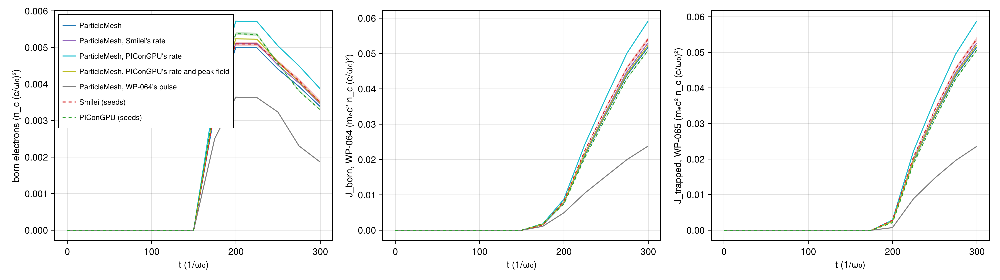

# Ionization injection in ParticleMesh, Smilei and PIConGPU

**Summary.**
- WP-064's and WP-065's nitrogen-doped 2D case (a₀ = 1.9, λ₀/32, 1656 steps, N⁵⁺ → N⁷⁺) run from one case file in ParticleMesh, Smilei v5.1 and PIConGPU 0.8.0, the two Monte Carlo codes with four seeds each.
- On WP-064's objective J_born, ParticleMesh is 4.3 % below Smilei's mean and 1.7 % above PIConGPU's, against seed spreads of 0.9 % and 0.4 %. No code self-injects plasma electrons.
- The codes' ADK prefactors differ by up to 18 % (T-1121). With Smilei's prefactor, ParticleMesh's N⁶⁺ peak is 0.4 % above Smilei's and its J_born 2.0 % below.
- With PIConGPU's prefactor ParticleMesh lands 16 % above PIConGPU. PIConGPU's launched pulse peaks 0.6 % to 0.7 % lower where it crosses the dopant, and the K shell's rate changes about ten times as much as the field. With PIConGPU's prefactor and its peak field, ParticleMesh is within 3 % of PIConGPU on J_born; its N⁶⁺ peak is 2.6 % lower and its born weight at the read-out 6 % higher, which is not explained.
- WP-064's pulse with the envelope in t − delay on the axis gives 0.44 of J_born: the envelope along the curved wavefront, which all three codes launch here, matters more than any code difference.
- The wakes on the axis agree to 0.33 % between ParticleMesh and Smilei and to 2.4 % against PIConGPU; the vacuum pulses to 0.24 % and 0.8 %.
- PIConGPU damps particle weights in its PML (Lehe 2022), so its plasma weight in the window is 15 % lower, all of it in the 12 rows at each open side; the dopant's rows are far from them.
- This is agreement between three codes at one resolution, not a validation; WP-065 found J not converged at λ₀/32.

| | |
|---|---|
| Work package | WP-081 (`trace/wp/WP-081-ionization-three-codes.md`); goals A5, A7 |
| Case | `scripts/lwfa/cases/ionization-2d.toml`; driver `scripts/lwfa/ionization.jl` (header: how the codes are matched), tests T-1120 to T-1125 |
| Code and runs | ParticleMesh and Smilei at `ef1d047` (runs/ion-cloud1), ParticleMesh's `plasma-rates-picongpu-a0` at `a0e8e79` (runs/ion-cloud2), PIConGPU's decks at `4b0279d` (runs/ion-5090-pic, summaries and log tails only); the comparison at `04a2f2d`. Each run's manifest and `published.toml` are in `wp-081-ionization-three-codes/runs/<run>/`, and `compare/manifest.toml` has the hashes of the summaries compared |
| Environment | ParticleMesh: Julia 1.13.4, Float64, Reference mode, plain gather, 2 threads of an Intel Xeon at 2.1 GHz. Smilei v5.1 (source build), 2 OpenMP threads on the same CPU. PIConGPU 0.8.0, CUDA 12.9, Float64, 2 ranks on one RTX 5090 |
| Data | `wp-081-ionization-three-codes/compare/`: `comparison.json` and five figures with sidecars |
| Review | none yet |

## Results

The born electrons at the read-out (weights in n_c (c/ω₀)², energies in mₑc² n_c (c/ω₀)²), and the axis lineouts by pair, printed by `ionization.jl table compare/comparison.json`:

| at t = 299.7 | born weight (10⁻³) | J_born (10⁻²) | J_trapped (10⁻²) | N⁶⁺ at its peak (10⁻³) | J_born / Smilei | J_born / PIConGPU |
|---|---|---|---|---|---|---|
| ParticleMesh | 3.39 | 5.18 | 5.14 | 4.99 | 0.957 | 1.02 |
| ParticleMesh, Smilei's rate | 3.47 | 5.3 | 5.26 | 5.11 | 0.98 | 1.04 |
| ParticleMesh, PIConGPU's rate | 3.87 | 5.92 | 5.88 | 5.71 | 1.09 | 1.16 |
| ParticleMesh, PIConGPU's rate and peak field | 3.49 | 5.23 | 5.2 | 5.23 | 0.967 | 1.03 |
| ParticleMesh, WP-064's pulse | 1.87 | 2.38 | 2.36 | 3.64 | 0.44 | 0.468 |
| Smilei (4 seeds) | 3.5 ± 0.0431 | 5.41 ± 0.0485 | 5.37 ± 0.0473 | 5.09 ± 0.0551 | 1.0 | 1.06 |
| PIConGPU (4 seeds) | 3.3 ± 0.0166 | 5.09 ± 0.0193 | 5.06 ± 0.018 | 5.37 ± 0.0349 | 0.941 | 1.0 |

| largest relative rms distance on the axis (%) | ParticleMesh–Smilei | ParticleMesh–PIConGPU | Smilei–PIConGPU |
|---|---|---|---|
| vacuum, E_y | 0.238 | 0.806 | 0.764 |
| plasma without the dopant, E_y | 0.251 | 0.888 | 1.04 |
| plasma without the dopant, wake E_x from t = 116 | 0.332 | 2.36 | 2.36 |

The figures `charge_states.png`, `born_spectrum.png`, `born_phase_space.png` and `wake_axis.png` are next to it, each with its sidecar.

PIConGPU's peak field over ParticleMesh's in vacuum, from the summaries' envelopes: 0.9958 at t = 100, 0.9928 at 150, 0.9941 at 175, 1.0024 at 300. The case's `comparison.picongpu_field_ratio` = 0.9935 is the mean of the two values where the pulse crosses the dopant.

## Not shown, open

- The remaining distance to PIConGPU after rate and field: N⁶⁺ 2.6 % higher in PIConGPU at its peak, then 6 % fewer born electrons in the window at the read-out. Its wake differs from the others by up to 2.4 % at t = 175 to 200, while the born electrons are trapped; whether that sets how many leave through the window's back is not checked.
- The 2.0 % between ParticleMesh with Smilei's prefactor and Smilei is about twice Smilei's seed spread. Smilei adds the ionization current; ParticleMesh and PIConGPU do not.
- The comparison is in 2D at one resolution. WP-082 is the 3D variant.
- Runtimes are in `comparison.json` ("seconds") but come from different hardware and thread counts, so they compare nothing.
