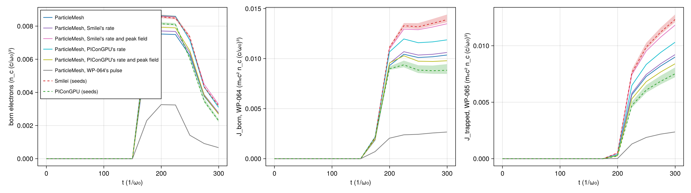

# Ionization injection in 3D in ParticleMesh, Smilei and PIConGPU

**Summary.**
- WP-081's nitrogen-doped case in 3D (a₀ = 1.9, waist 10, 448 × 128 × 128 cells, Δx = λ₀/32, Δy = Δz = 4Δx, 1704 steps, one plasma electron per cell) run from one case file in ParticleMesh, Smilei v5.1 and PIConGPU 0.8.0, the two Monte Carlo codes with four seeds each.
- On J_born, ParticleMesh is 25 % below Smilei's mean and 17 % above PIConGPU's, against seed spreads of 2.6 % and 4.9 %. The axis fields agree to 1.5 % in vacuum and the wakes to 4.4 %.
- Most of the distance to Smilei is the launched pulse. Smilei's peaks 0.4 % to 0.9 % higher where it crosses the dopant, and the K shell's rate changes about ten times as much as the field. With Smilei's prefactor and its peak field, ParticleMesh's N⁶⁺ peak is 0.4 % above Smilei's, its born weight at the read-out 2.8 % above and its J_born 2.9 % below, about one seed spread.
- With PIConGPU's prefactor and its peak field (0.5 % lower than ParticleMesh's), ParticleMesh's N⁶⁺ peak is 2.6 % below PIConGPU's, as in 2D. After birth PIConGPU keeps fewer born electrons in the window: 28 % of the peak at the read-out, against 34 % in ParticleMesh and 37 % in Smilei. That makes PIConGPU's J_born 11 % lower; the cause is not found.
- The on-axis vacuum field follows the 3D Gaussian beam, a₀/√(1 + (ξ/z_R)²), in all three codes: within 0.5 % up to the focus and 3 % to 3.5 % below it after. The 2D runs follow the 2D law, a₀/(1 + (ξ/z_R)²)^{1/4}, within 2 %.
- WP-064's pulse with the envelope in t − delay on the axis gives 0.19 of Smilei's J_born, against 0.44 in 2D.
- In ParticleMesh the same run on the CPU (16 threads, Float32) gives the GPU run's born weight and J_born to five digits.
- This is agreement between three codes at one resolution, not a validation.

| | |
|---|---|
| Work package | WP-082 (`trace/wp/WP-082-ionization-three-codes-3d.md`); goals A5, A7 |
| Case | `scripts/lwfa/cases/ionization-3d.toml`; driver `scripts/lwfa/ionization.jl`, tests T-1127 and T-1128 |
| Code and runs | Each run's manifest and `published.toml` are in `wp-082-ionization-three-codes-3d/runs/<run>/`. ParticleMesh and Smilei at `361a0a3`: ParticleMesh in runs/ion3d-5090, Smilei in runs/ion3d-smilei-&lt;run&gt;. ParticleMesh at each code's peak field at `3677708`, in runs/ion3d-5090-a0. Its CPU cross-check is in runs/ion3d-pm-plasma-rates-smilei-a0. PIConGPU at `11b4926`, with one openPMD file per output, in runs/ion3d-5090 (summaries and logs only). The comparison is at `6946e79`, and `compare/manifest.toml` has the hashes of the summaries compared |
| Environment | ParticleMesh: Julia 1.13.4, Float32, Reference mode, plain gather, on an RTX 5090. Smilei v5.1 on 16 threads of an AMD EPYC 9655. PIConGPU 0.8.0, CUDA 12.9, 2 ranks on one RTX 5090 |
| Data | `wp-082-ionization-three-codes-3d/compare/`: `comparison.json` and five figures with sidecars |
| Review | none yet |

## Results

The born electrons at the read-out (weights in n_c (c/ω₀)³, energies in mₑc² n_c (c/ω₀)³), and the axis lineouts by pair, printed by `ionization.jl table compare/comparison.json`:

| at t = 299.7 | born weight (10⁻³) | J_born (10⁻²) | J_trapped (10⁻²) | N⁶⁺ at its peak (10⁻³) | J_born / Smilei | J_born / PIConGPU |
|---|---|---|---|---|---|---|
| ParticleMesh | 2.7 | 1.04 | 0.899 | 7.52 | 0.746 | 1.17 |
| ParticleMesh, Smilei's rate | 2.77 | 1.06 | 0.921 | 7.7 | 0.764 | 1.2 |
| ParticleMesh, Smilei's rate and peak field | 3.29 | 1.35 | 1.18 | 8.59 | 0.971 | 1.53 |
| ParticleMesh, PIConGPU's rate | 3.1 | 1.19 | 1.03 | 8.63 | 0.855 | 1.34 |
| ParticleMesh, PIConGPU's rate and peak field | 2.69 | 0.979 | 0.84 | 7.93 | 0.704 | 1.11 |
| ParticleMesh, WP-064's pulse | 0.666 | 0.266 | 0.237 | 3.26 | 0.192 | 0.302 |
| Smilei (4 seeds) | 3.2 ± 0.0354 | 1.39 ± 0.0362 | 1.23 ± 0.0312 | 8.56 ± 0.0977 | 1.0 | 1.57 |
| PIConGPU (4 seeds) | 2.3 ± 0.0749 | 0.884 ± 0.0429 | 0.751 ± 0.0383 | 8.14 ± 0.0671 | 0.636 | 1.0 |

| largest relative rms distance on the axis (%) | ParticleMesh–Smilei | ParticleMesh–PIConGPU | Smilei–PIConGPU |
|---|---|---|---|
| vacuum, E_y | 1.22 | 0.868 | 1.5 |
| plasma without the dopant, E_y | 1.35 | 0.961 | 1.54 |
| plasma without the dopant, wake E_x from t = 116 | 3.56 | 3.64 | 4.35 |

The figures `charge_states.png`, `born_spectrum.png`, `born_phase_space.png` and `wake_axis.png` are next to it, each with its sidecar.

The other codes' peak field over ParticleMesh's in vacuum, from the summaries' envelopes on the axis where the pulse crosses the dopant: Smilei 1.0094 at t = 150 and 1.0043 at 175, PIConGPU 0.9947 at both. The case's `comparison` holds their means, 1.0069 and 0.9947. The born weight in the window, ParticleMesh at each code's prefactor and peak field over that code's mean:

| t | 175 | 200 | 225 | 250 | 275 | 300 |
|---|---|---|---|---|---|---|
| over Smilei | 1.005 | 1.004 | 1.010 | 0.978 | 1.034 | 1.027 |
| over PIConGPU | 0.979 | 0.974 | 0.976 | 1.081 | 1.102 | 1.169 |

## Not shown, open

- Why PIConGPU loses more born electrons from the window between t = 225 and 300 than the other codes. Its wake is the one that differs most (4.4 % from Smilei's), and its PML damps particle weights (Lehe 2022) on four open sides here. Its plasma weight in the window is 28 % below the others' at the read-out, and it drops already at t = 25, before the pulse arrives. Neither is checked against the born electrons' loss.
- PIConGPU's vacuum run: 5 of its 13 outputs, those before the window moves (steps 0 to 568), have broken HDF5 metadata and are left out (`unreadable_outputs` in its summary), so its vacuum comparison starts at t = 125. The plasma decks' outputs read. The same deck with one file for all outputs also hung at shutdown on the 5090.
- Runtimes are in `comparison.json` ("seconds"): ParticleMesh steps in 92 s and PIConGPU in 105 s on the RTX 5090, Smilei in 510 s on 16 CPU threads. They come from different hardware and precisions, so they compare nothing.
- The case is the 3D variant at one resolution, with one plasma electron per cell and Δy = Δz = 4Δx (a waist of 12.7 cells). A 3D grid study is not done.
