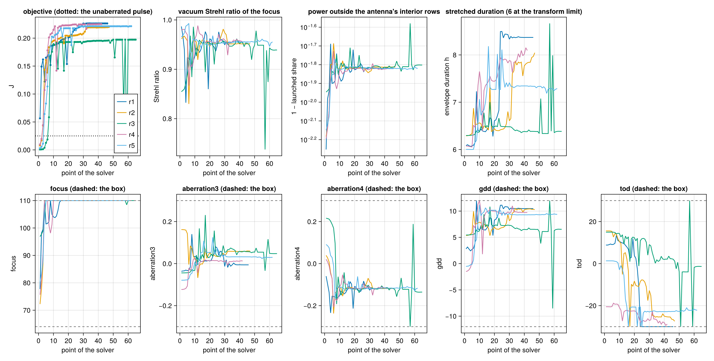
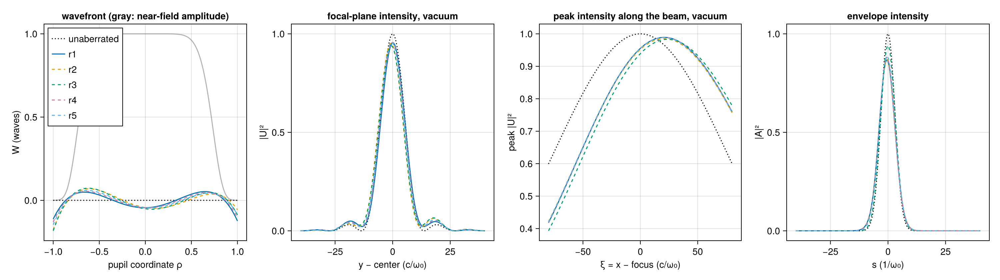

# WP-087: optimizing the pulse's shape at a fixed plasma and laser energy, 2D

**Summary.**
- L-BFGS-B maximized WP-065's J (the kinetic energy of the trapped electrons of the first bucket) over the pulse's shape alone, on WP-065's 2D case at 0.072 n_c with the energy of the a₀ = 1.9 budget: the focus, a wavefront of the Legendre modes P₃ and P₄ on a fixed super-Gaussian near field, and the GDD and TOD. The energy, and so a₀ = 1.898, is the same at every point. Five random starts ran at λ₀/32 with the compensated gather on an RTX 4080 SUPER.
- All five starts reach J = 0.197 to 0.226, against 0.0250 at the unaberrated, transform-limited pulse focused at 80: 7.9 to 9.0 times as much. The best is r1's, J = 0.2263 at (focus, P₃, P₄, GDD, TOD) = (110, −0.006, −0.118, 10.48, −30). All of it is the ionization's electrons; the plasma injects none at any point.
- Four of the five starts end at the same pulse: the focus on its upper bound of 110, P₃ near zero (−0.006 to 0.060), P₄ = −0.117 to −0.118, GDD 9.4 to 10.5 and TOD −22 to −30 (J = 0.220 to 0.226). The fifth (r3) ends at focus 110, P₃ 0.048, P₄ −0.135, GDD 6.5 and TOD −1.3, at J = 0.197.
- The wavefront mostly moves the focus beyond its bound. At P₄ ≈ −0.12 the vacuum peak intensity along the beam lies 20.5 to 24 c/ω₀ past the nominal focus, at x ≈ 131, the end of the dopant's section (108 to 132), with 0.98 to 0.99 of the unaberrated peak; the focal-plane Strehl ratio is 0.94 to 0.96.
- At the four common optima the GDD and TOD stretch the envelope from a duration of 6 to 7.3 to 8.4 (`envelope_extent`) and lower its peak intensity by 11 to 13 %.
- No start converged: all five stopped at 25 iterations with a projected gradient of 0.008 to 0.062 in z, against `pgtol` 0.0023. Over the last ten points of each path J varies by less than 0.5 % in all but r3, whose line search still tried far points.
- ForwardDiff's gradient is J's derivative: at the reference, Float64 central differences at 2⁻¹³ of each scale agree with it to 10⁻⁵ to 1.5·10⁻³, and at the best point, where the gradient is near zero, central differences at 2⁻¹⁶ agree to 0.8 to 14 %. At 2⁻¹³ there they differ by up to a factor of 6 (P₃, GDD): near the optimum J has bumps of a few 10⁻⁶ (about 2.5·10⁻⁵ of J) on that scale, larger than its slope.
- The run computed in Float64, although its records say Float32 (see "Setup"); its J equals the CPU's Float64 run to 3·10⁻⁷. A point with duals in five directions took a median 99.5 s on the card.
- The ionization is ADK without barrier suppression and takes no energy from the field (WP-059, WP-063), so the trapped charge is not a physical prediction.

| | |
|---|---|
| Work package | WP-087 (`trace/wp/WP-087-pulse-shape-study.md`); goals A0, A3, A7, A8 |
| Commits | optimization `1a1a158` (`dirty = false`); check at 2⁻¹³ `c13b3ea`, at 2⁻¹⁰ and 2⁻¹⁶ `9c91abc` (the box's request commits are those plus the run directory); figures and tables rebuilt by the report script at the pull request's head |
| Runs | `optim-pulse2d-opt-4080` on branch `runs/wp087-pulse2d-4080-opt`, `scripts/optim/pulse2d_opt.jl opt` with its defaults (stopped by the GPU wrapper's 6 h limit during r5 and resumed from its records); the check `pulse2d_opt.jl check scripts/runs/optim-pulse2d-opt-4080 backend=cpu` on the CPU box, branch `runs/wp087-pulse2d-check-cpu`, and with `points=best power=10` and `power=16`, branch `runs/wp087-pulse2d-check-steps-cpu`; `report` |
| Input hashes | SHA-256 of every input in the run's `manifest.toml` under `wp-087-pulse-shape-study/optim-pulse2d-opt-4080/` |
| Environment | Julia 1.13.3; NVIDIA GeForce RTX 4080 SUPER, KernelAbstractions CUDA, Reference mode, Intel Core i9-14900K host; the check on 16 cores of an AMD EPYC 9655, KernelAbstractions CPU, Float64 |
| Figures | `wp-087-pulse-shape-study/pulse2d_paths.png`, `pulse2d_shapes.png`, each with its JSON sidecar |
| Status | measured; not rerun by a breaker; not independently reviewed, so no number here is to leave the repository before that review |

## Setup

The case is WP-065's, as WP-068 runs it (`scripts/optim/born2d_case.jl`, `trapped2d_case.jl`) at λ₀/32, Δy = π/8 and the compensated gather, with the density at 0.072 n_c, the delay at 54 and the energy per unit length in z of the a₀ = 1.9 budget at the base Gaussian pulse (waist 10, duration 6). The pulse (`scripts/optim/pulse2d_case.jl`) is a `ShapedLaser` with a `PupilBeam`: a super-Gaussian near field of order 4 and radius 0.75 of the aperture, with numerical aperture 0.3256 so that its unaberrated focus has the base Gaussian's intensity FWHM, and a wavefront of the Legendre modes P₃ and P₄ in waves; and a `SpectralEnvelope` of the base duration with GDD and TOD. Tilt (P₁) and defocus (P₂) are left out, since the first steers the beam and the second duplicates the focus. The near field's amplitude is fixed, so the energy through the pupil, and a₀, do not depend on the phases (T-1181); at every point of the run at least 97.4 % of the power falls on the antenna's interior rows (`launched_fraction`; T-1187 holds it to a vacuum run). The choices and the assumptions behind them are in `questions/wp-087-pulse-shape-study.md`.

`PULSE_BOX` is focus 64 to 110 (WP-068's range), P₃ and P₄ −0.3 to 0.3 waves, GDD −12 to 12 and TOD −30 to 30 (in 1/ω₀² and 1/ω₀³), z = x/(80, 0.25, 0.25, 10, 25). The five starts are drawn uniformly inside the box, 10 % in from its bounds, by a counter-based hash with seed 87 (`random_start`), so they are the same on every machine; the unaberrated pulse at focus 80 is run once as a reference and sets `pgtol` to 2⁻⁶ of its largest gradient component in z. L-BFGS-B (OptimizationLBFGSB) with `maxiters = 25`, each point one run with duals in the five directions, recorded by the point's bits as in WP-068. In 2D with the polarization in the plane, mirroring y flips E_y, which is the carrier phase moved by π, so J(P₃, φ) = J(−P₃, φ + π) (T-1184) and P₃ has a gradient at the unaberrated pulse: the random starts are not needed for a zero gradient there in 2D, as they will be for modes odd in z in 3D.

The run's records say Float32, but the run computed in Float64: at `1a1a158` the a₀ normalization built its unit laser in Float64, which promoted the Float32 duals of every point to `Dual{Float64}`, and the records held the requested type instead of the state's. The parameters and the energy were still rounded to Float32 before the promotion, which is the likely reason J differs from the CPU's Float64 run by 2.6·10⁻⁷ of J at the reference and 2.9·10⁻⁷ at the best point instead of agreeing to roundoff. `c13b3ea` fixes both, and T-1180 checks that Float32 duals stay Float32. The J values stand; the timings are those of Float64.

The check (`pulse2d_opt.jl check`) runs, at the best optimum and at the reference, Float64 at λ₀/32 with duals and with central differences in each direction at 2⁻ᵖ of the direction's scale, on the CPU (`backend=cpu`); at the best optimum also at p = 10 and 16, each step in its own directory (`check_dir`).

## Results

From `wp-087-pulse-shape-study/tables.md` (printed by `pulse2d_opt.jl report`):

| start | start x | optimum x | J | J/J_ref | Strehl | h | on bounds | retcode | iterations | points run | max proj. grad. (z) | seconds |
|---|---|---|---|---|---|---|---|---|---|---|---|---|
| r1 | 77.7, -0.0366, -0.0597, 2.81, 8.85 | 110.0, -0.005805, -0.1185, 10.48, -30.0 | 0.2263 | 9.05 | 0.955 | 8.37 | focus=hi, tod=lo | MaxIters | 25 | 46 | 0.00841 | 4595 |
| r2 | 72.2, 0.162, 0.0393, 5.35, 15.6 | 110.0, 0.05972, -0.1169, 10.29, -27.4 | 0.2199 | 8.79 | 0.952 | 8.05 | focus=hi | MaxIters | 25 | 46 | 0.0292 | 4577 |
| r3 | 96.9, -0.0441, 0.216, 5.45, 15.0 | 110.0, 0.04774, -0.1354, 6.537, -1.337 | 0.1973 | 7.89 | 0.939 | 6.38 | none | MaxIters | 25 | 64 | 0.0621 | 6312 |
| r4 | 75.7, -0.123, 0.0208, -1.5, -20.5 | 110.0, 0.01263, -0.1178, 9.753, -28.78 | 0.2252 | 9.0 | 0.956 | 8.09 | focus=hi | MaxIters | 25 | 42 | 0.0284 | 4186 |
| r5 | 80.5, -0.079, 0.0912, -0.523, 1.33 | 110.0, 0.0299, -0.1168, 9.376, -22.19 | 0.2214 | 8.85 | 0.955 | 7.29 | focus=hi | MaxIters | 25 | 43 | 0.0395 | 4395 |

h is the envelope's duration as `PulseShapes.envelope_extent` gives it (at least twice the rms, 6 at the transform limit); Strehl is the vacuum focal-plane peak over the unaberrated one.

Check at the best point, Float64 at ppl 32, ny 2, central differences at 2^-10 of each scale (J = 0.226297):

| direction | dJ/dz central differences | dJ/dz ForwardDiff | relative difference |
|---|---|---|---|
| focus | 0.070628 | 0.0509593 | 0.39 |
| aberration3 | -0.0030173 | -0.00408066 | 0.26 |
| aberration4 | -0.00278529 | -0.00115683 | 1.4 |
| gdd | -0.000800382 | -0.00842086 | 0.9 |
| tod | 0.000213483 | -0.00608476 | 1.0 |

Check at the best point, Float64 at ppl 32, ny 2, central differences at 2^-13 of each scale (J = 0.226297):

| direction | dJ/dz central differences | dJ/dz ForwardDiff | relative difference |
|---|---|---|---|
| focus | 0.0485772 | 0.0509593 | 0.047 |
| aberration3 | -0.0278006 | -0.00408066 | 5.8 |
| aberration4 | -0.00158495 | -0.00115683 | 0.37 |
| gdd | -0.0309144 | -0.00842086 | 2.7 |
| tod | -0.0122385 | -0.00608476 | 1.0 |

Check at the reference point, Float64 at ppl 32, ny 2, central differences at 2^-13 of each scale (J = 0.0250134):

| direction | dJ/dz central differences | dJ/dz ForwardDiff | relative difference |
|---|---|---|---|
| focus | 0.14988 | 0.15011 | 0.0015 |
| aberration3 | 0.00317854 | 0.00317861 | 2.2e-5 |
| aberration4 | -0.0969838 | -0.0969849 | 1.1e-5 |
| gdd | 0.0208353 | 0.020843 | 0.00037 |
| tod | 0.000969737 | 0.000969516 | 0.00023 |

Check at the best point, Float64 at ppl 32, ny 2, central differences at 2^-16 of each scale (J = 0.226297):

| direction | dJ/dz central differences | dJ/dz ForwardDiff | relative difference |
|---|---|---|---|
| focus | 0.0435921 | 0.0509593 | 0.14 |
| aberration3 | -0.00421897 | -0.00408066 | 0.034 |
| aberration4 | -0.00114722 | -0.00115683 | 0.0083 |
| gdd | -0.00795245 | -0.00842086 | 0.056 |
| tod | -0.00614013 | -0.00608476 | 0.0091 |

## Not shown

The rest of `tables.md`: every point the solvers reported. The sidecars hold each path's J, Strehl ratio, launched share, envelope duration and dark-current weight per point, and each optimum's wavefront, focal-plane and on-axis vacuum intensity and envelope. The trapped weight of the born electrons rises from 0.00203 at the reference to 0.0119 at the best point. The flat-top's Fresnel ringing reaches the box's y walls at 4 to 18 % of the peak field; a box 1.5 times as high changes J by −2.3 to +1.2 % at four points at λ₀/16 (`questions/wp-087-pulse-shape-study.md` §6).

## Open

- The focus is on its bound in every start, and P₄ moves the vacuum focus another 20 c/ω₀ beyond it. Whether the wavefront does anything besides moving the focus needs a run with the focus bound raised past the dopant's section.
- No start converged in 25 iterations, consistent with J's bumps near the optimum being larger than its slope there; the optima are not checked in resolution either (no λ₀/48 run).
- The 3D half (Zernike modes to radial order 4 on WP-085's antenna) is the rest of this package.

## Data

`wp-087-pulse-shape-study/optim-pulse2d-opt-4080/` holds the run's `manifest.toml` and `published.toml`, which names its run branch with every point's record and each start's `result.json` and the SHA-256 of each. `scripts/rundata/run-data.sh fetch reports/wp-087-pulse-shape-study/optim-pulse2d-opt-4080/published.toml` brings it back into `scripts/runs/optim-pulse2d-opt-4080/`, and `julia +1.13 --project=scripts scripts/optim/pulse2d_opt.jl report reports/wp-087-pulse-shape-study scripts/runs/optim-pulse2d-opt-4080` rebuilds the figures and tables. `wp087-pulse2d-check-cpu/` and `wp087-pulse2d-check-steps-cpu/` hold the box's `box-status.toml` and a `published.toml` of the check's records; fetching them after the run puts the checks into its directory, and the report then prints their tables.
